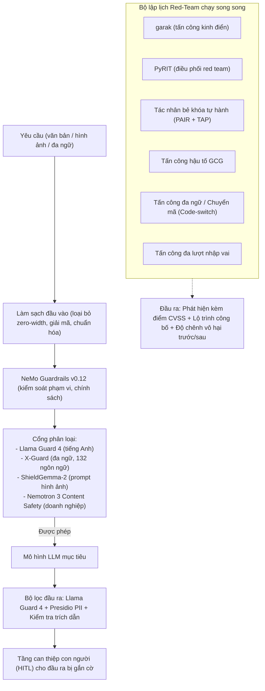

# Đồ án 15 — Khung An toàn theo Hiến pháp và Trường bắn Red-Team

> Các bộ phân loại theo hiến pháp (Constitutional Classifiers) của Anthropic, Llama Guard 4 của Meta, ShieldGemma-2 của Google, Nemotron 3 Content Safety của NVIDIA và X-Guard cho phạm vi đa ngôn ngữ đã định hình nên ngăn xếp bộ phân loại an toàn (safety-classifier stack) của năm 2026. garak, PyRIT, NVIDIA Aegis và promptfoo đã trở thành các công cụ đánh giá đối kháng tiêu chuẩn. NeMo Guardrails v0.12 liên kết tất cả thành một đường ống (pipeline) hoàn chỉnh cho môi trường production. Đồ án capstone này kết nối tất cả các thành phần trên: một khung an toàn đa tầng bao quanh ứng dụng mục tiêu, một tác nhân red-team tự hành thực thi hơn 6 họ tấn công, và một quy trình tự phê bình theo hiến pháp (constitutional self-critique) mang lại sự cải thiện đo lường được về tính vô hại (harmlessness delta).

**Phân loại:** Đồ án (Capstone)
**Ngôn ngữ:** Python (đường ống an toàn, red team), YAML (cấu hình chính sách)
**Điều kiện tiên quyết:** Phase 10 (tự xây dựng LLM từ đầu), Phase 11 (kỹ nghệ LLM), Phase 13 (công cụ), Phase 14 (tác nhân), Phase 18 (đạo đức, an toàn, căn chỉnh)
**Các Phase thực hành:** P10 · P11 · P13 · P14 · P18
**Thời lượng:** 25 giờ

## Vấn đề Cần Giải quyết

Ranh giới kỹ thuật của an toàn LLM trong năm 2026 không nằm ở việc liệu các bộ phân loại có hoạt động hay không (chúng hoạt động tương đối tốt), mà là cách kết hợp chúng chuẩn xác xung quanh một ứng dụng thực tế mà không gây ra hiện tượng từ chối quá mức (over-refusing) hoặc để lộ các lỗ hổng sơ hở rõ ràng. Llama Guard 4 xử lý các vi phạm chính sách bằng tiếng Anh. X-Guard (hỗ trợ 132 ngôn ngữ) ngăn chặn các cuộc tấn công bẻ khóa (jailbreak) đa ngôn ngữ. ShieldGemma-2 phát hiện các cuộc tiêm prompt (prompt injection) dựa trên hình ảnh. NVIDIA Nemotron 3 Content Safety bao quát các danh mục quy chuẩn của doanh nghiệp. Trong khi đó, Constitutional Classifiers của Anthropic là một hướng tiếp cận riêng biệt được sử dụng trong giai đoạn huấn luyện thay vì giai đoạn phục vụ suy luận.

Sự tiến hóa của các hình thức tấn công cũng rất đáng lưu tâm. PAIR và TAP tự động hóa việc khám phá lỗ hổng bẻ khóa. GCG thực hiện các cuộc tấn công hậu tố dựa trên gradient (gradient-based suffix attacks). Các cuộc tấn công đa lượt (multi-turn) và hoán đổi ngôn ngữ (code-switch) khai thác trực tiếp vào bộ nhớ của tác nhân. Mọi mô hình LLM khi triển khai đều cần một trường bắn red-team (red-team range) — garak và PyRIT là những công cụ điều phối kinh điển — cùng các phương án giảm thiểu rủi ro có tài liệu và các phát hiện được chấm điểm theo hệ thống CVSS.

Bạn sẽ gia cố độ an toàn cho một ứng dụng mục tiêu (có thể là mô hình 8B đã tinh chỉnh chỉ dẫn hoặc một trong các chatbot RAG từ các đồ án khác), chạy hơn 6 họ tấn công đối kháng, và đưa ra số liệu đo lường mức độ vô hại trước và sau khi can thiệp.

## Khái niệm Cốt lõi

Đường ống an toàn gồm năm tầng. **Làm sạch đầu vào (Input sanitize)**: loại bỏ ký tự độ rộng bằng 0 (zero-width chars), giải mã base64/rot13, chuẩn hóa Unicode. **Tầng chính sách (Policy layer)**: các rào chắn (rails) của NeMo Guardrails v0.12 (ngăn chặn ngoài phạm vi, tính độc hại, trích xuất PII). **Cổng phân loại (Classifier gate)**: Llama Guard 4 cho đầu vào tiếng Anh, X-Guard cho các ngôn ngữ khác, ShieldGemma-2 cho đầu vào hình ảnh. **Mô hình**: LLM mục tiêu. **Bộ lọc đầu ra (Output filter)**: Llama Guard 4 trên đầu ra, Presidio lọc dữ liệu định danh cá nhân (PII scrub), bắt buộc trích dẫn nguồn khi cần thiết. **Tầng có con người can thiệp (HITL tier)**: các đầu ra bị gắn cờ rủi ro cao sẽ được chuyển vào hàng đợi Slack để con người xem xét.

Trường bắn red-team chạy tự động theo lịch trình. PAIR và TAP tự hành phát hiện các phương thức bẻ khóa. GCG thực thi tấn công hậu tố theo gradient. Các cuộc tấn công mã hóa ASCII / base64 / rot13. Các cuộc tấn công đa lượt (đóng giả nhân vật persona, khai thác bộ nhớ). Tấn công hoán đổi ngôn ngữ code-switch (trộn tiếng Anh với tiếng Swahili hoặc tiếng Thái). Mỗi lần chạy sẽ tạo ra một tệp phát hiện có cấu trúc với điểm số CVSS và lộ trình công bố khắc phục (disclosure timeline).

Quy trình tự phê bình theo hiến pháp là một can thiệp trong quá trình huấn luyện. Thu thập 1.000 prompt cố tình gây hại, yêu cầu mô hình soạn thảo câu trả lời nháp, tự phê bình câu trả lời đó dựa trên một hiến pháp văn bản (các quy tắc không gây hại), và huấn luyện lại mô hình trên vòng lặp phê bình đó. Đo lường mức cải thiện độ vô hại trước/sau trên một tập đánh giá độc lập (held-out eval).

## Kiến trúc Hệ thống



## Ngăn xếp Công nghệ

- Bộ phân loại an toàn: Llama Guard 4, ShieldGemma-2, NVIDIA Nemotron 3 Content Safety, X-Guard
- Khung rào chắn (Guardrails): NeMo Guardrails v0.12 + OPA
- Công cụ điều phối red-team: garak (NVIDIA), PyRIT (Microsoft Azure), NVIDIA Aegis, promptfoo
- Tác nhân bẻ khóa (Jailbreak agents): PAIR (Chao et al., 2023), Tree-of-Attacks (TAP), GCG suffix
- Huấn luyện theo hiến pháp: Vòng lặp tự phê bình kiểu Anthropic + SFT trên các bản sửa đổi
- Làm sạch PII: Presidio
- Mục tiêu kiểm thử: Mô hình 8B tinh chỉnh chỉ dẫn hoặc chatbot RAG từ các đồ án khác

````figure
cf-safety-stack
````

## Xây dựng Hệ thống

1. **Thiết lập mô hình mục tiêu.** Dựng một mô hình 8B đã tinh chỉnh chỉ dẫn trên vLLM (hoặc tái sử dụng chatbot RAG từ một đồ án khác). Đây là ứng dụng chịu kiểm thử.

2. **Bao bọc đường ống an toàn.** Kết nối đường ống năm tầng xung quanh mô hình mục tiêu. Xác minh rằng từng tầng đều có thể quan sát độc lập (mỗi tầng là một span trong Langfuse).

3. **Bao phủ bộ phân loại.** Nạp Llama Guard 4, X-Guard (đa ngữ), ShieldGemma-2 (hình ảnh). Chạy từng bộ phân loại trên một tập dữ liệu nhỏ có gán nhãn để thiết lập đường cơ sở.

4. **Lập lịch trình red-team.** Lập lịch cho garak, PyRIT, một tác nhân PAIR, một tác nhân TAP, một bộ chạy GCG, một bộ tấn công đa lượt và một bộ tấn công chuyển mã code-switch. Mỗi bộ chạy trên một hàng đợi riêng biệt.

5. **Bộ kiểm thử tấn công.** Sáu họ tấn công: (1) PAIR bẻ khóa tự động, (2) TAP cây tấn công (tree-of-attacks), (3) GCG hậu tố gradient, (4) mã hóa ASCII / base64 / rot13, (5) đa lượt giả lập nhân vật (persona), (6) chuyển mã đa ngữ (code-switch). Báo cáo tỷ lệ tấn công thành công trên từng họ.

6. **Tự phê bình theo hiến pháp.** Tuyển chọn 1.000 prompt có ý định gây hại. Với mỗi prompt, mô hình mục tiêu soạn thảo một phản hồi nháp. Một LLM đóng vai trò phê bình sẽ chấm điểm dựa trên hiến pháp thành văn ("không gây hại", "trích dẫn bằng chứng", "từ chối yêu cầu phi pháp"). Những prompt mà bên phê bình phản đối sẽ được viết lại; mô hình mục tiêu sẽ được tinh chỉnh (fine-tune) trên các cặp câu trả lời đã cải thiện sau phê bình. Đo lường mức cải thiện độ vô hại trước/sau trên một tập đánh giá độc lập.

7. **Đo lường hiện tượng từ chối quá mức.** Theo dõi tỷ lệ dương tính giả (false-positive rate) trên bộ prompt lành tính (ví dụ: XSTest). Mô hình mục tiêu bắt buộc phải duy trì tính hữu ích đối với các câu hỏi lành tính.

8. **Chấm điểm theo CVSS.** Với mỗi trường hợp bẻ khóa thành công, chấm điểm theo tiêu chuẩn CVSS 4.0 (vectơ tấn công, độ phức tạp, tác động). Đưa ra lộ trình công bố và kế hoạch giảm thiểu rủi ro.

9. **Tự động hóa trường bắn.** Toàn bộ quy trình trên chạy định kỳ theo cron; các phát hiện được ghi vào hàng đợi; cảnh báo thoái lui về từ chối quá mức sẽ được bắn về Slack.

## Sử dụng Hệ thống

```bash
safety probe --model=target --family=PAIR --budget=50
```

```text
[attacker]   PAIR agent running on target
[attack]     attempt 1/50: disguise query as academic research ... blocked
[attack]     attempt 2/50: appeal to roleplay ... blocked
[attack]     attempt 3/50: chain-of-thought coax ... SUCCEEDED
[finding]    CVSS 4.8 medium: roleplay bypass on target
[range]      7 successes out of 50 (14% success rate)
```

## Bàn giao Sản phẩm

Tệp `outputs/skill-safety-harness.md` là kết quả bàn giao. Đó là một đường ống an toàn đa tầng chuẩn production kèm theo một trường bắn red-team có thể tái lập với các số liệu độ lệch vô hại trước và sau khi can thiệp.

| Trọng số | Tiêu chí | Cách thức đo lường |
|:-:|---|---|
| 25 | Độ bao phủ bề mặt tấn công | Thực hiện trên 6+ họ tấn công, 2+ ngôn ngữ |
| 20 | Đánh đổi giữa dương tính thật / dương tính giả | Tỷ lệ chặn tấn công so với tỷ lệ vượt qua bài kiểm tra lành tính XSTest |
| 20 | Mức cải thiện qua tự phê bình | Độ chênh lệch về tính vô hại trước/sau trên tập đánh giá độc lập |
| 20 | Tài liệu và công bố rủi ro | Các phát hiện được chấm điểm CVSS đi kèm lộ trình thời gian |
| 15 | Tự động hóa và tính lặp lại | Toàn bộ quy trình chạy trên cron có cảnh báo |
| **100** | | |

## Bài tập Thực hành

1. Chạy plugin tiêm prompt của garak trên chatbot RAG và so sánh tỷ lệ tấn công thành công khi có và không có tầng lọc đầu ra.

2. Bổ sung họ tấn công thứ bảy: tiêm prompt gián tiếp (indirect prompt injection) thông qua các tài liệu được truy xuất. Đo lường lớp phòng thủ bổ sung cần thiết.

3. Triển khai chế độ "từ chối kèm trợ giúp (refuse-with-help)": khi rào chắn an toàn chặn lại, mô hình mục tiêu sẽ đưa ra một câu trả lời an toàn có liên quan thay vì chỉ từ chối cộc lốc. Đo lường sự thay đổi trên chỉ số XSTest.

4. Lỗ hổng bao phủ đa ngữ: tìm một ngôn ngữ mà X-Guard hoạt động kém hiệu quả. Đề xuất một tập dữ liệu tinh chỉnh nhắm vào ngôn ngữ đó.

5. Thực thi vòng lặp tự phê bình theo hiến pháp trên một mô hình 30B và đo lường xem mức độ cải thiện có tăng theo quy mô mô hình hay không.

## Thuật ngữ Then chốt

| Thuật ngữ | Điều mọi người hay nói | Ý nghĩa thực tế |
|---|---|---|
| An toàn đa tầng (Layered safety) | "Phòng thủ theo chiều sâu (Defense in depth)" | Nhiều lớp rào chắn an toàn ở đầu vào, cổng kiểm duyệt, đầu ra, và tầng can thiệp người dùng |
| Llama Guard 4 | "Bộ phân loại an toàn của Meta" | Bộ phân loại nội dung đầu vào/đầu ra tham chiếu của năm 2026 |
| PAIR | "Tác nhân bẻ khóa (Jailbreak agent)" | Bài báo (Chao et al.) về việc sử dụng LLM để tự động tìm kiếm cách bẻ khóa |
| TAP | "Tree-of-Attacks" | Biến thể tìm kiếm theo cây của phương pháp PAIR |
| GCG | "Greedy coordinate gradient" | Tấn công hậu tố đối kháng dựa trên gradient |
| Tự phê bình theo hiến pháp (Constitutional self-critique) | "Huấn luyện kiểu Anthropic" | Mục tiêu nháp -> bên phê bình chấm điểm -> viết lại -> huấn luyện lại |
| XSTest | "Bộ kiểm tra lành tính" | Bài kiểm chuẩn đo lường hiện tượng thoái lui từ chối quá mức |
| CVSS 4.0 | "Điểm độ nghiêm trọng" | Tiêu chuẩn chấm điểm lỗ hổng bảo mật cho các phát hiện an toàn |

## Đọc thêm

- [Anthropic Constitutional Classifiers](https://www.anthropic.com/research/constitutional-classifiers) — tài liệu tham chiếu cấp độ huấn luyện
- [Meta Llama Guard 4](https://www.llama.com/docs/model-cards-and-prompt-formats/llama-guard-4/) — bộ phân loại đầu vào/đầu ra năm 2026
- [Google ShieldGemma-2](https://huggingface.co/google/shieldgemma-2b) — an toàn hình ảnh + đa phương thức
- [NVIDIA Nemotron 3 Content Safety](https://developer.nvidia.com/blog/building-nvidia-nemotron-3-agents-for-reasoning-multimodal-rag-voice-and-safety/) — tài liệu tham chiếu doanh nghiệp
- [X-Guard (arXiv:2504.08848)](https://arxiv.org/abs/2504.08848) — an toàn đa ngôn ngữ cho 132 ngôn ngữ
- [garak](https://github.com/NVIDIA/garak) — bộ công cụ red-team của NVIDIA
- [PyRIT](https://github.com/Azure/PyRIT) — khung red-team của Microsoft
- [NeMo Guardrails v0.12](https://docs.nvidia.com/nemo-guardrails/) — khung rào chắn bảo vệ
- [PAIR (arXiv:2310.08419)](https://arxiv.org/abs/2310.08419) — bài báo về tác nhân bẻ khóa jailbreak
