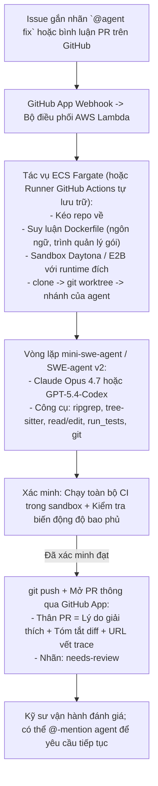

# Đồ án 16 — Tác nhân Tự hành Chuyển Issue GitHub thành PR

> Gắn nhãn cho một issue, nhận lại một Pull Request (PR) hoàn chỉnh — đây chính là hình thái sản phẩm của các tác nhân lập trình tự hành (autonomous coding agents) năm 2026: chạy một tác nhân trong môi trường hộp cát (sandbox) trên đám mây, xác minh toàn bộ bài kiểm thử vượt qua, và tạo một PR sẵn sàng để đánh giá kèm theo phần lý giải chi tiết. AWS Remote SWE Agents, Cursor Background Agents, OpenAI Codex cloud và Google Jules đều đang theo đuổi mô hình này. Những phần khó khăn nhất bao gồm: tự động tái lập môi trường build của kho lưu trữ (repo), ngăn chặn rò rỉ thông tin xác thực (credential leakage), thực thi giới hạn ngân sách theo từng repo, và đảm bảo tác nhân không bao giờ được phép ép đẩy nhánh (force-push). Đồ án capstone này xây dựng một phiên bản tự lưu trữ (self-hosted) và so sánh chi phí cũng như tỷ lệ thành công với các giải pháp thương mại được lưu trữ sẵn.

**Phân loại:** Đồ án (Capstone)
**Ngôn ngữ:** Python (tác nhân), TypeScript (GitHub App), YAML (Actions)
**Điều kiện tiên quyết:** Phase 11 (kỹ nghệ LLM), Phase 13 (công cụ), Phase 14 (tác nhân), Phase 15 (tác nhân tự hành), Phase 17 (cơ sở hạ tầng)
**Các Phase thực hành:** P11 · P13 · P14 · P15 · P17
**Thời lượng:** 30 giờ

## Vấn đề Cần Giải quyết

Tác nhân lập trình đám mây bất đồng bộ (async cloud coding agent) là một danh mục sản phẩm hoàn toàn khác biệt so với các tác nhân lập trình tương tác (đồ án 01). Trải nghiệm người dùng chỉ gói gọn qua một nhãn dán GitHub. Bạn chỉ cần gắn nhãn cho một issue dạng `@agent fix this`, một tiến trình làm việc (worker) sẽ lập tức khởi tạo trong một sandbox trên đám mây, sao chép kho lưu trữ, chạy các bài kiểm thử, chỉnh sửa mã nguồn, xác minh lại và mở một PR với lời giải thích cặn kẽ của tác nhân trong phần mô tả. Hoàn toàn không có vòng lặp tương tác, không cần mở terminal. AWS Remote SWE Agents, Cursor Background Agents, OpenAI Codex cloud, Google Jules và Factory Droids đều hội tụ về khuôn mẫu này.

Những thách thức kỹ thuật ở đây mang tính thực chiến cao: tái lập môi trường (tác nhân phải build repo từ đầu mà không có sẵn hình ảnh phát triển được lưu đệm), các bài kiểm thử chập chờn (flaky tests - cần phải chạy lại hoặc cô lập), giới hạn phạm vi thông tin xác thực (một GitHub App với quyền hạn chi tiết tối thiểu), thực thi hạn mức ngân sách theo từng repo mỗi ngày, và chính sách cấm tuyệt đối thao tác force-push. Đồ án này đo lường tỷ lệ vượt qua bài kiểm thử, chi phí và độ an toàn đối chiếu với các nền tảng thương mại.

## Khái niệm Cốt lõi

Cơ chế kích hoạt là một GitHub webhook (khi có nhãn issue mới hoặc bình luận trên PR). Một bộ điều phối (dispatcher) sẽ đẩy công việc vào hàng đợi của ECS Fargate hoặc AWS Lambda. Worker kéo mã nguồn về một sandbox Daytona hoặc E2B với tệp Dockerfile tổng quát được suy luận tự động từ cấu trúc repo (ngôn ngữ lập trình, framework). Tác nhân chạy vòng lặp mini-swe-agent hoặc SWE-agent v2 kết hợp với Claude Opus 4.7 hoặc GPT-5.4-Codex. Nó lặp lại chu trình: đọc mã, đề xuất phương án sửa, áp dụng bản vá (patch), chạy kiểm thử.

Xác minh là bước kiểm soát mang tính quyết định (gating step). Toàn bộ quy trình tích hợp liên tục (CI) phải chạy thành công bên trong sandbox trước khi PR được tạo. Độ biến động của độ bao phủ kiểm thử (coverage delta) sẽ được tính toán; nếu mức độ sụt giảm vượt quá ngưỡng cho phép, PR vẫn được mở nhưng sẽ gắn nhãn `needs-review`. Tác nhân đăng tải phần lý giải làm mô tả của PR cùng một luồng trao đổi `@agent` để người đánh giá có thể phản hồi và giao việc tiếp theo.

An toàn được kiểm soát chặt chẽ thông qua hai bề mặt GitHub độc lập: Ứng dụng GitHub (GitHub App) cung cấp một token cài đặt ngắn hạn với quyền `workflows: read` và các quyền tối thiểu đối với nội dung kho lưu trữ / PR; quy tắc bảo vệ nhánh (branch protection - chứ không phải quyền của ứng dụng) sẽ thực thi việc "không ghi trực tiếp vào nhánh `main`" và "không được force-push" — ứng dụng tuyệt đối không bao giờ được thêm vào danh sách ngoại lệ (bypass list). Quyền truy cập chỉ đọc theo đường dẫn đối với thư mục `.github/workflows` không phải là một tính năng gốc của GitHub App, do đó worker của tác nhân phải tự thực thi danh sách cho phép (allow-list) đối với việc chỉnh sửa tệp. Trần ngân sách cho từng repo mỗi ngày được thực thi tại bộ điều phối (ví dụ: tối đa 5 PR mỗi repo/ngày, 20 USD cho mỗi PR).

## Kiến trúc Hệ thống



## Ngăn xếp Công nghệ

- Kích hoạt (Trigger): GitHub App với token quyền hạn chi tiết (fine-grained token); bộ nhận webhook qua Lambda hoặc Fly.io
- Tiến trình xử lý (Worker): Tác vụ ECS Fargate (hoặc self-hosted runner trên GitHub Actions)
- Hộp cát (Sandbox): Daytona devcontainer hoặc sandbox E2B cho từng tác vụ
- Vòng lặp tác nhân: Đường cơ sở mini-swe-agent hoặc SWE-agent v2 chạy trên Claude Opus 4.7 / GPT-5.4-Codex
- Truy xuất (Retrieval): Bản đồ repo tree-sitter (repo-map) + ripgrep
- Xác minh (Verification): Toàn bộ CI chạy trong sandbox + cổng kiểm soát biến động độ bao phủ
- Khả năng quan sát (Observability): Langfuse kèm kho lưu trữ vết thực thi cho từng PR được liên kết từ thân PR
- Ngân sách: Mức trần chi phí hàng ngày cho mỗi repo; số lượng PR tối đa mỗi repo/ngày

````figure
cf-issue-to-pr
````

## Xây dựng Hệ thống

1. **Khởi tạo GitHub App.** Token cài đặt chi tiết: quyền đọc/ghi issues, quyền ghi pull_requests, quyền đọc/ghi contents, quyền đọc workflows. Quy tắc bảo vệ nhánh (bề mặt duy nhất có khả năng làm điều này) thực thi "không push trực tiếp lên `main`" và "không force-push"; ứng dụng không nằm trong danh sách bỏ qua kiểm tra. Worker thực thi quy tắc "không ghi vào `.github/workflows`" như một bước kiểm tra danh sách cho phép trên diff được đề xuất, do quyền GitHub App không hỗ trợ phân quyền theo phạm vi đường dẫn tệp.

2. **Bộ tiếp nhận Webhook.** Hàm Lambda nhận webhook khi có nhãn issue hoặc bình luận PR. Lọc theo nhãn `@agent fix this`. Đẩy tác vụ vào hàng đợi SQS.

3. **Bộ điều phối (Dispatcher).** Lấy tác vụ từ SQS. Thực thi ngân sách mỗi repo/ngày. Khởi chạy một tác vụ ECS Fargate với URL kho lưu trữ, nội dung issue và một sandbox Daytona mới tinh.

4. **Suy luận môi trường (Environment inference).** Tự động phát hiện ngôn ngữ (Python, Node, Go, Rust) và trình quản lý gói (uv, pnpm, go mod, cargo). Tự động sinh tệp Dockerfile nếu dự án chưa có sẵn.

5. **Vòng lặp tác nhân.** mini-swe-agent hoặc SWE-agent v2 với Claude Opus 4.7. Các công cụ: ripgrep, tree-sitter repo-map, read_file, edit_file, run_tests, git. Giới hạn cứng: chi phí tối đa 20 USD, thời gian thực tối đa 30 phút, tối đa 30 lượt tương tác của tác nhân.

6. **Xác minh (Verification).** Sau khi vòng lặp hoàn tất, chạy toàn bộ bộ kiểm thử bên trong sandbox. Tính toán độ biến động độ bao phủ bằng jacoco hoặc coverage.py. Nếu CI thất bại: dừng lại, không mở PR. Nếu độ bao phủ giảm hơn 2%: mở PR nhưng gắn nhãn `needs-review`.

7. **Đăng tải PR.** Đẩy nhánh của tác nhân lên git. Mở PR qua GitHub API với: tiêu đề, lý do giải thích, tóm tắt các điểm thay đổi (diff summary), URL theo dõi trace, chi phí và số lượt chạy.

8. **Vệ sinh thông tin xác thực.** Worker chạy với token cài đặt GitHub App ngắn hạn. Nhật ký (logs) được làm sạch để loại bỏ bí mật trước khi lưu trữ.

9. **Đánh giá (Eval).** 30 issue nội bộ được chuẩn bị sẵn với độ khó khác nhau. Đo lường tỷ lệ vượt qua, chất lượng PR (kích thước diff, phong cách code, độ bao phủ), chi phí và độ trễ. So sánh với Cursor Background Agents và AWS Remote SWE Agents trên cùng các issue đó.

## Sử dụng Hệ thống

```markdown
# Trên github.com
- Người dùng gắn nhãn issue #842 với `@agent fix this`
- PR #1903 xuất hiện sau 14 phút
- Phần thân mô tả:
  > Fixed NPE in widget.dedupe() caused by null comparator entry.
  > Added regression test widget_test.go::TestDedupeNullComparator.
  > Coverage delta: +0.12%
  > Turns: 7  Cost: $1.80  Trace: langfuse:...
  > Label: needs-review
```

## Bàn giao Sản phẩm

Tệp `outputs/skill-issue-to-pr.md` là kết quả bàn giao. Đó là một GitHub App kết hợp với worker đám mây bất đồng bộ giúp chuyển đổi các issue được gắn nhãn thành các PR sẵn sàng đánh giá với chi phí có giới hạn và thông tin xác thực được bảo vệ an toàn.

| Trọng số | Tiêu chí | Cách thức đo lường |
|:-:|---|---|
| 25 | Tỷ lệ thành công trên 30 issue | Thành công toàn diện (CI xanh + độ bao phủ đạt chuẩn) |
| 20 | Chất lượng PR | Kích thước diff, độ biến động bao phủ kiểm thử, tuân thủ phong cách |
| 20 | Chi phí và độ trễ trên mỗi issue giải quyết | Chi phí USD và thời gian thực trên từng PR |
| 20 | An toàn bảo mật | Token giới hạn quyền, ngân sách theo repo, không force-push, vệ sinh thông tin xác thực |
| 15 | Trải nghiệm người vận hành (Operator UX) | Bình luận giải thích rõ ràng, hỗ trợ thử lại, phản hồi khi được @-mention |
| **100** | | |

## Bài tập Thực hành

1. Bổ sung chế độ "sửa kiểm thử chập chờn (fix flaky test)": nhãn `@agent stabilize-flake TestX` sẽ chạy bài kiểm thử 50 lần trong sandbox và đề xuất một thay đổi tối thiểu giúp ổn định bài kiểm tra.

2. So sánh chi phí với Cursor Background Agents trên ba issue dùng chung. Báo cáo xem công cụ nào giành lợi thế ở từng trường hợp.

3. Triển khai bảng điều khiển ngân sách: chi phí theo từng repo mỗi ngày, chi phí theo từng người dùng. Phát cảnh báo khi có biến động bất thường.

4. Xây dựng chế độ "chạy thử (dry-run)" để mở một PR dạng nháp (draft) mà không cần chạy CI, giúp người đánh giá có thể xem xét kế hoạch với chi phí rẻ.

5. Bổ sung chính sách lưu giữ: các nhánh PR cũ hơn 7 ngày không được merge sẽ tự động bị xóa bỏ.

## Thuật ngữ Then chốt

| Thuật ngữ | Điều mọi người hay nói | Ý nghĩa thực tế |
|---|---|---|
| GitHub App | "Danh tính bot có phạm vi" | Ứng dụng với các quyền hạn chi tiết kèm token cài đặt có thời hạn ngắn |
| Tác nhân đám mây bất đồng bộ (Async cloud agent) | "Tác nhân chạy nền (Background agent)" | Worker không tương tác chạy trong một sandbox đám mây, không qua terminal |
| Suy luận môi trường (Environment inference) | "Tổng hợp Dockerfile" | Tự phát hiện ngôn ngữ + trình quản lý gói, tự sinh Dockerfile nếu chưa có |
| Xác minh (Verification) | "Chạy CI trong sandbox" | Thực thi toàn bộ bộ kiểm thử bên trong worker trước khi mở PR |
| Biến động độ bao phủ (Coverage delta) | "Bảo toàn độ bao phủ" | Mức chênh lệch tỷ lệ % bao phủ kiểm thử từ nhánh gốc sang nhánh của tác nhân |
| Ngân sách theo repo (Per-repo budget) | "Mức trần hàng ngày" | Giới hạn chi phí tiền mặt và số lượng PR được thực thi tại bộ điều phối |
| Lý do giải thích (Rationale) | "Phần giải thích trong thân PR" | Bản tóm tắt của tác nhân về những gì đã thay đổi và lý do vì sao; bắt buộc có trong thân PR |

## Đọc thêm

- [AWS Remote SWE Agents](https://github.com/aws-samples/remote-swe-agents) — tài liệu tham chiếu kinh điển về tác nhân đám mây bất đồng bộ
- [SWE-agent](https://github.com/SWE-agent/SWE-agent) — tài liệu tham chiếu CLI
- [Cursor Background Agents](https://docs.cursor.com/background-agent) — giải pháp thương mại thay thế
- [OpenAI Codex (cloud)](https://openai.com/codex) — đối thủ cạnh tranh dạng dịch vụ lưu trữ sẵn
- [Google Jules](https://jules.google) — phiên bản dịch vụ của Google
- [Factory Droids](https://www.factory.ai) — tài liệu tham chiếu thương mại khác
- [Tài liệu GitHub App](https://docs.github.com/en/apps) — định danh bot có giới hạn quyền
- [Hộp cát đám mây Daytona](https://daytona.io) — công nghệ sandbox tham chiếu
