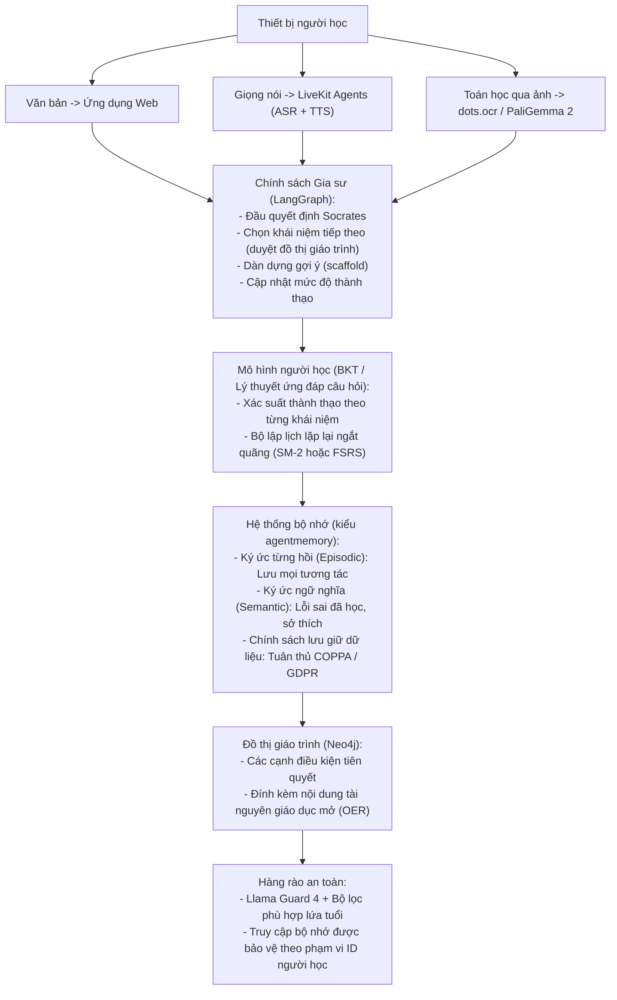

# Đồ án 17 — Gia sư AI Cá nhân hóa (Thích ứng, Đa phương thức, Kèm Bộ nhớ)

> Khanmigo (Khan Academy), Duolingo Max, Google LearnLM / Gemini for Education, Quizlet Q-Chat và Synthesis Tutor đều đã triển khai gia sư thích ứng đa phương thức trên quy mô lớn vào năm 2026. Khuôn mẫu chung của hệ thống bao gồm: một chính sách Socrates (Socratic policy - tuyệt đối không đưa ra câu trả lời trực tiếp), một mô hình người học được cập nhật liên tục sau mỗi lượt tương tác (theo trường phái theo dõi tri thức theo Bayes - Bayesian Knowledge Tracing), hỗ trợ đầu vào qua giọng nói + văn bản + chụp ảnh bài toán, truy xuất đồ thị giáo trình (curriculum graph), lập lịch lặp lại ngắt quãng (spaced repetition), và các bộ lọc an toàn nghiêm ngặt đảm bảo nội dung phù hợp lứa tuổi. Đồ án capstone này yêu cầu bạn phát triển một gia sư chuyên sâu theo môn học (đại số phổ thông K-12 hoặc lập trình Python cơ bản), thực hiện một nghiên cứu hiệu quả kéo dài hai tuần với 10 người học, và vượt qua bài kiểm toán an toàn nội dung.

**Phân loại:** Đồ án (Capstone)
**Ngôn ngữ:** Python (backend, mô hình người học), TypeScript (ứng dụng web), SQL (đồ thị giáo trình qua Postgres + Neo4j)
**Điều kiện tiên quyết:** Phase 5 (xử lý ngôn ngữ tự nhiên), Phase 6 (giọng nói), Phase 11 (kỹ nghệ LLM), Phase 12 (đa phương thức), Phase 14 (tác nhân), Phase 17 (cơ sở hạ tầng), Phase 18 (an toàn)
**Các Phase thực hành:** P5 · P6 · P11 · P12 · P14 · P17 · P18
**Thời lượng:** 30 giờ

## Vấn đề Cần Giải quyết

Hệ thống gia sư thích ứng (adaptive tutoring) từng là một lĩnh vực nghiên cứu ngách trong công nghệ giáo dục (ed-tech). Đến năm 2026, nó đã trở thành một sản phẩm tiêu dùng đại chúng. Khanmigo đã được triển khai trên hầu khắp các học khu tại Hoa Kỳ. Duolingo Max đạt hàng chục triệu người dùng hoạt động hàng tháng (MAU). LearnLM / Gemini for Education của Google cung cấp năng lực gia sư ngay trong Google Classroom. Quizlet Q-Chat hoạt động song song cùng các bộ flashcard. Synthesis Tutor trở nên phổ biến rộng rãi với hình tượng gia sư cho trẻ em tò mò. Các điểm chung cốt lõi: đầu vào đa phương thức (nhập liệu, trò chuyện giọng nói, chụp ảnh phương trình), sư phạm Socrates (hỏi gợi mở trước, giải thích sau), mô hình người học cập nhật sau mỗi tương tác, và rào chắn an toàn nghiêm ngặt phù hợp lứa tuổi.

Bạn sẽ xây dựng một hệ thống hoàn chỉnh cho một nhóm người học cụ thể. Thước đo đánh giá là một nghiên cứu hiệu quả thực tế: điểm kiểm tra trước và sau thử nghiệm (pre-test và post-test) trong vòng hai tuần với 10 người học. Vòng lặp giọng nói phải tạo cảm giác tự nhiên (tái sử dụng ngăn xếp con từ đồ án 03). Bộ nhớ phải tuyệt đối tôn trọng quyền riêng tư. Bộ lọc an toàn phải vượt qua các bài kiểm thử đối kháng red-team tuân thủ đạo luật COPPA dành cho lứa tuổi học sinh K-12.

## Khái niệm Cốt lõi

Hệ thống gồm bốn thành phần chính. **Chính sách gia sư (Tutor policy)** là một vòng lặp Socrates: khi người học hỏi xin đáp án, chính sách sẽ đưa ra một câu hỏi định hướng; khi họ trả lời đúng, hệ thống chuyển sang khái niệm tiếp theo; khi họ gặp bế tắc, hệ thống cung cấp một gợi ý dạng giàn giáo (scaffolded hint). **Mô hình người học (Learner model)** dựa trên phương pháp theo dõi tri thức theo Bayes (Bayesian Knowledge Tracing - BKT hoặc một biến thể tương đương) nhằm cập nhật xác suất nắm vững kiến thức (mastery probability) cho từng nút trong giáo trình sau mỗi tương tác. **Đồ thị giáo trình (Curriculum graph)** là cơ sở dữ liệu Neo4j lưu trữ các khái niệm với các cạnh điều kiện tiên quyết (prerequisite edges); chính sách sẽ duyệt trên đồ thị để chọn khái niệm tiếp theo cần học. **Bộ nhớ (Memory)** là kho lưu trữ ký ức từng hồi (episodic) kết hợp ký ức ngữ nghĩa (semantic - theo phong cách agentmemory) ghi lại các tương tác quá khứ, lỗi sai thường gặp và sở thích cá nhân.

Trải nghiệm người dùng hoàn toàn đa phương thức. Nhập văn bản cho các câu trả lời gõ phím. Nhập giọng nói qua LiveKit + Whisper (tái sử dụng đồ án 03). Chụp ảnh bài toán để nhận diện phương trình qua dots.ocr hoặc PaliGemma 2. Đầu ra giọng nói qua Cartesia Sonic-2. An toàn được đảm bảo bởi Llama Guard 4 cùng bộ lọc nội dung phù hợp lứa tuổi (chặn nội dung người lớn, bạo lực, tự hại) và chính sách lưu giữ dữ liệu tuân thủ nghiêm ngặt COPPA.

Báo cáo nghiên cứu hiệu quả là kết quả bàn giao quan trọng. 10 người học, bài kiểm tra trước và sau thử nghiệm, kéo dài hai tuần. Báo cáo mức độ tiến bộ về mặt học tập kèm khoảng tin cậy. So sánh đối chiếu với nhóm đối chứng không thích ứng (cùng nội dung bài học nhưng phân phối tuyến tính không qua chính sách gia sư Socrates).

## Kiến trúc Hệ thống



## Ngăn xếp Công nghệ

- Lựa chọn môn học: Đại số K-12 hoặc Nhập môn Python (chọn một môn để đào sâu)
- Chính sách gia sư: LangGraph chạy trên Claude Sonnet 4.7 (kèm lưu bộ nhớ đệm prompt)
- Mô hình người học: Theo dõi tri thức theo Bayes (BKT kinh điển) hoặc FSRS để lập lịch ngắt quãng
- Đồ thị giáo trình: Neo4j chứa các khái niệm + các cạnh điều kiện tiên quyết + nội dung tài nguyên giáo dục mở (OER)
- Bộ nhớ: Kho lưu trữ vector + từng hồi + ngữ nghĩa bền vững theo kiểu agentmemory
- Giọng nói: LiveKit Agents 1.0 + Cartesia Sonic-2 (tái sử dụng từ đồ án 03)
- Nhận diện bài toán qua ảnh: dots.ocr hoặc PaliGemma 2 để nhận diện công thức toán học
- An toàn: Llama Guard 4 + bộ lọc tùy chỉnh phù hợp với lứa tuổi
- Đánh giá: Sinh câu hỏi theo thang đo Bloom, bộ công cụ kiểm tra trước/sau, công cụ hỗ trợ nghiên cứu hiệu quả

````figure
cf-tutor-loop
````

## Xây dựng Hệ thống

1. **Đồ thị giáo trình.** Xây dựng một đồ thị Neo4j gồm 50–150 nút khái niệm (ví dụ: đại số K-12 từ "trục số" đến "công thức nghiệm phương trình bậc hai") kèm các cạnh quan hệ tiên quyết. Gắn kèm nội dung giáo dục mở (OER) trên từng nút (Open Textbook, OpenStax).

2. **Mô hình người học.** Khởi tạo mô hình theo dõi tri thức theo Bayes với các phân phối tiên nghiệm (priors): xác suất đoán mò (guess), xác suất sơ suất (slip), tốc độ học (learn-rate). Cập nhật mức độ thành thạo trên từng khái niệm sau mỗi lượt tương tác. Lưu trữ bền vững theo từng học sinh.

3. **Chính sách gia sư.** Luồng LangGraph với các nút: `read_signal` (câu trả lời của học sinh là đúng / đúng một phần / đang bị tắc?), `select_concept` (duyệt đồ thị giáo trình để chọn khái niệm có độ ưu tiên cao nhất), `scaffold` (soạn prompt gợi mở kiểu Socrates), `update_mastery`.

4. **Bộ nhớ.** Mọi tương tác đều được ghi vào kho lưu trữ từng hồi (episodic store). Các lỗi sai thường lặp lại và sở thích học tập được đúc kết thành bộ nhớ ngữ nghĩa (semantic memory). Áp dụng chính sách lưu giữ dữ liệu tuân thủ COPPA: tự động xóa sau 1 năm, cho phép phụ huynh truy cập và yêu cầu xóa.

5. **Đường truyền giọng nói.** Worker LiveKit Agents được gắn trực tiếp vào chính sách gia sư. Nhận dạng giọng nói (ASR) qua Whisper-v3-turbo. Chuyển văn bản thành giọng nói (TTS) qua Cartesia Sonic-2. Hỗ trợ ngắt lời (barge-in) tự nhiên (tái sử dụng cơ chế từ đồ án 03).

6. **Đường truyền bài toán qua ảnh.** Tải lên hoặc chụp ảnh bài toán; chạy dots.ocr hoặc PaliGemma 2 để nhận diện công thức; đưa vào gia sư dưới dạng dữ liệu đầu vào có cấu trúc.

7. **Rào chắn an toàn.** Mọi đầu ra của mô hình đều phải vượt qua Llama Guard 4 + bộ lọc phù hợp lứa tuổi (ngăn chặn nội dung tự hại, người lớn, bạo lực). Quyền truy cập bộ nhớ được phân phạm vi theo ID người học; cung cấp bề mặt cho phụ huynh yêu cầu xóa dữ liệu.

8. **Nghiên cứu hiệu quả.** 10 người học, bài kiểm tra chuẩn hóa trước thử nghiệm (30 câu hỏi cơ sở), hai tuần tương tác với gia sư (3 buổi/tuần), bài kiểm tra sau thử nghiệm. So sánh với một nhóm đối chứng gồm 10 người học học cùng nội dung đó theo cách thức phi thích ứng.

9. **Báo cáo tiến độ hàng tuần.** Tự động sinh báo cáo PDF tóm tắt các chủ đề đã khám phá, quỹ đạo nắm vững kiến thức và các bước đề xuất tiếp theo cho từng người học.

## Sử dụng Hệ thống

```text
người học: "Em không hiểu tại sao 3x + 6 = 12 lại suy ra x = 2"
[tín hiệu]  bế tắc
[khái niệm] 'cô lập biến số' (tiên quyết: đẳng thức cộng trừ)
[gợi mở]    "Để bắt đầu, em nghĩ chúng ta nên trừ số nào ở cả hai vế?"
người học: "Dạ số 6"
[tín hiệu]  chính xác
[thành thạo] đẳng thức cộng trừ: 0.62 -> 0.77
[khái niệm] tiếp tục 'cô lập biến số'
[gợi mở]    "Rất tốt. Vậy bây giờ 3x / 3 sẽ bằng bao nhiêu?"
```

## Bàn giao Sản phẩm

Tệp `outputs/skill-ai-tutor.md` là kết quả bàn giao. Đó là một gia sư thích ứng chuyên sâu theo môn học với đầu vào đa phương thức, mô hình người học, bộ nhớ, rào chắn an toàn và hiệu quả sư phạm đã được đo lường thực tế.

| Trọng số | Tiêu chí | Cách thức đo lường |
|:-:|---|---|
| 25 | Độ chênh lệch tiến bộ học tập | Mức chênh lệch giữa bài kiểm tra trước/sau trong nghiên cứu 10 người học kéo dài hai tuần |
| 20 | Độ trung thực với phương pháp Socrates | Điểm đánh giá theo thang tiêu chí (rubric) trên các mẫu trích lục hội thoại |
| 20 | Trải nghiệm đa phương thức | Tính mạch lạc và đồng nhất giữa giọng nói + hình ảnh + văn bản xuyên suốt |
| 20 | Tư thế an toàn + quyền riêng tư | Tỷ lệ vượt qua Llama Guard 4 + chính sách lưu giữ dữ liệu tuân thủ COPPA |
| 15 | Độ rộng giáo trình và chất lượng đồ thị | Độ bao phủ khái niệm + tính nhất quán của đồ thị điều kiện tiên quyết |
| **100** | | |

## Bài tập Thực hành

1. Thực hiện nghiên cứu hiệu quả có và không có mô hình người học thích ứng (thay bằng thứ tự khái niệm ngẫu nhiên). Báo cáo độ chênh lệch. Kỳ vọng hệ thống thích ứng sẽ giành chiến thắng, nhưng quy mô mức độ chênh lệch mới là con số mang lại nhiều ý nghĩa.

2. Thêm một phép thử đa phương thức: cùng một câu hỏi khái niệm nhưng được truyền đạt dưới dạng văn bản, giọng nói và hình ảnh. Đo lường xem người học có tiếp thu nhanh hơn với phương thức mà họ ưa thích hay không.

3. Xây dựng bảng điều khiển dành cho phụ huynh: các chủ đề đã luyện tập, biểu đồ mức độ thành thạo, các khái niệm sắp tới, các sự kiện an toàn (các lần vi phạm rào chắn). Đảm bảo tuân thủ COPPA.

4. Bổ sung chế độ chuyển đổi ngôn ngữ: gia sư chấp nhận đầu vào bằng tiếng Tây Ban Nha và giảng dạy bằng tiếng Tây Ban Nha. Đo lường độ bao phủ an toàn của X-Guard.

5. Kiểm thử áp lực đối với quyền riêng tư của bộ nhớ: xác minh rằng học sinh A không thể thấy dữ liệu của học sinh B ngay cả khi dùng kỹ thuật tấn công tiêm lại đoạn ghi âm giọng nói (voice-clip re-ingest attack). Ghi nhật ký các nỗ lực truy cập trái phép và phát cảnh báo.

## Thuật ngữ Then chốt

| Thuật ngữ | Điều mọi người hay nói | Ý nghĩa thực tế |
|---|---|---|
| Chính sách Socrates (Socratic policy) | "Hỏi gợi mở, không đưa đáp án" | Gia sư đặt câu hỏi định hướng thay vì trực tiếp đưa ra lời giải |
| Theo dõi tri thức theo Bayes (Bayesian knowledge tracing) | "BKT" | Các phương trình mô hình hóa người học kinh điển nhằm tính toán xác suất nắm vững trên từng khái niệm |
| FSRS | "Bộ lập lịch lặp lại ngắt quãng tự do" | Thuật toán lập lịch ngắt quãng năm 2024, ưu việt hơn thuật toán SM-2 kinh điển |
| Đồ thị giáo trình (Curriculum graph) | "Đồ thị DAG khái niệm" | Cơ sở dữ liệu Neo4j lưu trữ các khái niệm kèm theo các cạnh quan hệ tiên quyết |
| Bộ nhớ từng hồi (Episodic memory) | "Nhật ký từng tương tác" | Mọi lượt tương tác được lưu lại để phục vụ truy xuất sau này |
| Bộ nhớ ngữ nghĩa (Semantic memory) | "Kho mẫu hình đúc kết" | Các lỗi sai và sở thích đã học được cô đọng và nâng cấp từ bộ nhớ từng hồi |
| COPPA | "Luật bảo vệ quyền riêng tư của trẻ em" | Luật pháp Hoa Kỳ hạn chế việc thu thập dữ liệu từ trẻ em dưới 13 tuổi |

## Đọc thêm

- [Khanmigo (Khan Academy)](https://www.khanmigo.ai) — gia sư K-12 tham chiếu cho người dùng cuối
- [Duolingo Max](https://blog.duolingo.com/duolingo-max/) — gia sư học ngoại ngữ tham chiếu
- [Google LearnLM / Gemini for Education](https://blog.google/products-and-platforms/products/education/google-learnlm-gemini-generative-ai/) — mô hình giáo dục tham chiếu
- [Quizlet Q-Chat](https://quizlet.com) — tài liệu tham chiếu bổ sung
- [Synthesis Tutor](https://www.synthesis.com) — ví dụ tham chiếu từ startup
- [Thuật toán FSRS](https://github.com/open-spaced-repetition/fsrs4anki) — bộ lập lịch lặp lại ngắt quãng
- [Theo dõi Tri thức theo Bayes (Bayesian Knowledge Tracing)](https://en.wikipedia.org/wiki/Bayesian_knowledge_tracing) — nền tảng mô hình hóa người học
- [LiveKit Agents](https://github.com/livekit/agents) — ngăn xếp xử lý giọng nói
