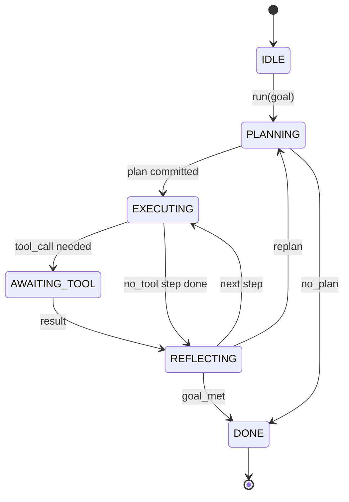

# Giao ước Vòng lặp Agent Harness (Agent Harness Loop Contract)

> Harness chính là agent. Mô hình chỉ là một bộ đồng xử lý (coprocessor). Bài học này cố định hợp đồng vòng lặp (loop contract) mà bạn có thể gắn kết nối bất kỳ mô hình nào vào.

**Type:** Build
**Languages:** Python
**Prerequisites:** Phase 13 lessons 01-07, Phase 14 lesson 01
**Time:** ~90 phút

## Mục tiêu học tập
- Đặc tả một vòng lặp agent harness dưới dạng máy trạng thái tất định (deterministic state machine) với các bước chuyển trạng thái tường minh.
- Triển khai mười chủ đề điểm móc vòng đời (lifecycle hook topics) mà người vận hành dùng để kết nối chính sách (policy), dữ liệu đo từ xa (telemetry) và rào chắn an toàn (guardrails).
- Định nghĩa hai điểm nhượng quyền kéo (pull points) nơi vòng lặp nhượng lại quyền kiểm soát cho bên gọi và tiếp tục chạy khi nhận được dữ liệu đầu vào mới.
- Thực thi giới hạn ngân sách theo từng phiên (per-session budgets bao gồm số lượt - turns, số lần gọi công cụ - tool calls, thời gian thực - wall-clock) mà không làm rò rỉ trạng thái dở dang khi vượt quá ngưỡng.
- Phát ra một luồng định kiểu gồm mười một loại sự kiện (typed event stream) để các giao diện người dùng (UI) và bộ truy vết (tracer) phía hạ nguồn có thể đăng ký theo dõi mà không cần trực tiếp can thiệp vào vòng lặp.

```figure
cf-loop-contract
```

## Khung tư duy (The frame)

Một agent lập trình hoạt động tự động trong bốn mươi lượt (turns) không đơn thuần là một vòng lặp trò chuyện (chat loop). Nó là một máy trạng thái (state machine) mà các nút của nó người vận hành có thể chặn bắt và các cạnh chuyển tiếp người vận hành có thể kiểm toán. Một khi bạn đã viết ra hợp đồng này một cách chặt chẽ, việc hoán đổi mô hình, công cụ hoặc chính sách sẽ không còn là một cuộc tái cấu trúc mã nguồn (refactor) nữa. Nó chỉ đơn giản trở thành một lệnh gọi đăng ký.

Bài học này xây dựng hợp đồng đó. Chúng ta định danh sáu trạng thái, mười chủ đề hook, hai điểm nhượng quyền kéo (pull points), mười một loại sự kiện và một khung giới hạn ngân sách (budget envelope). Mọi thành phần khác trong harness (sổ đăng ký công cụ - tool registry, tầng truyền tải JSON-RPC, bộ điều phối - dispatcher, bộ lập kế hoạch - planner) đều sẽ kết nối vào cấu trúc này.

## Các trạng thái (The states)

Vòng lặp có sáu trạng thái. Năm trạng thái hoạt động và một trạng thái kết thúc (terminal).



`IDLE` là điểm nhập hợp lệ duy nhất. `DONE` là điểm thoát hợp lệ duy nhất. `AWAITING_TOOL` là trạng thái duy nhất tự nó tạo ra một pull point. Điểm pull point thứ hai, `on_pause`, không phải là một trạng thái: nó được kích hoạt từ bất kỳ trạng thái hoạt động nào khi cạn kiệt ngân sách hoặc khi một hook yêu cầu đánh giá phê duyệt. Mọi chuyển đổi trạng thái khác đều là nội bộ.

Máy trạng thái này có tính tất định (deterministic). Khi nhận cùng một nhật ký sự kiện (event log), harness sẽ chuyển đến cùng một trạng thái. Đặc tính này cho phép bạn phát lại (replay) các phiên để gỡ lỗi mà không cần phải gọi lại mô hình ngôn ngữ.

## Các chủ đề điểm móc (The hook topics)

Hook là điểm tiếp giáp giúp người vận hành can thiệp vào vòng lặp. Harness phát ra mười chủ đề (topics). Mỗi chủ đề chấp nhận số lượng bên đăng ký (subscribers) tùy ý. Các subscriber được kích hoạt theo đúng thứ tự đăng ký. Một subscriber có thể biến đổi tải trọng dữ liệu (mutate payload), ném ngoại lệ để hủy bỏ lượt chạy, hoặc trả về một giá trị lính canh (sentinel) để bỏ qua bước tiếp theo.

```text
before_plan         after_plan
before_tool_call    after_tool_call
before_step         after_step
on_error
on_pause
on_budget_exceeded
on_complete
```

Cấu trúc này phản ánh chính xác mô hình mà Claude Code, Cursor và OpenCode đều đã hội tụ vào giữa năm 2025. Các tên gọi mang tính chức năng, không gắn với thương hiệu cụ thể nào. Một hook ngăn chặn lệnh `rm -rf` sẽ nằm ở `before_tool_call`. Một hook phát ra một span OpenTelemetry sẽ nằm ở `after_step`. Một hook tiếp tục phiên đang tạm dừng sẽ nằm ở `on_pause`.

## Các điểm nhượng quyền kéo (The pull points)

Vòng lặp nhượng lại quyền kiểm soát (yields control) ở hai vị trí. Thứ nhất là tại `AWAITING_TOOL` khi nó không thể tiến triển nếu thiếu kết quả công cụ. Thứ hai là tại `on_pause` khi ngân sách bị cạn kiệt hoặc một hook yêu cầu sự xem xét của con người một cách tường minh.

Một pull point không phải là một ngoại lệ (exception). Nó là một giá trị trả về. Bên gọi sẽ kiểm tra trạng thái của harness, lấy bất kỳ dữ liệu nào mà harness yêu cầu, rồi gọi `resume(payload)`. Harness sẽ tiếp tục chính xác từ nơi nó đã dừng lại. Đây là cấu trúc tương tự như một hàm sinh (generator) trong Python. Giao thức truyền tải qua pull point là do bạn lựa chọn. Trong giao diện dòng lệnh TUI, đó là một lần nhấn phím. Qua MCP, đó là lệnh gọi `tools/call`. Qua một hàng đợi tin nhắn, đó là việc thăm dò công việc (job poll).

## Luồng sự kiện (The event stream)

Vòng lặp nối thêm các sự kiện vào một luồng định kiểu (typed stream) tại các thời điểm cụ thể trong hợp đồng. Luồng này chỉ cho phép ghi nối tiếp (append-only) và các bên đăng ký có thể phát lại (replay) từ bất kỳ độ dời (offset) nào. Mười một loại sự kiện được triển khai bao gồm:

- `session.start` — phát ra một lần khi `run(goal)` được gọi
- `plan.draft` — phát ra khi bộ lập kế hoạch trả về một bản thảo kế hoạch
- `plan.commit` — phát ra sau khi bản thảo được chốt làm kế hoạch hoạt động
- `step.start` — phát ra khi bắt đầu mỗi bước thực thi
- `step.end` — phát ra khi kết thúc mỗi bước thực thi
- `tool.call` — phát ra khi một bước cần công cụ nhượng quyền kiểm soát cho bên gọi
- `tool.result` — phát ra khi tiếp tục với kết quả của công cụ
- `tool.error` — phát ra khi tiếp tục với một lỗi hoặc khi một hook hủy bỏ lệnh gọi
- `budget.warn` — phát ra khi đạt tới một giới hạn ngân sách
- `session.pause` — phát ra khi vòng lặp nhượng quyền do tạm dừng (ngân sách hoặc hook)
- `session.complete` — phát ra một lần khi vòng lặp chuyển đến `DONE`

Các sự kiện không sao chép lại tải trọng của hook. Hooks mang tính mệnh lệnh (biến đổi, hủy bỏ). Events mang tính quan sát (ghi chép, truyền tải). Hãy xem chúng là hai cơ chế trực giao (orthogonal) với nhau.

## Khung giới hạn ngân sách (The budget envelope)

Một phiên mang theo ba giới hạn: Số lượt (turn count), số lần gọi công cụ (tool call count), và số giây thời gian thực (wall-clock seconds). Mỗi lượt tăng số turn lên một. Mỗi lần gọi công cụ tăng số tool calls lên một. Thời gian thực được kiểm tra ở mỗi lần chuyển trạng thái. Khi đạt tới bất kỳ giới hạn nào, vòng lặp sẽ kích hoạt `on_budget_exceeded`, phát ra sự kiện `budget.warn`, sau đó chuyển sang `IDLE` với lý do vượt ngân sách ở pull point tiếp theo.

Ngân sách không phải là một công tắc ngắt khẩn cấp (kill switch). Nó là một sự nhượng quyền (yield). Bên gọi có quyền quyết định gia hạn ngân sách và tiếp tục, hoặc đóng phiên lại.

## Những gì bài học này không làm

Bài học này không gọi một mô hình thực tế. Nó không đăng ký các công cụ thực. Nó không triển khai giao thức truyền tải. Đó là nội dung của bốn bài học tiếp theo. Bài học này chốt chặt bản hợp đồng để bốn bài học kế tiếp có thể kết nối vào mà không cần phải viết lại mã nguồn.

Bộ lập kế hoạch tất định trong `main.py` chỉ là một thành phần đại diện (stand-in). Nó trả về một kế hoạch cố định gồm ba bước, trong đó có hai bước yêu cầu kết quả từ công cụ. Trọng tâm của bài học là vòng lặp, không phải kế hoạch.

## Cách đọc mã nguồn

`HarnessLoop` là lớp chính. Nó nắm giữ trạng thái, kích hoạt các hook, phát ra sự kiện. `Budget` theo dõi các giới hạn. `Event` là phong bì định kiểu trên luồng dữ liệu. `HookRegistry` là bảng điều phối. Hàm `_transition` là hàm duy nhất làm thay đổi trạng thái, đảm bảo các bất biến của máy trạng thái được tập trung tại một nơi duy nhất.

Hãy đọc `main.py` từ trên xuống dưới. Sau đó đọc `code/tests/test_loop.py`. Các bài kiểm thử cố định từng bước chuyển trạng thái và thứ tự kích hoạt của từng hook.

## Đào sâu mở rộng (Going further)

Phần khó nhất khi xây dựng một harness trong môi trường thực tế không phải là máy trạng thái. Đó là làm cho hợp đồng có khả năng thực thi bền bỉ (enforceable). Hợp đồng phải đứng vững khi bộ lập kế hoạch được nạp nóng lại (hot reload). Nó phải đứng vững khi một công cụ trả về chuỗi JSON sai định dạng. Nó phải đứng vững khi một hook ném lỗi trong `before_tool_call` tại lượt thứ hai mươi bảy của một phiên kéo dài bốn mươi lượt. Các bài kiểm thử trong bài học này mô phỏng các chế độ hỏng hóc (failure modes) đó. Hãy chạy thử chúng. Thử làm gãy chúng. Thêm các trường hợp kiểm thử mới.

Bài học tiếp theo sẽ bổ sung sổ đăng ký công cụ (tool registry). Sau đó là tầng truyền tải JSON-RPC. Tiếp theo là bộ điều phối (dispatcher). Đến bài học số 24, vòng lặp trong tệp này sẽ chạy một kế hoạch thực sự trên các công cụ thực tế với các giới hạn ngân sách thực tế được thực thi nghiêm ngặt.
