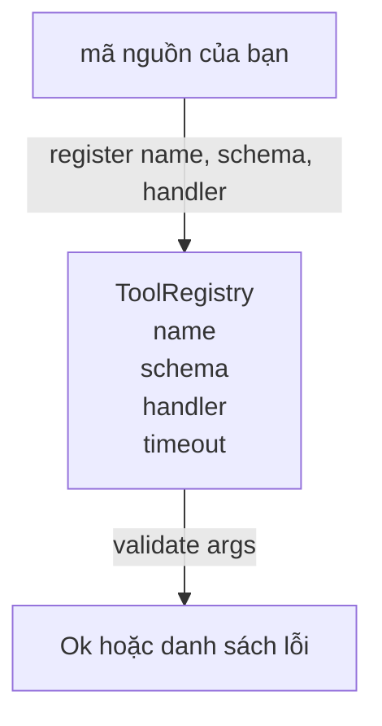

# Sổ đăng ký Công cụ với Xác thực Lược đồ (Tool Registry with Schema Validation)

> Một công cụ mà agent không thể xác thực là một công cụ mà agent không thể gọi. Hãy xây dựng sổ đăng ký (registry) và bộ kiểm tra lược đồ (schema checker) trước khi bạn bắt tay vào xây dựng các công cụ.

**Type:** Build
**Languages:** Python
**Prerequisites:** Phase 13 lessons 01-07, Phase 14 lesson 01
**Time:** ~90 phút

## Mục tiêu học tập
- Quản lý một sổ đăng ký định kiểu (typed registry) theo ánh xạ tên công cụ → lược đồ → hàm xử lý (tool name → schema → handler) mà bộ điều phối (dispatcher) có thể truy vấn một lần và tin cậy hoàn toàn sau đó.
- Triển khai một tập con của chuẩn JSON Schema 2020-12 bao quát các từ khóa mà chín mươi phần trăm các lệnh gọi công cụ thực tế sử dụng.
- Trả về các đường dẫn lỗi có định dạng con trỏ JSON (JSON pointer) chuẩn xác để mô hình có thể tự sửa sai chỉ trong một vòng lặp truy vấn (round trip).
- Từ chối việc tái đăng ký nếu không có ghi đè tường minh, bởi việc âm thầm ghi đè chính là nguyên nhân dẫn đến hiện tượng trôi dạt danh mục công cụ (catalog drift) trong môi trường sản xuất.
- Giữ cho bộ xác thực thuần khiết (pure validator, không I/O, không phụ thuộc thời gian, không biến toàn cục) để có thể chạy lại trơn tru trên một nhật ký phát lại (replay log).

```figure
cf-registry-validate
```

## Tại sao sổ đăng ký lại đi trước công cụ?

Một agent lập trình vào năm 2026 sở hữu số lượng công cụ đã đăng ký nhiều hơn mức mô hình có thể chứa trong một cửa sổ ngữ cảnh (context window) đơn lẻ. Một harness quy mô vừa phải có thể đăng ký hai trăm công cụ và chỉ đưa ra từ mười đến bốn mươi công cụ tại bất kỳ lượt (turn) nào. Sổ đăng ký (registry) là nguồn chân lý duy nhất (source of truth) cho các câu hỏi: "những công cụ nào đang tồn tại?", "các đối số của chúng có cấu trúc ra sao?", và "tôi cần gọi hàm xử lý (handler) nào?". Một khi ba câu trả lời đó đã được cố định, phần còn lại của harness sẽ không còn phải phỏng đoán nữa.

Sai lầm mà chúng ta muốn tránh là phát hành các handler mà không có lược đồ (schemas), hoặc phát hành schemas mà không có cơ chế xác thực (validation). Cả hai trường hợp này đều rất phổ biến. Cả hai đều biến tầng tiếp theo (bộ điều phối - dispatcher trong bài học số 23) thành một trò chơi đoán mò, nơi chế độ hỏng hóc duy nhất là vết ngăn xếp ngoại lệ (stack trace) bắn ra từ handler.

## Cấu trúc của một bản ghi công cụ (Tool Record)

```text
ToolRecord
  name        : str          (duy nhất, các đoạn chữ cái thường, số và gạch dưới phân tách bởi dấu chấm, ví dụ: snake_case.segment.case)
  description : str          (một dòng tóm tắt, hiển thị cho mô hình)
  schema      : dict         (tập con của JSON Schema 2020-12)
  handler     : Callable     (bất đồng bộ hoặc đồng bộ, trả về Any)
  idempotent  : bool         (bộ điều phối dùng thuộc tính này cho quyết định thử lại - retry)
  timeout_ms  : int          (ghi đè thời gian chờ mặc định của bộ điều phối cho từng công cụ)
```

Lược đồ (schema) là trường dữ liệu duy nhất mà bộ xác thực (validator) chạm tới. Hàm xử lý (handler) hoàn toàn mờ đục (opaque) đối với nó. Chúng ta cố ý tách rời chúng: Lược đồ là dữ liệu. Hàm xử lý là mã nguồn. Việc trộn lẫn chúng sẽ cám dỗ bạn đặt logic xác thực vào bên trong handler, và đó chính là lỗi mà chúng ta đang ngăn chặn.

## Tập con JSON Schema 2020-12

Toàn bộ đặc tả JSON Schema 2020-12 là một tài liệu đồ sộ. Chúng ta chỉ cần tám từ khóa thiết yếu:

```text
type           string / number / integer / boolean / object / array / null
properties     bản đồ tên thuộc tính -> lược đồ (map of property name -> schema)
required       danh sách các tên thuộc tính bắt buộc
enum           danh sách các giá trị nguyên thủy (primitive values) được phép
minLength      số nguyên, áp dụng cho chuỗi ký tự
maxLength      số nguyên, áp dụng cho chuỗi ký tự
pattern        biểu thức chính quy (regex) tương thích ECMA-262, áp dụng cho chuỗi
items          lược đồ áp dụng cho từng phần tử của mảng
```

Tập từ khóa này là đủ để đáp ứng những gì mà một API công cụ thực sự cần. Các từ khóa mà chúng ta không bổ sung (`oneOf`, `anyOf`, `allOf`, `$ref`, các điều kiện có điều kiện) tuy hợp lệ trong các lược đồ sản xuất nhưng lại biến bộ xác thực thành một bộ duyệt cây (tree walker) có thể gặp chu trình lặp vô hạn. Chúng ta đang xây dựng một sổ đăng ký công cụ, không phải một cỗ máy JSON Schema toàn năng.

## Đường dẫn lỗi bằng con trỏ JSON (JSON Pointer Error Paths)

Khi việc xác thực thất bại, bộ xác thực sẽ trả về một danh sách các lỗi. Mỗi lỗi mang theo một đường dẫn con trỏ JSON (JSON pointer path) chỉ thẳng vào dữ liệu đầu vào. Một con trỏ là một chuỗi các tên thuộc tính và chỉ số mảng được phân tách bằng dấu gạch chéo `/`.

```text
{"a": {"b": [1, 2, "x"]}}
                    ^
                    /a/b/2
```

Mô hình đọc các đường dẫn lỗi tốt hơn nhiều so với việc đọc các câu văn tự nhiên. Nếu một lược đồ yêu cầu `args.user.email` nhưng mô hình lại truyền vào một số nguyên, thông báo lỗi phải là `/user/email` kèm theo `expected_type: string`. Mô hình có thể tự sửa điều đó trong lượt gọi tiếp theo mà không cần thêm một vòng trao đổi ngôn ngữ tự nhiên nào.

## Đăng ký và Ghi đè (Registration and Override)

Hàm `register(name, schema, handler, **opts)` mặc định từ chối việc đăng ký lại. Bên gọi buộc phải truyền `override=True` để thay thế bản ghi cũ. Đây là nguyên tắc vệ sinh vận hành (operational hygiene). Việc hai phần khác nhau trong cơ sở mã âm thầm đăng ký cùng một tên công cụ là loại lỗi có thể tiêu tốn cả tuần lễ để truy tìm trong môi trường sản xuất.

Sổ đăng ký cung cấp ba phương thức đọc dữ liệu: `get(name)` trả về bản ghi hoặc ném ngoại lệ nếu không tìm thấy. `validate(name, args)` trả về `Ok` hoặc một danh sách các lỗi. `names()` trả về danh sách tên các công cụ theo đúng thứ tự đã đăng ký.

## Bộ xác thực là gì và không phải là gì

Nó là một lượt duyệt đơn quy nạp (recursive single pass) trên cây lược đồ. Nó có tính thuần khiết (pure). Nó không gọi các hàm xử lý. Nó không tự ý ép kiểu (type coercion, ví dụ: chuỗi `"42"` sẽ không vượt qua lược đồ kiểu `number`). Nó không âm thầm cắt ngắn dữ liệu.

Nó không phải là một ranh giới bảo mật (security boundary). Một handler độc hại vẫn có thể hành xử sai trái sau khi đã vượt qua bước xác thực. Bộ điều phối trong bài học số 23 sẽ bổ sung các tầng thời gian chờ (timeout) và hộp cát (sandbox). Sổ đăng ký chỉ chịu trách nhiệm định hình cấu trúc dữ liệu.

## Cấu trúc hình học (Shape)



## Cách đọc mã nguồn

Tệp `code/main.py` định nghĩa `ToolRegistry`, `ToolRecord`, `ValidationError` cùng tám hàm xác thực. Bộ xác thực điều phối dựa trên `schema["type"]` (hoặc xử lý một lược đồ có `enum` dưới dạng kiểm tra enum không định kiểu). Mỗi bộ xác thực kiểu dữ liệu trả về một danh sách rỗng (nếu hợp lệ) hoặc một danh sách các `ValidationError`. Trình duyệt cây ở cấp cao nhất sẽ nối các lỗi lại và chèn thêm các đoạn đường dẫn khi nó đi sâu xuống cây cấu trúc.

Tệp `code/tests/test_registry.py` bao quát các trường hợp đăng ký, ghi đè, xác thực thành công, xác thực thất bại kèm đường dẫn lỗi, và mọi từ khóa trong tập con đã chọn.

## Đào sâu mở rộng (Going further)

Hai phần mở rộng mà bạn sẽ muốn có khi bài học này hoàn thành là phân giải `$ref` dựa trên khối định nghĩa nội bộ (`definitions`), và `additionalProperties: false` để kiểm soát cấu trúc dữ liệu một cách chặt chẽ. Cả hai đều nhỏ gọn và thường được thêm vào khi danh mục công cụ vượt quá năm mươi mục. Chúng tôi đã lược bớt chúng khỏi bài học này để giữ cho tệp mã có thể đọc hiểu trọn vẹn trong một lượt.

Bài học tiếp theo (bài số 22) sẽ xây dựng tầng truyền tải JSON-RPC stdio nhằm hiển thị sổ đăng ký này ra cho client mô hình. Bài học sau đó nữa (bài số 23) sẽ bọc cả hai thành phần trên vào bên trong một bộ điều phối (dispatcher) có hỗ trợ thời gian chờ (timeouts) và thử lại (retries).
