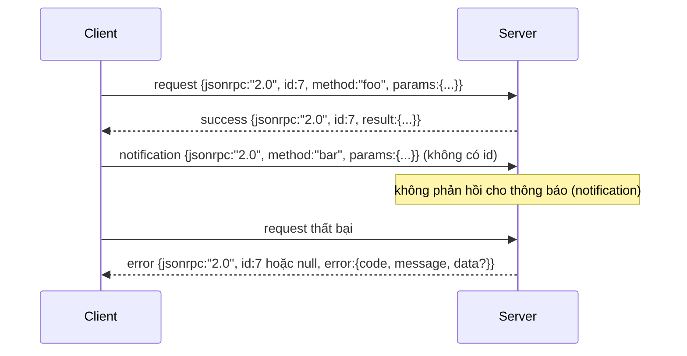

# JSON-RPC 2.0 qua Stdio Phân tách bằng Dòng mới (JSON-RPC 2.0 Over Newline-Delimited Stdio)

> Tầng truyền tải giữa một client mô hình và một server công cụ là JSON-RPC qua stdio. Việc tự tay xây dựng nó một lần sẽ dạy cho bạn biết mỗi tầng đóng khung (framing layer) đang giải quyết vấn đề gì và phải trả giá cho điều gì.

**Type:** Build
**Languages:** Python
**Prerequisites:** Phase 13 lessons 01-07, Phase 14 lesson 01
**Time:** ~90 phút

## Mục tiêu học tập
- Giao tiếp bằng giao thức JSON-RPC 2.0 được đóng khung dưới dạng JSON phân tách bằng dòng mới (newline-delimited JSON) qua stdin và stdout.
- Ánh xạ năm mã lỗi tiêu chuẩn (-32700, -32600, -32601, -32602, -32603) và thể hiện chúng với đúng ngữ nghĩa chuẩn mực.
- Phân biệt rõ các yêu cầu (requests), phản hồi (responses), thông báo (notifications) và các gói theo lô (batches) mà không tự ý bổ sung các khóa vỏ bọc (envelope keys) mới.
- Xử lý một lỗi phân tích cú pháp (parse error) trên từng dòng mà không làm ô nhiễm hay gián đoạn phần còn lại của luồng dữ liệu (stream).
- Xây dựng một kịch bản minh họa tự kết thúc sử dụng `io.BytesIO` để bài học có thể chạy mà không cần sinh tiến trình con (child process).

```figure
cf-jsonrpc-frames
```

## Tại sao JSON-RPC vẫn là ngôn ngữ chung (Lingua Franca)?

Một coding agent vào năm 2026 có thể phải giao tiếp với khoảng mười hai server công cụ trong một phiên duy nhất. Mỗi server là một tiến trình độc lập hoặc một đầu cuối (endpoint) từ xa. Định dạng truyền dữ liệu trên đường truyền (wire format) này đã được giữ nguyên không đổi kể từ năm 2013. JSON-RPC 2.0 chỉ là một tài liệu đặc tả dài vỏn vẹn hai trang. Nó tồn tại bền bỉ vì các giải pháp thay thế (gRPC, HTTP cho từng lệnh gọi, giao thức nhị phân tự tạo) đều áp đặt những đánh đổi mà JSON-RPC không có: chúng buộc phải chọn hoặc truyền phát liên tục (streaming), hoặc đóng lô (batching), hoặc bị gắn chặt vào tầng truyền tải (transport-coupling). JSON-RPC có tính đối xứng tuyệt vời trên stdio, sockets, websockets và HTTP; một client có thể điều khiển một server mà nó chưa từng tương tác trước đó miễn là cả hai đều tuân thủ đặc tả.

Bài học này xây dựng biến thể hoạt động trên stdio: JSON phân tách bằng dòng mới (newline-delimited JSON). Mỗi yêu cầu là một dòng. Mỗi phản hồi là một dòng. Ranh giới truyền tải chính là ký tự dòng mới `\n`.

## Cấu trúc gói tin trên đường truyền (The wire shape)

Tồn tại bốn dạng phong bì vỏ bọc (envelope shapes). Hai dạng do client gửi đi. Hai dạng do server phản hồi.



Một thông báo (notification) không có trường `id`. Server tuyệt đối không được phản hồi lại thông báo. Nếu server trả về phản hồi cho một notification, client sẽ không có cách nào gắn phản hồi đó vào vị trí gọi lệnh (call site). Quy tắc duy nhất này giúp cho logic đóng khung dữ liệu luôn đơn giản và rõ ràng.

Một lô (batch) là một mảng JSON chứa các request hoặc notification. Server sẽ phản hồi bằng một mảng các response theo thứ tự bất kỳ, tương ứng một-một cho mỗi mục không phải là notification. Nếu mọi mục trong batch đều là notification, server sẽ không gửi lại bất kỳ phản hồi nào.

## Năm mã lỗi tiêu chuẩn

```text
-32700  Parse error      Không thể phân tích cú pháp JSON
-32600  Invalid Request  Cấu trúc phong bì vỏ bọc không hợp lệ
-32601  Method not found Không tìm thấy phương thức
-32602  Invalid params   Tham số không hợp lệ
-32603  Internal error   Lỗi nội bộ
```

Các mã lỗi nằm trong khoảng từ -32000 đến -32099 được dành riêng cho các lỗi do server định nghĩa. Mọi mã lỗi khác là do ứng dụng tự quy định. Bài học này bám sát năm mã lỗi tiêu chuẩn. Nếu hàm xử lý của bạn ném ra ngoại lệ, tầng truyền tải sẽ đóng gói nó thành lỗi -32603 kèm theo tên lớp ngoại lệ nằm trong trường `data.exception`.

Lỗi phân tích cú pháp (parse error) có một quy tắc đặc biệt: trường `id` trong phản hồi sẽ mang giá trị `null`, bởi vì chuỗi yêu cầu chưa bao giờ được phân tích đủ sâu để trích xuất ra một id.

## Đóng khung dòng mới và bản demo BytesIO

Tầng truyền tải đọc từng dòng một. Một dòng là một chuỗi byte kéo dài đến và bao gồm ký tự `\n`. Nếu một dòng không thể phân tích cú pháp, tầng truyền tải sẽ ghi một phản hồi lỗi -32700 với `id: null` rồi tiếp tục vòng lặp. Luồng dữ liệu không hề bị nhiễm độc hay nghẽn tắc. Dòng tiếp theo sẽ được phân tích hoàn toàn mới.

Trong bài học này, chúng ta bọc một cặp `io.BytesIO` để đóng giả stdin và stdout. Server đọc các request cho đến khi gặp ký tự kết thúc tệp (EOF), ghi các phản hồi tương ứng cho từng yêu cầu, rồi trả về. Không cần sinh tiến trình mới (process spawn). Không cần cơ chế chờ quá hạn (timeouts). Hành vi của tầng truyền tải này giống hệt như một đường ống tiến trình con (subprocess pipe) thực thụ bởi vì giao diện `io` của Python tuân thủ cùng hợp đồng `.readline()` và `.write()`.

## Điều phối phương thức (Method dispatch)

Tầng truyền tải không cần biết những phương thức nào đang tồn tại. Nó chuyển giao quyền xử lý cho một hàm có thể gọi `handler(method, params)` do harness cung cấp. Hàm xử lý này sẽ trả về kết quả hoặc ném ngoại lệ. Ba lớp ngoại lệ sẽ được ánh xạ trực tiếp thành các mã lỗi cụ thể:

```text
MethodNotFound -> -32601
InvalidParams  -> -32602
Bất kỳ ngoại lệ nào khác -> -32603 với tên ngoại lệ trong data
```

Tầng truyền tải không bao giờ trực tiếp nhìn thấy sổ đăng ký công cụ (tool registry). Sổ đăng ký nằm ẩn sau handler. Đây chính là cấu trúc phân tầng mà chúng ta hướng tới: Tầng truyền tải nói ngôn ngữ JSON-RPC. Sổ đăng ký quản lý cấu trúc công cụ. Bộ điều phối (dispatcher trong bài học số 23) sẽ kết nối chúng lại với nhau.

## Hành vi của luồng khi gặp lỗi

```text
client gửi đi              server tiếp nhận         server phản hồi
---------------            -----------              -------------
{...valid request...}      phân tích ok             {...response, id khớp...}
{...broken json...         lỗi phân tích            {id:null, error: -32700}
{...valid request...}      phân tích ok             {...response, id khớp...}
{...missing method...}     vỏ bọc không hợp lệ      {id:X, error: -32600}
```

Một dòng JSON bị hỏng không làm dừng vòng lặp. Một trường `method` bị thiếu không làm dừng vòng lặp. Một ngoại lệ trong hàm xử lý không làm dừng vòng lặp. Tầng truyền tải tiếp tục đọc cho đến khi gặp EOF.

## Thông báo và luồng bất đối xứng (Notifications and asymmetric flows)

Một thông báo (notification) mang tính chất gửi-và-quên (fire-and-forget). Harness sử dụng các notification cho các sự kiện tiến độ, tín hiệu hủy bỏ và các dòng nhật ký (log lines). Notification là phương thức giúp một công cụ chạy lâu có thể truyền phát (stream) các cập nhật trạng thái mà không cần phải thực hiện một vòng lặp truy vấn-phản hồi hoàn chỉnh cho từng cập nhật.

Bài học triển khai một hàm trợ giúp ghi thông báo chiều đi: `write_notification`. Server sử dụng nó để phát ra tiến độ trong khi một yêu cầu đang được xử lý (in-flight). Kịch bản minh họa thể hiện mô hình này: một yêu cầu gửi đến, handler phát ra hai notification tiến độ, sau đó mới ghi phản hồi kết quả cuối cùng.

## Cách đọc mã nguồn

Tệp `code/main.py` định nghĩa `StdioTransport`, hàm trợ giúp phân tích cú pháp (`parse_request`), ba hàm trợ giúp ghi dữ liệu (`write_response`, `write_error`, `write_notification`), và vòng lặp điều phối `serve`. Các hằng số mã lỗi được khai báo ở phạm vi module.

Tệp `code/tests/test_transport.py` bao quát năm mã lỗi, các thông báo (không ghi phản hồi), các gói theo lô (mảng đầu vào, mảng đầu ra, bỏ qua các notification), chuỗi JSON hỏng (báo lỗi parse error rồi tiếp tục), và luồng bất đối xứng khi một handler ghi thông báo ở giữa chừng lệnh gọi.

## Đào sâu mở rộng (Going further)

Tầng truyền tải này là hoàn toàn đủ cho các bài học tiếp theo. Các tầng truyền tải trong môi trường sản xuất thường bổ sung ba yếu tố: Trường mã định danh tương quan (correlation ID) duy trì được qua các bước chuyển tiếp (trường `id` của bạn đã phục vụ điều này, nhưng trong một mạng lưới dịch vụ mesh bạn cần thêm một ID truy vết bên ngoài - trace ID). Một kênh hủy bỏ (một notification kiểu như `$/cancelRequest` mang theo id của lệnh gọi đang xử lý). Và một bước bắt tay thương lượng định dạng nội dung (content-type negotiation handshake) để cùng một socket có thể giao tiếp cả JSON-RPC lẫn HTTP có khả năng truyền phát (Streamable HTTP). Không có điều nào trong số đó làm thay đổi khuôn dạng gói tin trên đường truyền; chúng chỉ bổ sung thêm dữ liệu siêu dữ liệu (metadata).
