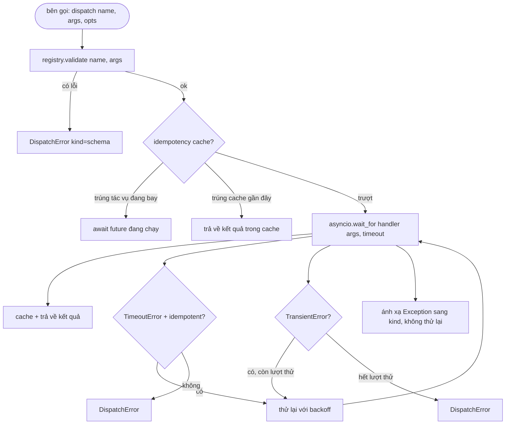

# Bộ điều phối Gọi hàm (Function Call Dispatcher)

> Bộ điều phối (dispatcher) là nơi harness hiện thực hóa và chịu trách nhiệm cho mọi cam kết mà lược đồ (schema) đã đưa ra. Thời gian chờ (timeouts), thử lại (retries), khử trùng lặp (dedupe), ánh xạ lỗi. Tất cả hội tụ tại một mối nối duy nhất.

**Type:** Build
**Languages:** Python
**Prerequisites:** Phase 13 lessons 01-07, Phase 14 lesson 01
**Time:** ~90 phút

## Mục tiêu học tập
- Bọc một hàm xử lý công cụ (tool handler) trong một giới hạn thời gian chờ theo từng lượt gọi (per-call timeout) để trả về một lỗi định kiểu thay vì làm treo cứng vòng lặp.
- Áp dụng chiến lược thử lại lùi thời gian theo cấp số nhân kèm nhiễu ngẫu nhiên (exponential backoff retry with jitter) cùng giới hạn số lần thử tối đa.
- Khử trùng lặp (deduplicate) các lần thử lại dựa trên khóa bất biến lũy thừa (idempotency key) để một lần thử lại chạy đua với một lệnh ban đầu bị chậm không bị kích hoạt hai lần.
- Ánh xạ các ngoại lệ từ hàm xử lý và các sự cố tầng truyền tải vào một vỏ bọc lỗi duy nhất (error envelope) mà vòng lặp harness đã hiểu rõ.
- Giới hạn việc điều phối song song bằng ngưỡng đồng thời (concurrency limit) để một đợt bùng nổ phân nhánh (fan-out) bốn mươi lệnh gọi công cụ không làm kiệt quệ vòng lặp sự kiện (event loop).

```figure
cf-dispatch-retry
```

## Vị trí của bộ điều phối

Bộ điều phối nằm giữa vòng lặp harness (bài học số 20) và sổ đăng ký công cụ (bài học số 21). Tầng truyền tải (bài học số 22) cung cấp dữ liệu cho vòng lặp. Vòng lặp chuyển lệnh gọi công cụ cho bộ điều phối. Bộ điều phối truy vấn sổ đăng ký, thực thi hàm xử lý và trả về kết quả thành công hoặc một vỏ bọc lỗi có cấu trúc chuẩn mực dạng JSON-RPC.

```mermaid
flowchart TD
    loop[vòng lặp harness]
    disp[bộ điều phối (dispatcher)]
    reg[sổ đăng ký công cụ]
    handler[hàm xử lý (handler)]
    loop --> disp
    disp -->|get name| reg
    disp -->|validate args| reg
    disp -->|asyncio.wait_for handler args timeout| handler
    handler -->|thành công| disp
    handler -->|TimeoutError -> retry hoặc fail| disp
    handler -->|Exception -> ánh xạ sang mã lỗi| disp
    disp -->|kết quả Ok hoặc DispatchError| loop
```

Bộ điều phối là tầng duy nhất nắm bắt thông tin về bộ định thời (timers), cơ chế thử lại (retries) và tính bất biến lũy thừa (idempotency). Vòng lặp không cần biết. Sổ đăng ký không cần biết. Hàm xử lý cũng không cần biết. Sự cô lập rành mạch này chính là mục tiêu cốt lõi.

## Thời gian chờ quá hạn (Timeouts)

Mỗi công cụ có một khoảng thời gian chờ mặc định. Bản ghi trong sổ đăng ký chứa trường `timeout_ms`. Bộ điều phối có thể ghi đè giá trị này nếu harness truyền vào một mức ghi đè riêng cho từng lệnh gọi. Chúng ta sử dụng `asyncio.wait_for`. Khi quá thời gian chờ, tác vụ của hàm xử lý sẽ bị hủy bỏ (cancelled) và bộ điều phối trả về `DispatchError(kind="timeout")`.

Theo mặc định, timeout không phải là một lỗi có thể thử lại đối với các công cụ không có tính bất biến lũy thừa (non-idempotent). Một lệnh `db.write` bị timeout có thể đã được commit vào cơ sở dữ liệu hoặc chưa. Việc thử lại một cách mù quáng có nguy cơ nhân bản thao tác ghi. Bộ điều phối tôn trọng cờ `idempotent` từ bản ghi của sổ đăng ký. Các công cụ có tính bất biến lũy thừa sẽ được thử lại; các công cụ không có tính chất này sẽ dừng lại ngay lập tức.

## Thử lại với lùi thời gian cấp số nhân (Retries with exponential backoff)

Chính sách thử lại quy định tối đa ba lần thử. Thời gian chờ lùi tăng theo cấp số nhân kèm theo độ trễ ngẫu nhiên (jitter):

```text
lần thử 1  -> độ trễ 0
lần thử 2  -> độ trễ 0.1s * (1 + random[0..0.5])
lần thử 3  -> độ trễ 0.4s * (1 + random[0..0.5])
```

Chỉ các lỗi thuộc loại `timeout` và `transient` (lỗi tạm thời) mới được phép thử lại. Một lỗi `schema`, một lỗi `not_found`, hoặc một lỗi `internal` sẽ không được thử lại. Các lỗi lược đồ (schema errors) có tính tất định: việc thử lại không làm thay đổi kết quả mà chỉ lãng phí ngân sách phiên chạy.

Vòng lặp thử lại luôn tôn trọng ngân sách do harness cung cấp. Nếu ngân sách của bên gọi chỉ còn lại 0 lượt gọi công cụ, bộ điều phối sẽ báo lỗi ngay lập tức ở lần thử đầu tiên (fail fast) và trả về `kind="budget_exceeded"`.

## Khử trùng lặp bằng khóa bất biến lũy thừa (Idempotency key dedupe)

Một lần thử lại được kích hoạt trong khi lệnh gọi ban đầu vẫn đang được xử lý (in-flight) là một lỗi thường gặp trong môi trường sản xuất. Lệnh gọi đầu tiên bị treo ở mốc 4.9 giây (ngay dưới ngưỡng timeout). Lần thử lại được kích hoạt ở giây thứ 5. Khi đó hai yêu cầu sẽ chạy đua cùng lúc với nhau trên cùng một dịch vụ hạ tầng (backend). Nếu công cụ đó là `payments.charge`, tài khoản của khách hàng sẽ bị trừ tiền hai lần.

Bộ điều phối chấp nhận một tham số tùy chọn là `idempotency_key`. Nếu một khóa tương tự đang trong quá trình thực thi khi có một lệnh gọi mới gửi đến, bộ điều phối sẽ chờ đợi đối tượng future đang chạy đó và trả về kết quả của nó. Bộ nhớ cache lưu giữ các khóa này trong vòng 60 giây sau khi hoàn tất để hấp thụ các lần thử lại đến muộn.

Khóa này thuộc trách nhiệm của bên gọi. Harness suy dẫn nó từ bộ lập kế hoạch: `f"{step_id}:{tool_name}:{hash(args)}"`. Bộ điều phối không tự sinh khóa, bởi vì việc suy dẫn khóa chỉ dựa trên các đối số đơn thuần có thể làm cho hai lệnh gọi mang ngữ nghĩa hoàn toàn khác nhau trông giống hệt nhau.

## Vỏ bọc lỗi (Error envelope)

Một lượt điều phối thất bại sẽ trả về một cấu trúc đồng nhất:

```text
DispatchError
  kind        : "timeout" | "transient" | "schema" | "not_found" | "internal" | "budget_exceeded"
  message     : str
  attempts    : int
  jsonrpc_code: int   (một trong các mã -32601, -32602, -32603)
```

Vòng lặp harness ánh xạ `kind` sang trạng thái tiếp theo của máy trạng thái: `schema` và `not_found` chuyển đến `on_error` và kích hoạt việc lập lại kế hoạch (replan). `timeout` và `transient` chuyển đến `on_error` và có thể kích hoạt hoặc không kích hoạt lập lại kế hoạch tùy thuộc vào số lần đã thử. `budget_exceeded` sẽ kích hoạt `on_budget_exceeded`.

## Giới hạn đồng thời khi mở rộng nhánh (Concurrency limit on fan-out)

Lệnh gọi `gather(*calls)` thực thi tất cả các coroutine cùng một lúc. Với bốn mươi lệnh gọi công cụ, điều đó tương đương với bốn mươi socket mở đồng thời hoặc bốn mươi đường ống tiến trình con. Hầu hết các hệ thống backend đều không mong muốn nhận bốn mươi kết nối song song từ một client duy nhất.

Bộ điều phối bọc lệnh `gather` bên trong một cờ hiệu kiểm soát đồng thời (semaphore). Giới hạn đồng thời mặc định là tám. Mỗi lệnh gọi phải chiếm được semaphore trước khi điều phối và giải phóng nó ngay khi hoàn tất. Bên gọi vẫn nhận được dữ liệu đầu ra dạng `gather`, nhưng lịch trình thực thi thực tế đã được giới hạn an toàn.

## Luồng xử lý cho một lệnh gọi đơn lẻ



## Cách đọc mã nguồn

Tệp `code/main.py` định nghĩa `Dispatcher`, `DispatchError` và `TransientError`. Bộ điều phối nhận một sổ đăng ký khi khởi tạo. Phương thức bất đồng bộ `dispatch(name, args, ...)` là điểm vào duy nhất. Thời gian chờ cho từng lần thử được áp dụng trực tiếp bên trong `_run_with_retries` bằng `asyncio.wait_for`. Hàm `gather_bounded(calls)` chạy nhiều lượt điều phối dưới sự kiểm soát của ngưỡng giới hạn đồng thời.

Tệp `code/tests/test_dispatcher.py` bao quát việc kích hoạt timeout, thử lại khi gặp lỗi tạm thời (transient), không thử lại khi lỗi lược đồ (schema error), khử trùng lặp qua tính bất biến lũy thừa (hai lệnh gọi đồng thời cùng khóa thu gọn thành một lần thực thi handler), và giới hạn đồng thời (semaphore hoạt động trong thực tế).

Các bài kiểm thử sử dụng `asyncio.sleep(0)` cùng các handler dựa trên `Counter` có tính tất định, giúp chúng hoàn thành trong vài mili giây mà không phụ thuộc vào thời gian đồng hồ thực tế.

## Đào sâu mở rộng (Going further)

Có hai phần mở rộng mà các bộ điều phối thực tế thường bổ sung thêm: Thứ nhất, ghi nhật ký có cấu trúc (structured logging) tại mỗi lần chuyển trạng thái (vốn đã được luồng sự kiện của vòng lặp hỗ trợ, nhưng bộ điều phối cũng nên phát ra thêm các sự kiện `dispatch.attempt` và `dispatch.retry`). Thứ hai, cơ chế ngắt mạch (circuit breakers): sau $N$ lần thất bại liên tiếp trong một khung thời gian, một công cụ sẽ bước vào giai đoạn hạ nhiệt (cool-down period), tại đó các lệnh điều phối sẽ lập tức trả về `kind="circuit_open"` thay vì tiếp tục cố gắng gọi hàm xử lý. Cả hai tính năng này đều có thể tích hợp liền mạch lên trên bộ điều phối này mà không làm thay đổi hợp đồng giao tiếp.

Bài học số 24 sẽ kết nối bộ điều phối với một agent lập kế hoạch và thực thi (plan-and-execute agent) để bạn chứng kiến cả bốn mảnh ghép phối hợp nhịp nhàng trong thực tế.
