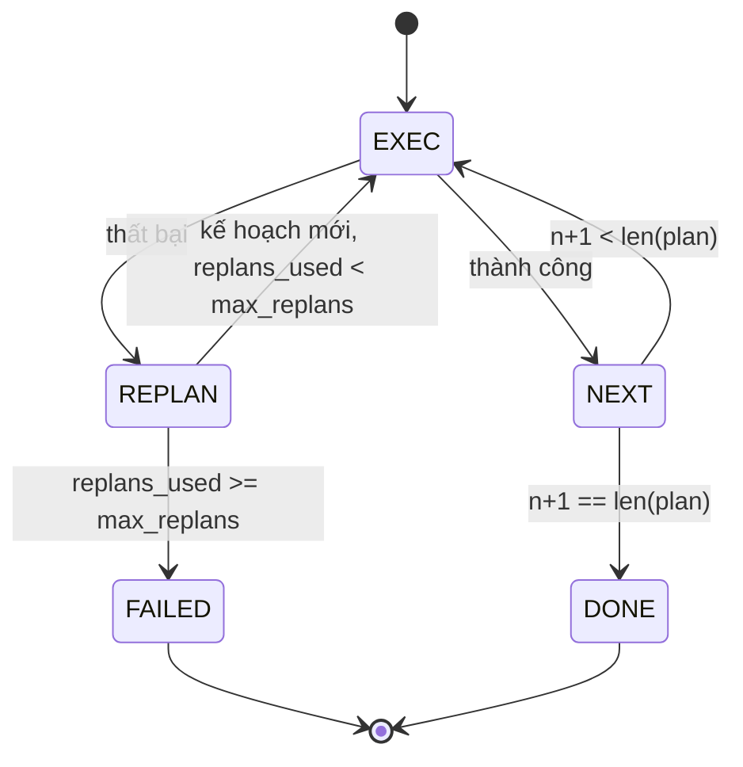

# Luồng Điều khiển Lập kế hoạch và Thực thi (Plan-Execute Control Flow)

> Một kế hoạch không thể trụ vững trước một thất bại chỉ là một kịch bản (script). Một kịch bản có khả năng tái lập kế hoạch (replan) mới thực sự là một agent. Hãy xây dựng bộ tái lập kế hoạch trước tiên.

**Type:** Build
**Languages:** Python
**Prerequisites:** Phase 13 lessons 01-07, Phase 14 lesson 01
**Time:** ~90 phút

## Mục tiêu học tập
- Biểu diễn một kế hoạch dưới dạng một danh sách các bước định kiểu có thứ tự để bộ thực thi (executor) có thể suy luận về tiến độ và kết quả.
- Thực thi các bước một cách tuần tự với cơ chế bàn giao thất bại có kiểm soát quay trở lại cho bộ lập kế hoạch (planner).
- Tái lập kế hoạch (replan) từ vị trí con trỏ hiện tại với lỗi trước đó được đưa vào ngữ cảnh nhằm giúp kế hoạch tiếp theo nắm bắt đầy đủ thông tin.
- Phát ra bản so khớp khác biệt kế hoạch (plan diff) tại mỗi lần sửa đổi để bộ truy vết hoặc UI phía hạ nguồn có thể hiển thị lý do kế hoạch thay đổi.
- Thực thi hai giới hạn ngân sách cứng: trần số bước thực thi tối đa và trần số lần tái lập kế hoạch tối đa.

```figure
cg-plan-replan
```

## Lập kế hoạch và thực thi, không phải chuỗi suy nghĩ tự do

Một agent theo phong cách chuỗi suy nghĩ (chain-of-thought) sẽ phát ra các token liên tục và phó mặc cho vòng lặp phỏng đoán xem lệnh gọi công cụ kết thúc ở đâu. Ngược lại, một agent lập kế hoạch và thực thi (plan-and-execute agent) sẽ phát ra một kế hoạch có cấu trúc trước tiên, sau đó thực thi từng bước một cách tất định. Kế hoạch ở đây là dữ liệu mà harness có thể nội quan (introspect). Quá trình thực thi là việc harness chạy dữ liệu đó thông qua một bộ điều phối (dispatcher).

Kiến trúc này gồm hai phần: Bộ lập kế hoạch (planner) tạo ra kế hoạch. Bộ thực thi (executor) vận hành kế hoạch đó. Điểm cốt lõi đáng chú ý nhất là điều gì sẽ xảy ra khi bộ thực thi gặp thất bại. Có ba lựa chọn:

```text
1. Abort         (hủy bỏ: báo thất bại và đưa lỗi lên tầng trên)
2. Skip          (bỏ qua: đánh dấu bước đó thất bại, tiếp tục các bước còn lại)
3. Replan        (tái lập kế hoạch: bàn giao lỗi cho bộ lập kế hoạch, lấy kế hoạch mới từ con trỏ hiện tại)
```

Tái lập kế hoạch (replan) chính là cơ chế biến một kịch bản thông thường thành một agent thông minh.

## Cấu trúc của một bước (Step)

```text
Step
  id              : int           (đơn điệu tăng trong một bản sửa đổi kế hoạch)
  tool_name       : str
  args            : dict
  expected_outcome: str           (điều kiện thành công do planner công bố)
  result          : Any | None
  error           : str | None
```

`expected_outcome` là một câu ngắn gọn mà planner phát ra cùng với bước thực hiện. Nó không bị ép buộc thực thi bởi executor. Nó phục vụ hai mục đích: bộ tái lập kế hoạch sẽ đọc nó khi sửa đổi kế hoạch; và luồng sự kiện sẽ phát nó ra để bộ truy vết có thể hiển thị "bước này dự kiến sẽ đạt được X".

## Cấu trúc của bộ lập kế hoạch (Planner)

```python
def planner(goal: str, history: list[Step], last_error: str | None) -> list[Step]:
    ...
```

Đây là một hàm thuần khiết (pure function). `goal` là mục tiêu của người dùng. `history` là danh sách các bước đã được thực thi (đã được điền đầy đủ kết quả và lỗi). `last_error` mang giá trị `None` ở lệnh gọi đầu tiên và là thông điệp thất bại gần nhất ở mọi lệnh gọi tiếp theo. Bộ lập kế hoạch sẽ trả về kế hoạch tiếp theo bắt đầu từ vị trí con trỏ hiện tại.

Bộ lập kế hoạch không cần biết về bộ thực thi. Nó không cần biết về cơ chế thử lại. Nó không cần biết về thời gian chờ (timeouts). Nhiệm vụ duy nhất của nó là tạo ra kế hoạch.

## Bộ thực thi (Executor)

Bộ thực thi là một máy trạng thái nhỏ gọn. Mỗi bước được thực thi thông qua bộ điều phối. Kết quả trả về là một trong ba khả năng: thành công, thất bại-có-thể-tái-lập-kế-hoạch, hoặc thất bại-chí-mạng. Các thất bại có thể tái lập kế hoạch sẽ được bàn giao lại cho planner. Các thất bại chí mạng (vượt ngân sách, chạm trần tái lập kế hoạch) sẽ trả về kết quả phiên `FAILED`.



## So khớp khác biệt kế hoạch khi sửa đổi (Plan diffs on revision)

Khi bộ lập kế hoạch trả về một kế hoạch mới sau một thất bại, bộ thực thi sẽ phát ra sự kiện `plan.diff` với ba trường dữ liệu:

```text
removed: danh sách ID các bước có trong kế hoạch cũ nhưng không có trong kế hoạch mới
added  : danh sách ID các bước có trong kế hoạch mới mà không có trong kế hoạch cũ
revised: danh sách ID các bước bị thay đổi tool_name hoặc args
```

Bộ truy vết hoặc giao diện người dùng có thể kết xuất trực quan thông tin này bằng cách gạch ngang các bước bị loại bỏ và làm nổi bật các bước mới được thêm vào. Điểm mấu chốt không nằm ở định dạng so khớp, mà ở chỗ việc sửa đổi kế hoạch là một sự kiện minh bạch, có thể quan sát được, chứ không phải một sự viết lại âm thầm.

## Hai giới hạn ngân sách cứng

`max_steps` giới hạn tổng số bước thực thi trong toàn bộ phiên, bao gồm cả các lần tái lập kế hoạch. Mặc định là mười hai. Các lần thử thất bại cũng được tính vào đây. Một kế hoạch gồm năm bước thất bại ở bước cuối cùng đã tiêu tốn năm lượt thực thi. Nếu mỗi lần tái lập kế hoạch thử lại bước đó và bổ sung thêm ba bước mới, và bước cuối cùng của bản sửa đổi đầu tiên lại tiếp tục thất bại, tổng số lượt đã là chín, và bản sửa đổi thứ hai cần thêm bốn bước nữa: tổng cộng mười ba. Bộ thực thi sẽ chạy bước thứ mười hai, từ chối bước thứ mười ba và trả về `FAILED` với lý do `step_budget`.

`max_replans` giới hạn số lần bộ lập kế hoạch được gọi lại sau bản kế hoạch đầu tiên. Mặc định là năm. Đây là giới hạn quan trọng hơn. Một bộ lập kế hoạch liên tục trả về cùng một kế hoạch hỏng năm lần liên tiếp nếu không có giới hạn này sẽ bị lặp vô tận cho đến khi chạm trần ngân sách bước. Việc giới hạn số lần tái lập kế hoạch giúp phát hiện thất bại nhanh hơn và đưa ra lý do rõ ràng hơn.

## Bộ lập kế hoạch tất định trong bài học này

Chúng ta không gọi một mô hình ngôn ngữ lớn trong bài học này. Bài học cung cấp một bộ lập kế hoạch tất định (deterministic planner) lựa chọn kế hoạch dựa trên `last_error`:

```text
last_error is None    -> phát ra kế hoạch bốn bước
last_error khớp với X -> phát ra kế hoạch ba bước đi vòng qua lỗi X
last_error khớp với Y -> phát ra kế hoạch hai bước dừng lại một cách êm thấm
trường hợp khác       -> trả về [] (báo hiệu không còn gì để tái lập kế hoạch)
```

Cấu trúc này là đủ để kiểm thử toàn diện hành vi của bộ thực thi trên mọi lộ trình chuyển trạng thái: thành công, tái lập kế hoạch một lần, tái lập kế hoạch hai lần, cạn kiệt số lần tái lập kế hoạch, và cạn kiệt ngân sách bước thực thi.

## Cấu trúc kết quả (Result shape)

```text
SessionResult
  status      : "completed" | "failed"
  reason      : str     ("goal_met" | "step_budget" | "replan_budget" | "no_plan")
  history     : list[Step]
  revisions   : list[PlanDiff]
  events      : list[Event]
```

Vòng lặp harness từ bài học số 20 có thể trực tiếp đọc cấu trúc này. Bộ điều phối từ bài học số 23 là thành phần thực thi từng bước. Sổ đăng ký từ bài học số 21 xác thực các đối số của từng bước. Tầng truyền tải từ bài học số 22 sẽ công bố toàn bộ luồng hoạt động này qua JSON-RPC tới một client mô hình.

## Cách đọc mã nguồn

Tệp `code/main.py` định nghĩa `PlanExecuteAgent`, `Step`, `PlanDiff`, `SessionResult`, và bộ lập kế hoạch tất định. Bộ thực thi là một phương thức duy nhất `run(goal)` trả về `SessionResult`. Bản so khớp kế hoạch (plan diff) được tính toán bằng cách so sánh ID của các bước và các bộ dữ liệu `(tool_name, args)`.

Tệp `code/tests/test_agent.py` bao quát trường hợp thành công tuyến tính, thất bại ở giữa kế hoạch rồi tái lập kế hoạch thành công, cạn kiệt số lần tái lập kế hoạch trả về `failed:replan_budget`, cạn kiệt ngân sách bước thực thi, và định dạng sự kiện plan-diff.

## Đào sâu mở rộng (Going further)

Có hai phần mở rộng bạn sẽ muốn bổ sung khi kết nối hệ thống này với một mô hình thực tế: Thứ nhất, lưu bộ nhớ đệm kế hoạch cục bộ (partial-plan caching): khi một kế hoạch chạy thành công ba trên sáu bước rồi mới gặp lỗi, bạn không muốn chạy lại ba bước đầu tiên. Bộ thực thi đã lưu giữ lịch sử (`history`); bộ lập kế hoạch chỉ cần đọc lại nó. Thứ hai, các nhánh chạy song song (parallel branches): bộ thực thi hiện tại hoạt động hoàn toàn tuần tự. Một bộ lập kế hoạch phát ra một nhánh độc lập (`gather_step` thay vì `next_step`) có thể kích hoạt hai lệnh gọi công cụ đồng thời thông qua bộ điều phối.

Cả hai tính năng đều bổ sung độ phức tạp đáng kể. Cả hai đều sẽ dễ dàng triển khai hơn nhiều một khi bộ thực thi tuyến tính đã được kiểm chứng và đóng băng vững chắc. Đó chính là những gì bài học này mang lại.
