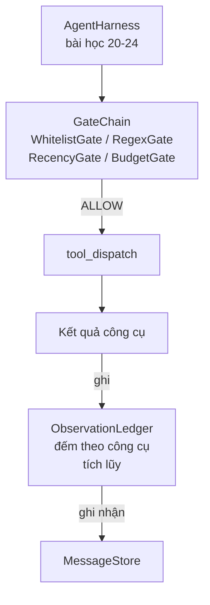

# Bài học Đỉnh cao 25: Cổng Xác minh và Ngân sách Quan sát (Verification Gates and the Observation Budget)

> Một agent harness mà không có tầng xác minh chẳng khác nào một lời cầu may được ngụy trang cẩu thả. Bài học này xây dựng chuỗi cổng xác minh tất định (deterministic gate chain) nhằm quyết định xem một lệnh gọi công cụ có được phép kích hoạt hay không, agent được phép nhìn thấy bao nhiêu phần kết quả đầu ra của nó, và khi nào vòng lặp buộc phải dừng lại vì agent đã đọc quá nhiều dữ liệu. Chuỗi này là một hàm kết hợp giữa các cổng nhỏ có định danh rõ ràng cùng một sổ cái quan sát (observation ledger) theo dõi từng token mà mô hình đã tiếp nhận.

**Type:** Build
**Languages:** Python (stdlib)
**Prerequisites:** Phase 19 · 20-24 (Track A1: agent loop, tool registry, message store, prompt builder, model router), Phase 14 · 33 (instructions as constraints), Phase 14 · 36 (scope contracts), Phase 14 · 38 (verification gates)
**Time:** ~90 phút

## Mục tiêu học tập

- Xây dựng một giao thức `VerificationGate` với phương thức `evaluate(call)` có tính tất định.
- Kết hợp các cổng ngân sách (budget), tính gần đây (recency), danh sách trắng (whitelist) và biểu thức chính quy (regex) thành một chuỗi với ngữ nghĩa ngắt sớm (short-circuit semantics).
- Theo dõi mọi quan sát thông qua một sổ cái `ObservationLedger` được đánh chỉ mục theo công cụ và lượt (turn).
- Từ chối một lệnh gọi công cụ khi ngân sách quan sát tích lũy (cumulative observation budget) bị vượt ngưỡng.
- Xuất bản ghi `GateDecision` có cấu trúc để hệ thống đo kiểm khả năng quan sát (observability) phía hạ nguồn có thể dễ dàng tiếp nhận.

## Vấn đề thực tế (The Problem)

Khi một agent harness cho phép mô hình gọi công cụ một cách tự do không kiểm soát, ba nhóm lỗi kinh điển sẽ xuất hiện chỉ trong vòng một giờ sử dụng thực tế đầu tiên.

Thứ nhất là quan sát không giới hạn (unbounded observation). Một lệnh `grep` quét qua một kho mã nguồn 200.000 dòng có thể xả nửa triệu token đầu ra vào lượt tiếp theo. Mô hình chỉ tìm thấy một kết quả khớp trên mỗi kilobyte dữ liệu và toàn bộ phần còn lại của cửa sổ ngữ cảnh bị lãng phí hoàn toàn. Chi phí token tăng vọt và agent trở nên kém cỏi hơn, thay vì thông minh hơn, trong việc hoàn thành tác vụ.

Thứ hai là sự lạc hậu về tính mới (stale recency). Một tác vụ chạy dài tích lũy năm mươi lệnh gọi công cụ. Mô hình đọc lại kết quả `read_file` đầu tiên từ lượt thứ ba như thể đó là trạng thái hiện hành theo thời gian thực. Các chỉnh sửa được thực hiện ở lượt thứ bốn mươi bảy không bao giờ hiển thị vì bộ xây dựng prompt (prompt builder) đã tuần tự hóa các quan sát sớm nhất lên đầu.

Thứ ba là hiện tượng leo thang đặc quyền âm thầm (privilege creep). Một tác vụ nghiên cứu bắt đầu bằng việc gọi `web_search`, nhưng sau đó bằng cách nào đó lại chuyển sang chạy lệnh `shell` vì mô hình tự bịa ra một tên công cụ mới và harness lại mặc định ở chế độ dễ dãi (permissive). Đến khi có người đọc nhật ký truy vết (trace), một tệp rác đã nằm chễm chệ trong thư mục `/tmp` và một lệnh `curl` đã được bắn thẳng vào một API nội bộ.

Cổng xác minh (verification gate) là thành phần của harness chịu trách nhiệm nói "KHÔNG". Nó không phải là một mô hình AI. Nó không phải là một giám khảo cảm tính. Nó là một hàm toán học tất định nhận vào `(call, history, ledger)` và trả về `ALLOW` (cho phép) hoặc `DENY` (từ chối) kèm theo lý do cụ thể. Lý do được ghi nhật ký. Mô hình được thông báo. Vòng lặp tiếp tục hoặc hủy bỏ.

## Khái niệm cốt lõi (The Concept)

```mermaid
flowchart LR
  Call[tool_call] --> Chain[Chuỗi cổng (Gate chain)]
  Chain -->|ALLOW| Dispatch[điều phối công cụ]
  Chain -->|DENY| Reason[lý do từ chối]
  Reason --> Store[nối thêm vào kho thông điệp]
  Reason --> Refusal[tăng biến đếm refusal_count]
  Reason --> Loop[vòng lặp tiếp tục<br/>hoặc dừng tại ngưỡng]
```

Một cổng (gate) là bất kỳ đối tượng nào sở hữu phương thức `evaluate(call, ctx) -> GateDecision`. Chuỗi cổng là một danh sách có thứ tự. Quá trình đánh giá áp dụng cơ chế ngắt sớm (short-circuit) ngay ở quyết định từ chối đầu tiên. Thứ tự sắp xếp là vô cùng quan trọng: các cổng kiểm tra cấu trúc có chi phí tính toán rẻ phải chạy trước các cổng đếm token tốn kém tài nguyên.

Bài học này xây dựng bốn cổng:

- `WhitelistGate`. Danh sách tên công cụ được phép là một tập hợp tường minh. Bất kỳ công cụ nào nằm ngoài danh sách đều bị từ chối. Đây là cổng có chi phí thấp nhất và luôn chạy đầu tiên.
- `RegexGate`. Các đối số của công cụ được so khớp với một biểu thức chính quy (regex). Hữu ích cho việc từ chối các lệnh gọi shell chứa `rm -rf`, hoặc các lệnh HTTP hướng tới dải IP nội bộ. Hoạt động thuần khiết trên tải trọng (payload) của lệnh gọi.
- `RecencyGate`. Mô hình chỉ được nhìn thấy các quan sát từ $N$ lượt gần nhất. Các quan sát cũ hơn sẽ bị che khuất (masked). Cổng này từ chối một lệnh gọi công cụ nếu kết quả của nó kéo dài một cửa sổ quan sát đã quá hạn.
- `BudgetGate`. Tổng số token tích lũy mà mô hình đã đọc trong suốt phiên có một mức trần cố định. Khi sổ cái báo hiệu đã chạm trần, mọi lệnh gọi công cụ tiếp theo đều bị từ chối thẳng thừng.

Sổ cái quan sát (observation ledger) đóng vai trò ghi chép kế toán. Mỗi lệnh gọi công cụ thành công sẽ ghi một dòng: tên công cụ, lượt chạy, số token phát ra, và số token tích lũy. Sổ cái trả lời hai câu hỏi: mô hình đã nhìn thấy tổng cộng bao nhiêu, và nó đã nhìn thấy bao nhiêu từ công cụ $X$. Cổng ngân sách đọc câu trả lời thứ nhất. Cổng ngân sách cho từng công cụ (mà bạn sẽ tự viết như một bài tập) sẽ đọc câu trả lời thứ hai.

```figure
cg-gate-chain
```

## Kiến trúc (Architecture)



Harness sẽ truy vấn chuỗi cổng. Chuỗi cổng sẽ gật đầu chấp thuận hoặc từ chối. Nếu chấp thuận, công cụ được thực thi, sổ cái tăng chỉ số, và kết quả được nối thêm vào kho lưu trữ thông điệp (message store). Nếu từ chối, mô hình nhận thông báo từ chối dưới dạng một tin nhắn hệ thống (system message) và vòng lặp sẽ quyết định thử lại hay hủy bỏ phiên.

## Những gì bạn sẽ xây dựng

Phần triển khai bao gồm một tệp `main.py` duy nhất kèm theo các bài kiểm thử:

1. Các dataclass `Observation` và `ToolCall` định nghĩa khuôn dạng dữ liệu trên đường truyền.
2. `ObservationLedger` ghi lại các dòng dữ liệu `(turn, tool, tokens)` và trả lời lời gọi `cumulative()` cũng như `per_tool(name)`.
3. `GateDecision` mang bộ dữ liệu `(allow, reason, gate_name)`.
4. `VerificationGate` là giao thức giao diện (protocol). Mỗi cổng triển khai `evaluate(call, ctx)`.
5. `GateChain` bao bọc một danh sách có thứ tự. Nó gọi từng cổng, trả về lệnh từ chối đầu tiên bắt gặp, hoặc trả về cho phép nếu tất cả các cổng đều vượt qua.
6. Kịch bản minh họa chạy một vòng lặp agent tổng hợp thu nhỏ gồm ba lượt. Lượt thứ ba chạm trần cổng ngân sách và vòng lặp báo cáo một quyết định từ chối rõ ràng kèm theo số lần từ chối khác không.

Bộ đếm token ở đây cố ý sử dụng thuật toán phỏng đoán đơn giản `len(text) // 4`. Mục đích của bài học là kiến trúc đường ống của các cổng, không phải bộ tách từ (tokenizer). Trong môi trường sản xuất, bạn chỉ cần thay thế bằng một tokenizer thực thụ.

## Tại sao thứ tự trong chuỗi lại quan trọng?

Một quyết định từ chối (deny) có chi phí xử lý rẻ hơn một quyết định cho phép (allow). `WhitelistGate` chạy với chi phí tra cứu bảng băm $O(1)$. `RegexGate` chạy trong $O(\text{pattern} \cdot \text{argv})$. `RecencyGate` đọc một lát cắt nhỏ của kho lưu trữ thông điệp. `BudgetGate` đọc toàn bộ sổ cái. Bạn cần sắp xếp chúng theo thứ tự chi phí tăng dần để một lệnh gọi bị từ chối sẽ ngắt sớm trước khi phải thực hiện các phép toán nặng nề.

Bạn cũng cần sắp xếp chúng theo bán kính ảnh hưởng (blast radius). Danh sách trắng là khẳng định mạnh mẽ nhất: công cụ này hoàn toàn không nằm trong thỏa ước. Cổng biểu thức chính quy đứng tiếp theo: đối số này vi phạm quy tắc. Cổng tính mới đứng sau: harness vẫn quan tâm nhưng lệnh gọi về mặt cấu trúc là hợp lệ. Cổng ngân sách đứng cuối cùng vì theo định nghĩa, nó chỉ được kích hoạt khi mọi kiểm tra khác đều đã vượt qua thành công.

## Mối liên kết với phần còn lại của Track A

Các bài học trước đã trang bị cho bạn vòng lặp, sổ đăng ký công cụ, kho thông điệp, bộ dựng prompt và bộ định tuyến mô hình. Bài học này bổ sung tầng kiểm soát nằm giữa mô hình và các công cụ. Bài học số 26 sẽ cung cấp hộp cát (sandbox) nơi bộ điều phối chuyển giao lệnh gọi công cụ sau khi chuỗi cổng đưa ra quyết định `ALLOW`. Bài học số 27 sẽ phát hành khung đánh giá (eval harness) ghi nhận số lần từ chối làm tín hiệu chất lượng. Bài học số 28 sẽ gắn kết các quyết định của cổng vào các span OpenTelemetry. Bài học số 29 sẽ ráp nối tất cả thành một coding agent hoàn chỉnh trong thực tế.

## Chạy thử nghiệm

```bash
cd phases/19-capstone-projects/25-verification-gates-observation-budget
python3 code/main.py
python3 -m pytest code/tests/ -v
```

Bản demo sẽ in ra dấu vết thực thi qua từng lượt bao gồm mọi quyết định của cổng và thoát với mã 0. Các bài kiểm thử bao quát sổ cái, từng cổng độc lập, cơ chế ngắt sớm của chuỗi, và vòng lặp tổng hợp từ đầu đến cuối.
