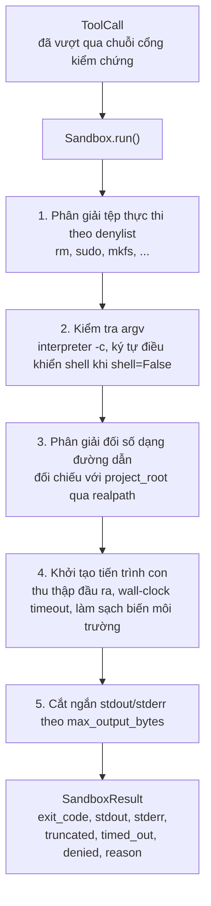
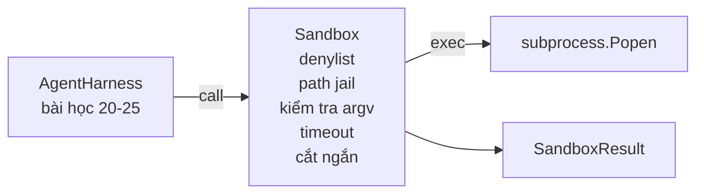

# Bài học Capstone 26: Sandbox Runner với Danh sách đen (Denylist) và Cơ chế giam đường dẫn (Path Jail)

> Cổng kiểm chứng (verification gate) quyết định xem một lệnh gọi công cụ (tool call) có được phép chạy hay không. Cơ chế cách ly (sandbox) quyết định điều gì sẽ xảy ra khi nó được thực thi. Bài học này xây dựng một bộ thực thi tiến trình con (subprocess runner) có khả năng từ chối các tệp thực thi nguy hiểm, từ chối các cấu trúc argv nguy hiểm, giam giữ mọi đường dẫn tệp trong thư mục gốc của dự án (project root), cắt ngắn đầu ra vượt kích thước và tiêu diệt các tiến trình chạy quá thời gian giới hạn theo đồng hồ thực tế (wall-clock timeout). Đây là lớp bảo vệ thứ hai trong hai lớp nằm giữa mô hình và hệ điều hành.

**Loại:** Xây dựng (Build)
**Ngôn ngữ:** Python (thư viện chuẩn - stdlib)
**Điều kiện tiên quyết:** Phase 19 · 25 (cổng kiểm chứng và ngân sách quan sát), Phase 14 · 33 (chỉ dẫn đóng vai trò ràng buộc), Phase 14 · 38 (cổng kiểm chứng)
**Thời gian:** ~90 phút

## Mục tiêu học tập

- Xây dựng lớp `Sandbox` bao bọc `subprocess.run` với tính năng giới hạn thời gian (timeout), bắt giữ đầu ra (capture) và cắt ngắn (truncation).
- Từ chối lệnh theo tên dựa trên danh sách đen (denylist) và theo cấu trúc đối số thông qua bộ kiểm tra argv (argv inspector).
- Từ chối bất kỳ đối số đường dẫn nào phân giải ra bên ngoài thư mục gốc dự án đã khai báo.
- Từ chối các ký tự điều khiển shell (shell metacharacters) khi chế độ shell bị tắt.
- Trả về đối tượng `SandboxResult` có cấu trúc giúp hệ thống quan sát hạ nguồn (downstream observability) và khung đánh giá (eval harness) có thể tiếp nhận.

## Vấn đề đặt ra

Một tác tử lập trình (coding agent) có quyền thực thi lệnh shell có thể cài đặt cửa sau (backdoor), làm rò rỉ khóa bí mật (exfiltrate keys), phá hỏng máy tính xách tay của lập trình viên và làm tăng vọt hóa đơn đám mây chỉ trong một lượt tương tác (turn). Biện pháp phòng vệ ít tốn kém nhất là không cấp quyền shell cho nó. Biện pháp phòng vệ ít tốn kém thứ hai là một sandbox từ chối dứt khoát một danh sách mẫu hành vi xác định.

Ba loại lỗi thường xuyên tái diễn trong các dấu vết (traces) của tác tử:

Thứ nhất là các tệp thực thi nguy hiểm. Một mô hình khi chịu áp lực phải sửa lỗi đường dẫn sẽ thử gọi `sudo`, `chmod -R 777`, `rm -rf`, `mkfs`, `dd`. Không có lệnh nào trong số này được phép xuất hiện trong một lượt chạy của tác tử. Danh sách đen sẽ chặn đứng chúng theo tên và theo bí danh (alias).

Thứ hai là các thủ thuật argv. Một mô hình khi được yêu cầu không dùng shell sẽ chuyển hướng tấn công qua một trình thông dịch (interpreter): `python3 -c "import os; os.system('rm -rf /')"`, `bash -c '...'`, `node -e '...'`, `perl -e '...'`. Sandbox cần nhận biết rằng bất kỳ trình thông dịch nào chạy với cờ tương tự `-c` thực chất chỉ là một lệnh shell trá hình.

Thứ ba là thoát khỏi đường dẫn (path escape). Mô hình được yêu cầu đọc `./src/main.py` nhưng lại cố đọc `../../etc/passwd`. Sandbox giam giữ mọi đối số đường dẫn bằng cách chuẩn hóa và phân giải qua `os.path.realpath` rồi đối chiếu tiền tố.

Sandbox này không phải là một ranh giới bảo mật ở cấp độ hệ điều hành. Một kẻ tấn công kiên quyết có quyền thực thi mã vẫn có thể phá vỡ rào chắn. Sandbox đóng vai trò là một rào chắn kiểm soát trong giai đoạn phát triển (development-time guardrail): nó khiến các chế độ lỗi phổ biến phát tín hiệu cảnh báo rõ ràng và ngăn chặn tác tử gây ra thiệt hại do sự yếu kém hoặc nhầm lẫn thuần túy.

## Khái niệm cốt lõi



Sandbox có bốn trục từ chối: tên tệp, argv, đường dẫn và cấu trúc lệnh. Mỗi trục là một hàm thuần túy (pure function) nhận đầu vào là lệnh gọi, chưa hề khởi chạy tiến trình con. Tiến trình con chỉ được sinh ra sau khi toàn bộ các trục kiểm tra đều được thông qua.

Mã thoát (exit code) trong `SandboxResult` tuân theo quy ước tiêu chuẩn: 0 biểu thị thành công, khác 0 biểu thị thất bại, kèm theo ba mã lính canh (sentinel codes) dành cho trường hợp bị từ chối (`denied`: -100), quá thời gian chờ (`timed_out`: -101), và bị cắt ngắn (mã thoát là mã thực tế kèm cờ hiệu được bật). Các bài học hạ nguồn sẽ đọc kết quả có cấu trúc này thay vì phân tích cú pháp stderr dạng thô.

````figure
cg-path-jail
````

## Kiến trúc hệ thống



Danh sách đen là một `frozenset` chứa tên cơ sở (basename) của các tệp thực thi. Các bí danh đường dẫn (`/bin/rm`, `/usr/bin/rm`) đều phân giải về cùng một tên cơ sở. Bộ kiểm tra argv nhận diện dạng thức trình thông dịch: bất kỳ mảng argv nào có `argv[0]` là một trình thông dịch và bất kỳ đối số nào phía sau bắt đầu bằng `-c` hoặc `-e` đều bị từ chối. Các ký tự điều khiển shell (`;`, `|`, `&`, `>`, `<`, dấu backtick, `$()`) sẽ gây ra sự từ chối nếu lệnh gọi không yêu cầu chế độ shell một cách tường minh.

Cơ chế giam giữ đường dẫn (path jail) là thành phần tinh tế nhất. Sandbox tiếp nhận một `project_root` khi khởi tạo. Bất kỳ đối số nào trông giống đường dẫn (chứa ký tự `/` hoặc khớp với một tệp hiện có) đều được chuẩn hóa qua `os.path.realpath`, sau đó kiểm tra đối chiếu với realpath của thư mục gốc dự án. Nếu mục tiêu đã phân giải không nằm dưới thư mục gốc, yêu cầu sẽ bị từ chối. Các nỗ lực vượt rào qua liên kết tượng trưng (symlink escape - một liên kết tượng trưng nằm trong thư mục gốc nhưng trỏ ra ngoài) bị vô hiệu hóa vì hệ thống kiểm tra realpath thay vì đường dẫn theo nghĩa đen.

## Những gì bạn sẽ xây dựng

Bản hiện thực bao gồm tệp `main.py` cùng một thư mục kiểm thử `tests/`.

1. Dataclass `SandboxResult`: `exit_code`, `stdout`, `stderr`, `truncated`, `timed_out`, `denied`, `reason`, `duration_ms`.
2. Dataclass `SandboxConfig`: `project_root`, `max_output_bytes`, `timeout_seconds`, `denylist`, `interpreter_block`.
3. Lớp `Sandbox`: phương thức `run(argv, *, shell=False, cwd=None)` trả về một `SandboxResult`.
4. Các hàm trợ giúp từ chối nội bộ: `_check_executable_denylist`, `_check_argv_interpreter`, `_check_shell_metachars`, `_check_path_jail`.
5. Cắt ngắn đầu ra với cờ `truncated` rõ ràng và một dòng đánh dấu trong luồng dữ liệu thu thập được.
6. Phần chạy thử nghiệm (demo) ở cuối tệp: một chuỗi các lệnh gọi hợp lệ và các lệnh gọi đối kháng (adversarial calls). Mỗi lệnh được hiển thị cùng kết quả tương ứng.

Sandbox sử dụng `subprocess.run` với mặc định `shell=False` và `capture_output=True`. Cơ chế giới hạn thời gian thực tế sử dụng đối số `timeout`; khi xảy ra ngoại lệ `TimeoutExpired`, sandbox sẽ tiêu diệt nhóm tiến trình (process group) và tổng hợp một `SandboxResult`.

## Tại sao đây chưa phải là một Sandbox thực thụ

Sandbox trong bài học này không sử dụng namespace, cgroups, seccomp, gVisor, Firecracker hay bất kỳ cơ chế cô lập cấp kernel nào. Bất cứ điều gì tiến trình con có thể làm, sandbox về mặt lý thuyết cũng có thể làm. Lớp bảo vệ ở đây mang tính cấu trúc: tác tử bị từ chối các lệnh gọi nguy hiểm phổ biến nhất, và thông báo từ chối rõ ràng được ghi nhận vào hệ thống quan sát thay vì âm thầm chạy ngầm.

Đối với các tác tử trong môi trường sản xuất (production agents), bạn cần xếp tầng các lớp bảo vệ: chạy bên trong vùng chứa Docker không có đặc quyền (unprivileged Docker container), chạy trong microVM, tước bỏ các năng lực (drop capabilities), gắn kết (mount) thư mục gốc dự án ở chế độ chỉ đọc (read-only) và một thư mục tạm ở chế độ đọc-ghi (read-write), thiết lập ulimit cho bộ nhớ và CPU, làm sạch môi trường thực thi theo một danh sách trắng (allowlist) an toàn đã biết. Bài học 29 sẽ thực hiện một phần các công việc này. Việc cô lập ở cấp hệ điều hành nằm ngoài phạm vi của bài học hiện tại.

## Chạy thử nghiệm

```bash
cd phases/19-capstone-projects/26-sandbox-runner-denylist
python3 code/main.py
python3 -m pytest code/tests/ -v
```

Mã demo tạo một thư mục tạm, đặt một tệp sạch vào đó, sau đó chạy một loạt các lệnh gọi thử nghiệm. Các lệnh gọi hợp lệ sẽ thành công. Các lệnh gọi bị chặn sẽ trả về `SandboxResult` với `denied=True` cùng lý do giải thích. Các lệnh chạy quá thời gian sẽ trả về `timed_out=True`. Quá trình cắt ngắn sẽ đặt `truncated=True`. Bản demo in ra một bảng kết quả định dạng JSON và kết thúc với mã thoát 0.

## Mối liên kết với các bài học khác trong Track A

Bài học 25 đã hoàn thiện chuỗi cổng kiểm chứng. Bài học 26 là bộ thực thi chạy sau khi cổng kiểm chứng ra phán quyết CHO PHÉP (ALLOW). Khung đánh giá trong Bài học 27 sẽ so sánh kết quả sandbox với mã thoát kỳ vọng của từng tác vụ. Bài học 28 phát ra một span `gen_ai.tool.execution` bao quanh mỗi lần gọi `Sandbox.run`. Bản demo hoàn chỉnh từ đầu đến cuối (end-to-end demo) trong Bài học 29 sẽ kết nối một tác tử lập trình thực tế qua cả hai lớp phòng vệ này.
