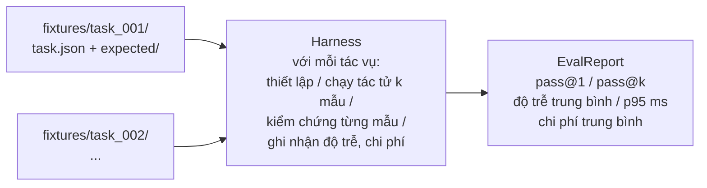
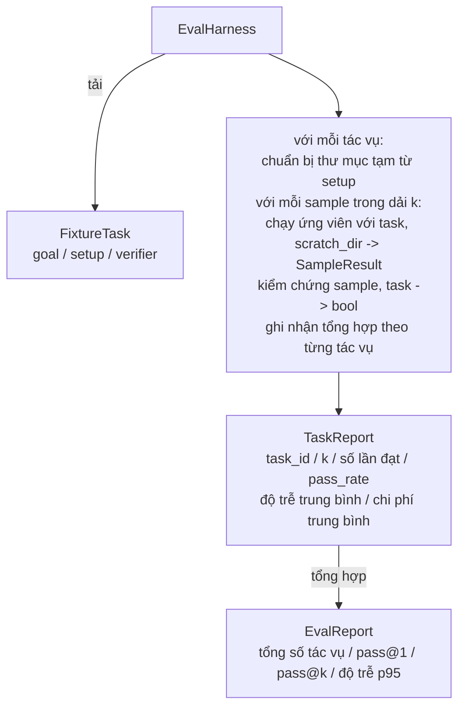

# Bài học Capstone 27: Khung đánh giá với các Tác vụ mẫu định sẵn (Eval Harness with Fixture Tasks)

> Một tác tử lập trình (coding agent) chỉ tốt bằng bộ tác vụ mà bạn dùng để đo lường nó. Bài học này xây dựng một khung đánh giá (eval harness) tiếp nhận một thư mục chứa các tác vụ mẫu định sẵn (fixture tasks), chạy từng tác vụ qua một tác tử ứng viên, chấm điểm đạt hay trượt thông qua một bộ kiểm chứng tiền định (deterministic verifier), và tổng hợp các kết quả thành các chỉ số pass@1, pass@k, độ trễ trung bình (mean latency) cùng chi phí trung bình. Khung đánh giá chính là nguồn chân lý (source of truth) giúp bạn phân biệt rõ ràng giữa một sự cải tiến tái cấu trúc (refactor) và một sự thụt lùi hiệu năng (regression).

**Loại:** Xây dựng (Build)
**Ngôn ngữ:** Python (thư viện chuẩn - stdlib)
**Điều kiện tiên quyết:** Phase 19 · 25 (cổng kiểm chứng), Phase 19 · 26 (bộ thực thi sandbox), Phase 14 · 30 (phát triển tác tử định hướng đánh giá), Phase 14 · 19 (bộ chuẩn kiểm thử SWE-bench và GAIA)
**Thời gian:** ~90 phút

## Mục tiêu học tập

- Định nghĩa một tác vụ mẫu (fixture task) dưới dạng bộ ba gồm: mục tiêu (goal), thiết lập ban đầu (setup) và bộ kiểm chứng (verifier).
- Chấm điểm nhiều lượt chạy lấy mẫu (sample runs) cho mỗi tác vụ và tính toán các chỉ số pass@1 cùng pass@k.
- Tổng hợp độ trễ và chi phí thành các số liệu thống kê trung bình và phân vị thứ 95 (p95).
- Kết nối các bộ kiểm chứng tiền định (so sánh tệp khác biệt, mã thoát, khớp biểu thức chính quy regex) thành các hàm tái sử dụng được.
- Xuất báo cáo JSON có cấu trúc để các tập lệnh theo dõi sự suy giảm hiệu năng (regression-tracking scripts) có thể tiếp nhận.

## Vấn đề đặt ra

Ba dạng lỗi thường xuyên làm sai lệch các điểm chuẩn tác tử (agent benchmarks) khi được xây dựng mà không có khung đánh giá chuẩn mực:

Thứ nhất là trạng thái đạt chưa được kiểm chứng (unverified pass). Tác tử tuyên bố đã sửa xong lỗi, con người liếc nhanh qua tệp so sánh (diff), bộ kiểm thử hiển thị màu xanh, nhưng ba tuần sau bộ kiểm thử hồi quy lại làm lộ ra chính lỗi đó. Tác tử đã lập luận một cách có vẻ hợp lý nhưng thực tế chẳng hề sửa đổi được gì.

Thứ hai là sự suy giảm hiệu năng không được phát hiện (undetected regression). Một thay đổi trong mẫu câu lệnh nhắc (prompt template) giúp tác tử làm tốt hơn 4% trên một tác vụ nổi bật nhưng lại làm giảm 14% trên một tác vụ thầm lặng. Nếu không có một tập dữ liệu chuẩn vàng (goldset) và điểm số chi tiết theo từng tác vụ, lỗi thụt lùi này sẽ hòa vào nhánh chính (main branch) và chỉ lộ ra khi người dùng khiếu nại.

Thứ ba là độ lệch tác vụ (per-task drift). Đợt đánh giá chạy vào thứ Hai với 100 tác vụ, nhưng đến thứ Sáu chỉ còn chạy với 95 tác vụ do ai đó đã đổi tên năm tệp mẫu. Tỷ lệ vượt qua trông như thể đã cải thiện 5%, nhưng thực tế hoàn toàn không phải vậy.

Khung đánh giá là chương trình biến những thất bại này thành dữ liệu thực tế rõ ràng. Nó chạy mọi tác vụ mẫu, trong mọi lần thử nghiệm, theo thứ tự có thể tái lập, đối chiếu với một bộ kiểm chứng luôn trả về đúng (true) hoặc sai (false) dựa trên các phép kiểm tra mang tính tiền định.

## Khái niệm cốt lõi



Một `FixtureTask` bao gồm một tệp JSON nhỏ kèm theo thư mục tùy chọn `expected/`. Tệp JSON khai báo một mã định danh `id`, một `goal` (câu lệnh nhắc nạp cho tác tử), một khối `setup` (các tệp cần thả vào thư mục làm việc tạm thời), và một khối `verifier`. Khối bộ kiểm chứng nêu rõ tên của một hàm trong sổ đăng ký bộ kiểm chứng (verifier registry) của khung đánh giá và cung cấp các đối số của nó.

Ba dạng bộ kiểm chứng bao quát phần lớn các tác vụ hữu ích:

Thứ nhất là `file_equals`. Sau khi tác tử chạy xong, so sánh tệp chỉ định với nội dung kỳ vọng. Bộ kiểm chứng này phục vụ các tác vụ thuộc dạng "hãy sửa lỗi này theo đúng cách chính xác này".

Thứ hai là `regex_match`. Nội dung của tệp chỉ định được đối chiếu với một biểu thức chính quy (regex). Bộ kiểm chứng này phục vụ các tác vụ dạng "hàm phải tồn tại và trả về giá trị X", nơi có nhiều cách hiện thực hợp lệ khác nhau.

Thứ ba là `shell_exit_zero`. Khung đánh giá thực thi một lệnh shell (thông qua sandbox ở bài học 26) và chỉ công nhận tác vụ đạt nếu lệnh trả về mã thoát bằng 0. Dạng này phục vụ các tác vụ kiểu "bộ kiểm thử phải vượt qua thành công".

Khung đánh giá chạy mỗi tác vụ `k` lần. Chỉ số pass@k được tính theo công thức `1 - (1 - p)^k`, trong đó p là tỷ lệ vượt qua thực nghiệm (empirical pass rate); khung đánh giá cũng báo cáo các số đếm thô để bạn có thể quan sát phương sai. Độ trễ được đo theo thời gian đồng hồ thực tế cho mỗi mẫu thử. Chi phí là bất kỳ chỉ số nào do tác tử tự báo cáo (số lượng token, chi phí USD, hoặc cả hai); khung đánh giá sẽ cộng dồn qua các mẫu và hiển thị số liệu theo từng tác vụ cũng như số liệu tổng hợp.

````figure
pass-at-k
````

## Kiến trúc hệ thống



Tác tử ứng viên là một hàm có thể gọi được (callable): `Callable[[FixtureTask, str], SampleResult]`. Khung đánh giá tạo thư mục tạm thông qua `tempfile.mkdtemp()` và truyền đường dẫn của nó dưới dạng chuỗi thuần túy. Khung đánh giá không bận tâm đến việc ứng viên hoạt động như thế nào bên trong. Ứng viên có thể là một bộ áp dụng bản vá tiền định (rất hữu ích cho các bài tự kiểm thử của khung đánh giá), một tác tử LLM thực thụ, hoặc một công cụ kiểm thử mờ (fuzzer). Bản giao kèo duy nhất giữa hai bên là cấu trúc `SampleResult`.

## Những gì bạn sẽ xây dựng

Tệp `main.py` cung cấp:

1. Dataclass `FixtureTask`.
2. Dataclass `SampleResult`: `success_self_reported`, `latency_ms`, `cost_units`, `edits`.
3. Dataclass `TaskReport`, `EvalReport` kèm phương thức `to_dict()`.
4. `VerifierRegistry` ánh xạ tên bộ kiểm chứng tới hàm tương ứng. Các bộ kiểm chứng tích hợp sẵn gồm: `file_equals`, `regex_match`, `shell_exit_zero`.
5. Lớp `EvalHarness`. Chạy một thư mục chứa các tác vụ đối chiếu với một ứng viên. Trả về đối tượng `EvalReport`.
6. Năm tác vụ mẫu được đóng gói sẵn trong `tasks/`:
   - Lỗi lệch một đơn vị (off-by-one) trong bài toán `fizzbuzz`
   - Thiếu lệnh trả về (missing return) trong hàm tính giai thừa `factorial`
   - Lỗi chính tả trong thông báo lỗi (error message typo)
   - Thân hàm bị để trống (empty function body)
   - Lỗi lệch một đơn vị khi duyệt danh sách liên kết (linked-list traversal)
7. Một ứng viên tham chiếu tiền định (`apply_known_fixes`) được khung đánh giá sử dụng để chứng minh chỉ số pass@1 đạt 1.0 tuyệt đối.
8. Phần demo in báo cáo `EvalReport` dưới dạng JSON và kết thúc với mã thoát 0.

Các tác vụ mẫu được đóng gói dưới dạng tệp JSON trong `tasks/` cùng với các cặp tệp mã nguồn trong `tasks/<id>/buggy/` và `tasks/<id>/expected/`. Khung đánh giá sao chép mã lỗi (buggy) vào thư mục tạm, giao cho ứng viên xử lý và kiểm chứng đối chiếu với thư mục mã chuẩn (expected).

## Tại sao cần cả pass@k chứ không chỉ riêng pass@1

Các tác tử LLM trong thực tế luôn có tính chất ngẫu nhiên (stochastic). Một chỉ số pass@1 đạt 0.6 thoạt nhìn giống như một thất bại. Tuy nhiên, nếu pass@5 đạt 0.95, điều đó cho thấy tác tử tìm ra câu trả lời đúng trong phần lớn thời gian nhưng có xu hướng chọn sai trong các lượt lấy mẫu đầu tiên. Giải pháp trong trường hợp này là cải tiến kỹ thuật lấy mẫu và xếp hạng (sampling and ranking), thay vì nhất thiết phải tiếp tục huấn luyện mô hình. Pass@k làm sáng tỏ khía cạnh này.

Pass@k được báo cáo song song cùng với pass@1 bởi vì chỉ dựa vào pass@k có thể che đậy một thất bại thực tế: nếu mô hình chỉ tìm ra câu trả lời đúng đúng một lần sau hai mươi lần thử, bạn chưa thể có một tác tử hữu dụng trên thực tế. Khung đánh giá hiển thị đầy đủ cả hai góc nhìn.

## Mối liên kết với các bài học khác trong Track A

Bài học 25 đã tạo ra chuỗi cổng kiểm chứng. Bài học 26 đã xây dựng sandbox. Khung đánh giá này sử dụng chính sandbox đó cho bất kỳ bộ kiểm chứng nào thuộc loại `shell_exit_zero`. Bài học 28 sẽ bọc mỗi lượt chạy của khung đánh giá bên trong một dấu vết OTel (OpenTelemetry trace). Bài học 29 sẽ chạy bản demo hoàn chỉnh từ đầu đến cuối trên một trong các tác vụ mẫu có sẵn và xác nhận pass@1 = 1.0 đối với ứng viên tham chiếu.

## Chạy thử nghiệm

```bash
cd phases/19-capstone-projects/27-eval-harness-fixture-tasks
python3 code/main.py
python3 -m pytest code/tests/ -v
```

Bản demo in ra `EvalReport` dưới định dạng JSON, bao gồm pass@1, pass@5, độ trễ trung bình và bảng phân tích chi tiết theo từng tác vụ. Mã thoát trả về là 0. Các bài kiểm thử bao phủ toàn diện các hàm kiểm chứng, công thức tính toán pass@k, việc nạp các tác vụ mẫu, và toàn bộ luồng hoạt động của khung đánh giá đối với ứng viên tham chiếu đi kèm.
