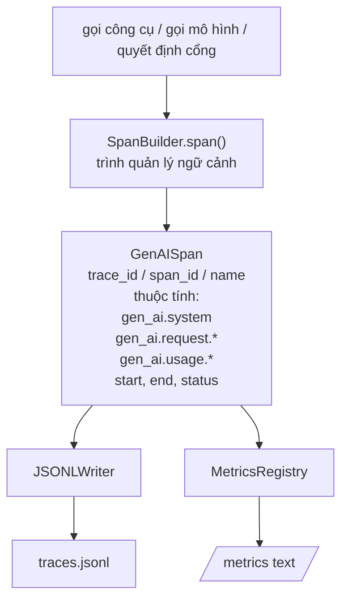
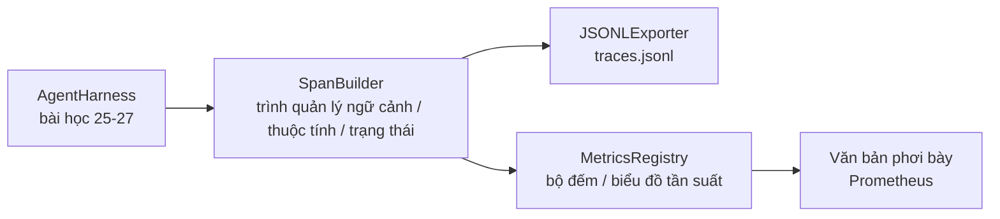

# Bài học Capstone 28: Khả năng quan sát với OTel GenAI Spans và Chỉ số Prometheus

> Một khung vận hành tác tử (agent harness) thiếu khả năng quan sát (observability) là một hộp đen tiêu tốn tiền bạc. Bài học này tự tay xây dựng một bộ tạo span (span builder) phát ra các bản ghi tuân thủ quy ước ngữ nghĩa OpenTelemetry GenAI (OpenTelemetry GenAI semantic conventions), ghi chúng vào tệp JSON-Lines theo từng dòng độc lập, và phơi bày các bộ đếm (counters) cùng biểu đồ tần suất (histograms) theo định dạng văn bản của Prometheus. Toàn bộ giải pháp chỉ sử dụng thư viện chuẩn của Python và hoạt động ngoại tuyến (offline).

**Loại:** Xây dựng (Build)
**Ngôn ngữ:** Python (thư viện chuẩn - stdlib)
**Điều kiện tiên quyết:** Phase 19 · 25 (cổng kiểm chứng), Phase 19 · 26 (sandbox), Phase 19 · 27 (khung đánh giá), Phase 13 · 20 (OpenTelemetry GenAI), Phase 14 · 23 (quy ước OTel GenAI)
**Thời gian:** ~90 phút

## Mục tiêu học tập

- Xây dựng một dataclass biểu diễn span tuân thủ quy ước ngữ nghĩa OpenTelemetry GenAI.
- Hiện thực một bộ xuất dữ liệu JSONL (JSONL exporter) ghi mỗi span độc lập trên một dòng riêng.
- Xây dựng các bộ đếm và biểu đồ tần suất kèm nhãn (labels) và hiển thị theo định dạng văn bản Prometheus.
- Bao bọc bất kỳ đối tượng hàm nào trong một trình quản lý ngữ cảnh span (span context manager) nhằm ghi nhận thời gian thực thi, trạng thái và ngoại lệ.
- Kiểm chứng các span được phát ra có thể tuần tự hóa và giải mã trọn vẹn qua `json.loads` và khớp chính xác với cấu trúc quy tả.

## Vấn đề đặt ra

Một tác tử lập trình trong môi trường sản xuất tạo ra ba nhóm dữ liệu sau mỗi lượt tương tác (turn): lệnh gọi mô hình (model call), lệnh thực thi công cụ (tool execution) và quyết định của cổng kiểm chứng (verification gate decision). Không nhóm nào trong số này có ích nếu thiếu đi dữ liệu đo từ xa có cấu trúc (structured telemetry).

Dạng lỗi thứ nhất là thiếu dấu vết thực thi (missing trace). Sự cố xảy ra vào thứ Ba nhưng bản ghi duy nhất còn lại là một nhật ký trò chuyện dài 500 dòng. Không có bản ghi nào cho biết công cụ nào đã chạy, tốn bao nhiêu thời gian, bao nhiêu token đã được nạp vào câu lệnh nhắc, hay cổng kiểm chứng có từ chối điều gì không. Tác giả của tác tử chỉ còn cách đoán mò.

Dạng lỗi thứ hai là dấu vết không thể phân tích cú pháp (unparseable trace). Khung vận hành có ghi lại các span nhưng lại dùng tên trường tùy tiện tự chế. Không có công cụ nào trong Grafana, Honeycomb, Jaeger hay CLI cục bộ có thể đọc được chúng. Mọi công cụ giám sát sẵn có trong ngăn xếp công nghệ của nhóm đều trở nên vô dụng vì các span không tuân theo chuẩn mực.

Dạng lỗi thứ ba là các chỉ số không được tổng hợp (unaggregated metric). Bạn có thể thấy một lệnh gọi công cụ chạy chậm trong dấu vết, nhưng không thể trả lời câu hỏi "độ trễ p95 của các lệnh gọi read_file trong một giờ qua là bao nhiêu?" bởi vì bạn chỉ có các dấu vết riêng lẻ chứ không có các chỉ số đo lường (metrics).

Quy ước ngữ nghĩa OpenTelemetry GenAI ra đời nhằm giải quyết chính xác bài toán này. Chúng định nghĩa một tập hợp nhỏ các thuộc tính chuẩn mà các bộ phát span trên khắp các khung làm việc LLM đều chia sẻ. Nếu khung vận hành của bạn ghi nhận đúng các thuộc tính đó, mọi hệ thống phụ trợ (backend) tương thích với OTel đều có thể tiếp nhận và đọc hiểu.

## Khái niệm cốt lõi



Mọi thao tác trong khung vận hành đều sinh ra một span. Một span bao gồm mã định danh trace (trace id - cho toàn bộ lượt gọi tác tử), mã định danh span (span id - cho riêng thao tác này), tên span (ví dụ: `gen_ai.chat`, `gen_ai.tool.execution`), các thuộc tính tuân thủ quy ước GenAI, thời điểm bắt đầu/kết thúc, và trạng thái thực thi.

Quy ước GenAI chuẩn hóa các khóa thuộc tính sau: `gen_ai.system` (nhà cung cấp, ví dụ: `anthropic`, `openai`), `gen_ai.request.model` (mã mô hình), `gen_ai.request.max_tokens`, `gen_ai.usage.input_tokens`, `gen_ai.usage.output_tokens`, `gen_ai.response.model`, `gen_ai.response.id`, `gen_ai.operation.name`, cùng với các khóa dành riêng cho công cụ như `gen_ai.tool.name` và `gen_ai.tool.call.id`.

Bộ xuất dữ liệu ghi ra định dạng JSONL (JSON Lines) với mỗi đối tượng JSON nằm trên một dòng. Đây là định dạng đơn giản nhất giúp các công cụ phía hạ nguồn có thể đọc luồng (stream), lọc nhanh bằng grep và nhập dữ liệu. Một bộ xuất OTel thực thụ sẽ giao tiếp qua giao thức OTLP gRPC; bộ xuất JSONL trong bài học này là phiên bản tương đương hoạt động ngoại tuyến và chạy mượt mà trên mọi máy trạm.

Các chỉ số nằm song song với dấu vết. Một bộ đếm sẽ tăng lên sau mỗi lệnh gọi công cụ: `tools_called_total{tool="read_file"}`. Một biểu đồ tần suất ghi nhận độ trễ đo được: `tool_latency_ms{tool="read_file"}`. Cả hai đều được tuần tự hóa theo định dạng văn bản phơi bày của Prometheus (Prometheus text exposition format) - vốn là chuẩn thực tế cho các hệ thống thu thập chỉ số theo cơ chế kéo (pull-based metrics).

````figure
trace-spans
````

## Kiến trúc hệ thống



Bộ tạo span là một lớp nhỏ với phương thức `span(name, attrs)` trả về một trình quản lý ngữ cảnh (context manager). Trình quản lý ngữ cảnh ghi lại thời gian bắt đầu khi bước vào (`__enter__`), ghi lại thời gian kết thúc khi thoát ra (`__exit__`), gắn ngoại lệ nếu có lỗi phát sinh, và chuyển giao span hoàn chỉnh tới bộ xuất dữ liệu.

Sổ đăng ký chỉ số (metrics registry) bao gồm hai từ điển (dict). Bộ đếm có dạng `{(name, frozen_labels): int}`. Biểu đồ tần suất lưu trữ các mẫu đo thô trong một danh sách và tuần tự hóa thành các thùng (buckets) của Prometheus tại thời điểm phơi bày dữ liệu.

## Những gì bạn sẽ xây dựng

Tệp `main.py` cung cấp:

1. Dataclass `GenAISpan`: `trace_id`, `span_id`, `parent_span_id`, `name`, `attributes`, `start_unix_nano`, `end_unix_nano`, `status`, `status_message`, `events`.
2. Lớp `SpanBuilder` với trình quản lý ngữ cảnh `span(name, attrs, parent=None)`.
3. Lớp `JSONLExporter` với phương thức `export(span)` để nối thêm một dòng dữ liệu.
4. Các lớp `Counter`, `Histogram` cùng `MetricsRegistry`.
5. Hàm `prometheus_exposition(registry)` sinh đầu ra định dạng văn bản.
6. Trình trang trí (decorator) `wrap_tool_call(name)` phát span và cập nhật các chỉ số đo lường.
7. Phần demo: tổng hợp một lượt gọi tác tử hoàn chỉnh (span `gen_ai.chat` bọc ngoài các span công cụ), ghi tệp `traces.jsonl`, in kết quả phơi bày Prometheus và kết thúc với mã thoát 0.

Trace id là một giá trị 16 byte (32 ký tự thập lục phân - hex) và span id là giá trị 8 byte (16 ký tự hex), đều được trích xuất ngẫu nhiên từ `uuid4`. Kích thước này tương thích hoàn toàn với chuẩn Ngữ cảnh dấu vết W3C (W3C Trace Context) mà OTel sử dụng. Bộ xuất dữ liệu không bao giờ ném lỗi ra ngoài; các lỗi I/O được hiển thị cảnh báo nhưng khung vận hành vẫn tiếp tục chạy.

Biểu đồ tần suất sử dụng một tập hợp thùng cố định cho độ trễ tính bằng mili-giây: 5, 10, 25, 50, 100, 250, 500, 1000, 2500, 5000, 10000, +Inf. Đây là phiên bản rút gọn từ các ngưỡng mặc định của OTel SDK (vốn chứa thêm 0, 75, 750, và 7500). Các mẫu được lưu trong danh sách; hàm phơi bày dữ liệu sẽ tính toán số lượng phần tử trong mỗi thùng khi được yêu cầu.

## Tại sao tự xây dựng thay vì dùng thư viện opentelemetry-sdk

Bộ SDK OTel của Python là một phụ thuộc cồng kềnh. Nó chứa hàng nghìn dòng mã, chạy một luồng nền để xuất OTLP, và tạo ra chi phí vận hành làm lu mờ dung lượng của bài học. Phiên bản tự viết này giúp bạn nắm vững định dạng truyền tải trên đường truyền (wire format). Trong môi trường sản xuất thực tế, bạn chỉ cần gán các thuộc tính tương tự vào bộ SDK chính thức để tận dụng miễn phí bộ xuất OTLP, cơ chế gom lô (batching) và tự phát hiện tài nguyên.

Quy ước GenAI hiện vẫn được đánh dấu là Đang phát triển (Development) trong đặc tả kỹ thuật, và một số thuộc tính đã từng bị đổi tên trước đây: chẳng hạn `gen_ai.usage.prompt_tokens` đã đổi thành `gen_ai.usage.input_tokens`. Hãy cố định phiên bản quy ước ngữ nghĩa mà bạn phát ra và kiểm tra lại mỗi khi nâng cấp SDK.

## Mối liên kết với các bài học khác trong Track A

Bài học 25 đã tạo ra chuỗi cổng kiểm chứng. Bài học 26 đã xây dựng sandbox. Bài học 27 đã xây dựng khung đánh giá. Bài học 28 mang lại khả năng quan sát cho cả ba thành phần này. Bài học 29 sẽ bao bọc mọi bước trong bản demo hoàn chỉnh từ đầu đến cuối bên trong các span và in định dạng văn bản Prometheus ở bước cuối.

## Chạy thử nghiệm

```bash
cd phases/19-capstone-projects/28-observability-otel-traces
python3 code/main.py
python3 -m pytest code/tests/ -v
```

Bản demo phát ra tệp `traces.jsonl` trong thư mục làm việc của bài học (được dọn dẹp sau khi kết thúc), sau đó in mẫu ba span tiêu biểu, rồi in dữ liệu phơi bày Prometheus cho các bộ đếm và biểu đồ tần suất. Các bài kiểm thử xác nhận span có thể giải mã hai chiều chuẩn xác, các thuộc tính chuẩn của GenAI hiện diện đầy đủ, bộ đếm tăng chính xác và biểu đồ tần suất chứa đúng số lượng phần tử theo thùng kỳ vọng.
