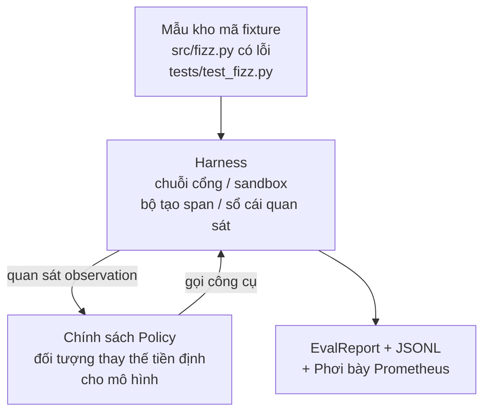
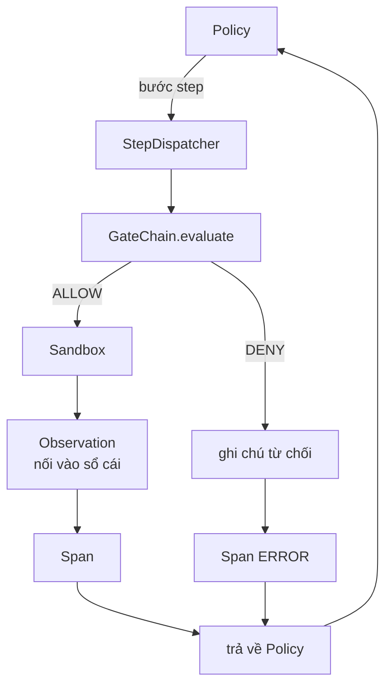

# Bài học Capstone 29: Tác tử lập trình hoàn chỉnh trên Khung vận hành

> Thành quả đỉnh cao của Track A. Bài học này kết nối chuỗi cổng kiểm chứng (gate chain), sandbox, khung đánh giá (eval harness) và các span OTel thành một tác tử lập trình hoàn chỉnh đang hoạt động thực tế nhằm sửa một lỗi có thực (ở quy mô nhỏ dạng tác vụ mẫu) trong một dự án Python nhiều tệp. Tác tử này sử dụng một chính sách tiền định (deterministic policy) thay vì mô hình ngôn ngữ lớn (LLM); sự thay thế này giúp bài học có tính tái lập tuyệt đối và làm nổi bật rằng khung vận hành chính là phần cốt lõi thú vị nhất. Bản hợp đồng giao tiếp giữa các thành phần hoàn toàn giống hệt: một mô hình thực tế có thể được cắm vào khớp nối chính sách một cách trơn tru.

**Loại:** Xây dựng (Build)
**Ngôn ngữ:** Python (thư viện chuẩn - stdlib)
**Điều kiện tiên quyết:** Phase 19 · 25 (cổng kiểm chứng), Phase 19 · 26 (sandbox), Phase 19 · 27 (khung đánh giá), Phase 19 · 28 (khả năng quan sát), Phase 14 · 38 (cổng kiểm chứng), Phase 14 · 41 (bàn làm việc cho kho mã thực tế), Phase 14 · 42 (capstone bàn làm việc tác tử)
**Thời gian:** ~90 phút

## Mục tiêu học tập

- Kết hợp chuỗi cổng kiểm chứng, sandbox, khung đánh giá và bộ tạo span vào một vòng lặp tác tử (agent loop) duy nhất.
- Hiện thực một chính sách tiền định sử dụng các công cụ `read_file`, `run_tests` và `write_file` để sửa lỗi trong tác vụ mẫu.
- Thực thi ngân sách bước toàn cục (global step budget) cùng ngân sách token quan sát (observation token budget) xuyên suốt một lượt chạy hoàn chỉnh.
- Phát ra các dấu vết OTel GenAI và các chỉ số Prometheus hoàn chỉnh cho toàn bộ lượt chạy.
- Kiểm chứng tác tử giải quyết thành công tác vụ mẫu trong vòng dưới 12 bước mà không có bất kỳ lệnh gọi công cụ hợp lệ nào bị cổng chặn.

## Vấn đề đặt ra

Hầu hết các bản minh họa tác tử chỉ hoạt động riêng lẻ: một sandbox độc lập, một khung đánh giá độc lập, một bộ phát span độc lập. Khi đứng riêng, chúng trông rất hoàn hảo. Nhưng khi ghép nối chúng lại với nhau, các vết nứt sẽ lộ diện.

Chuỗi cổng kiểm chứng trả về CHO PHÉP (ALLOW) nhưng sandbox lại từ chối vì một lý do mà chuỗi cổng chưa lường trước. Khung đánh giá ghi nhận kết quả đạt nhưng các span OTel lại báo rằng cổng kiểm chứng đã chặn một công cụ mà tác tử tuyên bố là đã sử dụng. Bộ đếm Prometheus bị tăng hai lần trong khi đáng lẽ chỉ tăng một lần. Ngân sách quan sát bị vượt quá nhưng tác tử vẫn tiếp tục chạy vì ngân sách được theo dõi ở chuỗi cổng mà sandbox không hay biết.

Bài học này đóng vai trò là bài kiểm thử tích hợp (integration test) cho toàn bộ track học. Tác tử phải thực hiện tuần tự sáu việc: đọc cấu trúc dự án, chạy bộ kiểm thử, xác định lỗi từ thông báo kiểm thử thất bại, ghi bản vá lỗi, chạy lại bộ kiểm thử và dừng lại. Mọi thao tác đều phải đi qua chuỗi cổng kiểm chứng. Mọi lệnh thực thi công cụ đều phải chạy qua sandbox. Mọi bước đi đều được bọc trong một span. Khung đánh giá sẽ chấm điểm toàn bộ quá trình ở bước cuối cùng.

## Khái niệm cốt lõi



Chính sách của tác tử là một máy trạng thái hữu hạn (state machine) gồm năm trạng thái:

`SURVEY` (Khảo sát): tác tử đọc danh sách tệp trong dự án. Trạng thái tiếp theo là RUN_TESTS.

`RUN_TESTS` (Chạy kiểm thử): tác tử chạy lệnh kiểm thử. Nếu các bài kiểm thử đều đạt, máy trạng thái dừng lại với kết quả thành công. Ngược lại, trạng thái tiếp theo là INSPECT.

`INSPECT` (Thanh tra): tác tử đọc tệp mã nguồn bị lỗi. Trạng thái tiếp theo là FIX.

`FIX` (Sửa lỗi): tác tử ghi đè tệp đã được sửa. Trạng thái tiếp theo là VERIFY.

`VERIFY` (Xác minh): tác tử chạy lại lệnh kiểm thử một lần nữa. Nếu kiểm thử đạt, dừng lại thành công. Nếu không, dừng lại với kết quả thất bại.

Mỗi trạng thái tương ứng với một lệnh gọi công cụ. Mỗi lệnh gọi công cụ đều đi qua chuỗi cổng kiểm chứng. Nếu một lệnh gọi công cụ bị từ chối, tác tử sẽ báo cáo sự từ chối trong dấu vết và dừng lại.

Lỗi trong tác vụ mẫu là lỗi lệch một đơn vị (off-by-one) trong tệp `fizz.py`. Chính sách tiền định phát hiện lỗi này từ thông báo thất bại của bài kiểm thử thông qua một biểu thức chính quy (regex) và phát ra tệp đã sửa đổi. Việc thay thế chính sách này bằng một LLM thực tế hoàn toàn không làm thay đổi hợp đồng giao tiếp của khung vận hành.

````figure
cg-harness-weave
````

## Kiến trúc hệ thống



Bài học này được thiết kế khép kín hoàn toàn. Mỗi thành phần nguyên bản từ các bài học trước đều được tái hiện thực hóa ở quy mô tối giản trong `main.py` (cổng kiểm chứng, sandbox, sổ cái quan sát, span) để bài học có thể chạy độc lập mà không cần nạp chéo mã từ các thư mục khác. Các tên gọi khớp chính xác với bài học 25 đến 28 nhằm đảm bảo ánh xạ khái niệm rõ ràng, minh bạch.

## Những gì bạn sẽ xây dựng

Tệp `main.py` cung cấp:

1. Các thành phần khung vận hành tối giản, được sao chép với cùng tên gọi như các bài học 25-28: `GateChain`, `Sandbox`, `ObservationLedger`, `SpanBuilder`, `MetricsRegistry`.
2. Lớp `CodingAgentPolicy`: máy trạng thái với năm trạng thái rõ ràng.
3. Lớp trợ giúp `Repo`: chuẩn bị thư mục làm việc tạm thời chứa tác vụ mẫu có lỗi.
4. Lớp `AgentRun`: điều khiển chính sách, điều phối qua khung vận hành, trả về một `AgentRunReport`.
5. Tác vụ mẫu đi kèm (`fixture_repo/`) gồm `src/fizz.py`, `tests/test_fizz.py`, và một cây thư mục `expected/` dành cho khung đánh giá.
6. Phần demo: chạy chính sách từ đầu đến cuối, in dấu vết từng bước, xác nhận trạng thái đạt, và in các chỉ số đo lường.

Tác vụ mẫu đi kèm có cùng cấu trúc với bài học 27: một tệp có lỗi và một tệp kiểm thử. Thông báo lỗi kiểm thử chứa đủ thông tin để chính sách tiền định nhận diện phương án sửa chữa. Một LLM thực thụ cũng sẽ làm công việc tương tự, dù chậm hơn và có khả năng truy hồi ngữ cảnh rộng hơn, nhưng bản chất không làm thay đổi các kỳ vọng từ phía khung vận hành.

## Tại sao chính sách lại không phải là một LLM

Một mô hình LLM thực sự đòi hỏi khóa API, yêu cầu kết nối mạng, và mang tính chất ngẫu nhiên khó kiểm chứng. Khung vận hành mới là trọng tâm chính mà bài học muốn truyền tải. Việc thay thế bằng một chính sách tiền định giúp bài học có thể chạy mượt mà trên bất kỳ máy tính xách tay của lập trình viên nào mà không cần cài đặt thêm phụ thuộc ngoài, đồng thời cho phép bộ kiểm thử xác nhận chính xác tuyệt đối số bước thực thi.

Chính sách trong bài học là một tập con chặt chẽ của những gì một tác tử LLM thực hiện. Chính sách đọc kho mã, nhìn thấy kiểm thử thất bại, xác định dòng lỗi, và phát ra bản sửa lỗi. LLM cũng lặp qua cùng một vòng lặp với cùng một bản hợp đồng khung vận hành; quy trình ghi chép sổ sách dữ liệu là hoàn toàn tương đương.

## Những gì phần demo xác nhận

Bản demo kiểm chứng năm điều kiện tiên quyết khi kết thúc, và bộ kiểm thử tái khẳng định lại chúng bằng lập trình:

1. Chính sách đã giải quyết thành công tác vụ mẫu trong ít hơn 12 bước.
2. Ngân sách quan sát không bao giờ bị vượt quá.
3. Không có lệnh từ chối nào từ cổng kiểm chứng bị kích hoạt trên các công cụ hợp lệ. (Tác tử không bao giờ tự bịa ra một tên công cụ bị cấm).
4. Mỗi bước thực hiện đều có một span tương ứng trong tệp `traces.jsonl`.
5. Kết quả phơi bày Prometheus chứa mục `tools_called_total{tool="read_file"}` và biểu đồ tần suất `tool_latency_ms`.

## Mối liên kết với các bài học khác trong Track A

Bài học này là điểm hội tụ tích hợp. Bài học 25 viết chuỗi cổng kiểm chứng. Bài học 26 viết sandbox. Bài học 27 viết khung đánh giá. Bài học 28 viết khả năng quan sát. Bài học 29 chứng minh toàn bộ các thành phần này phối hợp nhịp nhàng như một thể thống nhất. Từ đây, một khung tác tử sản xuất thực tế có thể mở rộng: thay thế chính sách tiền định bằng mô hình thực tế, thay tác vụ mẫu bằng tác vụ trên kho mã thực, thay bộ xuất JSONL bằng chuẩn OTLP.

## Chạy thử nghiệm

```bash
cd phases/19-capstone-projects/29-end-to-end-coding-task-demo
python3 code/main.py
python3 -m pytest code/tests/ -v
```

Bản demo in ra dấu vết theo từng bước, báo cáo đánh giá cuối cùng và kết quả phơi bày Prometheus. Mã thoát là 0. Bộ kiểm thử bao phủ toàn bộ các chuyển đổi trạng thái của chính sách, các lần từ chối của cổng đối với các lệnh gọi công cụ tổng hợp giả lập, quá trình chạy từ đầu đến cuối trên tác vụ mẫu đi kèm, và các bất biến về ngân sách bước.
