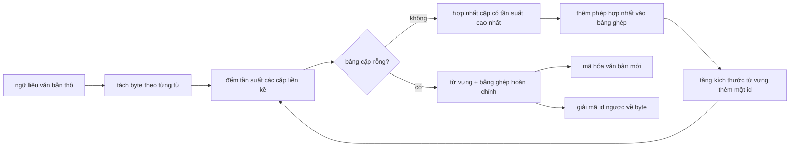
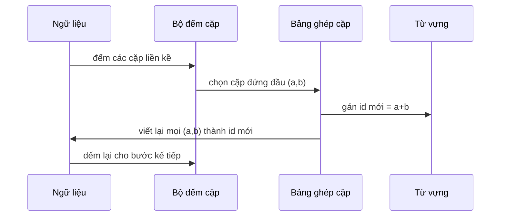

# Bộ tách từ BPE tự xây dựng từ đầu (BPE Tokenizer From Scratch)

> Nhập vào chuỗi byte, xuất ra các id, và khôi phục từ id về chính xác chuỗi byte ban đầu. Hãy tự tay xây dựng bộ tách từ (tokenizer) - điểm khởi đầu không thể thiếu của mọi mô hình ngôn ngữ văn bản hiện đại.

**Loại:** Xây dựng (Build)
**Ngôn ngữ:** Python
**Điều kiện tiên quyết:** Các bài học trong Phase 04, các bài học transformer trong Phase 07
**Thời gian:** ~90 phút

## Mục tiêu học tập
- Huấn luyện từ vựng mã hóa cặp byte (Byte-Pair Encoding - BPE) từ một kho ngữ liệu thô bằng cách lặp đi lặp lại việc hợp nhất cặp ký hiệu liền kề có tần suất xuất hiện cao nhất.
- Hiện thực một bảng ghép cặp (merge table) có tính tiền định và áp dụng nó lên văn bản mới để sinh ra luồng id từ con (subword ids).
- Thực hiện chuyển đổi hai chiều (round-trip) cho dữ liệu đầu vào UTF-8 tùy ý sang id rồi giải mã ngược lại mà không làm mất mát thông tin.
- Dành riêng và bảo vệ các token đặc biệt (`<|endoftext|>`, `<|pad|>`) để chúng không bị biến dạng qua quá trình huấn luyện và giải mã.
- Hiểu rõ lý do tại sao bảng chữ cái cấp byte (byte-level alphabet) là nền tảng phù hợp nhất cho một bộ tách từ đa năng.

````figure
cap-bpe-merge
````

## Khung nhận thức

Một mô hình ngôn ngữ không bao giờ nhìn thấy văn bản trực tiếp. Nó chỉ nhìn thấy các số nguyên. Ánh xạ từ một chuỗi văn bản sang một danh sách số nguyên và ngược lại chính là nhiệm vụ của bộ tách từ (tokenizer). Nếu làm sai ở tầng này, mọi đường cong hàm mất mát (loss curve) trong suốt quá trình huấn luyện đều sẽ đo lường sai lệch đối tượng.

Họ bộ tách từ cấp từ con (subword) thống trị dành cho các mô hình văn bản thông dụng là Mã hóa cặp byte (Byte-Pair Encoding - BPE). Ý tưởng cốt lõi rất tinh gọn: Bắt đầu từ một bảng chữ cái đã biết. Tìm cặp ký hiệu liền kề xuất hiện nhiều nhất trong ngữ liệu huấn luyện. Hợp nhất cặp đó thành một ký hiệu mới. Lặp lại quá trình cho đến khi kích thước từ vựng đạt dung lượng mục tiêu. Khi mã hóa văn bản mới, ta tái sử dụng chính danh sách hợp nhất đó theo đúng thứ tự đã học.

Chúng ta sẽ xây dựng biến thể hoạt động ở cấp độ byte (byte-level). Bảng chữ cái ban đầu gồm 256 byte thô (từ `0x00` đến `0xFF`), không phải các điểm mã Unicode (Unicode code points). Chính lựa chọn này cho phép bộ tách từ xử lý được bất kỳ văn bản UTF-8 đầu vào nào mà không bao giờ phải rơi về một token "không xác định" (`<unk>`).

## Quy trình xử lý



Bên huấn luyện và bên suy luận (inference) chia sẻ chung một bảng ghép cặp. Việc chia sẻ này là một bản hợp đồng ràng buộc. Nếu bạn thay đổi thứ tự hợp nhất lúc suy luận, bạn sẽ giải mã ra một chuỗi id hoàn toàn khác biệt.

## Bảng chữ cái cấp byte

256 id đầu tiên được dành riêng cho các byte thô từ `0x00` đến `0xFF`. Điều này đảm bảo mọi chuỗi ký tự đầu vào đều có thể được biểu diễn trong từ vựng ngay cả trước khi bất kỳ phép hợp nhất nào diễn ra. Sau khối byte này, chúng ta dành riêng một khoảng nhỏ cho các token đặc biệt. Vòng lặp huấn luyện không bao giờ đề xuất các id này làm mục tiêu hợp nhất vì chúng ta giữ chúng tách biệt hoàn toàn khỏi luồng văn bản tiền tách từ.

Bộ tiền tách từ (pretokenizer) phân tách ngữ liệu dựa trên khoảng trắng và ranh giới dấu câu trước khi đưa vào vòng huấn luyện. Nếu không có bước phân tách này, thuật toán BPE sẽ tự do học các phép ghép xuyên qua ranh giới giữa các từ, khiến từ vựng nhanh chóng bị lấp đầy bởi các cụm từ nguyên khối. Khi có bước phân tách, các phép ghép chỉ diễn ra trong phạm vi từng từ và kết quả đạt được khả năng khái quát hóa cao hơn.

## Vòng lặp huấn luyện

Ở mỗi bước huấn luyện, vòng lặp thực hiện ba việc: Duyệt qua từng từ trong ngữ liệu và đếm tần suất xuất hiện của từng cặp ký hiệu hiện tại liền kề, có tính trọng số theo tần suất xuất hiện của chính từ đó. Chọn ra cặp có số lần xuất hiện cao nhất. Viết lại mọi vị trí xuất hiện của cặp đó thành một ký hiệu mới duy nhất với id là vị trí còn trống tiếp theo trong từ vựng. Sau đó, ghi nhận phép ghép vào bảng.



Chi phí tính toán của mỗi bước là tuyến tính theo độ dài của ngữ liệu biểu diễn dưới dạng danh sách các chuỗi ký hiệu. Đối với một ngữ liệu một triệu từ và mục tiêu từ vựng mười nghìn id, vòng lặp hoàn thành trong vài giây vì các chuỗi ký hiệu sẽ ngắn dần sau mỗi lần ghép.

## Mã hóa văn bản mới

Giai đoạn suy luận không cần gọi bộ đếm cặp. Nó áp dụng bảng ghép cặp theo đúng thứ tự đã học được. Đối với một từ mới, bộ mã hóa bắt đầu bằng việc tách thành mảng byte. Nó quét chuỗi hiện tại để tìm phép ghép có thứ hạng thấp nhất (phép ghép xuất hiện sớm nhất trong bảng có thể áp dụng). Nó thực hiện phép ghép đó rồi quét lại. Vòng lặp kết thúc khi không còn phép ghép nào trong bảng có thể áp dụng cho chuỗi hiện tại.

Thứ tự ưu tiên theo thứ hạng là đặc tính giúp quá trình mã hóa mang tính tiền định và khớp chính xác với hành vi huấn luyện trên cùng một đầu vào. Một phép ghép được học đầu tiên sẽ nằm ở đầu bảng và luôn được áp dụng trước. Nếu có hai phép ghép cùng áp dụng được tại một vị trí, phép ghép có thứ hạng thấp hơn (học sớm hơn) sẽ được ưu tiên.

## Các token đặc biệt

Token đặc biệt là các id mà luồng byte thông thường không bao giờ có thể tự sinh ra. Chúng ta dành riêng chúng bằng phương pháp thủ công. Hai token là đủ cho bài học này:

- `<|endoftext|>`: dùng để phân tách các tài liệu trong quá trình tiền huấn luyện (pretraining). Nó báo hiệu cho mô hình: "một tài liệu mới bắt đầu từ đây, không được để ngữ cảnh của tài liệu trước rò rỉ sang."
- `<|pad|>`: dùng để chèn lấp các chuỗi ngắn hơn sao cho một mẻ (batch) có thể tạo thành một tensor hình chữ nhật đều đặn. Mặt nạ hàm mất mát (loss mask) sẽ ẩn token này trong lúc huấn luyện.

Bộ mã hóa tiếp nhận một cờ hiệu cho phép nhận diện các token đặc biệt trong chuỗi đầu vào. Khi tắt cờ, các chuỗi `<|endoftext|>` và `<|pad|>` sẽ bị tách từ như các byte chữ cái thông thường cấu thành nên chúng. Khi bật cờ, các chuỗi ký tự này được ánh xạ trực tiếp tới các id dành riêng và không bị ảnh hưởng bởi bất kỳ phép ghép nào.

## Đảm bảo tính toàn vẹn hai chiều (Round-trip guarantee)

Quá trình mã hóa rồi giải mã ngược lại bắt buộc phải tái tạo chính xác từng byte đầu vào ban đầu. Bộ giải mã sẽ nối chuỗi mở rộng byte của từng id theo thứ tự. Vì mỗi id hoặc là một byte thô hoặc là sự kết hợp của hai id đã biết trước đó, việc mở rộng đệ quy luôn kết thúc ở các byte thô. Quá trình giải mã sau đó sẽ trả về chuỗi UTF-8 được ghép bởi các byte này.

Bộ kiểm thử trong bài học này xác nhận đặc tính trên trên một câu chưa từng thấy trong huấn luyện, một câu chứa biểu tượng cảm xúc (emoji) Unicode, và một câu chứa token nguyên bản `<|endoftext|>`.

## Những điều bài học này không đề cập

Bài học không xây dựng một bộ tiền tách từ dựa trên biểu thức chính quy (regex) phức tạp như trong các bộ tách từ sản phẩm quy mô lớn. Bộ tiền tách từ ở đây chỉ là một hàm tách đơn giản theo khoảng trắng và dấu câu. Điều này là đủ để tạo ra các phép ghép hợp lý trên một ngữ liệu huấn luyện nhỏ và giữ nguyên giao thức với các bài học kế tiếp. Bài học tiếp theo sẽ coi bộ tách từ như một hộp đen và xây dựng tập dữ liệu cửa sổ trượt (sliding-window dataset) dựa trên nó.

Bài học không song song hóa bộ đếm cặp. Một vòng lặp Python trên ngữ liệu vài nghìn từ hoàn tất trong chưa đầy một giây. Với các ngữ liệu khổng lồ, hướng tiếp cận hiển nhiên là đếm cặp song song theo từng từ rồi thu gọn (reduce).

## Hướng dẫn đọc mã nguồn

Tệp `main.py` định nghĩa bốn đối tượng chính: Lớp `BPETokenizer` lưu trữ từ vựng, bảng ghép cặp và bảng token đặc biệt. Phương thức `train` là vòng lặp huấn luyện. Phương thức `encode` là đường dẫn suy luận. Phương thức `decode` thực hiện ghép nối byte. Phần demo ở cuối tệp huấn luyện một bộ tách từ nhỏ trên ngữ liệu tích hợp sẵn, mã hóa một câu kiểm thử riêng biệt, giải mã các id ngược lại và in cả hai kết quả. Các bài kiểm thử trong `code/tests/test_bpe.py` xác thực tính toàn vẹn hai chiều, việc bảo lưu token đặc biệt và thứ tự ưu tiên của bảng ghép cặp.

Hãy chạy bản demo. Sau đó thay đổi kích thước từ vựng mục tiêu từ 300 lên 600 và quan sát độ dài mã hóa của câu kiểm thử giảm đi như thế nào. Đường cong đó chính là đường cong nén BPE (BPE compression curve).
