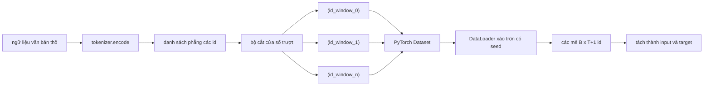
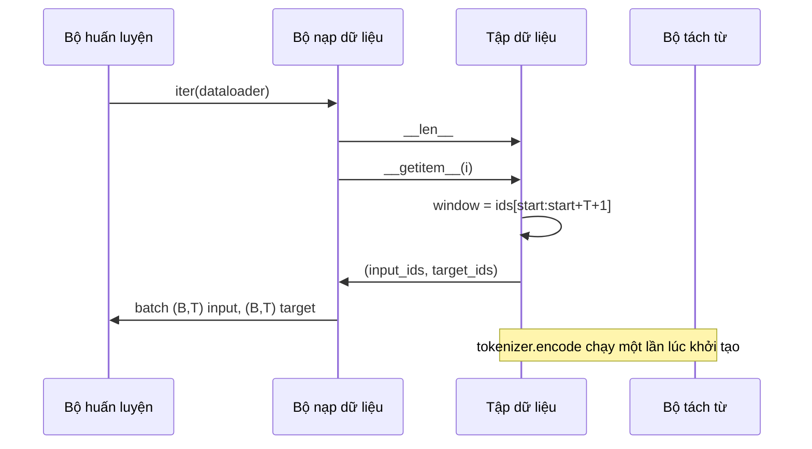

# Tập dữ liệu mã hóa Token với Cửa sổ trượt (Tokenized Dataset with Sliding Window)

> Một lượt chạy tiền huấn luyện (pretraining run) thực chất là một hàm ánh xạ từ các id token sang các gradient. Bài học này xây dựng băng chuyền nạp các id đó vào mô hình.

**Loại:** Xây dựng (Build)
**Ngôn ngữ:** Python
**Điều kiện tiên quyết:** Các bài học trong Phase 04, các bài học transformer trong Phase 07, Bài học 30 của phase này
**Thời gian:** ~90 phút

## Mục tiêu học tập
- Chuyển đổi một ngữ liệu thô thành một luồng id token thông qua một lần gọi bộ tách từ duy nhất.
- Cắt luồng id thành các cửa sổ có độ dài cố định với bước nhảy chồng lấn (overlap stride) có thể cấu hình.
- Xây dựng một `Dataset` PyTorch trả về các tensor đầu vào và mục tiêu phục vụ bài toán dự đoán token tiếp theo (next-token prediction).
- Bao bọc tập dữ liệu trong một `DataLoader` với tính năng xáo trộn tiền định (deterministic shuffle) được gieo hạt giống (seed) theo từng epoch.
- Phân tích sự đánh đổi giữa bước nhảy, độ dư thừa (redundancy) và kích thước tập dữ liệu hiệu dụng (effective dataset size).

````figure
cap-sliding-window
````

## Khung nhận thức

Một lượt tiền huấn luyện đọc từng mẻ (batch) id token tại mỗi thời điểm và cập nhật trọng số mô hình. Cấu trúc hình học (shape) của mỗi mẻ được cố định bởi hợp đồng huấn luyện. Đối với một mô hình ngôn ngữ nhân quả (causal language model), mẻ dữ liệu chứa các id đầu vào kích thước `(B, T)` và các id mục tiêu kích thước `(B, T)`, trong đó mục tiêu chính là chuỗi đầu vào dịch chuyển sang trái một vị trí. Nhiệm vụ của đường ống dữ liệu (data pipeline) là sinh ra hợp đồng đó theo yêu cầu, một cách tiền định và có thể tái lập, từ một ngữ liệu có thể lên tới vài gigabyte văn bản thô.

Bài học này xây dựng đường ống dữ liệu hoàn chỉnh. Bộ tách từ ở bài học trước biến văn bản thành một danh sách id phẳng trải dài. Một cửa sổ trượt cắt danh sách đó thành các mẫu huấn luyện. Một `Dataset` tùy biến phơi bày các mẫu này dưới dạng tensor. Một `DataLoader` gom chúng thành các mẻ và xáo trộn theo một hạt giống đã biết.

## Hợp đồng hình học (Shape contract)

Một mô hình ngôn ngữ nhân quả tiếp nhận các id có kích thước `(B, T)`, trong đó `B` là kích thước mẻ (batch size) và `T` là độ dài ngữ cảnh (context length). Mục tiêu tại vị trí `t` chính là đầu vào tại vị trí `t+1`. Điều đó có nghĩa là mỗi mẫu huấn luyện cần bao phủ `T+1` id thô. Bước nhảy cửa sổ (stride) kiểm soát mức độ chồng lấn giữa các mẫu liên tiếp.



Bộ cắt không bao giờ vượt qua ranh giới cuối của ngữ liệu. Nếu cửa sổ cuối cùng không có đủ số id để lấp đầy `T+1` vị trí, bộ cắt sẽ loại bỏ nó. Việc chèn thêm token `<|pad|>` vào phần đuôi cũng là một lựa chọn hợp lệ, nhưng nó làm phức tạp thêm mặt nạ hàm mất mát (loss mask). Trong bài học này, chúng ta chọn phương án loại bỏ.

## Tại sao lại dùng cửa sổ trượt

Ngữ liệu tiền huấn luyện là một luồng id dài duy nhất. Nếu mô hình chỉ thấy các cửa sổ không chồng lấn, mọi mẫu huấn luyện sẽ dạy nó cùng những ranh giới `T` cố định. Việc điều chỉnh bước nhảy (stride) sẽ dịch chuyển các ranh giới đó, giúp mô hình tiếp xúc với các tác vụ dự đoán token tiếp theo đa dạng hơn.

Bước nhảy bằng `T` tạo ra các cửa sổ không chồng lấn. Bước nhảy bằng `T // 2` tạo ra độ chồng lấn 50% và nhân đôi kích thước tập dữ liệu hiệu dụng. Bước nhảy bằng `1` tạo ra độ chồng lấn tối đa và tăng kích thước dữ liệu lên gấp `T` lần. Cái giá phải trả là chi phí tính toán cho mỗi epoch tăng lên. Lợi ích thu lại là sự đa dạng về mặt ranh giới ngữ cảnh. Phần lớn các đợt tiền huấn luyện quy mô lớn sử dụng bước nhảy bằng chính độ dài ngữ cảnh (`S = T`) vì ngữ liệu thực tế đã quá lớn so với khả năng duyệt hết trong một epoch, khiến lập luận về sự đa dạng ranh giới trở nên kém quan trọng hơn.

## Lớp Dataset

Một `Dataset` trong PyTorch bắt buộc phải có hai phương thức: `__len__` trả về tổng số mẫu, và `__getitem__` trả về một mẫu dưới dạng một cặp tensor. Lớp Dataset của chúng ta lưu trữ luồng id đã mã hóa và bước nhảy. Việc truy xuất chỉ số (index) sẽ tính toán điểm bắt đầu của cửa sổ ngay tức thì, do đó chi phí bộ nhớ chỉ tương đương với một bản sao duy nhất của luồng id, bất kể bước nhảy tạo ra bao nhiêu mẫu đi chăng nữa.



Phép dịch chuyển một vị trí (shift-by-one) diễn ra ngay bên trong `__getitem__`. Dataset trả về cặp `(input, target)` trong đó `input = window[:-1]` và `target = window[1:]`. Cả hai đều là tensor kiểu `long` trong PyTorch. Vòng lặp huấn luyện xem chúng như chân lý thực tế (ground truth).

## Xáo trộn tiền định (Deterministic shuffle)

Một `DataLoader` với `shuffle=True` đọc dữ liệu từ bộ sinh số ngẫu nhiên của PyTorch. Bằng cách truyền vào một đối tượng `torch.Generator` tường minh được gieo hạt giống (seed) theo từng epoch, chúng ta nhận được cùng một trật tự xáo trộn mỗi khi chạy lại quy trình. Đặc tính này mang tính quyết định khi bạn muốn so sánh hai lượt chạy chỉ khác nhau đúng một siêu tham số (hyperparameter). Nếu không cố định seed, hai lượt chạy sẽ duyệt dữ liệu theo thứ tự khác nhau và các đường cong hàm mất mát sẽ phân kỳ vì những lý do hoàn toàn không liên quan đến thay đổi của bạn.

Quy ước gieo seed trong bài học này rất đơn giản: `epoch_seed = base_seed + epoch_index`. Hạt giống cơ sở (`base_seed`) được truyền vào khi khởi tạo. Chỉ số epoch (`epoch_index`) được bộ huấn luyện tăng thêm ở đầu mỗi epoch. Khi chạy lại với cùng một seed cơ sở, hệ thống luôn đảm bảo thứ tự dữ liệu giống hệt nhau trong mọi epoch.

## Bộ lấy mẫu mẻ (Batch sampler)

Bộ lấy mẫu mặc định trong PyTorch chọn các chỉ số phân phối đều ngẫu nhiên không hoàn lại (without replacement). Đó chính xác là điều chúng ta cần cho tiền huấn luyện. Đối với tinh chỉnh (finetuning) trên tập dữ liệu nhỏ, giao ước cũng tương tự. `DataLoader` lắp ráp một mẻ bằng cách gọi `__getitem__` `B` lần rồi xếp chồng (stack) các kết quả lại. Vì mọi mẫu đều có độ dài bằng nhau theo cấu trúc thiết kế, không cần thêm bất kỳ logic chèn đệm (padding) nào.

Bài học giữ `num_workers=0` để đơn giản hóa. Trong một lượt chạy sản xuất thực tế, các tiến trình worker sẽ thực thi song song các lệnh gọi `__getitem__`. Với đường ống dữ liệu của chúng ta, thao tác này hầu như không tốn chi phí vì công việc chỉ là cắt lát một tensor trên bộ nhớ RAM, nhưng cùng một API Dataset này sẽ hỗ trợ worker một cách hoàn hảo.

## Đếm số lượng mẫu

Với một luồng id có độ dài `N`, độ dài ngữ cảnh `T`, và bước nhảy `S`, số lượng mẫu thu được là `max(0, 1 + (N - (T + 1)) // S)`. Bài học cung cấp công thức tính toán này dưới dạng một phương thức tĩnh (static method) trên Dataset để bộ huấn luyện có thể tính toán trước tổng số bước trên mỗi epoch mà không cần phải lặp qua dữ liệu.

## Những điều bài học này không đề cập

Bài học không phát luồng dữ liệu trực tiếp từ đĩa (disk streaming). Toàn bộ ngữ liệu được mã hóa hoàn toàn trong bộ nhớ và lưu dưới dạng một tensor duy nhất. Đối với ngữ liệu vài triệu id, dung lượng này chỉ dưới 100 megabyte, hoàn toàn phù hợp cho mục tiêu bài học. Kỹ thuật đọc luồng từ đĩa là một vấn đề kỹ thuật riêng biệt có thể tích hợp bằng cách thay thế tầng lưu trữ mà vẫn giữ nguyên hợp đồng của Dataset.

Bài học không xử lý nhiều tài liệu phức tạp. Ngữ liệu được coi như một luồng id liên tục duy nhất. Ranh giới giữa các tài liệu được biểu diễn bằng cách chèn id `<|endoftext|>` khi ngữ liệu được tạo từ nhiều văn bản khác nhau. Mô hình sẽ học cách dự đoán xuyên qua ranh giới này.

## Hướng dẫn đọc mã nguồn

Tệp `main.py` định nghĩa hai lớp và một hàm trợ giúp: Lớp `SlidingWindowDataset` là một PyTorch Dataset. Hàm `make_dataloader` trả về một DataLoader đã cấu hình kèm generator có gieo seed. Hàm `_encode_corpus_to_ids` thực hiện việc gọi bộ tách từ một lần. Phần demo ở cuối tệp xây dựng một bộ tách từ nhỏ trực tiếp, mã hóa ngữ liệu mẫu đi kèm, tạo dataset và dataloader, in ra một mẻ dữ liệu, và kiểm chứng tính hợp lệ của hợp đồng kích thước tensor. Các bài kiểm thử trong `code/tests/test_dataset.py` xác minh công thức đếm cửa sổ, đặc tính dịch chuyển một vị trí, tính tiền định của xáo trộn, và sự đánh đổi của bước nhảy.

Hãy chạy bản demo. Sau đó thử thay đổi độ dài ngữ cảnh từ 16 lên 32 và quan sát số lượng mẫu trong mỗi epoch giảm xuống như thế nào. Con số đó chính là ngân sách số bước huấn luyện cho mỗi epoch của bạn.
