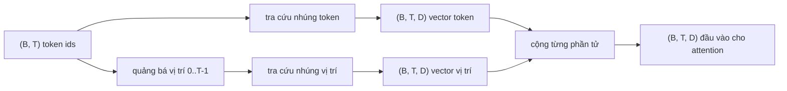
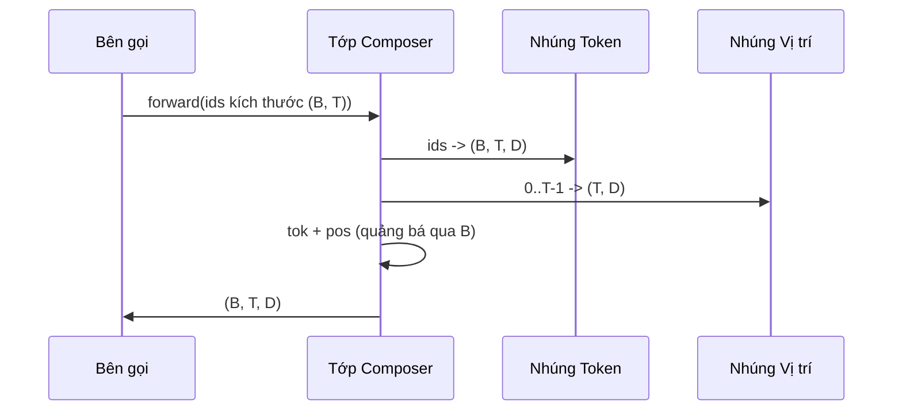

# Nhúng Token và Nhúng Vị trí (Token and Positional Embeddings)

> Các id là những số nguyên. Nhưng mô hình lại cần các vector. Hai bảng tra cứu (lookup tables) nằm giữa chúng, và lựa chọn bảng tra cứu vị trí sẽ định hình những gì mô hình có thể học được.

**Loại:** Xây dựng (Build)
**Ngôn ngữ:** Python
**Điều kiện tiên quyết:** Các bài học trong Phase 04, các bài học transformer trong Phase 07, Bài học 30 và 31 của phase này
**Thời gian:** ~90 phút

## Mục tiêu học tập
- Xây dựng một bảng tra cứu nhúng token (token-embedding lookup table) ánh xạ các id từ vựng sang các vector dày đặc (dense vectors).
- Xây dựng một bảng tra cứu nhúng vị trí khả huấn (learned positional-embedding lookup table) được lập chỉ mục theo vị trí.
- Xây dựng một bảng nhúng vị trí hình sin cố định (fixed sinusoidal positional embedding) dựa trên công thức toán học và không chứa tham số.
- Kết hợp nhúng token và nhúng vị trí thành một đầu vào duy nhất cho một khối transformer.
- So sánh sự khác biệt giữa nhúng khả huấn và nhúng hình sin về khả năng khái quát hóa độ dài (length generalization) và số lượng tham số.

````figure
cc-embedding-lookup
````

## Khung nhận thức

Điểm chạm đầu tiên của mô hình với một id token là một thao tác tra cứu hàng trong ma trận nhúng token (token-embedding matrix). Ma trận này có một hàng cho mỗi id trong từ vựng và một cột cho mỗi chiều mô hình (model dimension). Phép tra cứu trả về một vector mà phần còn lại của mô hình xem như ý nghĩa biểu diễn của id đó. Lan truyền ngược (backpropagation) sẽ cập nhật các hàng đã được kích hoạt trong lượt truyền thẳng (forward pass). Qua quá trình huấn luyện, hình học không gian của các hàng này sẽ học cách mã hóa sự tương đồng theo các hướng vector.

Bản thân các id token hoàn toàn không mang thông tin thứ tự. Mô hình cần một tín hiệu thứ hai báo cho nó biết rằng vị trí số một khác biệt với vị trí số mười bảy. Hai lựa chọn chiếm ưu thế cho tín hiệu này là nhúng vị trí khả huấn (một bảng tra cứu thứ hai, một hàng cho mỗi vị trí) và nhúng vị trí hình sin cố định (một công thức toán học không có tham số học). Lựa chọn này dẫn tới những hệ quả quan trọng: Một bảng khả huấn là một tham số mô hình và bị giới hạn bởi độ dài ngữ cảnh tối đa mà mô hình được huấn luyện. Một bảng hình sin về mặt lý thuyết không chứa tham số và công thức có thể mở rộng tới vị trí bất kỳ, tuy nhiên lớp `SinusoidalPositionalEmbedding` trong bài học này tính toán trước một bảng cố định tại `max_context_length` và phương thức `forward` sẽ báo lỗi nếu vượt quá giới hạn đó; do đó cả hai module ở đây đều thực thi độ dài ngữ cảnh tối đa. Mô hình vẫn có thể gặp khó khăn khi xử lý các chuỗi vượt quá độ dài huấn luyện ngay cả khi kích thước bảng đủ lớn để lập chỉ mục.

Bài học này xây dựng cả hai phương pháp và kết hợp chúng với nhúng token thành một đầu vào duy nhất cho khối chú ý (attention block) ở bài học tiếp theo.

## Hợp đồng hình học (Shape contract)

Đầu vào của giai đoạn nhúng là một mẻ (batch) các id token có kích thước `(B, T)`. Đầu ra là một tensor có kích thước `(B, T, D)` trong đó `D` là chiều của mô hình. Mọi phần tử trong mẻ đều có cùng độ dài ngữ cảnh `T`. Mọi vị trí đều có cùng số chiều vector `D`.



Sự kết hợp ở đây là một phép cộng (sum), không phải phép nối (concatenation). Phép cộng giữ cho chiều `D` không đổi xuyên suốt mạng và cho phép mô hình tự quyết định trên từng đặc trưng xem ý nghĩa token hay vị trí sẽ chiếm ưu thế tại mỗi lớp.

## Ma trận nhúng token

Nhúng token là một tensor tham số có kích thước `(V, D)`, trong đó `V` là kích thước từ vựng. PyTorch cung cấp lớp này thông qua `nn.Embedding(V, D)`. Khi khởi tạo, các giá trị được lấy mẫu từ một phân phối chuẩn Gauss nhỏ, theo truyền thống có giá trị trung bình bằng 0 và độ lệch chuẩn khoảng `0.02` cho các mô hình kích thước transformer. Việc khởi tạo chính xác ra sao ít quan trọng hơn việc nó phải nhất quán giữa các lượt chạy.

Lượt truyền thẳng là một thao tác lập chỉ mục đơn lẻ. PyTorch ánh xạ các id kiểu số nguyên int64 kích thước `(B, T)` thành các số thực float kích thước `(B, T, D)` bằng cách gom các hàng tương ứng. Lượt truyền ngược chỉ tích lũy gradient vào các hàng đã được truy xuất trong lượt truyền thẳng. Hai hàng không bao giờ xuất hiện trong mẻ dữ liệu sẽ nhận gradient bằng 0 tại bước đó.

Một chi tiết tinh tế: Nhúng token và phép chiếu đầu ra (output projection) ở cuối mô hình thường chia sẻ chung trọng số với nhau (buộc trọng số - weight tying). Khi điều đó diễn ra, mỗi lượt truyền ngược đều tác động tới mọi hàng của ma trận nhúng thông qua nhánh đầu ra. Bài học này tách biệt cả hai thành các module riêng rẽ, nhưng cùng một ma trận hoàn toàn có thể đảm nhiệm cả hai vai trò trong một mô hình hoàn chỉnh.

## Nhúng vị trí khả huấn (Learned positional embedding)

Nhúng vị trí khả huấn là một lớp `nn.Embedding` thứ hai có kích thước `(max_context_length, D)`. Việc tra cứu dựa trên id vị trí `0, 1, 2, ..., T-1`. Lượt truyền thẳng sẽ quảng bá (broadcast) vector vị trí đó dọc theo chiều của mẻ dữ liệu.

Điểm bất lợi của bảng khả huấn là nó không thể được truy vấn tại vị trí `T` nếu mô hình chỉ được huấn luyện đến vị trí `T-1`. Hàng dữ liệu đó đơn giản là không tồn tại. Các mô hình giải mã thuần túy (decoder-only) trong môi trường sản xuất sử dụng cơ chế này đều gắn cứng độ dài ngữ cảnh tối đa vào kiến trúc và từ chối xử lý các đầu vào dài hơn.

## Nhúng vị trí hình sin (Sinusoidal positional embedding)

Nhúng vị trí hình sin là một hàm toán học ánh xạ từ vị trí sang vector. Vị trí `p` và đặc trưng thứ `i` tạo ra:

```python
angle = p / (10000 ** (2 * (i // 2) / D))
emb[p, 2k]     = sin(angle)
emb[p, 2k + 1] = cos(angle)
```

Hàm này hoàn toàn không có tham số nào cần học. Mỗi vị trí đều có một vector duy nhất. Bước sóng biến thiên theo cấp số nhân dọc theo các chiều đặc trưng, do đó các chiều thấp hơn mã hóa vị trí ở thang độ thô và các chiều cao hơn mã hóa vị trí ở thang độ mịn.

Đặc tính quan trọng xuất phát từ việc kết hợp đồng thời cả `sin` và `cos` là vector tại vị trí `p + k` là một hàm tuyến tính của vector tại vị trí `p`. Điều này giúp lớp chú ý (attention layer) có một con đường thuận lợi để học các khoảng lệch vị trí tương đối (relative-position offsets). Mô hình không cần thêm một tham số riêng biệt chỉ để biểu đạt hành vi "hãy nhìn lùi lại năm token".

Bài học tính toán trước toàn bộ bảng hình sin một lần duy nhất lúc khởi tạo và lập chỉ mục vào đó trong lượt truyền thẳng.

## Sự kết hợp (Composition)

Đường ống xử lý đầu vào thực hiện tuần tự ba bước: Đọc các id token. Tra cứu các vector token. Cộng thêm các vector vị trí. Trả về tổng thu được.



Quá trình quảng bá (broadcasting) trong bước cộng sẽ tự động nhân bản tensor vị trí `(T, D)` dọc theo chiều mẻ dữ liệu. PyTorch xử lý việc này tự động vì tensor vị trí có kích thước `(1, T, D)` sau khi áp dụng phép unsqueeze.

## Phân tích so sánh đối chiếu

Bài học chạy cả hai biến thể trên cùng một đầu vào và in ra hai phép chẩn đoán:

Thứ nhất là số lượng tham số. Biến thể khả huấn bổ sung thêm `max_context_length * D` tham số lên trên ma trận nhúng token. Biến thể hình sin không bổ sung thêm tham số nào.

Thứ hai là độ tương đồng cosin (cosine similarity) giữa các vector nhúng ở các vị trí lân cận. Biến thể hình sin có độ suy giảm mượt mà và có thể dự đoán được vì đây là một hàm số liên tục. Biến thể khả huấn tại thời điểm khởi tạo có độ tương đồng ngẫu nhiên vì các hàng được lấy mẫu độc lập. Sau khi huấn luyện, biến thể khả huấn thường tự phát triển cấu trúc mượt mà tương tự, nhưng nó buộc phải tự khám phá ra cấu trúc đó từ dữ liệu huấn luyện.

## Những điều bài học này không đề cập

Bài học không xây dựng mã hóa vị trí quay (RoPE - Rotary Positional Encoding) hay AliBi. Đó là những lựa chọn hiện đại trong các transformer sản xuất ngày nay. Cả hai đều tuân theo cùng một hợp đồng hình học như các phép nhúng ở đây (áp dụng một phép biến đổi phụ thuộc vị trí lên các vector kích thước `(B, T, D)`), nhưng chúng được áp dụng ở bước chiếu chú ý (attention-projection step) thay vì ở đầu vào mạng. Bài học tiếp theo sẽ xây dựng khối chú ý, và một trong những phần mở rộng tùy chọn là tích hợp RoPE vào các phép chiếu truy vấn-khóa (query-key projections) tại đó.

Bài học chưa tiến hành huấn luyện các lớp nhúng. Việc huấn luyện đòi hỏi một hàm mất mát, từ đó đòi hỏi đầu ra của mô hình, mà điều này lại cần khối chú ý và đầu ra mô hình ngôn ngữ (LM head). Đó là nội dung của bài học tiếp theo và bài học kế tiếp nữa.

## Hướng dẫn đọc mã nguồn

Tệp `main.py` định nghĩa ba module chính: Lớp `TokenEmbedding` bao bọc `nn.Embedding(V, D)`. Lớp `LearnedPositionalEmbedding` bao bọc `nn.Embedding(L, D)`. Lớp `SinusoidalPositionalEmbedding` tính toán trước bảng giá trị và phơi bày nó dưới dạng một vùng đệm (buffer). Lớp `EmbeddingComposer` liên kết một nhúng token và một nhúng vị trí lại với nhau. Phần demo ở cuối in ra kích thước tensor, số lượng tham số và phép chẩn đoán độ tương đồng giữa các vị trí lân cận. Các bài kiểm thử trong `code/tests/test_embeddings.py` kiểm tra cấu trúc kích thước, hành vi quảng bá mẻ, số lượng tham số và tính đúng đắn của công thức hình sin.

Hãy chạy bản demo. Sau đó thử thay đổi chiều mô hình `D` từ 64 xuống 32 và quan sát sự thay đổi của các dải bước sóng hình sin.
