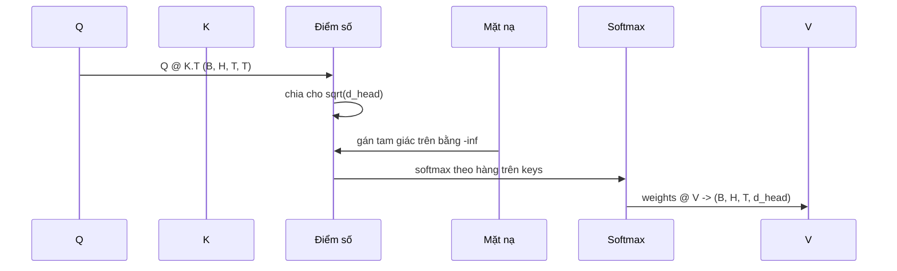

# Tự chú ý đa đầu (Multi-Head Self-Attention)

> Một phép chiếu tuyến tính, ba góc nhìn, H đầu chú ý song song, một mặt nạ nhân quả. Khối chú ý được xây dựng theo đúng cách mà mô hình thực tế sử dụng.

**Loại:** Xây dựng (Build)
**Ngôn ngữ:** Python
**Điều kiện tiên quyết:** Các bài học trong Phase 04, các bài học transformer trong Phase 07, Bài học 30 đến 32 của phase này
**Thời gian:** ~90 phút

## Mục tiêu học tập
- Hiện thực phép chiếu Truy vấn/Khóa/Giá trị (Query/Key/Value - QKV) theo mẻ dưới dạng một lớp tuyến tính duy nhất được chia thành H đầu chú ý (heads).
- Tính toán cơ chế chú ý tích vô hướng tỉ lệ (scaled dot-product attention) với phép chuẩn hóa và xử lý kiểu dữ liệu (dtype) chuẩn xác.
- Áp dụng mặt nạ nhân quả (causal mask) ngăn chặn một vị trí hiện tại chú ý đến các vị trí trong tương lai.
- Khảo sát các trọng số chú ý trên từng đầu đối với một đầu vào cố định và phân tích đối tượng mà từng đầu chú ý hướng tới.
- Huấn luyện một khối chú ý nhỏ trên một tác vụ đồ chơi (toy task) và quan sát hàm mất mát giảm dần khi các đầu chú ý bắt đầu chuyên biệt hóa.

````figure
cap-multihead-attention
````

## Khung nhận thức

Cơ chế chú ý (attention) là hàm cho phép biểu diễn của một token trích xuất và kết hợp thông tin từ các token khác trong cùng một chuỗi. Tự chú ý (self-attention) có nghĩa là các vector truy vấn (queries), khóa (keys) và giá trị (values) đều được dẫn xuất từ cùng một đầu vào. Đa đầu (multi-head) có nghĩa là phép chiếu được chia tách thành H bài toán chú ý diễn ra song song; đầu ra của chúng sau đó được ghép nối (concatenate) lại và chiếu ngược về không gian ban đầu.

Mẫu hình hiện thực hiệu năng cao trong thực tế là sử dụng một lớp tuyến tính duy nhất chiếu từ số chiều `D` lên `3 * D`, sau đó cắt lát thành ba góc nhìn (Q, K, V), rồi định hình lại (reshape) thành H đầu chú ý, mỗi đầu có kích thước `D // H`. Các phép nhân ma trận (matmul), hàm softmax và phép tính tổng có trọng số diễn ra dưới dạng các thao tác tensor theo mẻ (batched tensor operations) để các đầu chú ý được thực thi song song hoàn toàn trên bộ tăng tốc phần cứng (accelerator/GPU).

Bài học này xây dựng khối chú ý tối ưu đó. Nó cũng tích hợp mặt nạ nhân quả để cùng một đoạn mã có thể hoạt động như tầng chú ý trong một mô hình ngôn ngữ chỉ gồm bộ giải mã (decoder-only language model). Bài học tiếp theo sẽ xếp chồng khối này thành một mạng transformer hoàn chỉnh và bài học kế tiếp nữa sẽ tiến hành huấn luyện nó.

## Hợp đồng hình học (Shape contract)

Đầu vào là tensor kích thước `(B, T, D)`. Đầu ra cũng là tensor kích thước `(B, T, D)`. Mặt nạ có kích thước `(T, T)` hoặc có thể quảng bá (broadcast) về kích thước đó. Bên trong khối, các tensor trung gian có kích thước `(B, H, T, d_head)` với `d_head = D // H`. Ràng buộc bắt buộc là `D % H == 0`.

```mermaid
flowchart LR
    A["(B, T, D) đầu vào"] --> B["Linear D -> 3D"]
    B --> C["tách thành Q, K, V"]
    C --> D["reshape thành (B, H, T, d_head)"]
    D --> E["scores = Q @ K.T / sqrt(d_head)"]
    E --> F["áp dụng mặt nạ nhân quả"]
    F --> G["softmax trên chiều keys"]
    G --> H["context = weights @ V"]
    H --> I["reshape thành (B, T, D)"]
    I --> J["Linear đầu ra D -> D"]
    J --> K["(B, T, D) đầu ra"]
```



Hai lớp tuyến tính (phép chiếu QKV và phép chiếu đầu ra) là những tham số học duy nhất trong toàn bộ khối này. Mặt nạ, hàm softmax, các phép nhân ma trận và các thao tác định hình lại tensor đều hoàn toàn không có tham số.

## Phép chia tách QKV (QKV Split)

Cách hiện thực ngây thơ là sử dụng ba lớp tuyến tính riêng biệt cho Q, K và V. Cách hiện thực tối ưu sử dụng một lớp duy nhất cho ra `3 * D` đặc trưng rồi tách kết quả. Hai cách này tương đương nhau về mặt toán học bởi vì ba phép nhân ma trận riêng biệt với các ma trận trọng số `(D, D)` hoàn toàn giống với một phép nhân ma trận duy nhất với ma trận trọng số `(3D, D)` được xếp chồng lên nhau.

Phiên bản tối ưu chạy nhanh hơn đáng kể vì bộ tăng tốc phần cứng chỉ phải khởi chạy một kernel tính nhân ma trận thay vì ba. Nó cũng dễ khởi tạo hơn vì cả ba ma trận con đều nằm chung trong một tensor tham số duy nhất và có thể được khởi tạo đồng thời.

## Định hình lại đầu chú ý (Head Reshape)

Sau bước phân tách, mỗi tensor Q, K, V đều có kích thước `(B, T, D)`. Để biến chúng thành H bài toán chú ý song song, ta định hình lại thành `(B, T, H, d_head)` rồi chuyển vị (transpose) thành `(B, H, T, d_head)`. Chiều số đầu `H` lúc này nằm kề ngay cạnh chiều của mẻ dữ liệu `B`, cho phép PyTorch xử lý phép chú ý trên từng đầu như một thao tác theo mẻ trên `B * H` thực thể độc lập.

Chiều `d_head` được giữ ở vị trí cuối cùng để phép nhân ma trận tính điểm `Q @ K.transpose(-2, -1)` thực hiện co gọn (contract) chiều này lại. Kết quả thu được là tensor điểm số chú ý trên từng đầu có kích thước `(B, H, T, T)`.

## Co giãn tỉ lệ (Scaling)

Các giá trị điểm số được chia cho `sqrt(d_head)` trước khi đưa qua hàm softmax. Nếu không có bước co giãn này, giá trị tích vô hướng sẽ tăng tỉ lệ thuận theo độ lớn của `d_head`, đẩy softmax vào vùng bão hòa nơi một phần tử chiếm gần như toàn bộ trọng số và các phần tử khác tiến dần về 0. Gradient trong vùng này cực kỳ nhỏ khiến quá trình học bị đình trệ. Phép chia cho `sqrt(d_head)` giữ cho phương sai của điểm số xấp xỉ không đổi bất kể kích thước của đầu chú ý lớn hay nhỏ.

## Mặt nạ nhân quả (Causal Mask)

Một mô hình ngôn ngữ giải mã thuần túy chỉ được phép điều kiện hóa trên quá khứ khi dự đoán token tiếp theo. Mặt nạ nhân quả đảm bảo nguyên tắc này. Cụ thể, trước khi tính softmax, mọi phần tử nằm phía trên đường chéo chính của ma trận điểm số kích thước `(T, T)` đều bị thay thế bằng giá trị âm vô cùng (`-inf`). Sau khi đi qua hàm softmax, các vị trí này sẽ nhận trọng số bằng 0 tuyệt đối.



Chúng ta đăng ký mặt nạ dưới dạng một vùng đệm (buffer) lúc khởi tạo để nó luôn nằm trên cùng một thiết bị (CPU/GPU) với mô hình mà không tham gia vào đồ thị tính đạo hàm. Mặt nạ được tạo với độ dài ngữ cảnh tối đa mà khối có thể xử lý. Khi truyền thẳng, ta chỉ cần cắt góc trên bên trái kích thước `(T, T)`.

## Phép chiếu đầu ra (Output Projection)

Sau khi tính toán các vector ngữ cảnh trên từng đầu có kích thước `(B, H, T, d_head)`, ta chuyển vị ngược lại thành `(B, T, H, d_head)`, định hình lại thành `(B, T, D)`, và áp dụng một phép chiếu tuyến tính `(D, D)` cuối cùng. Phép chiếu đầu ra này cho phép mô hình trộn lẫn thông tin từ các đầu chú ý khác nhau. Nếu không có nó, H đầu chú ý sẽ chỉ có thể tái kết hợp thông qua các tầng tiếp theo, làm giảm tính linh hoạt của khối chú ý.

## Khảo sát trọng số chú ý

Bài học cung cấp cờ hiệu `return_weights=True` trong phương thức truyền thẳng. Khi bật cờ, khối sẽ trả về tensor trọng số chú ý của từng đầu kích thước `(B, H, T, T)` song song với đầu ra chính. Bản demo in ra bản đồ nhiệt (heatmap) thể hiện trọng số của một đầu trên một câu đầu vào ngắn, giúp bạn quan sát rõ cấu trúc tam giác nhân quả và trọng tâm chú ý tại từng vị trí.

Trong một mô hình đã qua huấn luyện, các đầu khác nhau sẽ học được các mẫu hình khác nhau: Có đầu sẽ chuyên chú ý vào token ngay phía trước; có đầu chú ý vào token mở đầu chuỗi; có đầu lại phân bổ trọng số chú ý gần như đồng đều. Điểm móc kiểm tra (inspection hook) này là cửa ngõ cho các phân tích về khả năng giải thích (interpretability) của mô hình.

## Demo huấn luyện

Bản demo ở cuối tệp `main.py` kết nối khối chú ý với một đầu phân loại LM head nhỏ và huấn luyện toàn bộ trên một tác vụ lặp lại (repeat task). Mỗi hàng của đầu vào là một id ngẫu nhiên được nhân bản xuyên suốt ngữ cảnh. Mục tiêu là chuỗi đầu vào dịch chuyển một vị trí, do đó mô hình phải học được rằng token tiếp theo giống hệt token trước đó. Hàm mất mát là cross-entropy. Với H=4, D=32, T=12, và từ vựng 64 ký hiệu, hàm mất mát giảm từ mức ngẫu nhiên (khoảng `log(64) ~ 4.16`) xuống dưới `1.0` chỉ sau ba epoch chạy trên CPU.

Mục đích của demo không phải là tạo ra một mô hình thực dụng, mà là để khẳng định rằng dòng gradient lan truyền thông suốt qua từng thành phần của khối và các đầu chú ý thực sự học được điều gì đó trên một bài toán có đáp án hiển nhiên.

## Những điều bài học này không đề cập

Bài học chưa tích hợp khối truyền thẳng tiến (feed-forward network / MLP). Một tầng transformer hoàn chỉnh trong thực tế bao gồm khối chú ý kết hợp với một mạng MLP hai lớp, cùng các kết nối phần dư (residual connections) và chuẩn hóa tầng (LayerNorm) bao quanh mỗi khối. Bài học tiếp theo sẽ bổ sung đầy đủ các thành phần này.

Bài học chưa hiện thực mã hóa vị trí quay (RoPE) hay AliBi. Cả hai kỹ thuật này đều được áp dụng ở bước chiếu QKV trong khối này, nhưng chúng thuộc về một đơn vị bài học riêng. Khối chú ý được xây dựng ở đây hoàn toàn tương thích với cả hai phương pháp bằng cách biến đổi Q và K trước khi nhân ma trận.

Bài học chưa xây dựng bộ nhớ đệm KV (KV cache) cho giai đoạn suy luận. Lưu trữ khóa và giá trị qua các lượt truyền thẳng là kỹ thuật tối ưu hóa giúp quá trình giải mã tự hồi quy (autoregressive decoding) đạt tốc độ cao. Nó thay đổi hợp đồng kích thước của tensor K và V nhưng không đổi với Q. Kỹ thuật này sẽ được đề cập trong bài học về suy luận.

## Hướng dẫn đọc mã nguồn

Tệp `main.py` định nghĩa lớp `MultiHeadSelfAttention`. Lớp này nắm giữ hai lớp tuyến tính và một vùng đệm mặt nạ. Lượt truyền thẳng thực hiện: chiếu tuyến tính, định hình lại, tính điểm, áp mặt nạ, tính softmax, nhân trọng số, định hình lại và chiếu đầu ra. Phần demo ở cuối xây dựng một mô hình nhỏ bọc khối chú ý với các lớp nhúng token, nhúng vị trí và LM head, huấn luyện trên tác vụ sao chép trong ba epoch, và in ra đường cong hàm mất mát cùng bản đồ nhiệt chú ý trên từng đầu. Các bài kiểm thử trong `code/tests/test_attention.py` kiểm chứng hợp đồng hình học, tính nhân quả, đặc tính softmax, phép phân tách đầu chú ý và dòng chảy gradient.

Hãy chạy bản demo. Sau đó thử tăng `n_heads` từ 4 lên 8 (vẫn giữ `d_model=32`, tức `d_head=4`) và quan sát sự biến đổi của bản đồ nhiệt.
