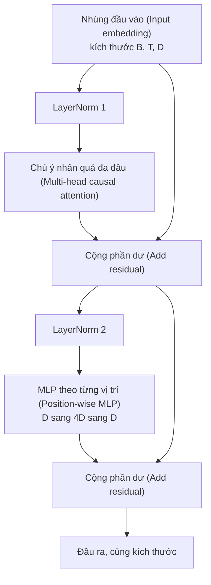
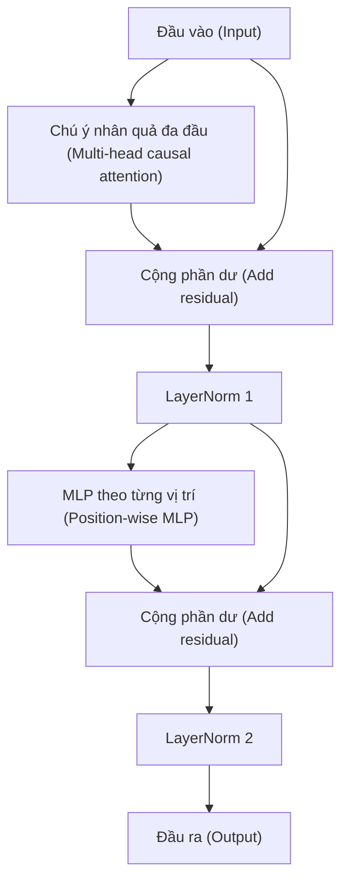

# Xây dựng khối Transformer từ số không (Transformer Block from Scratch)

> Một khối transformer chính là đơn vị cấu thành cốt lõi của mọi mô hình ngôn ngữ lớn dạng giải mã (decoder LLM) hiện đại. Chuẩn hóa tầng (layer norm), cơ chế chú ý đa đầu (multi-head attention), kết nối phần dư (residual connection), MLP, rồi lại kết nối phần dư. Biến thể pre-LN huấn luyện ổn định mà không cần giai đoạn làm nóng (warmup). Biến thể post-LN là cấu trúc từng được phát hành trong bài báo gốc. Bài học này sẽ xây dựng cả hai biến thể cạnh nhau, và chỉ ra cấu trúc nào sống sót qua chuỗi xếp chồng 12 tầng ở các tốc độ học (learning rate) phổ biến.

**Type:** Build
**Languages:** Python
**Prerequisites:** Phase 19 bài 30 đến 33 (bộ tách từ - tokenizer, nhúng từ - embeddings, toán học cơ chế chú ý - attention math, bộ nạp dữ liệu theo lô - batched data loader)
**Time:** ~90 phút

## Mục tiêu học tập

- Xây dựng một khối transformer trong PyTorch từ bốn mảnh ghép chuyển động: LayerNorm, cơ chế chú ý nhân quả đa đầu (multi-head causal attention), kết nối phần dư (residual connections), và MLP theo từng vị trí (position-wise MLP).
- Bố trí các lớp LayerNorm theo hai cấu hình (pre-LN và post-LN) và giải thích tại sao một cấu hình lại huấn luyện ổn định mà không cần giai đoạn làm nóng (warmup).
- Hiện thực hóa mặt nạ nhân quả (causal masking) bên trong cơ chế chú ý đa đầu để token `i` không thể nhìn thấy các token `j > i`.
- Theo dõi dòng chảy gradient qua cả hai biến thể trên một chuỗi xếp chồng 12 tầng và diễn giải kết quả một cách chặt chẽ, không suy diễn cảm tính.
- Tái sử dụng khối này như một đơn vị cắm-và-chạy (drop-in unit) khi bài học tiếp theo tiến hành lắp ráp mô hình GPT 124 triệu tham số.

## Vấn đề đặt ra

Mô hình transformer thực chất là một khối duy nhất được lặp đi lặp lại. Nếu làm sai khối này một lần rồi nhân bản nó lên 12 lần, bạn sẽ tạo ra một mô hình bị phân kỳ (diverge) ngay ở epoch đầu tiên hoặc phải dùng các thủ thuật làm nóng (warmup hacks) suốt quãng đường còn lại. Hai chế độ lỗi mà bạn sẽ thấy trong bài học này không hề xa lạ. Chúng xuất hiện ngay lần đầu tiên người học xếp chồng các khối một cách ngây thơ. Một lỗi là tầng chú ý nhìn trước tương lai. Lỗi còn lại là LayerNorm được đặt ở vị trí không thể kiểm soát được tín hiệu phần dư ở các tầng sâu.

Cách khắc phục mang tính kỹ thuật cơ học một khi bạn nhìn rõ bản chất. Khối transformer có chính xác hai nhánh phần dư và hai vị trí chuẩn hóa. Chọn đúng vị trí thì phần còn lại của mô hình chỉ là công việc quản trị tensor.

## Khái niệm cốt lõi

Mỗi khối transformer chỉ giải mã (decoder-only transformer block) là một hàm nhận vào một tensor có kích thước `(batch, sequence, embedding)` và trả về một tensor có cùng kích thước. Bên trong, hai tầng con (sublayers) sẽ thực hiện toàn bộ công việc.



Đây là biến thể pre-LN. LayerNorm nằm bên trong nhánh phần dư, ngay trước tầng con. Nhánh kết nối phần dư (residual connection) sẽ mang tín hiệu chưa chuẩn hóa truyền thẳng về phía trước.

Biến thể post-LN di chuyển LayerNorm ra phía sau phép cộng phần dư.



Kích thước tensor hoàn toàn giống nhau. Nhưng hành vi huấn luyện thì khác biệt một trời một vực. Với post-LN, gradient lan truyền ngược qua nhánh phần dư bắt buộc phải đi qua LayerNorm. Ở độ sâu 12 tầng và tốc độ học `3e-4`, gradient đó co lại rất nhanh đến mức buộc phải dùng lịch trình làm nóng (warmup schedule). Pre-LN giữ cho nhánh phần dư không bị chuẩn hóa, do đó gradient lan truyền thông suốt về tận tầng nhúng. Đây chính là lý do vì sao GPT-2 trở đi đều sử dụng cấu hình pre-LN.

### Cơ chế chú ý nhân quả đa đầu (Causal Multi-Head Attention)

Tầng con chú ý chiếu đầu vào theo ba hướng để tạo ra các tensor query, key, value. Mỗi tensor được định hình lại từ `(B, T, D)` thành `(B, H, T, D/H)` với `H` là số lượng đầu chú ý (head count). Cơ chế chú ý tích vô hướng theo tỷ lệ (scaled dot-product attention) tính toán `softmax(Q K^T / sqrt(d_k))` trên từng đầu, gán nửa trên tam giác thành âm vô cùng, áp dụng mặt nạ qua hàm softmax, rồi nhân với `V`. Các đầu được ghép nối (concatenate) trở lại thành một tensor duy nhất `(B, T, D)` và được chiếu tuyến tính thêm một lần nữa. Mặt nạ chính là mảnh ghép duy nhất tạo nên tính nhân quả của mô hình. Quên mặt nạ này, bạn sẽ huấn luyện một mô hình "gian lận" vì nhìn thấy trước dữ liệu tương lai.

### Mạng MLP

Mạng MLP theo từng vị trí áp dụng cùng một mạng nơ-ron hai tầng lên từng token một cách độc lập. Chiều ẩn (hidden width) gấp bốn lần chiều nhúng (embedding width), hàm kích hoạt là GELU, và một tầng dropout được đặt sau tầng tuyến tính thứ hai. Không có token nào giao tiếp với nhau bên trong MLP. Toàn bộ việc hòa trộn thông tin giữa các token đều diễn ra ở cơ chế chú ý.

### Kết nối phần dư phục vụ hai mục đích

Chúng biến đường truyền gradient thành dạng cộng dồn theo chiều sâu, giúp chuẩn gradient (gradient norm) duy trì được quy mô ổn định qua 12 tầng. Chúng cũng cho phép mỗi khối học một lượng cập nhật cộng dồn (additive update) vào biểu diễn hiện có thay vì thay thế hoàn toàn biểu diễn đó. Cả hai hiệu ứng này giải thích vì sao khối kiến trúc có thể mở rộng quy mô (scale) xuất sắc.

````figure
cc-transformer-block
````

## Xây dựng thực tế

`code/main.py` hiện thực hóa:

- `class LayerNorm` với hệ số tỉ lệ và độ dịch chuyển có thể học được (learnable scale and shift), tham số eps chống chia cho không, được áp dụng trên từng vector token.
- `class MultiHeadAttention` với `num_heads`, `head_dim = d_model // num_heads`, phép chiếu QKV hợp nhất (fused QKV projection), bộ đệm mặt nạ nhân quả được đăng ký trước (registered causal mask), cùng dropout cho chú ý và phần dư.
- `class FeedForward` với hai tầng tuyến tính, hàm kích hoạt GELU, và dropout.
- `class TransformerBlock` với cờ `pre_ln` chuyển đổi linh hoạt giữa hai biến thể.
- Một bản demo xây dựng chuỗi xếp chồng 6 tầng pre-LN và chuỗi 6 tầng post-LN với đầu vào giống hệt nhau, sau đó in ra (a) kích thước đầu ra, (b) chuẩn gradient tại tầng nhúng sau một lượt lan truyền ngược (backward pass).

Chạy mã nguồn:

```bash
python3 code/main.py
```

Đầu ra: kiểm tra kích thước tensor trên cả hai chuỗi, và so sánh chuẩn gradient cạnh nhau. Chuẩn gradient tầng nhúng của chuỗi pre-LN lớn hơn một bậc độ lớn (order of magnitude) so với chuỗi post-LN ở cùng tốc độ học; đây chính là bằng chứng thực nghiệm cho thấy pre-LN có thể huấn luyện mà không cần warmup.

## Ngăn xếp công nghệ

- `torch` cho các phép toán tensor, đạo hàm tự động (autograd), và kiến trúc `nn.Module`.
- Không dùng thư viện `transformers`, không dùng trọng số nạp sẵn. Toàn bộ khối được hiện thực hóa từ các thành phần nguyên thủy.

## Các mẫu thiết kế trong môi trường sản xuất thực tế

Ba mẫu thiết kế sau biến khối kiến trúc trong sách giáo khoa thành một thành phẩm sẵn sàng triển khai thực tế:

**Phép chiếu QKV hợp nhất (Fused QKV projection).** Ba tầng tuyến tính riêng biệt đòi hỏi ba lần gọi kernel GPU và ba phép nhân ma trận. Một tầng tuyến tính duy nhất có độ rộng `3 * d_model` thực hiện toàn bộ công việc đó chỉ trong một lần gọi kernel, sau đó tách kết quả đầu ra dọc theo trục cuối cùng. Đường dẫn hợp nhất này chạy nhanh hơn trên mọi bộ tăng tốc phần cứng và hoàn toàn trùng khớp với cách các bản hiện thực tham chiếu của GPT-2, LLaMA, và Mistral vận hành.

**Đăng ký bộ đệm mặt nạ nhân quả (Registered causal mask buffer).** Mặt nạ chỉ phụ thuộc vào độ dài ngữ cảnh tối đa. Hãy cấp phát nó một lần duy nhất lúc khởi tạo đối tượng bằng `register_buffer`, cắt lấy cửa sổ đang hoạt động ở mỗi lượt lan truyền xuôi, và loại bỏ hoàn toàn việc cấp phát bộ nhớ lặp đi lặp lại ở mỗi lượt gọi. Quên tối ưu này sẽ biến việc tạo mặt nạ thành điểm nghẽn bộ nhớ nghiêm trọng khi ngữ cảnh dài.

**Đặt Dropout ở hai vị trí, không phải ba.** Dropout thuộc về vị trí sau softmax của chú ý (attention dropout) và sau tầng tuyến tính thứ hai của MLP (residual dropout). Đặt dropout ngay trên chính đường truyền phần dư sẽ phá vỡ phép đồng nhất cộng tính (additive identity) vốn dĩ giúp gradient lưu thông ở tầng sâu. Một số bản hiện thực đời đầu mắc phải sai lầm này và phải trả giá bằng việc quá trình huấn luyện cực kỳ mong manh dễ gãy.

## Ứng dụng thực tế

- Khối transformer trong bài học này có thể ghép trực tiếp vào quá trình lắp ráp mô hình GPT trong bài 35 mà không cần sửa đổi.
- Biến thể pre-LN là cấu trúc mà mọi LLM trọng số mở hiện đại sử dụng. Biến thể post-LN là cấu trúc mà bài báo chú ý năm 2017 từng công bố. Nắm vững cả hai là đủ để đọc hiểu bất kỳ kiến trúc giải mã nào bạn sẽ gặp.
- Thay GELU bằng SiLU, bạn có hàm kích hoạt của họ mô hình LLaMA. Thay LayerNorm bằng RMSNorm, bạn có lớp chuẩn hóa của họ LLaMA. Cùng một bộ khung xương duy nhất.

## Bài tập

1. Thêm cờ `bias=False` vào mọi tầng tuyến tính trong khối. Các LLM trọng số mở hiện đại đều loại bỏ bias ở các tầng tuyến tính. Hãy đo lường xem bạn tiết kiệm được bao nhiêu tham số trong mô hình 12 tầng với chiều ẩn 768.
2. Thay thế `nn.LayerNorm` bằng RMSNorm tự viết và xác minh rằng kích thước đầu ra không thay đổi.
3. Thêm một cờ tùy chọn trả về ma trận trọng số chú ý cho đầu đầu tiên dưới dạng tensor `(B, T, T)`. Vẽ biểu đồ nửa trên tam giác để xác nhận nó bằng 0 sau hàm softmax.
4. Xây dựng một kiểm tra tính đúng đắn (sanity check) truyền một tensor `(2, 16, 384)` với `H=6` qua cả hai biến thể và khẳng định (assert) rằng đầu ra lan truyền xuôi là khác nhau (ví dụ dùng `not torch.allclose`) khi các trọng số được khởi tạo giống hệt nhau và dropout được đặt bằng 0.

## Thuật ngữ then chốt

| Thuật ngữ | Cách gọi thông thường | Ý nghĩa kỹ thuật thực sự |
|---|---|---|
| Pre-LN | "Pre norm" | LayerNorm nằm bên trong nhánh phần dư, trước mỗi tầng con; đường truyền phần dư mang tín hiệu chưa chuẩn hóa |
| Post-LN | "Post norm" | LayerNorm đặt sau phép cộng phần dư; cấu trúc được công bố trong bài báo 2017 và bắt buộc phải dùng warmup |
| Causal mask | "Mặt nạ tam giác" | Nửa trên tam giác của ma trận chú ý (attention logits) được đặt bằng âm vô cùng để token i không thể đọc token j khi j > i |
| Fused QKV | "Phép chiếu kết hợp" | Một tầng tuyến tính có độ rộng 3D thay vì ba tầng tuyến tính độ rộng D; một kernel, một phép nhân ma trận |
| Residual stream | "Đường nối tắt / Skip connection" | Tensor chưa chuẩn hóa lưu thông xuyên suốt từ trên xuống dưới qua từng khối; là nơi mỗi khối cộng thêm tín hiệu vào |

## Đọc thêm

- Phase 7 bài 02 (tự chú ý từ số không - self attention from scratch) để nắm vững toán học cơ chế chú ý bên dưới khối này.
- Phase 7 bài 05 (transformer hoàn chỉnh - full transformer) để xem phiên bản mã hóa - giải mã (encoder-decoder) của cùng bộ khung này.
- Phase 10 bài 04 (tiền huấn luyện mini GPT - pre training mini GPT) để xem quy trình huấn luyện mà khối này cắm vào.
- Phase 19 bài 35 (chuỗi bài này) thực hiện xếp chồng 12 khối này thành một mô hình GPT hoàn chỉnh.
