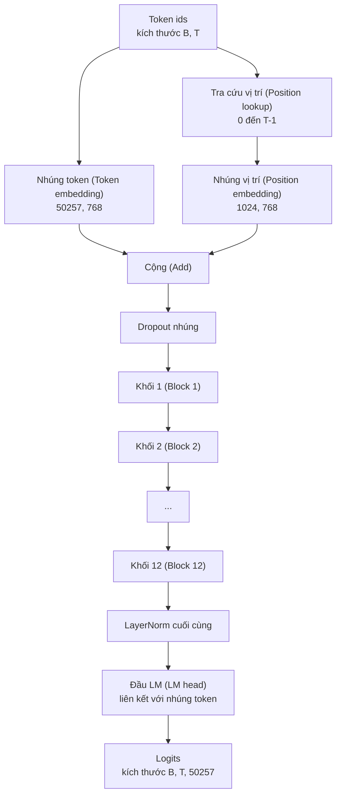
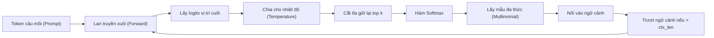

# Lắp ráp mô hình GPT (GPT Model Assembly)

> Mười hai khối xếp chồng, một ma trận nhúng token, một ma trận nhúng vị trí học được, một LayerNorm cuối cùng, và một đầu mô hình ngôn ngữ liên kết trọng số (tied language model head). Đó chính là toàn bộ mô hình GPT 124 triệu tham số. Bài học này sẽ lắp ráp các mảnh ghép đó thành một lớp hoạt động hoàn chỉnh, đếm số lượng tham số để xác nhận mô hình khớp chính xác với cấu hình tham chiếu 124M, và sinh văn bản bằng phương pháp lấy mẫu đa thức (multinomial sampling), điều chỉnh nhiệt độ (temperature scaling), cùng kỹ thuật cắt tỉa top-k.

**Type:** Build
**Languages:** Python
**Prerequisites:** Phase 19 bài 30 đến 34
**Time:** ~90 phút

## Mục tiêu học tập

- Lắp ráp khối transformer từ bài học 34 thành một mô hình GPT hoàn chỉnh: nhúng token (token embedding), nhúng vị trí (position embedding), N khối transformer, LayerNorm cuối cùng, và đầu mô hình ngôn ngữ (language model head).
- Tái lập cấu hình 124 triệu tham số chuẩn: kích thước từ vựng (vocab) 50257, ngữ cảnh tối đa 1024, chiều ẩn nhúng 768, 12 đầu chú ý, 12 tầng.
- Liên kết trọng số (weight tying) giữa đầu mô hình ngôn ngữ với ma trận nhúng token và giải thích tại sao kỹ thuật này tiết kiệm được ~38 triệu tham số ở quy mô này.
- Sinh văn bản từ câu mồi (prompt) bằng phương pháp lấy mẫu đa thức (multinomial sampling), điều chỉnh nhiệt độ (temperature), và cắt tỉa top-k, đồng thời duy trì độ dài ngữ cảnh bằng cửa sổ trượt (sliding window).
- Đo lường số lượng tham số và chi phí tính toán của lượt lan truyền xuôi so với mục tiêu tham chiếu 124M.

## Vấn đề đặt ra

Một khối transformer đứng riêng lẻ không thể làm được gì. Bạn cần chuyển các mã định danh token (token id) thành các vector, hòa trộn thông tin vị trí, truyền chúng qua chuỗi các khối xếp chồng, rồi chiếu ngược trở lại thành điểm số logit trên toàn bộ từ vựng. Bỏ quên bất kỳ bước nào trong bốn bước đó, mô hình hoặc sẽ thất bại khi lan truyền xuôi, hoặc bị trôi dạt thông tin vị trí, hoặc hoàn toàn không thể phát ngôn.

Hình dạng cấu trúc của mô hình cũng đóng vai trò quyết định. Mô hình tham chiếu GPT-2 small có đúng 124 triệu tham số ở cấu hình nêu trên. Những con số này không phải là ngẫu nhiên: kích thước từ vựng 50257 nhân với chiều nhúng 768 tạo nên bảng nhúng token. Ngữ cảnh 1024 nhân với 768 là bảng nhúng vị trí. Mười hai khối transformer, mỗi khối chứa xấp xỉ 7 triệu tham số, đóng góp khoảng 84 triệu. Đầu dự đoán cuối cùng tái sử dụng lại bảng nhúng token nhờ kỹ thuật liên kết trọng số. Cộng tất cả các phần lại, bạn đạt đúng 124 triệu tham số. Việc xây dựng một mô hình có số lượng tham số không khớp với con số tham chiếu là dấu hiệu cho thấy bạn đã đấu dây (wire) sai ở đâu đó.

## Khái niệm cốt lõi



Các token id trở thành vector token. Các position id trở thành vector vị trí. Cả hai được cộng vào nhau rồi truyền qua chuỗi xếp chồng các khối. LayerNorm cuối cùng là thành phần duy nhất nằm ngoài các khối mà vẫn tồn tại trong mọi biến thể hiện đại. Đầu LM tái sử dụng ma trận nhúng token, đó chính là ý nghĩa của kỹ thuật liên kết trọng số (weight tying).

### Liên kết trọng số (Weight Tying)

Ma trận nhúng token có kích thước `(vocab, d_model)`. Đầu mô hình ngôn ngữ cần chiếu từ `d_model` trở lại `vocab`. Hai ma trận này là chuyển vị (transpose) của nhau. Việc liên kết chúng có nghĩa là dùng chung chính xác một tensor tham số duy nhất cho cả hai nhiệm vụ. Với kích thước từ vựng 50257 và d_model 768, ma trận này chiếm 38 triệu tham số. Nếu không liên kết, bạn phải trả giá hai lần. Nếu liên kết, bạn chỉ tốn bộ nhớ một lần và còn thu được tín hiệu gradient trong sạch hơn vì bảng nhúng và đầu ra được cập nhật đồng bộ cùng nhau.

### Nhúng vị trí có thể học được (Learned Position Embedding), không phải dạng hình sin

GPT-2 sử dụng nhúng vị trí có thể học được (learned position embedding). Bảng vị trí là một tensor tham số duy nhất có kích thước `(1024, 768)`. Ở mỗi lượt lan truyền xuôi, mô hình tra cứu từ vị trí 0 đến T-1 rồi cộng kết quả tra cứu vào vector nhúng token. Đây là cơ chế mã hóa vị trí đơn giản nhất (so với các giải pháp thay thế như RoPE, ALiBi, hay độ lệch tương đối của T5) và là cơ chế mà bản tham chiếu 124M sử dụng.

### Quá trình sinh văn bản: Nhiệt độ, Top-k, và Lấy mẫu đa thức

Quá trình sinh văn bản diễn ra theo cơ chế tự hồi quy (autoregressive). Ở mỗi bước, mô hình trả về điểm số logit trên toàn bộ từ vựng tại mọi vị trí. Bạn chỉ lấy logits tại vị trí cuối cùng, chia cho nhiệt độ (temperature), tùy chọn che đi (mask) tất cả các logits ngoài top k thành âm vô cùng, áp dụng softmax để lấy phân phối xác suất, và rút ngẫu nhiên (sample) một token từ phân phối đó theo quy luật đa thức (multinomial).



Ba núm điều chỉnh mang lại ba hành vi khác nhau. Nhiệt độ tiệm cận 0 sẽ thoái hóa thành chọn lựa tham lam (greedy search). Nhiệt độ bằng 1 giữ đúng phân phối tự nhiên của mô hình. Top-k bằng 1 tương đương greedy. Top-k bằng 40 giúp lọc bỏ phần đuôi xác suất thấp (long tail). Sự kết hợp của các tham số này rất quan trọng; bài học tiếp theo về huấn luyện sẽ dùng quá trình sinh văn bản làm tín hiệu đánh giá chất lượng trực quan.

````figure
cc-gpt-assembly
````

## Xây dựng thực tế

`code/main.py` hiện thực hóa:

- Lớp dữ liệu `GPTConfig` với các giá trị mặc định của bản 124M: `vocab_size=50257`, `context_length=1024`, `d_model=768`, `num_heads=12`, `num_layers=12`, `mlp_expansion=4`, `dropout=0.1`, `use_bias=True`, `weight_tying=True`.
- Lớp `GPTModel` với nhúng token, nhúng vị trí, dropout cho nhúng, 12 khối `TransformerBlock`, LayerNorm cuối cùng, và một `lm_head` liên kết với nhúng token khi cờ được bật.
- Hàm hỗ trợ `count_parameters` trả về số lượng tham số duy nhất (đảm bảo tính đúng bản chất chia sẻ bộ nhớ của weight tying khi đếm).
- Hàm `generate` thực hiện điều chỉnh nhiệt độ, top-k, lấy mẫu đa thức, và ngữ cảnh cửa sổ trượt.
- Một bản demo xây dựng mô hình, in ra số lượng tham số bên cạnh con số tham chiếu 124M, và sinh một đoạn văn bản ngắn từ câu mồi cố định để chứng minh đường ống xử lý hoạt động thông suốt từ đầu đến cuối.

Chạy mã nguồn:

```bash
python3 code/main.py
```

Đầu ra: số lượng tham số so sánh với tham chiếu 124M, các token id được sinh ra từ câu mồi cho trước, và xác nhận rằng đầu LM cùng ma trận nhúng token thực sự chia sẻ chung vùng nhớ khi bật tính năng tying.

Để quá trình chạy thử nhanh chóng, tập lệnh cũng chạy thử một cấu hình thu nhỏ (`d_model=64`, `num_layers=2`) từ đầu đến cuối và in chuỗi token được sinh ra ngay trên terminal. Cấu hình 124M vẫn được khởi tạo nhưng chỉ thực thi đếm tham số và chạy một lượt lan truyền xuôi đơn lẻ.

## Ngăn xếp công nghệ

- `torch` cho các phép tính tensor, đạo hàm tự động (autograd), và cấu trúc module.
- `code/main.py` tự tái hiện cấu trúc khối tương tự như bài học 34.

## Các mẫu thiết kế trong môi trường sản xuất thực tế

Ba mẫu thiết kế tạo nên ranh giới giữa một mô hình chỉ chạy được và một mô hình sẵn sàng đưa vào vận hành:

**Khởi tạo các phép chiếu phần dư với độ lệch chuẩn nhỏ.** Phép chiếu đầu ra của cơ chế chú ý và tầng tuyến tính thứ hai của MLP đều nạp trực tiếp vào phép cộng phần dư. Nếu khởi tạo chúng với cùng độ lệch chuẩn như các tầng tuyến tính khác, độ lớn của luồng phần dư (residual stream) sẽ tăng dần theo độ sâu tầng và đẩy LayerNorm cuối cùng vào trạng thái quá tải (bão hòa). Hãy nhân tỉ lệ độ lệch chuẩn với `1 / sqrt(2 * num_layers)` cho riêng hai phép chiếu này; luồng phần dư sẽ duy trì trong phạm vi an toàn qua suốt 12 tầng.

**Lưu đệm (cache) tensor position id, không tính toán lại.** `torch.arange(T)` cấp phát bộ nhớ mới ở mỗi lượt lan truyền xuôi. Hãy cấp phát một lần duy nhất trong `__init__` cho độ dài ngữ cảnh tối đa, cắt lấy T phần tử đầu tiên ở mỗi lượt gọi, và loại bỏ hoàn toàn chi phí cấp phát bộ nhớ liên tục.

**Liên kết trọng số ở cấp độ tham số, không sao chép dữ liệu.** Thiết lập `lm_head.weight = token_embedding.weight` sẽ chia sẻ cùng một tensor; trong khi lệnh gán sao chép thì không. Bộ tối ưu hóa (optimizer) cần cập nhật một tham số duy nhất và đồ thị autograd chỉ cần tích lũy một lần. Nếu bạn sao chép tensor, đầu LM sẽ dần trôi dạt khỏi tầng nhúng và kỹ thuật liên kết trọng số trở nên vô nghĩa.

## Ứng dụng thực tế

- Lớp mô hình trong bài học này có cùng cấu trúc với mô hình mà bài học tiếp theo sẽ đem đi huấn luyện.
- Thay thế nhúng vị trí học được bằng RoPE, bạn sẽ thu được họ mô hình LLaMA mà không cần động đến khối transformer hay đầu LM.
- Thay thế GELU bằng SiLU và LayerNorm bằng RMSNorm, bạn hoàn thiện phần còn lại của các thay đổi trong họ LLaMA.
- Hàm sinh văn bản hoạt động với bất kỳ nguồn logits nào, không chỉ riêng mô hình này. Bạn hoàn toàn có thể trích xuất logits từ tệp GPT-2 được huấn luyện sẵn ở bài 37 và tái sử dụng vòng lặp sinh văn bản này.

## Bài tập

1. Tách rời (untie) đầu LM khỏi ma trận nhúng token và đếm lại tham số. Xác minh mức chênh lệch đúng bằng 50257 * 768 = 38.597.376 tham số.
2. Thay thế nhúng vị trí học được bằng bảng hình sin được tính sẵn tại thời điểm khởi tạo. Xác nhận mô hình vẫn lan truyền xuôi bình thường và số lượng tham số giảm đi 786.432.
3. Thêm cờ `greedy=True` vào hàm sinh văn bản để bỏ qua bước lấy mẫu ngẫu nhiên và chọn luôn token có điểm số lớn nhất (argmax). Xác nhận chuỗi sinh ra mang tính tất định (deterministic) qua nhiều lần chạy.
4. Thêm tham số `repetition_penalty` để chia logit của bất kỳ token nào đã xuất hiện trong câu mồi hoặc lịch sử sinh ra cho một hằng số trước khi qua softmax. Chứng minh trên một câu mồi cố định rằng các giá trị lớn hơn 1 sẽ giảm số lần lặp từ trong kết quả.
5. Bổ sung kỹ thuật lấy mẫu `top_p` (nucleus sampling) bên cạnh `top_k`. Viết một dòng kiểm tra đảm bảo tổng xác suất của các token được giữ lại vượt ngưỡng `top_p`.

## Thuật ngữ then chốt

| Thuật ngữ | Cách gọi thông thường | Ý nghĩa kỹ thuật thực sự |
|---|---|---|
| Weight tying | "Nhúng liên kết" | Đầu LM và ma trận nhúng token dùng chung một tensor tham số; tiết kiệm kích thước từ vựng nhân d_model tham số và khớp với bản tham chiếu GPT-2 |
| Position embedding | "Vị trí học được" | Một bảng riêng biệt có kích thước (độ dài ngữ cảnh, d_model) được cộng vào vector token; được tối ưu hóa từ đầu đến cuối (end-to-end) |
| Sliding window context | "Cắt giới hạn ngữ cảnh" | Khi độ dài của câu mồi cộng với các token vừa sinh vượt quá ngữ cảnh tối đa, loại bỏ các token cũ nhất để cửa sổ hoạt động luôn vừa vặn |
| Top-k sampling | "Cắt tỉa K" | Giữ lại K giá trị logit cao nhất, che các giá trị còn lại bằng âm vô cùng, rồi tính softmax trên các giá trị còn lại |
| Temperature | "Nhiệt độ lấy mẫu" | Chia logits cho T trước khi đưa qua softmax; T < 1 làm sắc nét phân phối xác suất, T = 1 giữ nguyên phân phối tự nhiên, T > 1 làm phẳng phân phối |

## Đọc thêm

- Phase 19 bài 34 để hiểu chi tiết khối transformer mà mô hình này xếp chồng.
- Phase 19 bài 36 để tìm hiểu vòng lặp huấn luyện vận hành mô hình này với hàm mất mát cross-entropy.
- Phase 19 bài 37 để nạp trọng số GPT-2 tiền huấn luyện vào đúng kiến trúc này.
- Phase 7 bài 07 (mô hình hóa ngôn ngữ nhân quả GPT - GPT causal language modeling) để nắm vững toán học dự đoán token tiếp theo.
- Phase 10 bài 04 (tiền huấn luyện mini GPT - pre training mini GPT) để xem quy trình huấn luyện nguyên bản trên cùng kiến trúc.
