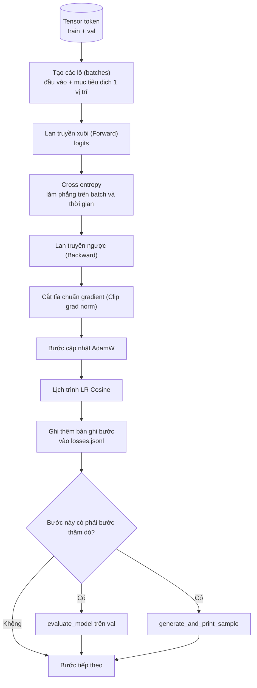

# Vòng lặp huấn luyện và Đánh giá (Training Loop and Evaluation)

> Một vòng lặp không đo lường là một vòng lặp dối trá. Bài học này sẽ xây dựng vòng lặp huấn luyện vận hành mô hình GPT: bộ tối ưu hóa AdamW với phân tách phân rã trọng số (weight decay split), lịch trình tốc độ học kết hợp làm nóng và suy giảm cosine (warmup plus cosine learning rate schedule), hàm hỗ trợ `calc_loss_batch`, lượt duyệt `evaluate_model` trên tập dữ liệu đánh giá giữ lại (held-out data), phép thăm dò định tính `generate_and_print_sample` sau mỗi K bước, và tệp nhật ký JSONL ghi lại các giá trị hàm mất mát để bạn trực quan hóa sau này. Chính bộ khung xương này sẽ huấn luyện mọi LLM giải mã (decoder LLM) mà bạn từng xây dựng.

**Type:** Build
**Languages:** Python
**Prerequisites:** Phase 19 bài 30 đến 35
**Time:** ~90 phút

## Mục tiêu học tập

- Xây dựng một vòng lặp huấn luyện tính toán hàm mất mát cross-entropy với sự căn chỉnh đầu vào và mục tiêu chính xác cho bài toán dự đoán token tiếp theo.
- Cấu hình AdamW với phân rã trọng số (weight decay) chỉ áp dụng cho các tensor ma trận trọng số, tuyệt đối không áp dụng cho LayerNorm hoặc các tensor bias.
- Hiện thực hóa lịch trình tốc độ học với giai đoạn làm nóng tuyến tính (linear warmup) và suy giảm cosine (cosine decay), đồng thời theo dõi biến thiên tốc độ học theo thời gian.
- Đánh giá trên tập dữ liệu giữ lại (held-out split) bằng `evaluate_model` để tổn thất đánh giá (eval loss) có thể so sánh nhất quán qua nhiều lần chạy khác nhau.
- Sinh mẫu văn bản định tính sau mỗi K bước bằng `generate_and_print_sample` nhằm phát hiện sớm các dấu hiệu phân kỳ trước khi đường cong hàm mất mát kịp phản ánh.
- Lưu trữ tổn thất ở từng bước vào tệp JSONL để có thể nạp lại, vẽ biểu đồ và chuyển giao nhật ký huấn luyện như một sản phẩm hoàn chỉnh.

## Vấn đề đặt ra

Một tập lệnh huấn luyện chỉ in ra giá trị hàm mất mát mà không làm gì khác sẽ thất bại theo ba cách. Nó không thể cho bạn biết liệu hàm mất mát giảm có đúng nguyên nhân hay không (mô hình hoàn toàn có thể quá khớp - overfit tập huấn luyện và không học được quy luật tổng quát nào). Nó không thể báo trước nếu một đợt phân kỳ đang chớm nở (hàm mất mát có thể tăng đột ngột một bước rồi hồi phục, hoặc tăng vọt rồi sụp đổ hoàn toàn). Nó không thể diễn đạt những gì mô hình thực sự đã học (hàm mất mát chỉ là một số vô hướng; trong khi mẫu sinh ra là cả một đoạn văn). Cả ba thất bại này đều bị che giấu trừ khi vòng lặp được thiết kế để đo lường thấu đáo.

Vòng lặp trong bài học này đo lường theo ba cách: Tổn thất trên lô huấn luyện ở mỗi bước. Tổn thất trên lô dữ liệu giữ lại sau mỗi K bước. Một đoạn văn bản nối tiếp sinh ra từ câu mồi cố định sau mỗi K bước. Nhật ký huấn luyện được ghi vào tệp JSONL, đóng vai trò như bằng chứng xác thực cho toàn bộ quá trình chạy của vòng lặp.

## Khái niệm cốt lõi



Hai thành phần không hiển nhiên nhưng cực kỳ cốt yếu là: căn chỉnh mục tiêu mất mát (loss alignment) và phân tách phân rã trọng số trong AdamW (AdamW decay split).

### Căn chỉnh hàm mất mát (Loss Alignment)

Mô hình dự đoán token tiếp theo tại mọi vị trí. Nếu lô đầu vào chứa các token `[t0, t1, t2, t3]`, thì lô mục tiêu tương ứng bắt buộc phải là `[t1, t2, t3, t4]`. Hàm mất mát cross-entropy được tính toán trên kích thước phẳng `(batch * seq, vocab)` so với mục tiêu phẳng `(batch * seq,)`. Bỏ quên bước dịch chuyển một vị trí này, bạn sẽ vô tình huấn luyện mô hình dự đoán chính nó — một quá trình hội tụ về tổn thất bằng 0 rất nhanh nhưng hoàn toàn vô dụng.

### Phân tách phân rã trọng số trong AdamW (AdamW Decay Split)

Phân rã trọng số đóng vai trò chuẩn hóa (regularize) các tensor trọng số, nhưng không nên áp dụng cho hệ số tỉ lệ chuẩn hóa (scale) hay độ lệch (bias). Đặt phân rã trọng số lên hệ số tỉ lệ của LayerNorm sẽ dần dần kéo hệ số này về 0 và phá hủy chức năng của tầng chuẩn hóa. Áp dụng phân rã trọng số lên bias tuy không gây hại về mặt toán học nhưng là sự lãng phí tài nguyên tính toán. Quy tắc phân tách chuẩn mực trong công nghiệp là: các tensor dạng ma trận 2D (trọng số tuyến tính, bảng nhúng từ) sẽ nhận weight decay; bất kỳ thành phần nào có dạng 1D như scale hay shift/bias sẽ không bị áp dụng decay.

### Lịch trình làm nóng kết hợp suy giảm Cosine (Warmup plus Cosine Schedule)

Giai đoạn làm nóng (warmup) tăng dần tốc độ học từ 0 lên giá trị mục tiêu qua vài trăm bước đầu tiên, giúp trạng thái bên trong của bộ tối ưu hóa (optimizer state như momentum và biến thiên bậc hai) có đủ thời gian tích lũy ổn định. Suy giảm cosine (cosine decay) sau đó hạ dần tốc độ học về tiệm cận 0 trong suốt các bước còn lại, giúp giai đoạn cuối tinh chỉnh các trọng số với bước đi nhỏ và chính xác. Sự kết hợp này là lịch trình phổ biến nhất trong huấn luyện LLM trọng số mở, vì nó loại bỏ phần lớn các thời điểm bất ổn định trong 1.000 bước đầu và 1.000 bước cuối.

### Đánh giá trên tập dữ liệu giữ lại (Held-out Evaluation)

`evaluate_model` chạy một số lượng lô cố định từ tập kiểm định (validation split), tích lũy tổn thất, chia cho số lượng lô và trả về giá trị trung bình. Quá trình này không tính gradient và tắt dropout. Con số thu được có tính tái lập hoàn toàn giữa các lần chạy khi dùng chung seed và tập phân chia dữ liệu. Việc theo dõi tổn thất kiểm định song song với tổn thất huấn luyện là phương pháp tiêu chuẩn để bạn phát hiện hiện tượng quá khớp (overfitting).

### Lấy mẫu định tính như một tín hiệu cảnh báo sớm

Một mô hình có hàm mất mát huấn luyện giảm rất đẹp nhưng các mẫu sinh ra chỉ lặp đi lặp lại đúng một token duy nhất là một mô hình đã hỏng. Ngược lại, một mô hình có đường cong hàm mất mát thoai thoải nhưng các đoạn văn bản sinh ra ngày càng mạch lạc và đúng ngữ pháp là một mô hình đang tiếp thu tốt. Phép thăm dò định tính này chạy nhanh hơn việc đọc toàn bộ đồ thị và có thể tóm được các trạng thái lỗi mà giá trị vô hướng bỏ sót.

````figure
cap-training-loop
````

## Xây dựng thực tế

`code/main.py` hiện thực hóa:

- `make_batches(token_ids, batch_size, context_length)` thực hiện cắt một tensor token dài thành các cặp đầu vào và mục tiêu dịch chuyển một vị trí.
- `calc_loss_batch(model, inputs, targets)` thực hiện lan truyền xuôi, làm phẳng các tensor và trả về giá trị mất mát cross-entropy vô hướng.
- `evaluate_model(model, val_loader, max_batches)` lặp qua một số lượng lô kiểm định cố định với cờ `torch.no_grad()` và trả về tổn thất trung bình.
- `generate_and_print_sample(model, prompt, max_new_tokens)` chạy hàm sinh văn bản từ bài 35 trên một câu mồi cố định và in kết quả ra màn hình.
- `build_param_groups(model, weight_decay)` tạo danh sách hai nhóm tham số phân tách cho AdamW.
- `cosine_with_warmup(step, warmup_steps, total_steps, max_lr, min_lr)` tính toán và trả về tốc độ học tại một bước cụ thể.
- `train(...)` vận hành toàn bộ vòng lặp, ghi nhật ký vào `outputs/losses.jsonl`, đồng thời in tổn thất kiểm định cùng mẫu văn bản sinh ra sau mỗi `eval_every` bước.
- Một bản demo huấn luyện một mô hình nhỏ trên dữ liệu tổng hợp trong vài bước ngắn, ghi tệp JSONL và in kết quả kiểm tra định kỳ. Bản demo chạy trong chưa đầy một phút trên CPU.

Chạy mã nguồn:

```bash
python3 code/main.py
```

Đầu ra: dòng hiển thị tổn thất ở từng bước, tổn thất kiểm định ở các bước thăm dò, mẫu sinh ra ở các bước thăm dò, và tệp thành phẩm `outputs/losses.jsonl` có thể nạp dễ dàng bằng `json.loads` trên từng dòng.

## Ngăn xếp công nghệ

- `torch` cho autograd, bộ tối ưu hóa (optimizer) và các module nơ-ron.
- `main.py` tự xây dựng lại lớp `GPTModel` cùng các module phụ trợ tương tự bài 35 ngay tại chỗ.

## Các mẫu thiết kế trong môi trường sản xuất thực tế

Ba mẫu thiết kế biến vòng lặp lý thuyết thành một quy trình vững chắc bạn có thể yên tâm để chạy qua đêm:

**Cắt tỉa chuẩn gradient (Gradient norm clipping) là yêu cầu bắt buộc.** Một lô dữ liệu xấu (dữ liệu dị biệt, bước nhảy tốc độ học đột ngột, lỗi số học dấu phẩy động) có thể tạo ra một gradient khổng lồ phá hủy hàng giờ huấn luyện trước đó. Lệnh `torch.nn.utils.clip_grad_norm_(params, max_norm=1.0)` đặt sau `backward` và trước `step` sẽ giữ bộ tối ưu hóa trong ranh giới an toàn. Ngưỡng cắt tỉa là một siêu tham số tự do, nhưng giá trị 1.0 là mặc định an toàn cho hầu hết các bài toán.

**Ghi nhật ký JSONL có thể phục hồi, không dùng pickle.** Lưu trữ tổn thất từng bước dưới dạng các dòng `{"step": int, "train_loss": float, "lr": float}` trong tệp JSONL đảm bảo tính bền vững: nếu máy chủ bị sập ngang, tệp nhật ký vẫn đọc được bình thường, bạn có thể lọc bằng `grep`, vẽ biểu đồ chỉ với 30 dòng mã Python, và khôi phục huấn luyện bằng cách đọc bước cuối cùng. Dùng pickle sẽ trói buộc dữ liệu vào cấu trúc module tại thời điểm tạo tệp, rất dễ đổ vỡ khi tái cấu trúc mã nguồn.

**Các lô đánh giá được trích xuất từ một phân đoạn cố định.** Các token kiểm định được chia thành các lô ngay khi bắt đầu tập lệnh, không phải xáo trộn ngẫu nhiên liên tục. Tính tái lập phụ thuộc vào việc các lô đánh giá phải giống hệt nhau giữa các lần chạy; nếu không, việc so sánh tổn thất kiểm định giữa hai lần thử nghiệm sẽ đo lường sự xáo trộn của dữ liệu nhiều hơn là năng lực của mô hình.

## Ứng dụng thực tế

- Vòng lặp trong bài học này là bộ khung nguyên bản dùng để huấn luyện mô hình 124M trên dữ liệu thực tế. Chỉ cần thay tensor token tổng hợp bằng một bộ nạp kiểu thư viện `datasets`, vòng lặp sẽ chạy mượt mà không cần sửa đổi.
- Nhật ký JSONL là bằng chứng chuyển giao biến một lần chạy huấn luyện thành kết quả khoa học có thể kiểm chứng. Bài học tiếp theo sẽ sử dụng tệp này để so sánh điểm kiểm tra (checkpoint) mới huấn luyện với mô hình tiền huấn luyện.
- Phép thăm dò mẫu định tính là tấm lưới an toàn mà các chỉ số vô hướng không thể nào thay thế được.

## Bài tập

1. Viết các bài kiểm thử đơn vị cho hàm `build_param_groups()` để khẳng định chắc chắn các tham số scale và bias rơi vào nhóm không phân rã, còn ma trận trọng số tuyến tính và bảng nhúng rơi vào nhóm có phân rã trọng số.
2. Thay thế các token ngẫu nhiên tổng hợp bằng các byte từ một tệp văn bản nhỏ để bản demo huấn luyện trên dữ liệu đọc được. Xác minh rằng mẫu văn bản sinh ra thực sự xuất hiện các ký tự có trong tệp đó.
3. Thêm một mức sàn `min_lr` bằng 10% giá trị `max_lr` vào lịch trình cosine và vẽ lại biểu đồ tốc độ học.
4. Lưu điểm kiểm tra (checkpoint) mô hình sau mỗi `eval_every` bước bên cạnh việc ghi tệp JSONL. Bổ sung cờ `resume_from` để nạp lại cả trạng thái mô hình lẫn trạng thái bộ tối ưu hóa.
5. Ghi nhận thông lượng xử lý ở từng bước (số token trên giây) bên cạnh hàm mất mát và xác nhận con số này dao động trong một biên độ ổn định.

## Thuật ngữ then chốt

| Thuật ngữ | Cách gọi thông thường | Ý nghĩa kỹ thuật thực sự |
|---|---|---|
| Loss alignment | "Dịch chuyển một vị trí" | Token đầu vào ở vị trí 0..T-1, token mục tiêu ở vị trí 1..T; mất mát cross-entropy được tính trên các tensor đã làm phẳng |
| Decay split | "Hai nhóm tham số" | AdamW nhận các tensor dạng ma trận có áp dụng weight decay và các tensor scale hoặc bias hoàn toàn không áp dụng decay |
| Warmup | "Làm nóng" | Tốc độ học tăng dần từ 0 lên giá trị mục tiêu qua số bước cố định để trạng thái bộ tối ưu kịp khởi tạo ổn định |
| Eval batches | "Các lô dữ liệu giữ lại" | Một phân đoạn cố định của tensor token kiểm định, chia lô một lần lúc khởi động, dùng giống hệt nhau ở mỗi lần kiểm tra |
| Qualitative probe | "In thử mẫu" | Một đoạn văn bản ngắn sinh từ câu mồi cố định được in ra sau mỗi K bước để phát hiện các lỗi mà hàm mất mát che giấu |

## Đọc thêm

- Phase 19 bài 35 để hiểu mô hình mà vòng lặp này điều khiển.
- Phase 19 bài 37 để nạp trọng số tiền huấn luyện vào cùng mô hình này.
- Phase 10 bài 04 (tiền huấn luyện mini GPT - pre training mini GPT) để xem quy trình thực tế trên tập dữ liệu lớn.
- Phase 10 bài 10 (đánh giá - evaluation) để tìm hiểu các phương pháp đánh giá toàn diện ngoài hàm mất mát cross-entropy.
