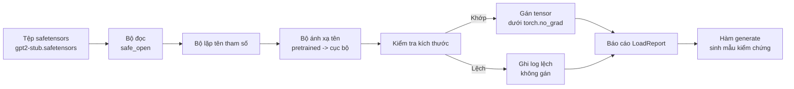

# Nạp trọng số tiền huấn luyện (Loading Pretrained Weights)

> Huấn luyện một mô hình 124 triệu tham số từ con số không là một quyết định tốn kém về ngân sách; nạp một điểm kiểm tra (checkpoint) đã công bố là công việc thường nhật. Bài học này sẽ nạp các trọng số theo cấu trúc GPT-2 từ tệp safetensors vào chính xác kiến trúc mô hình từ bài học 35, bóc tách từng bước ánh xạ tên tham số (parameter name mapping), và sinh thử nghiệm một đoạn văn bản tiếp nối để chứng minh việc nạp trọng số đã thành công mỹ mãn. Không cần kết nối mạng, không dùng thư viện nạp bên thứ ba, không có cơ chế mờ ám.

**Type:** Build
**Languages:** Python
**Prerequisites:** Phase 19 bài 30 đến 36
**Time:** ~90 phút

## Mục tiêu học tập

- Đọc tệp safetensors bằng thư viện Python `safetensors` và kiểm tra tên cùng kích thước của từng tensor.
- Ánh xạ từng tên tham số tiền huấn luyện sang tên tham số tương ứng bên trong mô hình GPT từ bài học 35.
- Xử lý hai quy ước đặt tên khác nhau giữa trọng số GPT-2 công bố chính thức và mô hình tự xây dựng: `wte/wpe/h.N.attn.c_attn/c_proj` và `mlp.c_fc/c_proj` so với quy ước cục bộ `tok_embed/pos_embed/blocks.N.attn.qkv/out_proj` và `mlp.fc1/fc2`.
- Phát hiện và từ chối nạp khi có sự lệch kích thước (shape mismatch) với thông báo lỗi rõ ràng trước khi bất kỳ phép gán trọng số nào diễn ra.
- Sinh một đoạn văn bản tiếp nối ngắn bằng các trọng số đã nạp và xác nhận rằng các token sinh ra đến từ phân phối trọng số đã nạp, chứ không phải từ phân phối khởi tạo ngẫu nhiên ban đầu.

## Vấn đề đặt ra

Các trọng số công bố trong cộng đồng nghiên cứu không được đóng gói sẵn cho riêng kiến trúc của bạn. Chúng mang các tên gọi mà bản hiện thực gốc đã sử dụng. Tệp tiền huấn luyện lưu `transformer.h.0.attn.c_attn.weight` với kích thước `(2304, 768)`; mô hình của bạn lại chờ đợi `blocks.0.attn.qkv.weight` có kích thước `(2304, 768)` (cùng một ma trận nhưng theo quy ước bố cục khác) hoặc mô hình của bạn dùng `nn.Linear` vốn lưu ma trận ở dạng chuyển vị. Cùng một tham số nhưng xuất hiện với ba danh tính hơi khác biệt (tên gọi, kích thước chiều, và bố cục byte trong bộ nhớ), và bộ nạp (loader) buộc phải hòa giải cả ba yếu tố này.

Một bộ nạp sao chép mù quáng sẽ đặt đúng tensor vào sai vị trí và tạo ra một mô hình chỉ sinh ra những câu từ vô nghĩa. Một bộ nạp từ chối sao chép khi kích thước sai lệch nhưng không ghi nhật ký sẽ khiến bạn phải đoán mò xem tensor nào không nạp được. Bộ nạp trong bài học này hoạt động minh bạch: từng phép gán đều được ghi nhật ký, từng kích thước đều được kiểm tra, và một cấu trúc `LoadReport` sẽ tổng kết các trường hợp khớp, thiếu, và lệch kích thước để bạn nắm bắt chính xác chuyện gì đã diễn ra.

## Khái niệm cốt lõi



Bộ ánh xạ tên thực chất là một hàm chuyển đổi chuỗi sang chuỗi. Kiểm tra kích thước là một câu lệnh điều kiện `if`. Phép gán diễn ra bên trong khối `torch.no_grad()` để autograd không theo dõi quá trình nạp. Báo cáo lưu giữ kết quả xử lý của từng tên tham số.

### Quy ước đặt tên của GPT-2

Các trọng số GPT-2 công bố được lưu dưới các tên gọi như sau:

| Tên tiền huấn luyện | Kích thước | Ý nghĩa kỹ thuật |
|---|---|---|
| `wte.weight` | (50257, 768) | Nhúng token (Token embedding) |
| `wpe.weight` | (1024, 768) | Nhúng vị trí (Position embedding) |
| `h.N.ln_1.weight` | (768,) | Hệ số tỉ lệ LayerNorm 1 tại khối N |
| `h.N.ln_1.bias` | (768,) | Độ dịch LayerNorm 1 tại khối N |
| `h.N.attn.c_attn.weight` | (768, 2304) | Trọng số tuyến tính QKV hợp nhất |
| `h.N.attn.c_attn.bias` | (2304,) | Độ lệch tuyến tính QKV hợp nhất |
| `h.N.attn.c_proj.weight` | (768, 768) | Phép chiếu đầu ra chú ý |
| `h.N.attn.c_proj.bias` | (768,) | Độ lệch phép chiếu đầu ra chú ý |
| `h.N.ln_2.weight` | (768,) | Hệ số tỉ lệ LayerNorm 2 |
| `h.N.ln_2.bias` | (768,) | Độ dịch LayerNorm 2 |
| `h.N.mlp.c_fc.weight` | (768, 3072) | Trọng số tầng fc1 của MLP |
| `h.N.mlp.c_fc.bias` | (3072,) | Độ lệch tầng fc1 của MLP |
| `h.N.mlp.c_proj.weight` | (3072, 768) | Trọng số tầng fc2 của MLP |
| `h.N.mlp.c_proj.bias` | (768,) | Độ lệch tầng fc2 của MLP |
| `ln_f.weight` | (768,) | Hệ số tỉ lệ LayerNorm cuối cùng |
| `ln_f.bias` | (768,) | Độ dịch LayerNorm cuối cùng |

Có hai bất ngờ cần lưu ý trước. Các tầng tuyến tính `c_attn`, `c_proj`, `c_fc` được lưu trữ với ma trận bị chuyển vị so với những gì `nn.Linear.weight` mong đợi. Bộ nạp phải thực hiện chuyển vị trong quá trình gán. Đầu LM (LM head) hoàn toàn không có mặt trong tệp trọng số; mô hình dựa vào kỹ thuật liên kết trọng số với `wte`, do đó đầu LM được thiết lập bằng bí danh (aliasing) ngay khi `wte` được nạp xong.

### Quy ước đặt tên cục bộ

Mô hình tự xây dựng trong chuỗi bài này dùng các tên mang tính mô tả rõ ràng:

| Tên cục bộ | Ý nghĩa kỹ thuật |
|---|---|
| `tok_embed.weight` | Nhúng token |
| `pos_embed.weight` | Nhúng vị trí |
| `blocks.N.ln1.scale` | Hệ số tỉ lệ LayerNorm 1 tại khối N |
| `blocks.N.ln1.shift` | Độ dịch LayerNorm 1 |
| `blocks.N.attn.qkv.weight` | Trọng số QKV hợp nhất |
| `blocks.N.attn.qkv.bias` | Độ lệch QKV hợp nhất |
| `blocks.N.attn.out_proj.weight` | Phép chiếu đầu ra chú ý |
| `blocks.N.attn.out_proj.bias` | Độ lệch phép chiếu đầu ra |
| `blocks.N.ln2.scale` | Hệ số tỉ lệ LayerNorm 2 |
| `blocks.N.ln2.shift` | Độ dịch LayerNorm 2 |
| `blocks.N.mlp.fc1.weight` | Trọng số tầng fc1 của MLP |
| `blocks.N.mlp.fc1.bias` | Độ lệch tầng fc1 của MLP |
| `blocks.N.mlp.fc2.weight` | Trọng số tầng fc2 của MLP |
| `blocks.N.mlp.fc2.bias` | Độ lệch tầng fc2 của MLP |
| `final_ln.scale` | Hệ số tỉ lệ LayerNorm cuối |
| `final_ln.shift` | Độ dịch LayerNorm cuối |

Ánh xạ này là một hàm cố định. Bài học cung cấp nó dưới dạng một từ điển (dict) mà bộ nạp sẽ lặp qua.

### Tệp giả lập mẫu (Stub Fixture)

Trọng số GPT-2 thật có kích thước khoảng 0,5 GB. Bản demo này không tải tệp nặng đó về máy; nó sẽ tạo một tệp safetensors nhỏ giả lập ngay trong lần chạy đầu tiên, với đúng quy ước đặt tên của GPT-2 và kích thước phù hợp với mô hình 12 khối tại d_model 192 thay vì 768. Tệp giả lập có cấu trúc hoàn toàn chuẩn mực để kích hoạt mọi nhánh mã nguồn trong bộ nạp. Khi thay tệp giả lập bằng tệp trọng số thật, bộ nạp sẽ hoạt động mà không cần thay đổi một dòng mã nào.

````figure
cc-weight-remap
````

## Xây dựng thực tế

`code/main.py` hiện thực hóa:

- Bản sao gọn gàng của `GPTModel` từ bài 35 để bài học này hoàn toàn độc lập.
- `make_pretrained_to_local(num_layers)` mở rộng các mục ánh xạ cho từng tầng.
- `load_safetensors(model, path)` lặp qua các tên, ánh xạ chúng, kiểm tra kích thước, chuyển vị các trọng số kiểu conv1d, và gán giá trị dưới cờ `torch.no_grad()`. Hàm trả về một đối tượng `LoadReport`.
- `make_stub_safetensors(path, cfg)` tạo tệp dữ liệu giả lập với đúng quy ước đặt tên của mô hình tiền huấn luyện.
- Một bản demo tạo `outputs/gpt2-stub.safetensors` trong lần chạy đầu tiên, khởi tạo mô hình mới, ghi lại mẫu văn bản sinh ra khi khởi tạo ngẫu nhiên, nạp tệp giả lập, ghi lại mẫu văn bản sau khi nạp, in cả hai mẫu, và xác minh rằng chúng khác nhau (chứng minh việc nạp trọng số đã thực sự làm thay đổi hành vi của mô hình).

Chạy mã nguồn:

```bash
python3 code/main.py
```

Đầu ra: đường dẫn tệp giả lập, nhật ký nạp từng tham số, bảng tổng kết `LoadReport`, mẫu văn bản trước khi nạp, mẫu văn bản sau khi nạp, và một trường hợp cố tình tiêm lỗi lệch kích thước tensor để kích hoạt và kiểm thử nhánh xử lý lỗi.

## Ngăn xếp công nghệ

- `safetensors` cho định dạng tệp trên đĩa và khả năng đọc truyền phát (streaming reader).
- `torch` cho cấu trúc mô hình và các phép toán gán tensor.
- Không dùng thư viện `transformers`, không dùng `huggingface_hub`, không thực hiện bất kỳ lệnh gọi mạng nào.

## Các mẫu thiết kế trong môi trường sản xuất thực tế

Ba mẫu thiết kế giúp bộ nạp đứng vững trước các bộ trọng số mà bạn không trực tiếp tạo ra:

**Luôn thẩm định tệp trước khi gán bất kỳ trọng số nào.** Mở tệp, liệt kê tất cả các tên tensor kèm kiểu dữ liệu (dtype) và kích thước, chạy toàn bộ quy trình kiểm tra ánh xạ và kích thước; chỉ khi mọi thứ hợp lệ mới tiến hành gán trọng số. Các mô hình bị nạp dở dang một nửa là những cỗ máy sinh lỗi ngầm cực kỳ nguy hiểm.

**Ghi nhật ký mọi phép gán với tên nguồn và tên đích rõ ràng.** Khi có điều gì bất thường, nhật ký sẽ cho bạn biết chính xác tensor nào đã rơi vào vị trí nào; phương án thay thế tồi tệ là phải ngồi đọc các bãi kết xuất nhị phân (hexdump). Lớp dữ liệu `LoadReport` trong bài này theo dõi các danh sách `loaded`, `missing`, `unexpected`, và `shape_mismatch`, sau đó in bản tóm tắt ở cuối quá trình.

**Đầu LM là bí danh liên kết trọng số, không phải bản sao riêng biệt.** Thiết lập `model.lm_head.weight = model.tok_embed.weight` sau khi nạp `tok_embed` là mẫu thiết kế chuẩn mực. Sao chép ma trận nhúng vào một tham số `lm_head.weight` mới sẽ phá vỡ liên kết trọng số và âm thầm làm nhân đôi số lượng tham số thực tế của bạn.

## Ứng dụng thực tế

- Bộ nạp hoạt động với bất kỳ tệp safetensors nào tuân theo quy ước đặt tên tiền huấn luyện. Các tệp GPT-2 thật (small / medium / large / xl) hoạt động trơn tru mà không cần đổi mã; chỉ có cấu hình mô hình là khác nhau.
- Mô hình thiết kế tương tự áp dụng dễ dàng cho trọng số của LLaMA, Mistral, hay Qwen khi bạn cập nhật bảng ánh xạ tên. Các bước kiểm tra kích thước và lập báo cáo giữ nguyên 100%.
- Thử nghiệm sinh văn bản ngay sau khi nạp là chốt chặn nhanh chóng: nếu mẫu sinh ra sau khi nạp trông giống hệt mẫu sinh ra lúc khởi tạo ngẫu nhiên, việc nạp đã không làm thay đổi mô hình, nghĩa là bảng ánh xạ đã bỏ sót toàn bộ các tensor trong im lặng.

## Bài tập

1. Thêm đối số `dtype` vào bộ nạp để ép kiểu từng tensor sang kiểu dữ liệu đích (`bfloat16`, `float16`, `float32`) trong khi gán. Xác nhận rằng một mô hình `float32` có thể hạ kiểu về `bfloat16` mà vẫn sinh văn bản bình thường.
2. Thêm đối số `expected_layers` để từ chối nạp điểm kiểm tra nếu chỉ số `h.N` không khớp với `num_layers` của mô hình.
3. Ghép bộ nạp vào hàm sinh văn bản từ bài 35 và tạo hai mẫu văn bản đặt cạnh nhau: một mẫu từ khởi tạo ngẫu nhiên, một mẫu từ tệp giả lập đã nạp.
4. Xây dựng đường dẫn xuất dữ liệu: ghi lại trạng thái hiện tại của mô hình vào một tệp safetensors mới bằng quy ước đặt tên tiền huấn luyện. Nạp vòng tròn (round trip) lại tệp đó vào bộ nạp và xác nhận báo cáo ghi nhận 0 lỗi lệch kích thước.
5. Mở rộng `NAME_MAP` để xử lý quy ước đặt tên của LLaMA (không có bias, dùng RMSNorm, bố cục qkv hợp nhất) và chạy lại bộ nạp trên một tệp giả lập LLaMA do bạn tự tạo.

## Thuật ngữ then chốt

| Thuật ngữ | Cách gọi thông thường | Ý nghĩa kỹ thuật thực sự |
|---|---|---|
| Name map | "Ánh xạ khóa / Key remapping" | Hàm ánh xạ từ tên tensor tiền huấn luyện sang tên tham số cục bộ; thường là một dict với các mục được lặp mở rộng theo chỉ số tầng |
| Shape mismatch | "Lệch kích thước" | Tensor tiền huấn luyện tồn tại dưới tên đã ánh xạ nhưng số chiều không khớp với tham số cục bộ; bộ nạp từ chối gán và ghi log cảnh báo |
| Transpose-on-load | "Bố cục Conv1d" | Trọng số GPT-2 công bố lưu các phép chiếu chú ý và MLP ở dạng chuyển vị so với mong đợi của nn.Linear; bộ nạp phải chuyển vị khi gán |
| Weight tying alias | "Đầu LM dùng chung" | Thiết lập model.lm_head.weight = model.tok_embed.weight để đầu LM và nhúng chia sẻ bộ nhớ; đầu LM không xuất hiện trong tệp vì lý do này |
| Load report | "Báo cáo độ bao phủ" | Một dataclass theo dõi các danh sách loaded, missing, unexpected, và shape_mismatch; in báo cáo là cách bạn biết việc nạp có thành công hay không |

## Đọc thêm

- Phase 19 bài 35 để nắm vững kiến trúc tiếp nhận trọng số.
- Phase 19 bài 36 để xem vòng lặp huấn luyện tạo ra một điểm kiểm tra có cùng cấu trúc.
- Phase 10 bài 11 (lượng tử hóa - quantization) để biết cách xử lý các trọng số đã nạp khi bộ nhớ bị giới hạn.
- Phase 10 bài 13 (xây dựng đường ống LLM hoàn chỉnh - building a complete LLM pipeline) để xem toàn bộ vòng đời xoay quanh việc nạp và suy luận mô hình.
