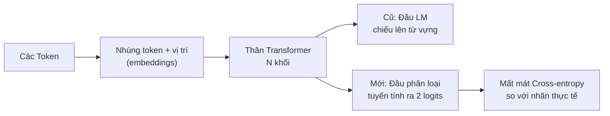
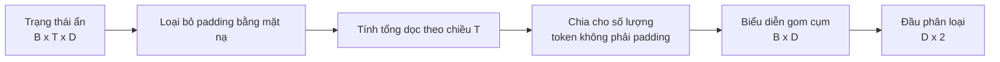
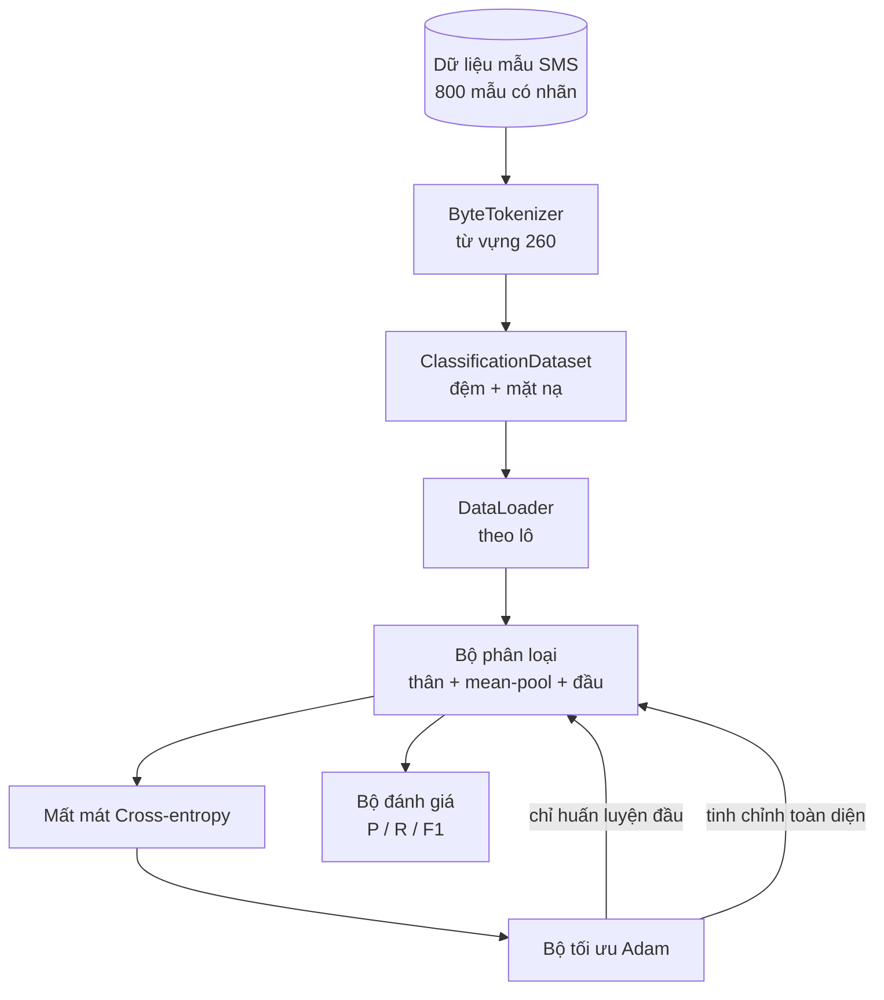

# Bài học Capstone 38: Tinh chỉnh bộ phân loại bằng kỹ thuật tráo đổi đầu (Classifier Fine-Tuning by Head Swap)

> Dự án capstone đầu tiên của Chuỗi bài B. Một mô hình ngôn ngữ tiền huấn luyện thực chất là một chuỗi xếp chồng các khối tự chú ý (self-attention blocks) kết thúc bằng một đầu dự đoán token. Khi bạn cần giải quyết bài toán phân loại thư rác (spam) hay thư thường (ham), phần đầu dự đoán ngôn ngữ không còn phù hợp nhưng phần thân (body) của mô hình thì hầu như đã nắm bắt đúng cấu trúc ngôn ngữ. Bài học này sẽ bóc tách đầu dự đoán cũ, gắn một tầng tuyến tính hai lớp phân loại vào biểu diễn được gom cụm (pooled representation), và huấn luyện bộ phân loại theo hai phương pháp khác nhau: chỉ huấn luyện tầng đầu ra (head-only) và tinh chỉnh toàn diện (full fine-tuning). Đánh giá hiệu năng dựa trên độ chuẩn xác (precision), độ thu hồi (recall) và điểm F1 trên tập dữ liệu giữ lại. Bạn sẽ hiểu rõ mỗi chiến lược mang lại lợi ích gì và cái giá phải trả là bao nhiêu.

**Type:** Build
**Languages:** Python (torch, numpy)
**Prerequisites:** Phase 19 bài 30 đến 37 (Chuỗi bài NLP LLM: bộ tách từ - tokenizer, bảng nhúng từ - embedding table, khối chú ý - attention block, thân transformer, vòng lặp tiền huấn luyện, lưu điểm kiểm tra, sinh văn bản, độ hỗn loạn - perplexity)
**Time:** ~90 phút

## Mục tiêu học tập

- Thay thế đầu mô hình ngôn ngữ bằng đầu phân loại mà không cần khởi tạo lại phần thân của mô hình.
- Hiện thực hóa hai chế độ huấn luyện: đóng băng phần thân (head-only) và tinh chỉnh toàn diện (full fine-tuning), cùng chia sẻ chung một vòng lặp huấn luyện duy nhất.
- Xây dựng đường ống dữ liệu nhận biết bộ tách từ để thực hiện đệm (padding), tạo mặt nạ đệm (masking padding), và gom cụm đầu ra của cơ chế chú ý (pooling attention output).
- Tính toán độ chuẩn xác (precision), độ thu hồi (recall), điểm F1, và ma trận nhầm lẫn (confusion matrix) từ điểm số logit thô.
- Phân tích và đánh giá sự đánh đổi giữa số lượng tham số, thời gian huấn luyện và dư địa cải thiện hiệu năng (head-room).

## Vấn đề đặt ra

Bạn đã tiền huấn luyện một mô hình transformer nhỏ trên một kho ngữ liệu tổng quát. Đầu ra của mô hình chiếu trạng thái ẩn cuối cùng lên từ vựng gồm 1.000 token. Bây giờ bạn có 800 tin nhắn SMS được dán nhãn là spam (tin rác) hoặc ham (tin thường) và bạn cần một bộ phân loại nhị phân. Có ba lựa chọn.

Lựa chọn sai lầm là huấn luyện một bộ phân loại hoàn toàn mới từ con số không trên 800 mẫu dữ liệu này. Phần thân của mô hình tiền huấn luyện đã mã hóa sẵn các cấu trúc rất hữu ích: danh tính từ vựng, thông tin vị trí, và quan hệ đồng xuất hiện đơn giản. Vứt bỏ nó đi là lãng phí toàn bộ tài nguyên tính toán đã đầu tư để tạo ra nó.

Hai lựa chọn đúng đắn là: tráo đổi đầu với phần thân được đóng băng (frozen body), và tráo đổi đầu với phần thân cho phép huấn luyện (trainable body). Huấn luyện chỉ phần đầu diễn ra cực nhanh, hầu như không tốn thêm bộ nhớ và hiếm khi bị quá khớp (overfit) trên lượng dữ liệu ít ỏi này. Tinh chỉnh toàn diện thì chậm hơn, dễ có nguy cơ quá khớp trên tập dữ liệu nhỏ, nhưng lại có thể đạt độ chính xác cao hơn khi miền dữ liệu hạ nguồn (downstream domain) trôi dạt xa khỏi kho ngữ liệu tiền huấn luyện.

Bài học này xây dựng cả hai phương án để bạn có thể so sánh trực tiếp trên cùng một tập dữ liệu thử nghiệm.

## Khái niệm cốt lõi



Mô hình là một hàm số `f_theta(tokens) -> hidden_states`. Đầu mô hình là một hàm số `g_phi(hidden) -> logits`. Tráo đổi đầu đồng nghĩa với việc giữ lại bộ tham số `theta` và thay thế hàm `g_phi`. Các tham số của phần thân là thành phần tốn kém nhất. Phần đầu chỉ là một tầng tuyến tính đơn lẻ.

Có hai tập tham số có thể huấn luyện:

- `theta` (phần thân): hàng chục ngàn trọng số trên mỗi khối chú ý.
- `phi` (phần đầu): `hidden_dim * num_classes` trọng số cộng thêm một vector bias.

Trong chế độ huấn luyện chỉ phần đầu, bạn tính gradient đối với `phi` và triệt tiêu gradient đối với `theta`. PyTorch cho phép làm điều này bằng cách thiết lập `requires_grad=False` trên các tham số của phần thân. Bộ tối ưu hóa khi đó chỉ nhìn thấy phần đầu và phần thân được giữ đóng băng hoàn toàn.

Trong chế độ tinh chỉnh toàn diện, bạn để dòng gradient lan truyền ngược xuyên suốt toàn bộ chuỗi khối xếp chồng. Các trọng số của phần thân sẽ dịch chuyển dần để thích ứng với mục tiêu phân loại. Rủi ro ở đây là hiện tượng quên thảm khốc (catastrophic forgetting) trên tập dữ liệu nhỏ: tri thức tiền huấn luyện của phần thân bị xóa nhòa bởi nhiễu quá khớp.

## Câu hỏi về kỹ thuật gom cụm (Pooling)

Một bộ phân loại cần đúng một vector đại diện cho mỗi chuỗi, chứ không phải một vector cho từng token. Ba lựa chọn phổ biến:

- **Gom cụm trung bình (Mean pool)**: lấy trung bình cộng các trạng thái ẩn dọc theo chuỗi, có trọng số thông qua mặt nạ chú ý (attention mask).
- **Gom cụm CLS (CLS pool)**: chèn thêm một token đặc biệt vào đầu chuỗi và chỉ lấy đầu ra của token này. Đây là cách làm của BERT.
- **Gom cụm token cuối (Last-token pool)**: lấy trạng thái của token thực sự cuối cùng (không phải token đệm). Đây là cách làm của các bộ phân loại thuộc dòng GPT.

Bài học này sử dụng gom cụm trung bình với việc áp dụng mặt nạ chú ý tường minh. Đây là phương pháp đơn giản nhất, mang lại tín hiệu ổn định trên các độ dài chuỗi khác nhau, và không đòi hỏi phải tiền huấn luyện trước một token CLS.



## Dữ liệu thực nghiệm

Tám trăm tin nhắn SMS, cân bằng hoàn hảo giữa 400 spam và 400 ham, được tạo ra một cách tất định trong `code/main.py`. Bộ sinh dữ liệu sử dụng một seed cố định, lựa chọn các mẫu câu và điền vào các vị trí trống, xuất ra các tin nhắn có độ dài từ 5 đến 25 token. Dữ liệu thực tế thường chứa nhiều nhiễu mà bộ dữ liệu mẫu này không có. Mục đích của việc dùng dữ liệu mẫu là đảm bảo tính tái lập 100%.

Dữ liệu được chia theo tỷ lệ 80/20: 640 mẫu huấn luyện, 160 mẫu kiểm thử. Việc phân chia được phân tầng (stratified) để tập kiểm thử vẫn giữ đúng tỷ lệ cân bằng 50/50. Một tập dữ liệu kiểm tra giữ lại với tỷ lệ nhãn đã biết giúp các chỉ số độ chuẩn xác và độ thu hồi phản ánh chân thực năng lực của mô hình.

## Các chỉ số đánh giá

Bài toán phân loại nhị phân với nhãn 1 là lớp dương tính (spam). Các số đếm bao gồm:

- `TP` (True Positive): dự đoán là spam, thực tế đúng là spam.
- `FP` (False Positive): dự đoán là spam, thực tế là ham (báo động nhầm).
- `FN` (False Negative): dự đoán là ham, thực tế là spam (bỏ lọt rác).
- `TN` (True Negative): dự đoán là ham, thực tế đúng là ham.

Ba chỉ số quan trọng hàng đầu:

- `precision = TP / (TP + FP)`. Trong số các tin nhắn bị gắn cờ là spam, có bao nhiêu phần trăm thực sự là spam?
- `recall = TP / (TP + FN)`. Trong tổng số spam thực tế, mô hình đã phát hiện được bao nhiêu phần trăm?
- `F1 = 2 * P * R / (P + R)`. Trung bình điều hòa giữa precision và recall.

Ma trận nhầm lẫn (confusion matrix) hiển thị bốn giá trị đếm này dưới dạng lưới 2x2. Bản demo sẽ in ma trận này ra stdout cho cả hai chế độ huấn luyện.

````figure
cap-classifier-head-swap
````

## Kiến trúc hệ thống



Phần thân mô hình là một transformer được chủ đích thu nhỏ: từ vựng 260, chiều ẩn 64, 4 đầu chú ý, 2 khối, độ dài chuỗi tối đa 32. Kích thước này đủ nhỏ để huấn luyện cả hai chế độ đến khi hội tụ chỉ trong vòng 90 giây trên CPU. Mô hình không được tiền huấn luyện trước từ bên ngoài; thay vào đó, hàm hỗ trợ `pretrain_quick` sẽ chạy 5 epoch huấn luyện mô hình ngôn ngữ trên chính văn bản của tập dữ liệu mẫu để mang lại cho phần thân một điểm xuất phát có ý nghĩa. Điều này giúp bài học hoàn toàn độc lập và khép kín.

## Những gì bạn sẽ xây dựng

Bản hiện thực gồm một tệp `main.py` cùng một module kiểm thử (`code/tests/test_main.py`).

1. `ByteTokenizer`: ánh xạ byte thành các mã định danh, dành riêng một mã id cho padding.
2. `Block`: một khối transformer với cơ chế chú ý đa đầu và một tầng truyền thẳng (feed-forward). Cấu trúc pre-norm.
3. `LMBody`: nhúng token + vị trí cùng một chuỗi các khối xếp chồng. Trả về các trạng thái ẩn.
4. `MeanPool`: tính trung bình có trọng số theo mặt nạ dọc theo trục chuỗi thời gian.
5. `Classifier`: kết hợp thân, lớp gom cụm, và đầu tuyến tính. Cùng một thực thể thân được tái sử dụng qua các chế độ huấn luyện.
6. `freeze_body` và `unfreeze_body`: bật tắt thuộc tính `requires_grad` trên các tham số của phần thân.
7. `train_classifier`: một vòng lặp huấn luyện dùng chung. Nhận vào mô hình và một bộ tối ưu hóa được cấu hình riêng cho nhóm tham số được phép huấn luyện.
8. `evaluate`: chạy trên tập kiểm thử và trả về `Metrics(precision, recall, f1, confusion)`.
9. `run_demo`: tiền huấn luyện nhanh phần thân, sau đó huấn luyện và đánh giá chế độ chỉ huấn luyện đầu, tiếp đến là tinh chỉnh toàn diện, in cả hai báo cáo và thoát với mã 0.

## Tại sao việc so sánh này lại quan trọng

Chế độ chỉ huấn luyện phần đầu thường huấn luyện nhanh hơn và khi bị thiếu khớp (underfit) thì kết quả suy giảm nhẹ nhàng hơn. Trên tập dữ liệu thử nghiệm này, bạn thường thấy độ chuẩn xác đạt gần 0.9 và độ thu hồi đạt gần 0.85 sau 20 epoch huấn luyện chỉ phần đầu. Tinh chỉnh toàn bộ mô hình tốn thời gian lâu hơn khoảng ba lần và kết quả có thể chênh lệch một vài phần trăm theo cả hai chiều tùy thuộc vào seed ngẫu nhiên.

Bài học không chọn ra phương pháp nào là người chiến thắng tuyệt đối. Nó dạy bạn cách đọc các con số và đánh giá chi phí. Trên 800 ví dụ và một phần thân nhỏ, chỉ huấn luyện phần đầu là quyết định đúng đắn. Trên 80.000 ví dụ và một phần thân lớn hơn, tinh chỉnh toàn diện bắt đầu phát huy rõ rệt ưu thế. Giá trị cốt lõi bạn nhận được từ bài học này là giao diện lập trình (API): cùng một hàm `train_classifier` duy nhất xử lý được cả hai kịch bản, và việc chuyển đổi chỉ cần một lệnh gọi đơn giản.

## Mục tiêu mở rộng

- Thêm chế độ thứ ba chỉ rã đông (unfreeze) khối transformer cuối cùng. Kỹ thuật này thường được gọi là tinh chỉnh một phần (partial fine-tuning). Nó tốn ít tài nguyên hơn tinh chỉnh toàn phần nhưng học được nhiều hơn chế độ chỉ huấn luyện đầu.
- Thêm bộ điều chỉnh lịch trình tốc độ học (learning rate scheduler). Lịch trình cosine cho phần đầu kết hợp với tốc độ học nhỏ hơn cố định cho phần thân là cấu hình chuẩn trong môi trường sản xuất.
- Thay thế gom cụm trung bình bằng gom cụm chú ý có học (learned attention pool): một tầng chú ý nhỏ với một vector query duy nhất có thể học được. Phương pháp này thường vượt trội hơn mean pool trên các chuỗi dài.

Bản hiện thực cung cấp sẵn các điểm kết nối (hooks). Các bài kiểm thử xác định rõ hợp đồng hoạt động. Việc bứt phá các giới hạn con số phụ thuộc vào sự khám phá của bạn.
