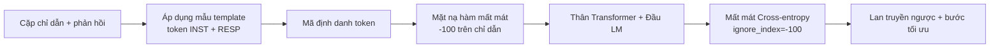
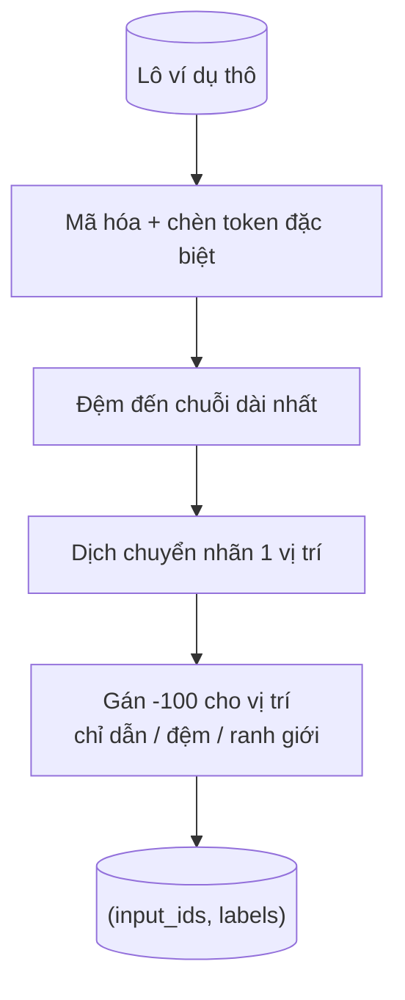
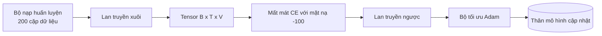

# Bài học Capstone 39: Tinh chỉnh chỉ dẫn bằng Tinh chỉnh có giám sát (Instruction Tuning by Supervised Fine-Tuning)

> Một mô hình nền tảng tiền huấn luyện (base model) có thể nối dài một chuỗi văn bản nhưng hoàn toàn không biết cách làm theo một chỉ dẫn. Tinh chỉnh có giám sát (Supervised Fine-Tuning - SFT) là bước thay đổi tối thiểu khắc phục triệt để điều này: cung cấp cho mô hình các cặp ví dụ gồm câu chỉ dẫn (instruction) và câu phản hồi mong muốn (desired response), rồi huấn luyện phần thân mô hình dự đoán các token phản hồi. Mấu chốt kỹ thuật ở đây là hàm mất mát chỉ được tính toán trên câu phản hồi, tuyệt đối không tính trên câu chỉ dẫn. Bài học này sẽ xây dựng một vòng lặp SFT theo phong cách Alpaca với hàm gom lô tùy biến (custom collate function) giúp che các token chỉ dẫn bằng `ignore_index=-100`, huấn luyện trên 200 cặp chỉ dẫn - phản hồi, và đánh giá trên tập kiểm thử giữ lại bằng chỉ số khớp chính xác (exact-match).

**Type:** Build
**Languages:** Python (torch, numpy)
**Prerequisites:** Phase 19 bài 30 đến 37 (Chuỗi bài NLP LLM: bộ tách từ - tokenizer, bảng nhúng từ - embedding table, khối chú ý - attention block, thân transformer, vòng lặp tiền huấn luyện, lưu điểm kiểm tra, sinh văn bản, độ hỗn loạn - perplexity)
**Time:** ~90 phút

## Mục tiêu học tập

- Định dạng dữ liệu cặp chỉ dẫn - phản hồi thành một chuỗi nhân quả duy nhất với các token ranh giới (boundary tokens) rõ ràng.
- Xây dựng một hàm gom lô (collate function) áp dụng mặt nạ che các token chỉ dẫn để hàm mất mát cross-entropy chỉ tính toán trên các token phản hồi.
- Huấn luyện một phần thân transformer nhỏ theo mục tiêu SFT và quan sát sự chuyển biến tích cực của chỉ số đánh giá.
- Hiện thực hóa cơ chế sinh văn bản theo phương pháp tham lam (greedy) và lấy mẫu theo nhiệt độ (temperature-sampled) tôn trọng ranh giới bắt đầu phản hồi.
- Tính toán chỉ số khớp chính xác (exact-match) trên các câu hoàn thiện sinh ra từ tập kiểm thử giữ lại.

## Vấn đề đặt ra

Một mô hình nền tảng chỉ được huấn luyện trên bài toán dự đoán token tiếp theo sẽ không có bất kỳ ý niệm nào về việc thế nào là một "chỉ dẫn". Đưa cho nó chuỗi ký tự `"Thủ đô của nước Pháp là gì?"`, nó sẽ tiếp tục nối dài câu hỏi hoặc tự bịa ra một câu văn bất kỳ tiếp theo. Mô hình nắm được ngữ pháp ngôn ngữ nhưng không hiểu được giao ước định dạng hội thoại.

Giao ước SFT là một khuôn mẫu chuỗi (string template). Mỗi mẫu huấn luyện được chuyển đổi thành một chuỗi đơn nhất với ba phân vùng:

```text
<INST> Thủ đô của nước Pháp là gì? <RESP> Thủ đô của nước Pháp là Paris.
```

Các token ranh giới là các token đặc biệt được đăng ký trước khi huấn luyện. Mô hình học được quy luật rằng mọi thứ sau `<RESP>` là câu phản hồi và câu phản hồi mới là phần bị chấm điểm. Mục tiêu dự đoán token tiếp theo của mô hình nền tảng vẫn được áp dụng; chỉ khác là nó được huấn luyện trên một kho ngữ liệu mà mỗi ví dụ đều tuân theo cấu trúc này.

Nhưng có một cái bẫy kỹ thuật. Nếu bạn truyền toàn bộ chuỗi này vào hàm mất mát cross-entropy thông thường, bạn đang vô tình huấn luyện mô hình dự đoán cả các token của câu chỉ dẫn. Câu chỉ dẫn là dữ kiện đã cho sẵn từ người dùng. Bạn cần gradient tại các vị trí đó phải bằng 0 tuyệt đối. Giải pháp cứu cánh ở đây là tạo mặt nạ (mask).

## Khái niệm cốt lõi



`ignore_index` là một tính năng mạnh mẽ của `torch.nn.functional.cross_entropy`. Bất kỳ vị trí mục tiêu nào có giá trị bằng `ignore_index` sẽ đóng góp mức mất mát bằng 0 và tạo ra gradient bằng 0. Giá trị quy ước chuẩn trong PyTorch là `-100`. Hàm gom lô sẽ tạo ra hai tensor cho mỗi ví dụ: `input_ids` (toàn bộ chuỗi văn bản) và `labels` (bản sao của `input_ids` nhưng các vị trí thuộc câu chỉ dẫn bị ghi đè bằng giá trị `-100`).

Mô hình vẫn quan sát toàn bộ chuỗi trong lượt lan truyền xuôi; cơ chế chú ý vẫn có thể tham chiếu đầy đủ đến câu chỉ dẫn. Tuy nhiên, hàm mất mát chỉ tính toán duy nhất trên các token phản hồi. Đây chính xác là điều kiện bạn cần: lấy câu chỉ dẫn làm điều kiện tiên quyết, và tập trung tối đa vào việc dự đoán câu phản hồi.

## Dữ liệu thực nghiệm

Hai trăm cặp chỉ dẫn - phản hồi được tạo ra một cách tất định trong `main.py`. Chúng bao quát sáu loại tác vụ:

- Sự thật thực tế một lượt (Thủ đô của X)
- Tính toán số học
- Trích xuất danh sách
- Tóm tắt trong một câu
- Sinh mã lập trình (lệnh in, sắp xếp)
- Định nghĩa khái niệm

Mỗi tác vụ có một câu chỉ dẫn theo khuôn mẫu và một câu phản hồi tất định. Dữ liệu này được cố tình thiết kế đơn giản. Chỉ số khớp chính xác vốn rất nhạy cảm và khắt khe, nên bài học sử dụng tập dữ liệu thử nghiệm mà câu trả lời đúng là một chuỗi ký tự cố định duy nhất. Các tập dữ liệu SFT thực tế sẽ cần các chỉ số đánh giá mềm dẻo hơn; nhưng nguyên lý cốt lõi thì hoàn toàn tương đồng.

Dữ liệu được chia theo tỷ lệ 160 mẫu huấn luyện và 40 mẫu kiểm thử. Tập kiểm thử bao phủ toàn bộ sáu loại tác vụ để có thể báo cáo chỉ số khớp chính xác chi tiết cho từng danh mục.

## Tách từ và Đệm chuỗi (Tokenisation and Padding)

Bộ tách từ hoạt động ở cấp độ byte với ba mã token đặc biệt dành riêng:

- `INST_ID = 256`: đánh dấu điểm bắt đầu của phân vùng chỉ dẫn.
- `RESP_ID = 257`: đánh dấu ranh giới chuyển tiếp giữa chỉ dẫn và phản hồi.
- `PAD_ID = 258`: token đệm dùng cho các lô có độ dài chuỗi không đồng đều.

Chuỗi hoàn chỉnh có dạng `[INST] inst_bytes [RESP] resp_bytes [PAD]*`. Hàm gom lô thực hiện:

1. Tách từ cho từng ví dụ.
2. Đệm tất cả các ví dụ trong lô đến độ dài của chuỗi dài nhất trong lô đó.
3. Tạo `labels` = `input_ids` dịch chuyển một vị trí (mục tiêu mô hình ngôn ngữ nhân quả), với:
   - Toàn bộ phân vùng chỉ dẫn được thay thế bằng `-100`.
   - Toàn bộ phân vùng đệm padding được thay thế bằng `-100`.
   - Vị trí ranh giới `RESP_ID` cũng được thay thế bằng `-100` (bạn không huấn luyện mô hình dự đoán token ranh giới; bạn chỉ huấn luyện nó dự đoán nội dung tiếp nối sau đó).



Bước dịch chuyển là thủ thuật nhân quả kinh điển: vị trí `i` của `input_ids` sẽ dự đoán vị trí `i+1`, do đó `labels[i] = input_ids[i+1]` (với vị trí cuối cùng bị loại bỏ khỏi đầu vào và vị trí đầu tiên bị loại khỏi mục tiêu). Mặt nạ `-100` được áp dụng sau bước dịch chuyển để rơi chính xác vào các vị trí cần che.

## Quá trình huấn luyện



Vòng lặp là cấu trúc SFT chuẩn mực trong PyTorch: bộ tối ưu hóa Adam, tốc độ học khoảng 3e-4 đến 1e-3, huấn luyện từ 10 đến 20 epoch trên tập dữ liệu này, không cần bộ điều chỉnh lịch trình LR. Mô hình đủ nhỏ (chiều ẩn 96, 2 khối, độ dài tối đa 64) để huấn luyện hội tụ trên CPU trong chưa đầy hai phút.

Cứ sau mỗi 5 epoch, vòng lặp lại thực hiện một lượt đánh giá nhanh trên tập dữ liệu kiểm thử giữ lại và in chỉ số khớp chính xác. Chứng kiến chỉ số exact-match tăng từ 0.0 ở epoch đầu tiên lên khoảng 0.85 ở epoch thứ 15 là thành quả xứng đáng của bài học: bạn trực tiếp thấy mô hình học được khuôn mẫu định dạng và câu trả lời cùng một lúc.

## Quá trình sinh văn bản

Tại thời điểm đánh giá, mô hình nhận tiền tố câu chỉ dẫn `[INST] inst_bytes [RESP]` và liên tục sinh ra các token cho đến khi thỏa mãn một trong hai điều kiện:

- Chuỗi đạt độ dài tối đa `max_len`, hoặc
- Mô hình phát ra dấu hiệu dừng phỏng đoán đặc biệt: hai byte kết thúc câu liên tiếp (`.`, `!`, `?`).

Bài học cung cấp phương pháp giải mã tham lam (greedy decoding) cùng bộ lấy mẫu theo nhiệt độ tùy chọn. Đánh giá exact-match bắt buộc dùng giải mã tham lam để tránh biến chỉ số đánh giá thành một đại lượng ngẫu nhiên. Các hệ thống thực tế thường lấy mẫu đa dạng rồi dùng một mô hình trọng tài chấm điểm mờ; quy trình đó sẽ được trình bày ở bài 41.

## Đánh giá khớp chính xác (Exact-Match Evaluation)

Khớp chính xác (exact-match) là thước đo văn bản khắt khe nhất. Chuỗi phản hồi được mô hình dự đoán sẽ được chuẩn hóa (chuyển chữ thường, cắt bỏ khoảng trắng thừa, thu gọn khoảng trắng kép) và so sánh trực tiếp với chuỗi phản hồi chuẩn tham chiếu cũng được chuẩn hóa tương tự. Thước đo nhận giá trị 1 hoặc 0 cho mỗi ví dụ. Điểm tổng hợp là giá trị trung bình cộng.

Các hệ thống SFT thực tế thường bổ sung thêm điểm F1 cấp độ token (bài 41) và một mô hình ngôn ngữ lớn làm giám khảo (LLM-as-a-judge). Khớp chính xác vẫn giữ nguyên giá trị to lớn vì nó hoàn toàn rõ ràng, không có sự nhập nhằng; nếu chỉ số báo 0.7, điều đó có nghĩa là chính xác 70% các câu chỉ dẫn trong tập kiểm thử đã sinh ra câu trả lời chuẩn xác từng ký tự một.

````figure
cc-sft-loss-mask
````

## Những gì bạn sẽ xây dựng

Bản hiện thực gồm một tệp `main.py` cùng các bài kiểm thử tự động:

1. `InstructionTokenizer`: bộ mã hóa cấp độ byte với các token đặc biệt dành riêng. Có khả năng mã hóa tiền tố chỉ dẫn đơn lẻ hoặc toàn bộ cặp chỉ dẫn - phản hồi.
2. `make_dataset`: tạo 200 cặp dữ liệu trải rộng trên sáu loại tác vụ với seed ngẫu nhiên cố định.
3. `SFTDataset`: trả về `(input_ids, labels)` cho từng mẫu, đã được chuẩn bị sẵn sàng cho việc tạo mặt nạ.
4. `sft_collate`: thực hiện đệm động (dynamic padding), xây dựng tensor theo lô, gán `-100` cho các vị trí chỉ dẫn và padding.
5. `TinyGPT`: thân transformer kết hợp với đầu LM liên kết hoặc tách rời.
6. `train_sft`: vòng lặp SFT hoàn chỉnh, tích hợp các điểm nối (hooks) đánh giá sau mỗi epoch.
7. `generate`: giải mã nhân quả từ tiền tố câu mồi, hỗ trợ chọn tham lam hoặc lấy mẫu, kèm cơ chế dừng phỏng đoán.
8. `exact_match`: hàm so sánh chuỗi đã chuẩn hóa, trả về giá trị số thực trong đoạn `[0, 1]`.
9. `run_demo`: khởi tạo dữ liệu, huấn luyện trong 20 epoch, thực hiện đánh giá, in phân tích chi tiết theo từng danh mục tác vụ, và thoát thành công với mã 0.

## Tại sao mặt nạ lại đóng vai trò quyết định

Nếu không có mặt nạ, hàm mất mát sẽ coi các token của câu chỉ dẫn như các mục tiêu cần dự đoán. Mô hình sẽ học cách tự tái tạo lại câu chỉ dẫn. Đây là một mục tiêu hoàn toàn sai lệch và làm suy giảm chất lượng mô hình theo hai cách. Thứ nhất, dung lượng tham số quý giá của mô hình bị lãng phí vào việc học tái tạo các dữ liệu đầu vào mà người dùng chắc chắn luôn cung cấp sẵn. Thứ hai, mức mất mát của câu phản hồi sẽ bị lấn át trong tổng gradient vì số lượng token chỉ dẫn thường áp đảo số token phản hồi trong phần lớn các lô; tốc độ học hiệu dụng của bộ tối ưu trên phần nội dung bạn thực sự quan tâm sẽ bị kéo thấp hơn nhiều so với dự tính. Mặt nạ không phải là một chi tiết trau chuốt bên ngoài; nó chính là cốt lõi của mục tiêu tối ưu.

## Mục tiêu mở rộng

- Thêm giai đoạn làm nóng tốc độ học (warmup) nối tiếp bằng suy giảm cosine. SFT nhạy cảm với tốc độ học hơn nhiều so với giai đoạn tiền huấn luyện.
- Ghi nhật ký hàm mất mát trên từng token và vẽ biểu đồ biến thiên qua các epoch. Bạn sẽ nhận thấy những epoch đầu tiên bị chi phối bởi các token khuôn mẫu (`<RESP>`, các tiền tố thông dụng), trong khi các epoch sau mới thực sự tập trung tối ưu các token chứa câu trả lời thực sự.
- Mở rộng tiêu chí đánh giá với điểm BLEU-1 hoặc chrF. Chỉ số khớp chính xác thường đánh giá thấp các mô hình biết diễn đạt lại bằng từ đồng nghĩa nhưng vẫn truyền tải đúng câu trả lời.
- Thêm khuôn mẫu trò chuyện (chat template) với định dạng hội thoại nhiều lượt (multi-turn) và huấn luyện trên tập dữ liệu mẫu có chứa các câu hỏi tiếp nối.

Bản hiện thực này cung cấp đầy đủ giao ước định dạng, cơ chế mặt nạ và vòng lặp huấn luyện. Sự chuyển dịch mục tiêu từ một mô hình nền tảng thành một trợ lý biết tuân thủ chỉ dẫn thực chất chỉ nằm gọn trong một hàm gom lô duy nhất.
