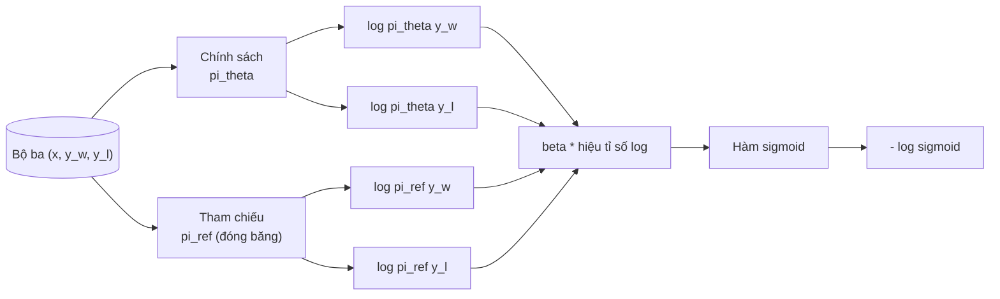
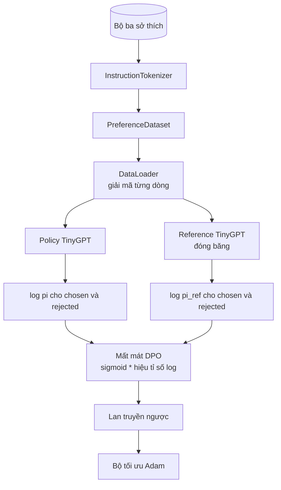

# Bài học Capstone 40: Tối ưu hóa tùy chọn trực tiếp từ số không (Direct Preference Optimization from Scratch)

> Mô hình phần thưởng (reward model) và thuật toán PPO là ngăn xếp RLHF kinh điển. DPO (Direct Preference Optimization - Tối ưu hóa tùy chọn trực tiếp) thu gọn toàn bộ ngăn xếp cồng kềnh đó thành một hàm mất mát có giám sát duy nhất, tối ưu trực tiếp chính sách mô hình (policy) dựa trên các cặp dữ liệu sở thích của con người. Bài học này sẽ dẫn xuất toán học hàm mất mát DPO từ đẳng thức chênh lệch phần thưởng, cung cấp một cặp mô hình tham chiếu (reference model) và mô hình chính sách hoạt động thực tế, tính toán log-xác suất trên từng token, và huấn luyện một transformer nhỏ trên tập dữ liệu sở thích gồm các câu hoàn thiện được chọn (chosen) và bị loại (rejected). Các bài kiểm thử tự động sẽ kiểm chứng công thức toán học và chiều hướng của gradient để đảm bảo bản hiện thực chuẩn xác tuyệt đối theo bài báo gốc.

**Type:** Build
**Languages:** Python (torch, numpy)
**Prerequisites:** Phase 19 bài 30 đến 37 (Chuỗi bài NLP LLM: bộ tách từ - tokenizer, bảng nhúng từ - embedding table, khối chú ý - attention block, thân transformer, vòng lặp tiền huấn luyện, lưu điểm kiểm tra, sinh văn bản, độ hỗn loạn - perplexity)
**Time:** ~90 phút

## Mục tiêu học tập

- Dẫn xuất hàm mất mát DPO dưới dạng hàm sigmoid trên hiệu số tỉ số log có nhân tỉ lệ (scaled log-ratio difference) và liên hệ nó với hàm phần thưởng ẩn (implicit reward).
- Xây dựng cặp mô hình tham chiếu và mô hình chính sách, trong đó mô hình tham chiếu được đóng băng hoàn toàn và mô hình chính sách có thể huấn luyện.
- Tính toán log-xác suất ở cấp độ chuỗi trên cả hai mô hình, đồng thời che đi các token thuộc câu mồi (prompt).
- Huấn luyện mô hình chính sách trên các bộ ba `(prompt, chosen, rejected)` và quan sát log-xác suất của câu được chọn tăng dần so với câu bị loại.
- Khóa chặt hành vi của hệ thống bằng các bài kiểm thử kiểm tra công thức mất mát, dấu của gradient, và tính bất biến của mô hình tham chiếu.

## Vấn đề đặt ra

Bạn đã có một mô hình SFT. Nó biết tuân thủ các chỉ dẫn, nhưng kết quả đầu ra chưa đồng đều: một số câu phản hồi rất sáng sủa súc tích, trong khi một số khác lại dài dòng, lan man hoặc sai lệch. Bạn cũng sở hữu một tập dữ liệu nhỏ gồm các cặp dữ liệu sở thích: với cùng một câu mồi, người đánh giá đã đánh dấu một câu phản hồi là được chọn (chosen) và câu còn lại là bị loại (rejected).

Lời giải truyền thống của RLHF (Học tăng cường từ phản hồi của con người) là quy trình hai giai đoạn: Huấn luyện một mô hình phần thưởng độc lập dựa trên dữ liệu sở thích. Sau đó tối ưu hóa chính sách mô hình theo mô hình phần thưởng đó bằng thuật toán PPO. Cách tiếp cận này hoạt động tốt nhưng cực kỳ tốn kém tài nguyên: phải nạp đồng thời hai mô hình vào bộ nhớ GPU trong suốt quá trình chạy PPO, phải kiểm soát phân kỳ KL để giữ cho chính sách không trôi quá xa khỏi mô hình tham chiếu, và dễ gặp hiện tượng "gian lận phần thưởng" (reward hacking) khi mô hình phần thưởng mắc sai sót.

DPO thay thế hoàn toàn cả hai giai đoạn trên bằng một hàm mất mát có giám sát duy nhất. Mô hình phần thưởng không bao giờ cần phải tồn tại tường minh. Mô hình chính sách được huấn luyện trực tiếp trên các cặp sở thích, với một hình phạt phân kỳ KL tường minh hướng về mô hình tham chiếu SFT được tích hợp sẵn bên trong công thức. Cùng một nghiệm tối ưu dưới mô hình sở thích Bradley-Terry, nhưng lượng mã nguồn giảm đi đáng kể.

## Khái niệm cốt lõi

Bắt đầu từ mô hình sở thích Bradley-Terry. Cho một câu mồi `x` và hai câu phản hồi hoàn thiện `y_w` (được chọn - chosen) và `y_l` (bị loại - rejected), xác suất mà con người ưu tiên lựa chọn `y_w` hơn `y_l` được mô hình hóa bởi:

```math
P(y_w > y_l \mid x) = \sigma\big( r(x, y_w) - r(x, y_l) \big)
```

trong đó `r` là một hàm phần thưởng tiềm ẩn. Quy trình RLHF trước tiên khớp hàm `r` từ dữ liệu sở thích, sau đó huấn luyện chính sách `pi` để tối đa hóa `r` kèm theo một mỏ neo phạt phân kỳ KL:

```math
\max_{\pi} \; \mathbb{E}_{x, y \sim \pi} \big[ r(x, y) \big] - \beta \, \mathrm{KL}(\pi \,\|\, \pi_{\text{ref}})
```

Dẫn xuất của DPO nhận thấy rằng chính sách tối ưu `pi*` theo mục tiêu trên có một nghiệm dạng đóng (closed form) biểu diễn qua `r`:

```math
\pi^*(y \mid x) = \frac{1}{Z(x)} \, \pi_{\text{ref}}(y \mid x) \exp\!\left( \frac{r(x, y)}{\beta} \right)
```

Biến đổi biểu thức trên để rút ra hàm phần thưởng `r`:

```math
r(x, y) = \beta \big( \log \pi^*(y \mid x) - \log \pi_{\text{ref}}(y \mid x) \big) + \beta \log Z(x)
```

Số hạng hàm phân vùng `log Z(x)` hoàn toàn giống nhau cho cả `y_w` và `y_l` (nó chỉ phụ thuộc vào `x`, không phụ thuộc vào `y`), do đó nó bị triệt tiêu hoàn toàn khi chúng ta tính hiệu số phần thưởng:

```math
\begin{aligned}
r(x, y_w) - r(x, y_l) = \beta \big( &\log \pi_\theta(y_w \mid x) - \log \pi_{\text{ref}}(y_w \mid x) \\
&- \log \pi_\theta(y_l \mid x) + \log \pi_{\text{ref}}(y_l \mid x) \big)
\end{aligned}
```

Thay hiệu số này vào hàm sigmoid của Bradley-Terry và lấy log-likelihood âm (negative log-likelihood) trên các cặp sở thích:

```math
\begin{aligned}
L_{\text{DPO}}(\theta) = -\mathbb{E}_{(x, y_w, y_l)} \Big[
  \log \sigma\big( \beta \big( &\log \pi_\theta(y_w \mid x) - \log \pi_{\text{ref}}(y_w \mid x) \\
  &- \log \pi_\theta(y_l \mid x) + \log \pi_{\text{ref}}(y_l \mid x) \big) \big)
\Big]
\end{aligned}
```

Đây chính là hàm mất mát DPO. Nó là một hàm sigmoid trên một giá trị vô hướng duy nhất cho mỗi ví dụ, được tính toán từ bốn giá trị log-xác suất. Không cần mô hình phần thưởng riêng biệt. Không cần PPO. Không cần số hạng KL lộ thiên trong hàm mất mát; ràng buộc KL đã được tích hợp chặt chẽ ngay từ bước dẫn xuất dạng đóng.



## Dấu của Gradient

Một bước kiểm chứng tính đúng đắn hữu ích trước khi bắt đầu bất kỳ đợt huấn luyện nào. Hãy lấy đạo hàm riêng của hàm mất mát đối với `log pi_theta(y_w | x)`:

```math
\frac{\partial L_{\text{DPO}}}{\partial \log \pi_\theta(y_w \mid x)} = -\beta \big(1 - \sigma(z)\big)
```

với `z` là đối số truyền vào hàm sigmoid. Biểu thức này luôn mang giá trị âm với mọi `z`, điều này có nghĩa là: tăng log-xác suất của chính sách đối với câu hoàn thiện được chọn sẽ làm giảm hàm mất mát. Tương tự đối xứng, đạo hàm đối với `log pi_theta(y_l | x)` mang giá trị dương: tăng log-xác suất của câu bị loại sẽ làm tăng hàm mất mát. Quá trình huấn luyện do đó đẩy log-xác suất của câu được chọn tăng lên và dìm câu bị loại xuống. Mô hình tham chiếu luôn bị đóng băng; nó không bao giờ suy chuyển.

## Dữ liệu thực nghiệm

Mười hai bộ ba sở thích đi kèm bài học. Mỗi bộ ba gồm `(prompt, chosen, rejected)`. Câu hoàn thiện được chọn ngắn gọn và chính xác. Câu bị loại dài dòng, lạc đề hoặc sai nội dung. Các cặp này bao quát cùng các họ tác vụ như bài học 39 (thủ đô, số học, danh sách) để một chính sách xuất phát từ mô hình SFT có một điểm khởi đầu hợp lý.

Tập dữ liệu mẫu này được thiết kế nhỏ gọn một cách có chủ đích. DPO hoạt động trên hàng chục ngàn cặp trong môi trường sản xuất; ở đây, mục tiêu là để công thức toán học và vòng lặp có thể chạy thông suốt từ đầu đến cuối trên một tập dữ liệu nhỏ và khoảng cách log-xác suất giữa câu được chọn và câu bị loại mở rộng rõ rệt trước mắt bạn.

## Tính bất biến của mô hình tham chiếu (Reference Invariance)

Một bản hiện thực DPO phải quản lý mô hình tham chiếu hết sức cẩn thận. Mô hình tham chiếu chính là mô hình SFT được giữ nguyên bất động. Ba tính chất bắt buộc phải thỏa mãn:

- Các tham số của mô hình tham chiếu không bao giờ được phép nhận gradient.
- Các log-xác suất từ mô hình tham chiếu không bao giờ thay đổi giữa các epoch.
- Mô hình chính sách ban đầu phải xuất phát từ đúng các trọng số của mô hình tham chiếu. (Bộ trọng số tối ưu `theta` chính là trọng số tham chiếu cộng thêm một lượng cập nhật học được; khởi tạo chính sách như một bản sao của mô hình tham chiếu là điểm xuất phát chuẩn mực toán học.)

Bản hiện thực đảm bảo các tính chất này bằng cách:

- Bọc mô hình tham chiếu trong khối `torch.no_grad()` suốt các lượt lan truyền xuôi.
- Thiết lập `requires_grad=False` cho mọi tham số của mô hình tham chiếu.
- Khởi tạo chính sách bằng lệnh `policy.load_state_dict(reference.state_dict())` ngay sau khi xây dựng mô hình tham chiếu.

````figure
cap-dpo-preference
````

## Kiến trúc hệ thống



Mô hình ở đây chính là kiến trúc TinyGPT được sử dụng trong bài 39 (chỉ giải mã, nhân quả, bộ tách từ cấp byte). Mô hình tham chiếu và mô hình chính sách chia sẻ cùng một kiến trúc; trọng số của chính sách sẽ dần dịch chuyển khỏi mô hình tham chiếu trong quá trình huấn luyện, trong khi mô hình tham chiếu được giữ cố định hoàn toàn.

## Những gì bạn sẽ xây dựng

Bản hiện thực gồm một tệp `main.py` cùng các bài kiểm thử tự động:

1. `InstructionTokenizer`: bộ tách từ cấp byte với các token đặc biệt `INST` và `RESP`. Cùng cấu trúc với bài học 39.
2. `TinyGPT`: transformer chỉ giải mã. Có cùng cấu trúc với bài 39 để bài học này hoàn toàn độc lập ngay cả khi bạn chưa học bài 39.
3. `make_preferences`: trả về 12 bộ ba `(prompt, chosen, rejected)`.
4. `sequence_log_prob`: nhận vào mô hình, tiền tố câu mồi và câu hoàn thiện, trả về tổng các log-xác suất của token tiếp theo trên câu hoàn thiện (không tính phần đóng góp từ các vị trí thuộc câu mồi).
5. `dpo_loss`: nhận vào bốn giá trị log-xác suất cùng hệ số `beta`, trả về tensor mất mát cho từng ví dụ và độ chênh lệch phần thưởng ẩn phục vụ ghi nhật ký.
6. `train_dpo`: vòng lặp theo từng epoch tính toán log-xác suất của câu được chọn và bị loại dưới cả chính sách và tham chiếu, áp dụng hàm mất mát, và thực hiện bước tối ưu Adam.
7. `evaluate_margins`: tính toán và trả về biên độ chênh lệch trung bình log-xác suất giữa câu được chọn và bị loại dưới mô hình chính sách tại bất kỳ thời điểm nào.
8. `run_demo`: khởi tạo tham chiếu và chính sách từ một lượt tiền huấn luyện ngắn, sao chép trọng số, huấn luyện trong 30 bước, in ra mức mất mát và biên độ chênh lệch ở từng bước, rồi kết thúc thành công với mã 0.

## Tại sao DPO lại hiệu quả

DPO tương đương hoàn toàn về mặt toán học với quy trình RLHF truyền thống dưới mô hình sở thích Bradley-Terry, xét theo phép tham số hóa hàm phần thưởng. Hàm phần thưởng ẩn `r(x, y) = beta * (log pi(y|x) - log pi_ref(y|x))` hoàn toàn có thể xác định được từ dữ liệu sở thích sai khác một hàm theo `x` (vốn đã bị triệt tiêu trong phép trừ). Nghiệm dạng đóng của chính sách cho phép bạn bỏ qua hoàn toàn mô hình phần thưởng tường minh. Ràng buộc KL được áp đặt một cách tự nhiên theo mặt cấu trúc: bất kỳ sự trôi dạt nào của `pi` ra xa khỏi `pi_ref` đều làm tỉ số log lớn lên, khiến hàm sigmoid bão hòa và tự động triệt tiêu gradient khi chính sách đi quá xa. Mô hình tham chiếu đóng vai trò như chiếc lưới an toàn bảo vệ mô hình của bạn.

## Mục tiêu mở rộng

- Thêm chuẩn hóa theo độ dài vào tổng log-xác suất: chia tổng log-xác suất cho độ dài của câu hoàn thiện. Xu hướng thiên vị độ dài (length bias) là một lỗi thường gặp trong DPO, khi mô hình có xu hướng ưu tiên các câu phản hồi ngắn hơn đơn giản vì giá trị tuyệt đối của tổng log-xác suất của chúng nhỏ hơn.
- Thêm biến thể hàm mất mát IPO: thay thế tổ hợp sigmoid + log bằng `(z - 1)^2`. So sánh tốc độ hội tụ trên tập dữ liệu thử nghiệm.
- Bổ sung tham số làm mịn nhãn (label smoothing) để nội suy giữa nhãn cứng chosen/rejected và phân phối đều 0.5.
- Thay thế mô hình tham chiếu bằng một mô hình nhỏ hơn, nhẹ hơn (theo phong cách chưng cất tri thức - knowledge distillation).

Bản hiện thực này cung cấp cho bạn hàm mất mát, cơ chế đảm bảo tính bất biến của tham chiếu, và vòng lặp huấn luyện hoàn chỉnh. Nền tảng toán học là linh hồn của bài học. Mã nguồn sẽ biến toán học trừu tượng thành hiện thực trực quan sinh động.
