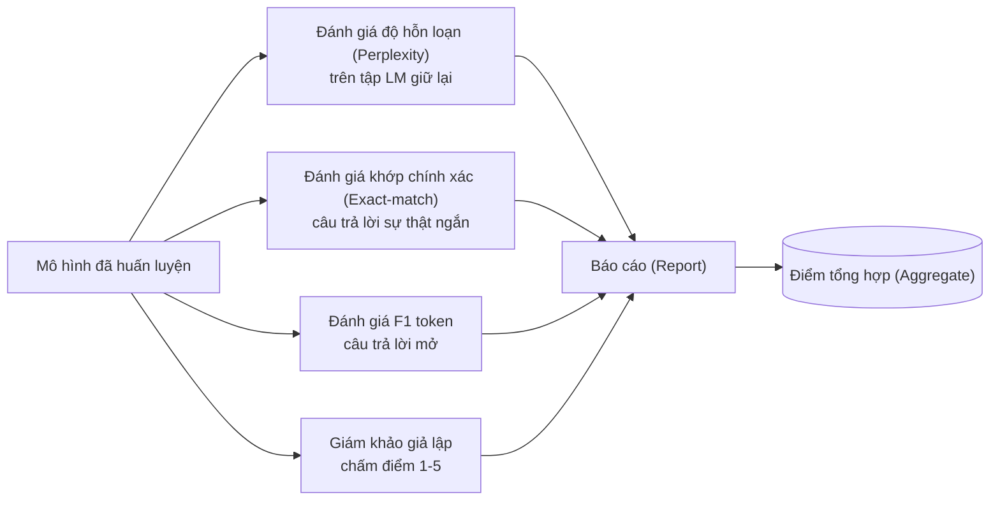
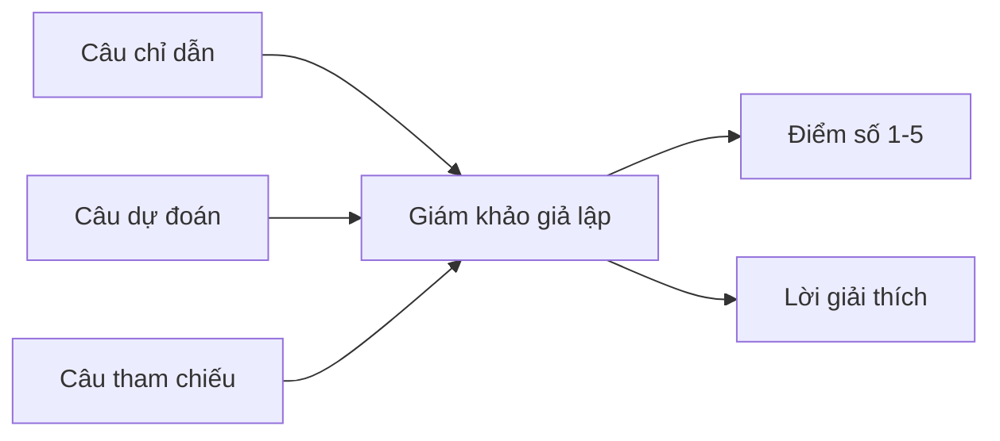
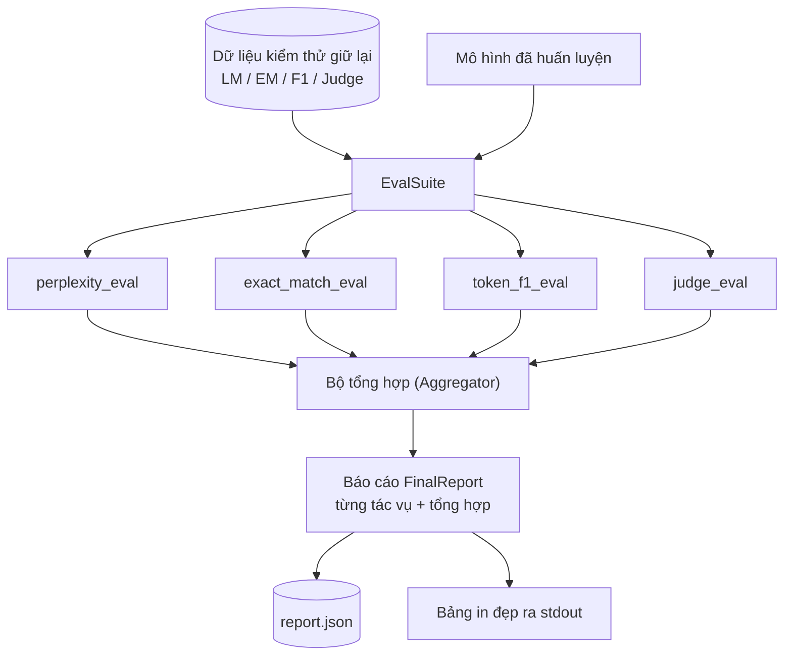

# Bài học Capstone 41: Đường ống đánh giá toàn diện (Full Evaluation Pipeline)

> Huấn luyện là phần bạn có thể giám sát bằng các đường cong hàm mất mát. Đánh giá là phần bạn bắt buộc phải chủ động thiết kế. Bài học này sẽ xây dựng một đường ống đánh giá thống nhất có thể tiếp nhận bất kỳ mô hình ngôn ngữ nào đã qua huấn luyện, thực thi bốn bài đánh giá không đồng nhất, tổng hợp các kết quả thành một báo cáo chi tiết theo từng tác vụ, và đi kèm một bộ giám khảo LLM cục bộ giả lập (local mock LLM-as-a-judge) để toàn bộ quy trình vận hành độc lập mà không cần kết nối mạng. Bốn bài đánh giá bao quát mọi chiều cạnh thiết yếu mà bất kỳ mô hình nào chuẩn bị đưa vào sản xuất cũng phải trải qua: mô hình hóa ngôn ngữ (độ hỗn loạn - perplexity), tính chuẩn xác của câu trả lời ngắn (khớp chính xác - exact-match), độ tương đồng của câu trả lời mở (token F1), và chấm điểm định tính (giám khảo LLM - judge).

**Type:** Build
**Languages:** Python (torch, numpy)
**Prerequisites:** Phase 19 bài 30 đến 37 (Chuỗi bài NLP LLM: bộ tách từ - tokenizer, bảng nhúng từ - embedding table, khối chú ý - attention block, thân transformer, vòng lặp tiền huấn luyện, lưu điểm kiểm tra, sinh văn bản, độ hỗn loạn - perplexity)
**Time:** ~90 phút

## Mục tiêu học tập

- Tính toán độ hỗn loạn (perplexity) trên tập kiểm thử giữ lại có tính đến việc loại trừ các token đệm (padding tokens) trên một mô hình transformer nhỏ.
- Vận hành bài đánh giá khớp chính xác (exact-match) trên các câu mồi mang tính sự thật ngắn gọn.
- Tính toán chỉ số F1 cấp độ token (token-level F1) giữa chuỗi dự đoán và chuỗi tham chiếu sau khi đã qua bước chuẩn hóa văn bản.
- Xây dựng một giám khảo LLM cục bộ giả lập (local mock LLM-as-a-judge) chấm điểm đầu ra của mô hình theo thang điểm từ 1 đến 5 kèm lời giải thích.
- Tổng hợp bốn bài đánh giá thành một báo cáo có trọng số duy nhất với bảng phân tích chi tiết theo từng tác vụ.

## Vấn đề đặt ra

Một chỉ số đơn lẻ không bao giờ có thể mô tả toàn diện năng lực của một mô hình ngôn ngữ. Độ hỗn loạn (perplexity) chỉ cho biết mô hình khớp tốt đến đâu với phân phối ngôn ngữ nhưng hoàn toàn không nói lên được liệu nó có trả lời đúng câu hỏi hay không. Khớp chính xác (exact-match) đo lường xem mô hình có sinh ra đúng chuỗi văn bản mẫu hay không nhưng lại trừng phạt oan uổng những cách diễn đạt đồng nghĩa hoàn toàn chính xác. Điểm F1 token chấp nhận việc diễn đạt tương đương nhưng lại dễ bị đánh lừa bởi những câu có nhiều từ trùng lặp dù nội dung hoàn toàn sai lệch. Phương pháp giám khảo LLM (LLM-as-a-judge) nắm bắt được các khía cạnh định tính tinh tế nhưng lại tốn kém chi phí và mang tính ngẫu nhiên.

Đường ống đánh giá thực tế bạn cần phải hội tụ đủ cả bốn phương pháp trên. Mỗi bài đánh giá sẽ bao quát một chiều cạnh mà các phương pháp khác bỏ sót. Mỗi bài chạy trên một tập con dữ liệu giữ lại riêng biệt được thiết kế chuyên biệt cho chỉ số đó. Báo cáo cuối cùng sẽ đặt các chỉ số theo từng tác vụ cạnh nhau cùng một điểm số tổng hợp, giúp người đánh giá nắm bắt ngay lập tức mô hình đang đánh đổi những gì.

Bài học này xây dựng trọn vẹn đường ống đánh giá đó từ đầu đến cuối chỉ trong một tệp duy nhất.

## Khái niệm cốt lõi



Mỗi bài đánh giá là một hàm có dạng `(model, dataset) -> EvalResult`. Kết quả trả về chứa giá trị chỉ số định lượng, chi tiết từng ví dụ phục vụ kiểm tra sâu, và tên định danh dùng cho khâu tổng hợp. Đường ống kết hợp các bài đánh giá lại với nhau dựa trên một cấu hình quy định rõ những bài nào cần chạy và trọng số tương ứng của từng bài là bao nhiêu.

## Tính toán độ hỗn loạn (Perplexity) một cách chuẩn xác

Độ hỗn loạn là `exp(trung bình log-likelihood âm trên mỗi token)`. Bản hiện thực có hai cạm bẫy kỹ thuật kinh điển:

- Giá trị trung bình phải được tính trên tổng số vị trí token thực tế, không phải trên `batch * sequence`. Các token đệm (padding) bắt buộc phải bị loại bỏ khỏi mẫu số, nếu không độ hỗn loạn trông sẽ "đẹp" hơn nhiều so với năng lực thực sự của mô hình.
- Mô hình dự đoán token tiếp theo, nghĩa là điểm logit ở vị trí `i` sẽ dự đoán token ở vị trí `i+1`. Lỗi lệch một vị trí (off-by-one) ở đây diễn ra trong im lặng: mô hình vẫn huấn luyện bình thường nhưng chỉ số thu được trở nên hoàn toàn vô nghĩa.

Bài đánh giá sẽ tính tổng các giá trị `-log p(token)` trên các vị trí không phải padding theo từng lô cùng số lượng token thực tế của lô đó, sau đó mới thực hiện phép chia ở bước tổng kết cuối cùng. Cách làm này an toàn hơn nhiều về mặt số học so với việc lấy trung bình cộng độ hỗn loạn của từng lô (vốn sẽ đánh giá thấp các chuỗi ngắn) và hoàn toàn khớp với định nghĩa trong sách giáo khoa.

## Khớp chính xác (Exact-Match) kèm bước chuẩn hóa

Quy trình đánh giá sẽ chuẩn hóa cả câu dự đoán lẫn câu tham chiếu trước khi so sánh:

- Chuyển toàn bộ về chữ thường.
- Cắt bỏ khoảng trắng thừa ở hai đầu.
- Thu gọn các chuỗi khoảng trắng bên trong thành một dấu cách duy nhất.
- Bỏ dấu câu kết thúc ở cuối chuỗi (`.`, `!`, `?`) nếu hai chuỗi chỉ khác nhau duy nhất ở dấu câu này.

Chuẩn hóa giúp chỉ số khớp chính xác trở nên hữu dụng trong thực tế. Một mô hình trả lời `"Paris"` là đúng; trả lời `"Paris."` cũng đúng; trả lời `"  paris  "` vẫn là đúng. Thước đo này vẫn yêu cầu câu trả lời phải trùng khớp ký tự sau khi đã qua bước chuẩn hóa.

## Điểm F1 Token theo chuẩn mực

Điểm F1 token là trung bình điều hòa giữa độ chuẩn xác (precision) và độ thu hồi (recall) được tính toán trên tập hợp đa phần tử các từ (bag-of-tokens). Các bước thực hiện:

1. Chuẩn hóa câu dự đoán và câu tham chiếu (cùng quy tắc như khớp chính xác).
2. Tách mỗi chuỗi thành danh sách các token (tách theo khoảng trắng).
3. Đếm số lượng phần tử trong giao của hai tập đa phần tử (multiset intersection).
4. Độ chuẩn xác (Precision) = `số_lượng_giao / len(tokens_dự_đoán)`. Độ thu hồi (Recall) = `số_lượng_giao / len(tokens_tham_chiếu)`. F1 = trung bình điều hòa của Precision và Recall.

Nếu cả câu dự đoán và câu tham chiếu đều rỗng, F1 bằng 1 (khớp rỗng). Nếu chỉ có một bên rỗng, F1 bằng 0. Quy chuẩn này hoàn toàn khớp với chuẩn tham chiếu đánh giá SQuAD và tạo ra các con số ổn định qua nhiều cách diễn đạt khác nhau.

## Giám khảo LLM cục bộ giả lập (Local Mock LLM-as-Judge)

Một giám khảo thực tế thường là một mô hình hàng đầu (frontier model) đứng sau một giao diện lập trình API. Đối với bài học này, bộ giám khảo cần phải chạy ngoại tuyến hoàn toàn. Giám khảo giả lập là một bộ chấm điểm tất định nhận vào câu chỉ dẫn, câu dự đoán của mô hình và câu tham chiếu, sau đó trả về một điểm số trong tập `{1, 2, 3, 4, 5}` kèm theo lời giải thích ngắn gọn trong một dòng. Quy tắc chấm điểm hoàn toàn minh bạch:

- 5 điểm nếu câu dự đoán đã chuẩn hóa trùng khớp hoàn toàn với câu tham chiếu đã chuẩn hóa.
- 4 điểm nếu F1 token giữa câu dự đoán và câu tham chiếu đạt từ 0.8 trở lên.
- 3 điểm nếu F1 token nằm trong khoảng `[0.5, 0.8)`.
- 2 điểm nếu F1 token nằm trong khoảng `[0.2, 0.5)`.
- 1 điểm cho các trường hợp còn lại.

Đây tuy chưa phải là một giám khảo AI thực sự, nhưng nó mang đúng giao diện chuẩn mực. Bạn có thể dễ dàng thay thế nó bằng một mô hình thật sau này chỉ bằng việc sửa đổi một hàm duy nhất. Toàn bộ đường ống xử lý không hề bị ảnh hưởng.



## Tổng hợp kết quả (Aggregation)

Điểm tổng hợp là trung bình có trọng số của các điểm đánh giá đã được chuẩn hóa. Mỗi bài đánh giá sẽ tự chuẩn hóa điểm số của mình về thang đoạn `[0, 1]`:

- Độ hỗn loạn (Perplexity): chuẩn hóa theo công thức `1 / (1 + log(perplexity))`. Độ hỗn loạn bằng 1 sẽ ánh xạ thành 1, độ hỗn loạn tiến tới vô cùng sẽ ánh xạ về 0.
- Khớp chính xác (Exact-match): vốn đã nằm sẵn trong đoạn `[0, 1]`.
- F1 Token: vốn đã nằm sẵn trong đoạn `[0, 1]`.
- Giám khảo (Judge): lấy điểm số chia cho 5.

Các trọng số hoàn toàn có thể cấu hình được. Tỷ lệ mặc định là 0.2 cho độ hỗn loạn, 0.3 cho khớp chính xác, 0.3 cho F1 token, và 0.2 cho giám khảo. Việc lựa chọn trọng số là một quyết định mang tính chiến lược sản phẩm; bài học mở sẵn núm điều chỉnh này để bạn tự do thử nghiệm.

````figure
cg-eval-quadrant
````

## Kiến trúc hệ thống



Lớp `EvalSuite` đóng vai trò điều phối tinh gọn. Mỗi bài đánh giá riêng lẻ là một hàm độc lập nhận `(model, tokenizer, dataset, config)` và trả về một `EvalResult`. Lớp `Aggregator` thu thập toàn bộ các kết quả và sản sinh ra bản báo cáo cuối cùng. Bản demo sẽ in một bảng dữ liệu trực quan ra màn hình terminal và đồng thời lưu một bản sao JSON để các đường ống CI hạ nguồn có thể dễ dàng tiếp nhận.

## Những gì bạn sẽ xây dựng

Bản hiện thực gồm một tệp `main.py` cùng các bài kiểm thử tự động:

1. `TinyGPT`: kiến trúc transformer chỉ giải mã tương tự như các bài 38-40, được tích hợp sẵn để bài học này hoàn toàn độc lập.
2. `InstructionTokenizer`: bộ tách từ cấp byte với các token đặc biệt INST / RESP / PAD.
3. Bốn bộ dữ liệu thử nghiệm: một kho ngữ liệu LM, một tập EM, một tập F1, và một tập cho giám khảo. Mỗi tập gồm 20 mẫu được sinh tất định.
4. `perplexity_eval`: trả về `EvalResult` chứa giá trị độ hỗn loạn cùng biểu đồ tần suất mất mát trên từng token.
5. `exact_match_eval`: trả về giá trị EM trung bình và bản ghi chi tiết cho từng ví dụ.
6. `token_f1_eval`: trả về giá trị F1 token trung bình và bản ghi chi tiết cho từng ví dụ.
7. `mock_judge` và `judge_eval`: chấm điểm và đưa ra lời giải thích cho từng ví dụ, tính điểm số trung bình trên toàn bộ tập dữ liệu.
8. `Aggregator.normalise`: quy tắc chuẩn hóa chuyên biệt cho từng bài đánh giá.
9. `Aggregator.aggregate`: tính điểm trung bình có trọng số và đóng gói báo cáo hoàn chỉnh.
10. `run_demo`: huấn luyện nhanh một mô hình nhỏ, chạy đồng loạt cả bốn bài đánh giá, in bảng báo cáo trực quan, ghi tệp JSON, và thoát thành công với mã 0.

## Cách đọc bản báo cáo

Bản báo cáo được cấu trúc thành ba tầng thông tin. Tầng trên cùng là điểm số tổng hợp duy nhất. Ngay bên dưới là bốn con số định lượng chi tiết của từng bài đánh giá. Dưới cùng là danh sách bóc tách chi tiết từng ví dụ phục vụ cho công tác chẩn đoán lỗi sâu. Một đường ống kiểm thử tự động CI bị lỗi thường chỉ cần quan tâm đến điểm số tổng hợp, nhưng một kỹ sư đang điều tra sự suy giảm hiệu năng (regression) sẽ cần đào sâu vào từng ví dụ cụ thể để xem mô hình đã trả lời sai ở những đầu vào nào.

Bản xuất dữ liệu JSON sử dụng các khóa cố định bền vững để các bảng điều khiển CI (dashboards) có thể vẽ đồ thị xu hướng hiệu năng qua các phiên bản mô hình khác nhau. Bảng in đẹp trên màn hình terminal phục vụ trực tiếp cho kỹ sư quan sát ngay sau khi hoàn thành đợt huấn luyện.

## Mục tiêu mở rộng

- Thêm bài đánh giá độ chuẩn định (calibration eval): xác suất đầu ra sau softmax của mô hình có thực sự tương xứng với độ chính xác của nó không? Hãy chia các dự đoán vào các khoảng tin cậy (confidence buckets) và báo cáo độ chính xác thực nghiệm trên từng khoảng.
- Thêm bài đánh giá độ bền vững (robustness eval): gắn thẻ cho từng ví dụ với các dạng nhiễu hạt khác nhau (lỗi chính tả, diễn đạt lại, câu gây nhiễu) và báo cáo mức độ sụt giảm điểm số theo từng loại nhiễu.
- Thay thế giám khảo giả lập bằng một mô hình AI thực tế thông qua một lệnh gọi HTTP API. Chữ ký của hàm sẽ được giữ nguyên hoàn toàn.
- Học trọng số đánh giá theo từng tác vụ: thay vì dùng trọng số cố định, hãy khớp các trọng số sao cho phù hợp với thứ tự ưu tiên mô hình mong muốn trong thực tế.

Bản hiện thực này cung cấp cho bạn trọn bộ bốn bài đánh giá, bộ tổng hợp và cơ chế xuất báo cáo chuẩn mực. Các đường ống đánh giá đẳng cấp công nghiệp trong thực tế chỉ đơn giản là xếp chồng thêm nhiều chiều kích đánh giá nữa lên trên nền tảng này; mô hình kiến trúc vẫn không hề thay đổi: một hàm cho mỗi bài đánh giá, một bộ tổng hợp, và một bản báo cáo toàn diện.
