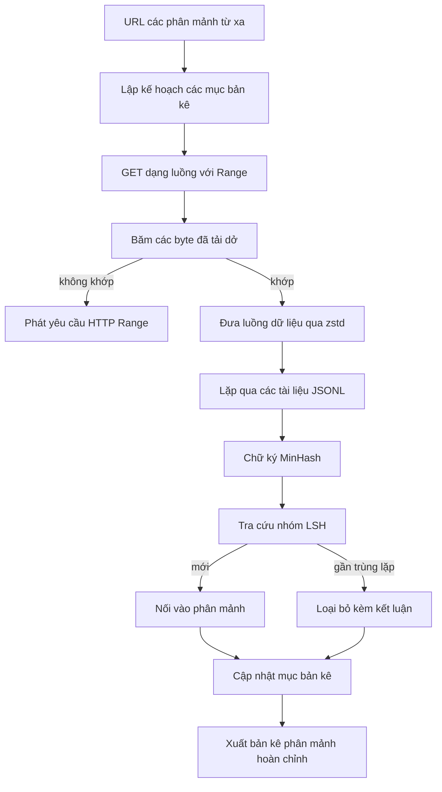

# Trình Tải Tập Dữ Liệu Quy Mô Lớn (Large Corpus Downloader)

> Huấn luyện một mô hình ngôn ngữ bắt đầu từ rất lâu trước lượt truyền xuôi (forward pass) đầu tiên. Tập dữ liệu (corpus) cần phải được lưu trữ xuống đĩa, giải nén, loại bỏ trùng lặp và sẵn sàng định vị chỉ mục, với giải pháp tiếp tục tải (resume) đã được tính toán kỹ lưỡng trước khi kết nối mạng bị gián đoạn ở mức 4 phần trăm. Bài học này xây dựng một trình tải dữ liệu dạng luồng (streaming downloader) có khả năng kéo các phân mảnh (shards) nén về máy, giải nén trực tiếp trên luồng bằng Zstandard, lấy dấu vân tay các tài liệu gần trùng lặp qua MinHash kết hợp băm nhạy cảm cục bộ (locality-sensitive hashing - LSH), và xuất ra một bản kê phân mảnh (shard manifest) mà phần còn lại của đường ống xử lý có thể hoàn toàn tin cậy.

**Type:** Build
**Languages:** Python
**Prerequisites:** Phase 19 lessons 30-37
**Time:** ~90 phút

## Mục Tiêu Học Tập

- Truyền dữ liệu dạng luồng từ các phân mảnh từ xa bằng `urllib` và giải nén bằng `zstandard` mà không cần đệm toàn bộ tệp vào bộ nhớ RAM.
- Tiếp tục tải các tệp tải dở bằng cách phát các yêu cầu HTTP `Range` dựa trên độ lệch byte đã kiểm chứng (verified byte offset).
- Xây dựng chữ ký MinHash cho từng tài liệu và phân nhóm bằng LSH để các tài liệu gần trùng lặp xảy ra va chạm băm (hash collision).
- Xuất bản kê phân mảnh kèm mã băm nội dung (content hash), kích thước byte, số lượng tài liệu và kết luận loại bỏ trùng lặp (dedup verdict).

## Vấn Đề

Lần đầu tiên bạn huấn luyện trên một tập dữ liệu 200 GB, đường truyền mạng bị đứt ở mức 41% và tập lệnh thoát với một ngoại lệ từ `urllib`. Lần thứ hai nó bị đứt ở 78%. Đến khi chạm mốc 99%, bạn đã phải viết lại vòng lặp ba lần. Hai sự cố bạn buộc phải tính đến ngay từ phút đầu tiên là tiếp tục tải khi bị gián đoạn (partial-download resume) và loại bỏ tài liệu trùng lặp (duplicate document removal). Cả hai đều có giải pháp rõ ràng; nhưng cả hai thường bị bỏ qua bởi vì đường ống dữ liệu thường khởi đầu từ một lời gọi `requests.get` đơn dòng đơn giản rồi dần phát sinh nhiều vấn đề phức tạp.

Tiếp tục tải là một bài toán HTTP. Máy chủ phải hỗ trợ tiêu đề `Range`, máy khách phải theo dõi độ lệch byte đã được xác thực so với bản ghi lưu trên đĩa, và độ lệch byte đã kiểm chứng này phải tồn tại nguyên vẹn ngay cả khi tiến trình bị tắt đột ngột. Nếu độ lệch và tệp trên đĩa lệch nhau dù chỉ một byte, quá trình tải tiếp tục sẽ ghi rác vào tệp và tập dữ liệu sẽ bị hỏng theo cách mà chỉ lộ ra trong quá trình mã hóa token (tokenization).

Loại bỏ trùng lặp là một bài toán về chữ ký đại diện. Việc khử trùng lặp bằng mã băm chính xác (exact-hash dedup) sẽ bỏ sót các tài liệu gần trùng lặp (near-duplicates): cùng một bài viết Wikipedia xuất hiện với ba phần chân trang chuẩn (boilerplate footers) khác nhau, cùng một tệp mã nguồn với phần tiêu đề giấy phép (license header) khác nhau, cùng một bài blog với tham số theo dõi (tracking parameter) gắn trên mỗi liên kết. MinHash kết hợp LSH bắt được những trường hợp này với chi phí dưới mức tuyến tính (sub-linear cost). Chi phí chỉ là một chữ ký đại diện cho mỗi tài liệu và một lần tra cứu nhóm (bucket lookup) cho mỗi chữ ký.

## Khái Niệm



### Xử lý luồng với `urllib`

Thư viện chuẩn `urllib.request.urlopen` trả về một đối tượng dạng tệp (file-like object). Bọc nó bên trong `zstandard.ZstdDecompressor().stream_reader`, các byte dữ liệu sẽ chảy thẳng từ mạng qua bộ giải nén vào bộ lặp tài liệu mà không bao giờ cần hiện thực hóa phân mảnh nén hoặc phân mảnh đã giải nén trong bộ nhớ RAM. Chi phí bộ nhớ duy nhất là bộ đệm dòng (line buffer), chữ ký MinHash cho tài liệu hiện tại, và chỉ mục LSH.

### Tiếp tục tải với `Range`

Trình tải ghi hai tệp cho mỗi phân mảnh: bản thân phân mảnh đó và một điểm kiểm tra (checkpoint) `.partial.json`. Điểm kiểm tra ghi lại `verified_bytes`, `expected_size`, `sha256_prefix` (được tính trên `verified_bytes` byte đầu tiên), và URL nguồn. Khi khởi động, trình tải đọc điểm kiểm tra, tính toán lại `sha256_prefix` trên các byte đã lưu trên đĩa, và chỉ tiếp tục tải nếu mã băm tính toán lại hoàn toàn khớp. Nếu mã băm sai, tệp tải dở sẽ bị hủy bỏ và quá trình tải khởi động lại từ byte số không. Hiện tượng hỏng dữ liệu âm thầm (silent corruption) là bất khả thi vì các byte đã xác thực luôn được kiểm tra chứ không bị giả định mù quáng.

### MinHash kết hợp LSH

MinHash ước tính độ tương đồng Jaccard (Jaccard similarity) của hai tập hợp trong một không gian cố định. Đối với một tài liệu, tập hợp ở đây là các mẩu từ/ký tự gối nhau (shingles - các n-gram gối nhau) của văn bản. Chữ ký gồm `k` giá trị băm nhỏ nhất, mỗi giá trị tương ứng với một hàm băm độc lập. Hai tài liệu có độ tương đồng Jaccard $s$ sẽ có xác suất $s$ trùng khớp trên bất kỳ một thành phần đơn lẻ nào của chữ ký.

LSH sau đó gom `k` thành phần thành `b` dải (bands), mỗi dải gồm `r` hàng (rows), trong đó $k = b \times r$. Hai tài liệu sẽ va chạm trong ít nhất một dải với xác suất $1 - (1 - s^r)^b$, tạo thành một ngưỡng dốc (sharp threshold) xung quanh giá trị $s$ mà bạn điều chỉnh thông qua cặp số $(b, r)$. Ngưỡng cho quá trình khử trùng lặp tập dữ liệu thông thường là $s = 0.8$, được tài liệu nghiên cứu LSH xác định là đạt được với $k = 128$, $b = 32$, $r = 4$.

### Bản kê phân mảnh như một bản giao ước (Contract)

Đầu ra bền vững (durable output) duy nhất của trình tải là bản kê (manifest). Bản kê lưu trữ cho mỗi phân mảnh: URL, số byte sau khi giải nén, số tài liệu, số tài liệu duy nhất sau khi khử trùng lặp, và mã sha256 của tệp phân mảnh cuối cùng. Quá trình mã hóa token ở hạ nguồn sẽ đọc bản kê này chứ không quét danh sách thư mục. Nếu một phân mảnh bị thiếu hoặc mã sha256 bị sai, bản kê sẽ chỉ đạo giai đoạn tiếp theo từ chối khởi động. Bản kê chính là ranh giới phân định giữa "dữ liệu đã được tải về" và "dữ liệu đã được tải về và có thể kiểm chứng được".

```figure
cap-corpus-downloader
```

## Tự Xây Dựng (Build It)

Tệp `code/main.py` cài đặt:

- `ShardPlanner` - đọc danh sách các URL phân mảnh và tạo ra các mục bản kê dự kiến.
- `StreamingDownloader` - mở luồng `urllib` hỗ trợ tùy chọn `Range`, ghi vào tệp tạm thời, cập nhật điểm kiểm tra `.partial.json` trên mỗi khối dữ liệu (chunk), và xác minh tiền tố sha256 khi tiếp tục tải.
- `ZstdDocIterator` - bọc luồng dữ liệu dạng tệp trong `zstandard.ZstdDecompressor` và sinh ra (yield) mỗi tài liệu trên một dòng.
- `MinHasher` - tạo chữ ký gồm `k` thành phần cho một chuỗi ký tự bằng cách sử dụng một họ các hạt giống băm (hash seeds) cố định.
- `LSHIndex` - phân nhóm các chữ ký theo từng dải và báo cáo các trường hợp va chạm.
- `Dedup` - kết hợp bộ băm và chỉ mục để gán nhãn cho mỗi tài liệu là `keep` (giữ lại) hoặc `near_duplicate` (gần trùng lặp) kèm theo id của phân mảnh tương ứng.
- `ManifestWriter` - thu thập số liệu thống kê trên từng phân mảnh và ghi tệp `manifest.json`.

Phần trình diễn ở cuối tệp xây dựng một tập dữ liệu tổng hợp nhỏ trên đĩa, nén bằng `zstandard`, tải về thông qua URL `file://`, loại bỏ trùng lặp và in bản kê.

Chạy thử:

```bash
python3 code/main.py
```

Tập lệnh thoát với mã lỗi 0 và in bản tóm tắt bản kê ra màn hình.

## Các Mô Hình Trong Thực Tế (Production Patterns)

Bốn mô hình giúp mở rộng quy mô bài học này sang các tập dữ liệu thực tế.

**Lưu điểm kiểm tra trước khi ghi (Checkpoint before write).** Tệp `.partial.json` phải được gọi `fsync` trước khi các byte được nối thêm vào phân mảnh. Nếu không, sự cố mất điện có thể đảo ngược thứ tự: byte của phân mảnh đã ghi xuống đĩa nhưng điểm kiểm tra chưa kịp cập nhật; lần tiếp tục tải kế tiếp sẽ tin rằng nó có ít byte đã kiểm chứng hơn thực tế, và các byte đuôi bị ghi trùng lặp sẽ làm hỏng tệp. Phải lưu điểm kiểm tra trước rồi mới ghi dữ liệu. Đây chính là nguyên tắc kỷ luật tương tự như nhật ký ghi trước (write-ahead log - WAL).

**Chỉ mục LSH phân mảnh (Sharded LSH index).** Một chỉ mục LSH duy nhất bao phủ toàn bộ tập dữ liệu sẽ không thể đặt vừa trong RAM ở quy mô 200 GB. Hãy phân vùng chỉ mục LSH theo mã băm của dải đầu tiên, lưu các phân vùng trên đĩa, và chỉ tham chiếu phân vùng mà chữ ký mới sẽ rơi vào. Chi phí đánh đổi là thêm một lần đọc đĩa cho mỗi tài liệu; bù lại, chỉ mục LSH không còn là trần giới hạn bộ nhớ cứng nữa.

**Đánh dấu bia mộ thay vì xóa bỏ (Tombstone, not delete).** Các tài liệu trùng lặp bị loại bỏ được ghi nhận vào bản kê với kết luận `near_duplicate` và id phân mảnh của tài liệu mà chúng bị va chạm. Xóa hẳn chúng sẽ làm mất mối liên kết giữa tài liệu trùng lặp và tài liệu gốc được giữ lại. Việc đánh dấu bia mộ (tombstoning) bảo toàn dấu vết kiểm toán (audit trail) và cho phép các bước xử lý hạ nguồn có thể thay đổi quyết định về ngưỡng phân định nếu cần.

**Mã sha256 từng phân mảnh trong bản kê, kèm mã sha256 cho chính bản kê.** Bản thân tệp bản kê cũng phải được tạo mã băm nội dung. Các giai đoạn hạ nguồn sẽ xác thực mã băm của bản kê trước khi tin tưởng vào các mục phân mảnh bên trong. Nếu thiếu điều này, bản kê sẽ là bề mặt tấn công âm thầm: kẻ tấn công có quyền chỉnh sửa một tệp duy nhất có thể làm sai lệch toàn bộ đường ống huấn luyện.

## Sử Dụng Thư Viện (Use It)

Các thực tiễn triển khai:

- **Tiếp tục tải trên mọi lần chạy CI.** Các máy chạy CI thường là môi trường tạm thời (ephemeral). Trình tải phải giả định rằng đĩa luôn mới tinh trên mỗi lần chạy và tự phục hồi từ bộ nhớ đệm (cache) hoặc từ máy chủ từ xa. Cờ `--cache-dir` là một tùy chọn hạng nhất.
- **Khử trùng lặp trước khi mã hóa token.** Quá trình mã hóa token (tokenization) rất tốn kém tài nguyên tính toán. Việc chạy nó hai lần trên cùng một tài liệu nhân đôi chi phí mà không đem lại cải thiện nào cho đường cong hàm mất mát (loss curve). Khử trùng lặp phải nằm ở thượng nguồn của quá trình mã hóa token, chứ không phải ở hạ nguồn.
- **Bản kê như một rào chắn kiểm duyệt mã nguồn (Merge gate).** Quá trình huấn luyện sẽ đọc mã băm sha256 của bản kê từ một commit cố định. Một phiên bản tập dữ liệu mới đòi hỏi một commit bản kê mới. Cầu nối giữa mã nguồn và dữ liệu là hệ thống git, chứ không phải các giả định truyền miệng.

## Xuất Bản Sản Phẩm (Ship It)

Tệp `outputs/skill-corpus-downloader.md` trong một dự án thực tế sẽ mô tả những URL nào cung cấp dữ liệu cho trình tải, thư mục điểm kiểm tra được tổ chức ra sao, độ rộng shingle và bộ ba $(k, b, r)$ nào được dùng cho khử trùng lặp, và tệp bản kê được đặt ở đâu trong hệ thống quản lý phiên bản. Bài học này xuất bản động cơ cốt lõi thực thi các nhiệm vụ đó.

## Bài Tập Thực Hành

1. Thêm cờ `--shingle-width` và đo lường sự thay đổi của kết luận khử trùng lặp ở các độ rộng 3, 5, 9. Hãy bảo vệ cho giá trị mặc định được lựa chọn.
2. Thêm hỗ trợ định dạng gzip song song với zstd bằng cách kiểm tra các byte nhận dạng ma thuật (magic bytes). Trình tải không nên yêu cầu phía gọi phải chỉ định codec thủ công.
3. Thêm chế độ `--resume-only` từ chối khởi động tải mới nếu không tìm thấy điểm kiểm tra nào. Điều này rất hữu ích trong CI để ngăn một lượt chạy vô tình kéo lại toàn bộ 200 GB.
4. Chuyển chỉ mục LSH sang tệp shelf hoặc cơ sở dữ liệu sqlite và đo lường thông lượng xử lý so với phiên bản trong bộ nhớ RAM.
5. Thêm bước kiểm tra sha256 của bản kê khi khởi động. Trình tải phải lập tức báo lỗi và dừng hoạt động (fail closed) nếu bản kê trên đĩa không khớp với mã băm bản kê trong `manifest.lock`.

## Thuật Ngữ Then Chốt

| Thuật ngữ | Người ta thường nói | Bản chất thực sự |
|-----------|--------------------|-------------------|
| Shard (Phân mảnh) | "Một tệp dữ liệu" | Một lát cắt độc lập của tập dữ liệu có mã sha256 riêng, được dùng làm đơn vị tiếp tục tải và khử trùng lặp |
| Chữ ký MinHash (MinHash signature) | "Dấu vân tay" | Bản phác thảo gồm $k$ thành phần của một tập hợp, trong đó mỗi thành phần là giá trị tối thiểu của một hàm băm độc lập trên tập hợp đó |
| Dải LSH (LSH band) | "Nhóm / Bucket" | Một nhóm gồm $r$ thành phần chữ ký được dùng làm khóa nhóm duy nhất để phát hiện va chạm băm |
| Byte đã kiểm chứng (Verified bytes) | "Độ lệch tiếp tục tải" | Các byte trên đĩa có tiền tố sha256 hoàn toàn khớp với điểm kiểm tra; độ lệch an toàn duy nhất để tiếp tục tải |
| Bản kê (Manifest) | "Chỉ mục dữ liệu" | Bản ghi bền vững duy nhất ghi lại những gì trình tải đã tạo ra, bao gồm cả các mã băm nội dung |

## Đọc Thêm (Further Reading)

- [RFC 7233](https://datatracker.ietf.org/doc/html/rfc7233) - Các yêu cầu HTTP Range, giao thức tiếp tục tải
- [Đặc tả định dạng Zstandard](https://datatracker.ietf.org/doc/html/rfc8478) - định dạng khung cho phép giải nén dạng luồng an toàn
- [MinHash](https://en.wikipedia.org/wiki/MinHash) - họ chữ ký được sử dụng trong bài học này
- [Băm nhạy cảm cục bộ (Locality-sensitive hashing)](https://en.wikipedia.org/wiki/Locality-sensitive_hashing) - cơ chế phân dải đằng sau ngưỡng khử trùng lặp
- Phase 19 · 43 - Tập dữ liệu được mã hóa token định dạng HDF5 mà trình tải này cung cấp dữ liệu
- Phase 19 · 44 - Lịch trình suy giảm học tập cosine (cosine schedule) huấn luyện trên tập dữ liệu
- Phase 19 · 45 - Vòng lặp độ chính xác hỗn hợp tự động (AMP) sử dụng lịch trình học tập
