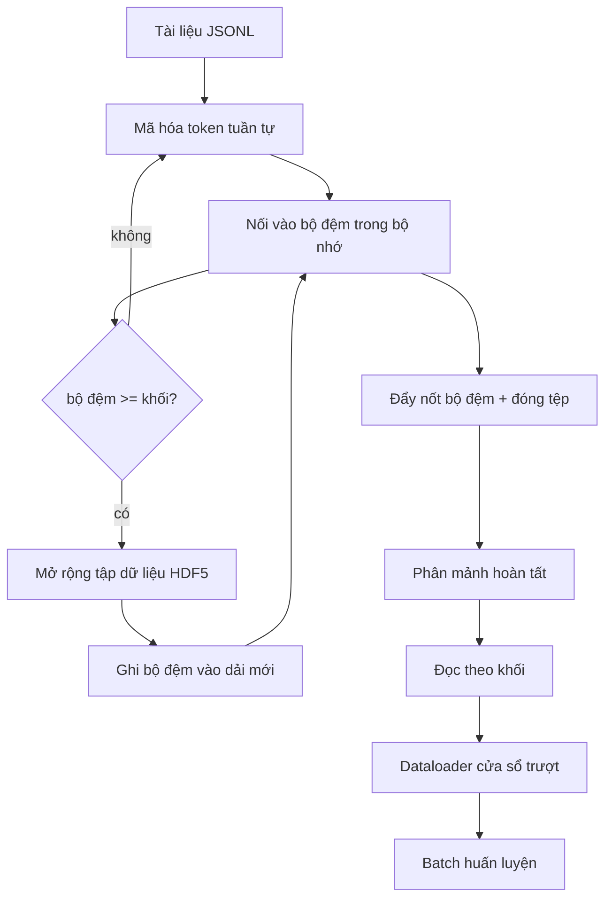

# Tập Dữ Liệu Token Hóa Định Dạng HDF5 (HDF5 Tokenized Corpus)

> Tập dữ liệu đã tải về cần phải được bố trí theo một cấu trúc mà trình huấn luyện có thể đọc luồng ở tốc độ truyền tải tối đa của phần cứng (line speed). Định dạng JSONL trên đĩa không thể trụ nổi qua 16 tiến trình nạp dữ liệu (dataloader workers). Nhưng HDF5 với tập dữ liệu số nguyên có thể thay đổi kích thước và chia khối (chunked integer dataset) thì hoàn toàn đáp ứng được. Bài học này xây dựng quy trình mã hóa token dạng luồng vào một tập dữ liệu HDF5 có thể mở rộng kích thước, ghi phân mảnh (sharded write) trên nhiều tệp, đọc theo khối tại thời điểm huấn luyện, và một bộ nạp dữ liệu cửa sổ trượt (sliding-window dataloader) tạo ra các chuỗi có độ dài cố định với quy tắc đóng gói chuẩn xác.

**Type:** Build
**Languages:** Python
**Prerequisites:** Phase 19 lessons 30-37
**Time:** ~90 phút

## Mục Tiêu Học Tập

- Đưa luồng tài liệu vào một tập dữ liệu số nguyên HDF5 có khả năng thay đổi kích thước với kích thước khối (chunking) tiền định.
- Phân mảnh quá trình ghi trên nhiều tệp HDF5 để giới hạn phạm vi lỗi và tạo điều kiện xử lý song song.
- Đọc token thông qua bố cục phân khối được hỗ trợ bởi bộ nhớ đệm trang (page cache) của HDF5 để bộ nạp dữ liệu chỉ sao chép vào bộ đệm batch ngay tại thời điểm tạo batch.
- Cài đặt một bộ nạp dữ liệu cửa sổ trượt xuất ra các chuỗi huấn luyện có độ dài cố định với các quy tắc đóng gói (packing rules) rõ ràng.

## Vấn Đề

Một lượt chạy huấn luyện mô hình ngôn ngữ hiện đại đọc hàng trăm nghìn mẫu token mỗi giây trên hàng chục worker. Định dạng JSONL trên đĩa sẽ sụp đổ ngay khi gặp lỗi trang do bộ đệm nguội (cold-cache page fault) đầu tiên: bộ phân tích cú pháp JSON rất chậm, ranh giới tài liệu không thể định vị chỉ mục trực tiếp, và việc nhảy tới "mẫu số 4.217.884" đòi hỏi phải quét tuần tự toàn bộ tệp. Ngay cả Parquet, dù nén rất tốt, cũng không phải là lựa chọn phù hợp vì trình huấn luyện không cần dữ liệu dạng cột; thứ nó cần là một luồng token phẳng hỗ trợ truy cập ngẫu nhiên với độ phức tạp $O(1)$.

HDF5 là lựa chọn lý tưởng vì nó cung cấp một tập dữ liệu chỉ chứa số nguyên, được chia khối và có thể thay đổi kích thước, với các khối dữ liệu cực kỳ thân thiện với bộ nhớ đệm trang tại thời điểm đọc. Trình huấn luyện chỉ cần yêu cầu một lát cắt `tokens[3_200_000 : 3_208_192]` và HDF5 sẽ sao chép siêu phiến (hyperslab) được yêu cầu từ bộ đệm trang sang một mảng NumPy mới cấp phát. Chi phí chỉ là một bộ điều khiển tệp (file handle) đang mở và một dung lượng bộ đệm trang bằng kích thước khối trên mỗi worker — con số không đáng kể so với chi phí giải mã JSONL.

Vấn đề khi xây dựng là làm sao cho phía ghi hoạt động chuẩn xác và minh bạch. Các tập dữ liệu có thể thay đổi kích thước rất dễ bị dùng sai: nếu ghi từng tài liệu một, tệp HDF5 sẽ bị phân mảnh đến mức không thể sử dụng nổi. Nếu ghi toàn bộ tài liệu trong một lần thay đổi kích thước duy nhất, một sự cố tắt tiến trình sẽ làm mất trắng toàn bộ phân mảnh. Kỷ luật chuẩn mực là đệm trước rồi mở rộng sau (buffer-then-extend), với kích thước bộ đệm khớp đúng kích thước khối, kết hợp với việc ghi phân mảnh trải đều khối lượng công việc trên nhiều tệp để khi xảy ra sự cố sập chỉ làm mất tối đa một phân mảnh duy nhất.

## Khái Niệm



### Sử dụng HDF5 có thể thay đổi kích thước đúng chuẩn

Tập dữ liệu token được khởi tạo với `maxshape=(None,)` và một kích thước khối cố định `chunks=(chunk_size,)`. Quá trình ghi tiến hành bằng cách đệm các token vào một mảng NumPy có độ dài bằng `chunk_size`. Khi bộ đệm đầy, tập dữ liệu được mở rộng thêm đúng `chunk_size` và dữ liệu trong bộ đệm được ghi vào phạm vi mới đó. Khi kết thúc phân mảnh, phần dư còn lại trong bộ đệm sẽ được ghi vào phạm vi cục bộ cuối cùng. Mọi thao tác ghi đều liên tục và căn chỉnh theo ranh giới khối (chunk-aligned), ngoại trừ lần ghi cuối cùng — nơi mà phía đọc được thông báo cắt ngắn tại giá trị `token_count` đã được ghi lại trong thuộc tính HDF5 của phân mảnh.

### Ghi phân mảnh (Sharded write)

Một tệp HDF5 đơn lẻ là một điểm lỗi duy nhất (single point of failure). Đường ống xử lý sẽ ghi các phân mảnh song song: mỗi phân mảnh đầu vào từ bài học Phase 19 · 42 sẽ tạo ra một phân mảnh đầu ra HDF5 tương ứng. Một tệp chỉ mục `shards.json` ghi nhận cho từng phân mảnh: đường dẫn tệp, số lượng token, số lượng tài liệu và mã băm sha256 trên chuỗi byte token. Trình huấn luyện đọc `shards.json` để tính toán độ lệch toàn cục (global offsets) và xác thực tập dữ liệu.

### Đọc theo khối (Chunked read)

Tại thời điểm huấn luyện, mỗi worker mở phần tệp HDF5 được giao ở chế độ `swmr=True` và truy vấn lát cắt `tokens[start:stop]`. Bố cục phân khối của HDF5 giúp thao tác này trở nên cực kỳ nhẹ nhàng một khi khối dữ liệu đã ở trạng thái nóng (hot): thư viện h5py không ánh xạ bộ nhớ (mmap) tệp, mà nó đọc toàn bộ khối thông qua bộ nhớ đệm khối của HDF5 và bộ nhớ đệm trang của hệ điều hành, sau đó sao chép siêu phiến được yêu cầu ra ngoài. Worker không bao giờ phải nạp toàn bộ tệp vào bộ nhớ: lát cắt dữ liệu được chép vào bộ đệm batch của bộ nạp dữ liệu, sau đó bộ nạp sẽ chép nó vào một tensor huấn luyện nằm trên bộ nhớ được ghim (pinned-memory tensor) tại thời điểm tạo batch. Tuyến thực thi quan trọng (hot path) chỉ tốn một lời gọi hệ thống (syscall) cho mỗi lần chuyển khối; mọi thao tác còn lại hoàn toàn diễn ra trên RAM.

### Bộ nạp dữ liệu cửa sổ trượt (Sliding-window dataloader)

Bộ nạp dữ liệu là thành phần duy nhất trong hệ thống nắm rõ độ dài chuỗi huấn luyện. Nó chọn ngẫu nhiên một chỉ số bắt đầu trong luồng token toàn cục, đọc `window_size + 1` token, và trả về cặp `(input, target) = (tokens[:-1], tokens[1:])`. Ranh giới tài liệu không bị ép buộc tách biệt: một cửa sổ có thể nằm vắt ngang qua hai tài liệu khác nhau, với một mã nhận diện `boundary_token_id` tường minh nằm ở giữa để mô hình học cách sử dụng ký tự phân cách này. Đây là quy tắc đóng gói chuẩn mực; nó cũng là quy tắc mà người mới bắt đầu thường quên, dẫn đến việc tạo ra một tập dữ liệu có tới 8% token ranh giới huấn luyện và chỉ có 92% văn bản tự nhiên.

```figure
cc-hdf5-corpus
```

## Tự Xây Dựng (Build It)

Tệp `code/main.py` cài đặt:

- `Tokenizer` - một bộ mã hóa token cấp độ byte (byte-level deterministic tokenizer) đủ dùng cho phần minh họa. Giao diện gồm `encode(text) -> list[int]` và `vocab_size`.
- `HDF5ShardWriter` - mở một tập dữ liệu số nguyên có thể thay đổi kích thước, đệm token đến kích thước khối, mở rộng và ghi theo các bước cố định, ghi nhận `token_count` và `sha256` thành các thuộc tính HDF5 khi đóng tệp.
- `ShardedTokenizationPipeline` - lặp qua các tài liệu đầu vào, điều phối chúng tới một trình ghi, và xuất ra tệp chỉ mục `shards.json`.
- `MmapTokenStore` - mở các tệp phân mảnh để đọc theo khối (tên gọi mang tính tiện lợi; h5py đọc theo khối chứ không dùng mmap cho tệp), tính toán các độ lệch toàn cục, cung cấp API đơn nhất `get_slice(start, stop)`.
- `SlidingWindowDataloader` - chọn các cửa sổ ngẫu nhiên từ luồng toàn cục và sinh ra các mảng NumPy `(input_ids, target_ids)`.

Phần trình diễn ở cuối tệp xây dựng một tập dữ liệu nhỏ trong bộ nhớ, mã hóa token thành hai phân mảnh, mở chúng để đọc theo khối, chạy bộ nạp dữ liệu trong 10 batch, và in kích thước từng batch cùng mã tổng kiểm (checksum).

Chạy thử:

```bash
python3 code/main.py
```

Tập lệnh thoát với mã lỗi 0 và in mã tổng kiểm của các batch.

## Các Mô Hình Trong Thực Tế (Production Patterns)

Bốn mô hình giúp mở rộng quy mô bài học này sang một đợt huấn luyện thực tế.

**Kích thước khối bằng kích thước đọc điển hình.** Trình huấn luyện đọc `window_size + 1` token cho mỗi mẫu. Đặt khối HDF5 là bội số của `window_size` sẽ giúp các lần đọc được căn chỉnh khớp với bộ nhớ đệm trang. Việc chia khối không khớp có thể làm giảm một nửa thông lượng vì mỗi mẫu sẽ phải chạm vào hai khối khác nhau.

**Số lượng token lưu trong thuộc tính, không phải trong tập dữ liệu.** Lát cắt cuối cùng của tập dữ liệu có thể chỉ đầy một phần vì kích thước khối không chia hết ranh giới tài liệu. Hãy lưu giá trị `token_count` thực tế dưới dạng một thuộc tính HDF5 trên tập dữ liệu và yêu cầu phía đọc cắt ngắn đúng tại giá trị đó. Nếu không có điều này, phía đọc sẽ đọc vượt quá phần cuối vào các token độn số không và mô hình sẽ học cách dự đoán số không.

**Mã sha256 phân mảnh với kiểm tra song song.** Mỗi phân mảnh có mã sha256 riêng tính trên chuỗi byte token. Trình huấn luyện có thể xác thực tất cả các phân mảnh song song trước khi bắt đầu huấn luyện. Một mã sha256 sai sẽ giúp phát hiện lỗi sớm ngay từ đầu, thay vì đợi đến epoch thứ ba sau mười sáu giờ chạy.

**Sử dụng `swmr=True` ở cả hai phía, kèm `libver="latest"` trên trình ghi.** Chế độ một bên ghi - nhiều bên đọc (Single-Writer-Multiple-Reader - SWMR) yêu cầu phía ghi phải mở với `libver="latest"`, tạo trước mọi tập dữ liệu, sau đó thiết lập `file.swmr_mode = True`. Sau bước đó, phía ghi phải gọi `dataset.flush()` sau mỗi lần mở rộng kích thước để các worker phía đọc (được mở với `swmr=True`) nhìn thấy dữ liệu nhất quán. Việc bỏ quên `libver="latest"` hoặc bật SWMR sau khi đã thay đổi cấu trúc là nguyên nhân phổ biến gây ra lỗi "file is locked".

## Sử Dụng Thư Viện (Use It)

Các thực tiễn triển khai:

- **Một tệp HDF5 cho mỗi phân mảnh nguồn.** Trình tải (bài học 42) xuất một phân mảnh cho mỗi URL; bước mã hóa token (bài học này) xuất một tệp HDF5 cho mỗi phân mảnh nguồn. Ánh xạ 1:1 này giúp việc tiếp tục chạy và khôi phục khi gặp lỗi cục bộ trở nên vô cùng đơn giản.
- **Mã định danh token ranh giới (Boundary token id).** Token ranh giới là một phần của từ vựng tokenizer và là token duy nhất mà bộ nạp dữ liệu tự động chèn vào. Hàm mất mát huấn luyện sẽ che (mask) token ranh giới nếu mô hình cần bỏ qua nó; nếu không, mô hình sẽ học cách sử dụng nó như một ký tự phân tách chuỗi.
- **`shards.json` đóng vai trò chân lý duy nhất (Source of truth).** Thêm một phân mảnh mới đồng nghĩa với việc ghi tệp HDF5, tính mã sha256 của nó, và nối thêm một mục vào bản kê. Trình huấn luyện chỉ đọc tệp này một lần khi khởi động và không bao giờ quét qua danh sách thư mục.

## Xuất Bản Sản Phẩm (Ship It)

Tệp `outputs/skill-hdf5-tokenized-corpus.md` trong một dự án thực tế sẽ mô tả tokenizer nào cung cấp dữ liệu cho đường ống, kích thước khối nào khớp với cửa sổ của trình huấn luyện, tệp `shards.json` nằm ở đâu trong hệ thống quản lý phiên bản, và các worker của bộ nạp dữ liệu được phân chia giữa các tệp như thế nào. Bài học này xuất bản động cơ thực thi cốt lõi.

## Bài Tập Thực Hành

1. Thêm cờ `--compression gzip` vào trình ghi HDF5 và đo lường chi phí suy giảm thông lượng trên tập dữ liệu mẫu. Hãy bảo vệ cho lựa chọn mặc định.
2. Thêm hạt giống ngẫu nhiên tiền định (deterministic seed) vào bộ nạp dữ liệu cửa sổ trượt và kiểm chứng rằng hai lần chạy với cùng một hạt giống sẽ tạo ra các batch hoàn toàn giống hệt nhau.
3. Thêm chế độ `--validate` đọc từng phân mảnh, tính toán lại sha256 trên các token của nó và so sánh với `shards.json`. Hệ thống CI cần chạy bước này trước khi bắt đầu huấn luyện.
4. So sánh thông lượng của bộ nạp dữ liệu ở các kích thước khối bằng, bằng một nửa và gấp đôi kích thước cửa sổ. Báo cáo hiệu ứng của bộ nhớ đệm trang.
5. Thêm cờ `--max-document-tokens` cắt ngắn các tài liệu quá dài ngay tại thời điểm ghi. Hãy phân tích sự đánh đổi so với việc quyết định cắt ngắn tại thời điểm đọc.

## Thuật Ngữ Then Chốt

| Thuật ngữ | Người ta thường nói | Bản chất thực sự |
|-----------|--------------------|-------------------|
| Tập dữ liệu có thể thay đổi kích thước (Resizable dataset) | "Chỉ ghi nối thêm (Append-only)" | Một tập dữ liệu HDF5 với `maxshape=(None,)` mở rộng thông qua các lời gọi `resize` theo các bước kích thước khối |
| Bố cục phân khối (Chunked layout) | "Cách HDF5 lưu trữ" | Các khối có kích thước cố định trên đĩa mà HDF5 đọc và lưu trữ tạm thời như một khối duy nhất, giúp bộ nạp dữ liệu đọc một dải liên tục với chi phí thấp |
| Chế độ `swmr` | "Vừa ghi vừa đọc" | Chế độ một bên ghi - nhiều bên đọc (Single-Writer-Multiple-Reader) cho phép các worker nạp dữ liệu chia sẻ tệp một cách an toàn |
| Chỉ mục phân mảnh (Shard index) | "shards.json" | Bản chỉ mục bền vững lưu trữ toàn bộ các phân mảnh token kèm theo độ lệch và mã băm nội dung |
| Cửa sổ trượt (Sliding window) | "Mẫu huấn luyện" | Một lát cắt có độ dài cố định của luồng token toàn cục mà trình huấn luyện ghép cặp với mục tiêu dịch chuyển một bước của nó |

## Đọc Thêm (Further Reading)

- [Tài liệu phân khối HDF5](https://support.hdfgroup.org/documentation/hdf5/latest/hdf5_chunking.html) - bố cục tập dữ liệu chia khối và thay đổi kích thước được sử dụng trong bài học này
- [Hướng dẫn sử dụng h5py](https://docs.h5py.org/en/stable/) - thư viện Python liên kết với HDF5
- [Lưu trữ phân khối h5py](https://docs.h5py.org/en/stable/high/dataset.html#chunked-storage) - cách h5py đọc các tập dữ liệu chia khối và định kích thước bộ nhớ đệm khối
- Phase 19 · 42 - Trình tải dữ liệu có đầu ra được bài học này mã hóa token
- Phase 19 · 44 - Lịch trình cosine sử dụng bộ nạp dữ liệu này
- Phase 19 · 45 - Vòng lặp AMP bọc lấy bước huấn luyện
