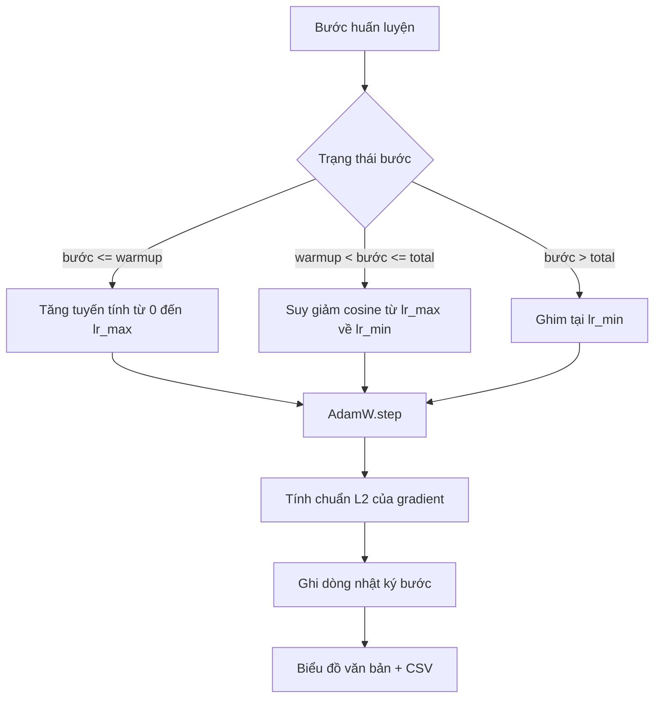

# Lịch Trình Tốc Độ Học Cosine với Khởi Động Tuyến Tính (Cosine LR with Linear Warmup)

> Lịch trình tốc độ học (learning-rate schedule) là quyết định quan trọng thứ hai sau hàm mất mát (loss function). Thuật toán AdamW kết hợp với suy giảm cosine (cosine decay) và giai đoạn khởi động tuyến tính (linear warmup) là lựa chọn mặc định hiện đại cho huấn luyện mô hình ngôn ngữ, bởi vì nó giúp mô hình tiếp nhận một độ dài bước hiệu dụng nhỏ trong một nghìn lượt cập nhật đầu tiên đầy mong manh, tăng dần đều lên mức đỉnh đã cấu hình, rồi suy giảm mượt mà về gần mức số không. Bài học này xây dựng lịch trình đó, hiển thị đường cong qua các bước huấn luyện, ghi nhận chuẩn gradient (gradient norms) song song với lịch trình tốc độ học, và chứng minh rằng lịch trình tuân thủ chính xác các ranh giới khởi động, đạt đỉnh và suy giảm.

**Type:** Build
**Languages:** Python
**Prerequisites:** Phase 19 lessons 30-37
**Time:** ~90 phút

## Mục Tiêu Học Tập

- Cài đặt bộ tối ưu hóa AdamW kết nối chặt chẽ với lịch trình tốc độ học cosine có khởi động tuyến tính.
- Tính toán giá trị chính xác của lịch trình tại bất kỳ bước nào mà không bị sai lệch số thực dấu phẩy động (floating-point drift) qua các lần chạy khác nhau.
- Ghi nhật ký chuẩn $L_2$ của gradient song song với tốc độ học để trạng thái sức khỏe của quá trình huấn luyện có thể quan sát trực tiếp được.
- Kết xuất lịch trình thành biểu đồ dạng văn bản (text plot) trực quan và tệp CSV chuẩn tắc mà mọi công cụ đều có thể sử dụng.

## Vấn Đề

Một nghìn bước cập nhật huấn luyện đầu tiên luôn là giai đoạn dữ dội và bất ổn nhất. Các trọng số của mô hình vẫn còn ở rất gần trạng thái khởi tạo ngẫu nhiên. Ước tính mô-men bậc hai tích lũy của bộ tối ưu hóa vẫn chưa đi vào ổn định. Chuẩn gradient lúc này rất lớn và nhiễu loạn. Nếu tốc độ học nằm ở mức đỉnh cao nhất ngay trong những bước cập nhật đầu tiên này, mô hình sẽ hoặc là phân kỳ hoàn toàn, hoặc rơi vào một vùng bình nguyên hàm mất mát (loss plateau) mà không bao giờ thoát ra được. Hai giải pháp kinh điển cho vấn đề này là cắt xén gradient (gradient clipping) — chủ đề của bài học Phase 19 · 45, và một lịch trình tốc độ học khởi đầu từ giá trị nhỏ rồi tăng dần lên.

Lịch trình suy giảm cosine kèm khởi động tuyến tính gồm ba giai đoạn rõ rệt. Từ bước số 0 đến bước `warmup_steps`, tốc độ học tăng dần tuyến tính từ 0 đến giá trị đỉnh `lr_max` được cấu hình. Từ bước `warmup_steps` đến bước `total_steps`, tốc độ học tuân theo nửa trên của đường cong cosine, suy giảm mượt mà từ `lr_max` về `lr_min`. Sau bước `total_steps`, tốc độ học được ghim cố định ở `lr_min` để nếu trình huấn luyện bị cấu hình sai mà chạy quá số bước quy định thì cũng không vô tình thoát khỏi phạm vi của lịch trình.

Vấn đề cốt lõi khi xây dựng là các lịch trình rất dễ mắc lỗi lệch một đơn vị (off-by-one). Sai số lệch một đơn vị này thường chỉ lộ diện sau sáu giờ chạy huấn luyện khi tốc độ học bị cao hơn hoặc thấp hơn 1% tại đúng thời điểm mô hình bắt đầu bị quá khớp (overfitting) — một lỗi hoàn toàn vô hình trừ phi lịch trình được kiểm thử toàn diện tại các điểm ranh giới.

## Khái Niệm



### Công thức khởi động tuyến tính (Warmup formula)

Đối với `step` nằm trong đoạn `[0, warmup_steps]` với `warmup_steps > 0`, tốc độ học được tính bằng `lr_max * step / warmup_steps`. Trường hợp suy biến `warmup_steps = 0` được xem là "không khởi động": lịch trình bắt đầu trực tiếp tại `lr_max` ngay ở bước 0 và lập tức bước vào giai đoạn suy giảm cosine. Một số bộ kiểm thử truyền `warmup_steps = 0` để kiểm tra xem lịch trình có tạo ra một đường cong hợp lệ hay không.

### Công thức suy giảm Cosine (Cosine formula)

Đối với `step` nằm trong khoảng nửa mở `(warmup_steps, total_steps]`, tốc độ học là `lr_min + 0.5 * (lr_max - lr_min) * (1 + cos(pi * progress))`, trong đó `progress = (step - warmup_steps) / max(1, total_steps - warmup_steps)`. Tại `step = warmup_steps`, hàm cosine trả về $\cos(0) = 1$, mang lại giá trị đúng bằng `lr_max`, khớp hoàn hảo với điểm kết thúc giai đoạn khởi động. Tại `step = total_steps`, hàm cosine trả về $\cos(\pi) = -1$, mang lại giá trị đúng bằng `lr_min`, khớp hoàn hảo với điểm kết thúc giai đoạn suy giảm.

Tính liên tục tại cả hai đầu mút ranh giới không phải là sự ngẫu nhiên. Đó là lý do tại sao lịch trình được cài đặt như một hàm duy nhất nhận đầu vào là `step`, chứ không phải là ba hàm riêng biệt chắp vá lại với nhau. Một lịch trình chắp vá sẽ làm mất đi một điểm ranh giới ngay lần đầu tiên `lr_max` bị thay đổi.

### Mức đáy sau tổng số bước (Floor after total steps)

Khi `step > total_steps`, tốc độ học giữ nguyên ở mức `lr_min`. Quy ước này rất rõ ràng: lịch trình không báo lỗi và không ngoại suy vượt giới hạn; nó ghim ở mức đáy sàn và để trình huấn luyện ghi cảnh báo. Những trình huấn luyện muốn kéo dài thêm thời gian huấn luyện chỉ cần điều chỉnh tham số `total_steps` của lịch trình, chứ không phải can thiệp vào vòng lặp.

### Ghi nhật ký chuẩn gradient song song với tốc độ học

Lịch trình chỉ là một nửa câu chuyện về sức khỏe huấn luyện. Chuẩn gradient (gradient norm) là nửa còn lại. Vòng lặp huấn luyện ghi nhận cả hai đại lượng này trên từng bước. Một đợt huấn luyện bị phân kỳ sẽ làm lộ ra sự tăng đột biến của chuẩn gradient trước cả khi hàm mất mát tăng vọt; một giai đoạn khởi động được tinh chỉnh tốt sẽ giữ cho chuẩn gradient tăng tuyến tính tương ứng với tốc độ học; một mức đỉnh quá hung hăng sẽ khiến chuẩn gradient duy trì ở mức cao bất thường sau giai đoạn khởi động. Dữ liệu ghi trên đĩa có định dạng `step, lr, grad_l2_norm, loss`. Tệp CSV chính là bản ghi bền vững duy nhất.

```figure
cap-cosine-warmup
```

## Tự Xây Dựng (Build It)

Tệp `code/main.py` cài đặt:

- `CosineWithWarmup` - một hàm phi trạng thái (stateless function) `lr(step) -> float` hoạt động trên cấu hình lịch trình đã định.
- `TrainState` - đóng gói mô hình, bộ tối ưu hóa `AdamW` và lịch trình vào một hàm bước duy nhất.
- `TrainState.step` - thực hiện một lượt truyền xuôi (forward pass), một lượt truyền ngược (backward pass), ghi nhận chuẩn $L_2$ của gradient, và áp dụng `lr(step)` vào bộ tối ưu hóa.
- `plot_schedule_ascii` - xuất lịch trình thành biểu đồ trực quan dạng văn bản thuần có thể đọc bằng mắt thường.
- `write_schedule_csv` - xuất một dòng cho mỗi bước chứa giá trị tốc độ học tương ứng.

Phần minh họa ở cuối tệp xây dựng một mô hình `nn.Linear` nhỏ, huấn luyện trong 20 bước trên một batch đầu vào cố định, và in tốc độ học, chuẩn gradient cùng hàm mất mát trên từng bước. Lịch trình cũng được hiển thị thành một biểu đồ dạng văn bản để kiểm tra độ tin cậy bằng mắt.

Chạy thử:

```bash
python3 code/main.py
```

Tập lệnh thoát với mã lỗi 0 và in nhật ký huấn luyện từng bước kèm theo biểu đồ lịch trình.

## Các Mô Hình Trong Thực Tế (Production Patterns)

Bốn mô hình nâng tầm lịch trình này thành một thành phần chuẩn sản xuất.

**Lịch trình nằm trong tệp cấu hình, không nằm trong mã nguồn.** Trình huấn luyện đọc `warmup_steps`, `total_steps`, `lr_max`, `lr_min` từ tệp cấu hình YAML hoặc JSON được lưu trữ trong git. Lịch trình có thể tái lập vì cấu hình được quản lý nội dung theo mã băm; lịch trình có thể kiểm toán vì cấu hình là một phần của bản so sánh PR (diff).

**Bộ đếm bước tăng đơn điệu và tách rời khỏi epoch.** Một số framework dễ nhầm lẫn giữa bước (step) và chu kỳ (epoch) khi tập dữ liệu bị phân mảnh hoặc khi bộ nạp dữ liệu khởi động lại. Lịch trình phải đọc `global_step` từ điểm kiểm tra của trình huấn luyện, chứ không đọc từ một biến đếm cục bộ. Một lượt chạy được tiếp tục sẽ đi tiếp đúng tại vị trí của lịch trình vì bộ đếm bước là trục tọa độ bền vững.

**Lưu biểu đồ lịch trình ngay trong thư mục chạy.** Mỗi lần chạy huấn luyện đều ghi tệp `outputs/lr_schedule.png` (hoặc trong bài học này là một biểu đồ văn bản) vào thư mục chạy tương ứng. Người đánh giá khi quét qua thư mục có thể kiểm tra trực quan tính hợp lý của lịch trình mà không cần chạy lại bất cứ thứ gì. Điều này giúp loại trừ lớp lỗi cấu hình sai lịch trình ngay tại thời điểm mở PR.

**Lược đồ dòng nhật ký cố định.** Cấu trúc cố định `step, lr, grad_l2_norm, loss` theo đúng thứ tự đó. Một notebook phân tích hoặc bảng điều khiển trực quan (dashboard) ở hạ nguồn phụ thuộc vào lược đồ này; đổi tên một cột mà không nâng phiên bản sẽ phá vỡ mọi bảng điều khiển đang tồn tại.

## Sử Dụng Thư Viện (Use It)

Các thực tiễn triển khai:

- **Quét tìm mức đỉnh (Peak) trước khi quét bất kỳ tham số nào khác.** `lr_max` là núm điều chỉnh nhạy cảm nhất. Hãy quét tìm nó trên một mô hình nhỏ trước; giá trị `lr_max` tối ưu thay đổi khá yếu theo kích thước mô hình, vì vậy kết quả quét từ mô hình nhỏ là một tiên nghiệm (prior) rất đáng tin cậy.
- **Khởi động được tính theo tỷ lệ phần trăm của tổng số bước, không phải số lượng tuyệt đối.** Một đợt chạy 200 triệu bước với 2.000 bước khởi động sẽ đạt mức đỉnh gần như tức thì; trong khi một đợt chạy 20.000 bước với cùng con số đó sẽ dành tới 10% chỉ để khởi động. Hãy cấu hình giai đoạn khởi động dưới dạng tỷ lệ (thường là 1-3%) để lịch trình tự động co giãn theo thời lượng huấn luyện.
- **`lr_min` luôn khác không có chủ đích.** Một mức đáy sàn bằng 10% của `lr_max` giúp bộ tối ưu hóa tiếp tục học hỏi trong giai đoạn đuôi dài (long tail). Một lịch trình có `lr_min = 0` tạo ra một đường cong huấn luyện trông rất đẹp mắt trên đồ thị nhưng lại tạo ra một mô hình chưa thực sự hội tụ hoàn chỉnh.

## Xuất Bản Sản Phẩm (Ship It)

Tệp `outputs/skill-cosine-warmup.md` trong một dự án thực tế sẽ mô tả tệp cấu hình nào chứa lịch trình, bộ đếm toàn cục được đọc từ bước huấn luyện nào, và đợt quét `lr_max` nào đã tìm ra giá trị được triển khai. Bài học này xuất bản động cơ thực thi cốt lõi.

## Bài Tập Thực Hành

1. Thêm một biến thể lịch trình căn bậc hai nghịch đảo (inverse-square-root schedule) và so sánh nó trên một đợt chạy huấn luyện mẫu 200 bước. Đường cong nào mang lại giá trị hàm mất mát cuối cùng thấp hơn?
2. Thêm cờ `--restart` kích hoạt một giai đoạn khởi động thứ hai tại `total_steps / 2`. Hãy bảo vệ quan điểm liệu kỹ thuật khởi động lại ấm (warm restarts) có giúp ích hay làm hại trên lượt chạy thử nghiệm nhỏ này.
3. Thêm một kiểm thử đơn vị (unit test) chứng minh tính liên tục của lịch trình: với `warmup_steps > 0`, tại mọi bước thuộc đoạn `[0, total_steps]`, chênh lệch `|lr(step+1) - lr(step)|` bị chặn trên bởi giá trị lớn hơn giữa độ dốc khởi động `lr_max / warmup_steps` và độ dốc cosine dốc nhất `pi * (lr_max - lr_min) / (2 * (total_steps - warmup_steps))`. Một đoạn cosine ngắn có thể dốc hơn đoạn khởi động, do đó chỉ dùng độ dốc khởi động sẽ không phải là chặn trên an toàn.
4. Tích hợp lịch trình này vào `torch.optim.lr_scheduler.LambdaLR` để phối hợp với mã nguồn của framework. Bài học sử dụng một hàm bước đơn giản; lớp bọc của PyTorch thay đổi điều gì?
5. Thêm cờ `--plot-png` xuất ra biểu đồ thực tế bằng `matplotlib`. Hãy phân tích xem biểu đồ văn bản của bài học hay tệp hình ảnh PNG là lựa chọn mặc định tốt hơn cho các lượt chạy CI.

## Thuật Ngữ Then Chốt

| Thuật ngữ | Người ta thường nói | Bản chất thực sự |
|-----------|--------------------|-------------------|
| Khởi động (Warmup) | "Khởi đầu chậm" | Đường tăng tuyến tính từ 0 đến `lr_max` trong `warmup_steps` lượt cập nhật đầu tiên |
| Suy giảm Cosine (Cosine decay) | "Hạ mượt mà" | Nửa trên của đường cong cosine từ `lr_max` về `lr_min` trong toàn bộ các bước còn lại |
| Mức đáy sàn (Floor) | "Sau khi huấn luyện" | Giá trị cố định `lr_min` mà lịch trình ghim lại khi bước vượt quá `total_steps` |
| Chuẩn gradient (Gradient norm) | "Độ dài L2 của grad" | Chuẩn Euclid của vector gradient nối liền, được ghi nhận tại mỗi bước huấn luyện |
| Bước toàn cục (Global step) | "Trục lịch trình" | Bộ đếm bước tăng đơn điệu không bị mất khi khởi động lại và trực tiếp điều khiển lịch trình |

## Đọc Thêm (Further Reading)

- [Loshchilov and Hutter, SGDR: Stochastic Gradient Descent with Warm Restarts (arXiv 1608.03983)](https://arxiv.org/abs/1608.03983) - bài báo tham chiếu gốc về lịch trình cosine
- [Loshchilov and Hutter, Decoupled Weight Decay Regularization (arXiv 1711.05101)](https://arxiv.org/abs/1711.05101) - bài báo tham chiếu gốc về AdamW
- [PyTorch torch.optim.lr_scheduler](https://docs.pytorch.org/docs/stable/optim.html#how-to-adjust-learning-rate) - cách các hàm bước kết hợp với bộ điều phối lịch trình của framework
- Phase 19 · 42 - Trình tải dữ liệu có tập dữ liệu được lịch trình này sử dụng
- Phase 19 · 43 - Bộ nạp dữ liệu cùng tiến hóa song song với lịch trình
- Phase 19 · 45 - Cắt xén gradient và AMP, tầng tiếp theo trong vòng lặp huấn luyện
