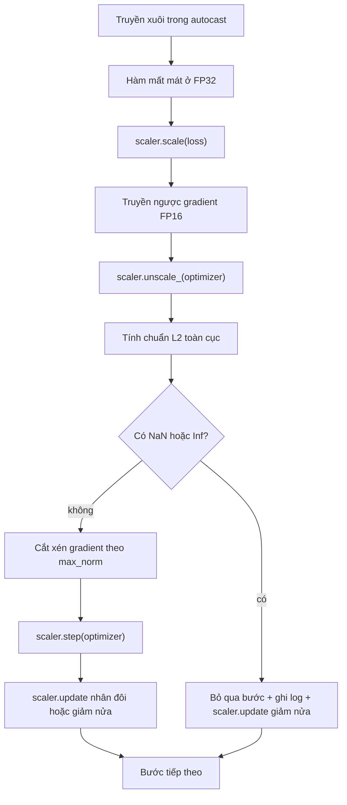

# Cắt Xén Gradient và Huấn Luyện Độ Chính Xác Hỗn Hợp (Gradient Clipping and Mixed Precision)

> Bộ tối ưu hóa và lịch trình từ bài học trước giả định rằng các gradient luôn ở trạng thái lành mạnh. Thực tế thường không như vậy. Chỉ một batch dữ liệu bất thường duy nhất cũng có thể khiến chuẩn gradient tăng vọt tới ba bậc độ lớn. Quá trình huấn luyện với độ chính xác hỗn hợp (mixed-precision training) càng khuếch đại vấn đề này khi gây ra hiện tượng tràn số FP16 ở phía hàm mất mát. Bài học này xây dựng hai vành đai an toàn mà môi trường huấn luyện thực tế bắt buộc phải có: cắt xén gradient (gradient clipping) theo một chuẩn $L_2$ toàn cục được cấu hình, và một vòng lặp huấn luyện độ chính xác hỗn hợp với autocast kết hợp GradScaler có khả năng phát hiện NaN và Inf, bỏ qua bước cập nhật một cách sạch sẽ, đồng thời ghi nhận hệ số co giãn (scaling factor) để phục vụ điều tra sự cố.

**Type:** Build
**Languages:** Python
**Prerequisites:** Phase 19 lessons 30-37
**Time:** ~90 phút

## Mục Tiêu Học Tập

- Tính toán chuẩn $L_2$ toàn cục trên gradient của toàn bộ các tham số và cắt xén trực tiếp tại chỗ (in-place) khi giá trị này vượt quá ngưỡng cấu hình.
- Đóng gói bước huấn luyện trong `autocast` kết hợp `GradScaler` để các lượt truyền xuôi và truyền ngược FP16 không bị đổ vỡ bởi hiện tượng tràn số (overflow).
- Phát hiện các giá trị NaN và Inf trong hàm mất mát hoặc gradient, bỏ qua bước cập nhật của bộ tối ưu hóa và ghi nhật ký cảnh báo bước bị bỏ qua.
- Báo cáo hệ số co giãn (scaling factor) của `GradScaler` ở mỗi bước để có thể nhận diện ngay lập tức chuỗi các bước bị bỏ qua kéo dài.

## Vấn Đề

Một đợt huấn luyện chạy rất êm ả ngày hôm qua bỗng nhiên có đường cong hàm mất mát dựng đứng lên ở bước 8.217. Thủ phạm là một batch dữ liệu cá biệt có chuẩn gradient lên tới 4.200, gấp hai mươi lần mức đỉnh trước đó. Nếu không có cơ chế cắt xén, bộ tối ưu hóa sẽ áp dụng một bước cập nhật xóa sạch toàn bộ những gì mô hình đã học được trong suốt một giờ trước đó. Khi có bộ cắt xén chuẩn $L_2$ toàn cục ở ngưỡng 1.0, chính batch dữ liệu đó chỉ đóng góp một bước cập nhật có độ dài chuẩn bằng đơn vị; hàm mất mát giữ nguyên xu hướng ổn định; đợt huấn luyện được cứu sống.

Huấn luyện độ chính xác hỗn hợp giúp tăng thông lượng xử lý lên gấp 2-3 lần bằng cách tính toán lượt truyền xuôi và phần lớn lượt truyền ngược ở định dạng số thực 16-bit (FP16). Cái giá phải trả là FP16 có dải số mũ (exponent range) rất hẹp. Một gradient thông thường nếu bị tràn số trong FP16 sẽ chuyển thành vô cực (Inf), lan truyền qua các tầng tiếp theo thành giá trị không xác định (NaN), và biến toàn bộ trọng số thành NaN ở bước cập nhật tối ưu kế tiếp. Công cụ `GradScaler` của PyTorch giải quyết vấn đề này bằng cách nhân hàm mất mát với một hệ số co giãn lớn trước lượt truyền ngược, rồi chia các gradient cho chính hệ số đó trước bước cập nhật tối ưu hóa. Nếu bất kỳ gradient nào bị Inf hoặc NaN tại thời điểm giải co giãn (unscale), bộ co giãn sẽ bỏ qua bước cập nhật đó và giảm một nửa hệ số co giãn; nếu $N$ bước trước đó đều sạch sẽ, bộ co giãn sẽ nhân đôi hệ số này lên. Xuyên suốt quá trình huấn luyện, hệ số này sẽ tự động tìm kiếm giá trị cao nhất mà dải giá trị của FP16 có thể dung nạp được.

Khó khăn khi xây dựng là làm sao ghép nối hai cơ chế này theo đúng trật tự. Cắt xén trước khi giải co giãn sẽ khiến ngưỡng cắt tác động nhầm lên gradient đã bị nhân tỉ lệ; cắt xén sau khi giải co giãn đòi hỏi thứ tự thực thi nghiêm ngặt trên `GradScaler`. Trình tự chính xác bắt buộc phải là: `scaler.scale(loss).backward()`, tiếp theo là `scaler.unscale_(optimizer)`, rồi gọi `clip_grad_norm_`, sau đó đến `scaler.step(optimizer)`, và cuối cùng là `scaler.update()`. Bất kỳ trật tự nào khác đều sẽ tạo ra một vòng lặp bị lỗi một cách âm thầm.

## Khái Niệm



### Chuẩn $L_2$ toàn cục (Global L2 norm)

Chuẩn $L_2$ toàn cục là chuẩn Euclid của vector gradient ghép nối của toàn bộ mô hình, chứ không phải chuẩn riêng rẽ trên từng tham số. PyTorch cài đặt cơ chế này qua hàm `torch.nn.utils.clip_grad_norm_(parameters, max_norm)`. Hàm này trả về giá trị chuẩn trước khi cắt xén (pre-clip norm) để bài học có thể ghi nhật ký cả giá trị tự nhiên lẫn giá trị sau cắt xén — điều này tối quan trọng để chẩn đoán tình trạng "hệ thống đang bị cắt xén ở mọi bước".

### autocast và GradScaler

`torch.amp.autocast(device_type)` là một trình quản lý ngữ cảnh (context manager) cho phép chạy chọn lọc các phép toán hợp lệ (chủ yếu là các phép nhân ma trận) ở định dạng FP16. `torch.amp.GradScaler(device_type)` là công cụ trợ giúp nhân tỉ lệ hàm mất mát trước khi truyền ngược và đảo ngược tỉ lệ gradient trước bước tối ưu hóa. Hai thành phần này được thiết kế song hành với nhau; sử dụng cái này mà thiếu cái kia là một lỗi cấu hình nghiêm trọng mà bộ kiểm thử cần phải bắt được.

Bài học này sử dụng `autocast` trên CPU vì đây là môi trường chạy trong các luồng CI; mô hình này chuyển đổi nguyên vẹn sang môi trường CUDA chỉ bằng cách đổi `device_type="cpu"` thành `device_type="cuda"`. Công cụ GradScaler trên CPU đóng vai trò là một lớp mô phỏng (stub — do CPU autocast mặc định hoạt động trên BF16 và không cần co giãn hàm mất mát), nhưng bài học vẫn bao gồm đầy đủ các điểm gọi lệnh để mã nguồn hoàn toàn đồng nhất với vòng lặp chạy trên GPU thực tế.

### Phát hiện NaN và Inf

Quá trình kiểm tra diễn ra ở hai vị trí. Thứ nhất, bản thân hàm mất mát được kiểm tra bằng `torch.isfinite` trước lượt truyền ngược; một giá trị hàm mất mát là Inf hoặc NaN sẽ không thể sinh ra gradient hữu ích và bước này sẽ được bỏ qua ngay mà không cần đi vào bộ tối ưu hóa. Thứ hai, sau khi gọi `scaler.unscale_(optimizer)`, bài học quét các gradient đã giải co giãn bằng `has_non_finite_grad(...)` và coi bất kỳ giá trị Inf hoặc NaN nào là dấu hiệu để bỏ qua bước. Hai phép kiểm tra này cùng nhau bao phủ toàn bộ các kịch bản hỏng hóc ở cả chiều truyền xuôi lẫn chiều truyền ngược.

### Chẩn đoán hệ số co giãn (Scaling factor diagnostics)

Hệ số co giãn là trạng thái nội bộ của GradScaler. Ở mỗi bước, bài học đọc giá trị `scaler.get_scale()` và ghi nhật ký nó bên cạnh tốc độ học và chuẩn gradient. Một đợt huấn luyện khỏe mạnh sẽ cho thấy hệ số co giãn tăng dần theo lũy thừa của hai cho đến khi bão hòa quanh ngưỡng $2^{17}$ hoặc $2^{18}$. Một đợt huấn luyện bất ổn sẽ làm lộ ra hệ số co giãn dao động liên tục giữa các giá trị cao và thấp — dấu hiệu cho thấy các gradient của mô hình lúc thì nằm trong dải biểu diễn được, lúc lại vượt quá ngưỡng cho phép. Dấu hiệu chẩn đoán này hoàn toàn vô hình nếu không ghi nhật ký.

```figure
grad-clip-monitor
```

## Tự Xây Dựng (Build It)

Tệp `code/main.py` cài đặt:

- `clip_global_l2_norm` - một lớp bọc quanh `torch.nn.utils.clip_grad_norm_` trả về cả chuẩn trước và sau khi cắt xén.
- `has_non_finite_grad` - hàm tiện ích quét toàn bộ gradient để tìm các giá trị NaN và Inf.
- `AmpTrainState` - đóng gói mô hình, bộ tối ưu hóa `AdamW`, `GradScaler` và thiết bị autocast. Cung cấp phương thức `step(inputs, targets)` chạy toàn bộ đường ống cắt xén, co giãn và bỏ qua bước khi gặp NaN.
- `StepLog` và `SkipLog` - các bản ghi cấu trúc theo từng bước.
- Phần minh họa huấn luyện một mô hình `nn.Linear` nhỏ trong 20 bước, cố tình chèn giá trị `Inf` vào gradient tại bước thứ 5 để kích hoạt nhánh xử lý bỏ qua bước, và in nhật ký thu được ra màn hình.

Chạy thử:

```bash
python3 code/main.py
```

Tập lệnh thoát với mã lỗi 0 và in nhật ký từng bước với mỗi dòng được gắn thẻ `STEP` hoặc `SKIP`; trong đó có ít nhất một dòng là `SKIP`.

## Các Mô Hình Trong Thực Tế (Production Patterns)

Bốn mô hình nâng tầm vòng lặp này thành một bước huấn luyện chuẩn sản xuất.

**Biến đếm số bước bỏ qua là một cảnh báo khẩn cấp (Alert), không chỉ là một dòng nhật ký.** Vài bước bị bỏ qua rải rác trong suốt một đợt huấn luyện là hiện tượng bình thường. Hàng trăm bước bị bỏ qua trong một epoch là một cảnh báo nghiêm trọng: mô hình đang rơi vào một vùng số học mà FP16 không thể gánh vác nổi và vòng lặp huấn luyện đang thất bại trong câm lặng. Bài học theo dõi tỷ lệ bỏ qua trượt trong 1.000 bước và trong thực tế sẽ kích hoạt thông báo sự cố (page) nếu tỷ lệ này vượt quá 5%.

**Ngưỡng cắt xén nằm trong tệp cấu hình.** Giá trị `max_norm = 1.0` là chuẩn mặc định hiện đại cho việc huấn luyện mô hình ngôn ngữ. Hãy quét tìm ngưỡng này trên một mô hình nhỏ trước; ngưỡng lớn hơn giúp mô hình học hỏi được từ các batch thực sự khó; ngưỡng nhỏ hơn giúp chặn đứng các trường hợp xấu nhất nhưng lại khiến đường cong mất mát nhiễu hơn. Ngưỡng cắt xén thuộc về cùng một tệp cấu hình YAML hoặc JSON như lịch trình từ bài học 44.

**Nhật ký chuẩn gradient được lưu vào CSV cùng với lịch trình.** Các cột trong CSV là `step, lr, grad_l2_pre_clip, grad_l2_post_clip, loss, skipped, skip_reason, scaler_scale`. Một người đánh giá khi mở tệp sẽ thấy được toàn bộ bức tranh: lịch trình, diễn biến gradient, hệ số co giãn và kết quả bỏ qua bước (kèm lý do) ngay trên cùng một dòng. Phân tán các cột ra nhiều tệp khác nhau rất dễ dẫn đến việc phân tích dữ liệu bị lệch pha.

**`scaler.update()` phải chạy ở mọi bước, ngay cả khi bước đó bị bỏ qua.** Ở một bước sạch sẽ, bộ co giãn đọc bộ đếm bước-không-inf, tăng biến đếm và có thể nhân đôi hệ số. Ở một bước bị bỏ qua, bộ co giãn giảm một nửa hệ số và đặt lại bộ đếm về 0. Quên gọi `update()` trên nhánh bỏ qua bước chính là nguồn gốc của lỗi "hệ số co giãn không bao giờ thay đổi".

## Sử Dụng Thư Viện (Use It)

Các thực tiễn triển khai:

- **Thiết bị autocast phải khớp với thiết bị của bộ tối ưu hóa.** Dùng `torch.amp.autocast(device_type="cuda")` cho huấn luyện trên GPU; `torch.amp.autocast(device_type="cpu")` cho CPU. Việc lẫn lộn thiết bị sẽ gây ra lỗi kiểu ngầm định khiến đường cong hàm mất mát trông có vẻ bình thường nhưng mô hình thực chất không hề học được gì.
- **Kiểm tra hàm mất mát trước khi truyền ngược.** Lời gọi `torch.isfinite(loss).all()` chỉ là một phép giản lược tensor đơn giản; chi phí tính toán là không đáng kể nhưng nó giúp tiết kiệm toàn bộ chi phí truyền ngược vô ích khi gặp hàm mất mát mang giá trị NaN. Luôn luôn chạy phép kiểm tra này.
- **Dùng `set_to_none=True` trong `zero_grad`.** Thiết lập gradient về `None` thay vì số 0 giúp bộ tối ưu hóa bỏ qua các phép toán tính toán cho các nhóm tham số không bị ảnh hưởng. Thiết lập này mang lại sự cải thiện thông lượng miễn phí và giảm nhẹ bề mặt phát sinh lỗi.

## Xuất Bản Sản Phẩm (Ship It)

Tệp `outputs/skill-clip-amp.md` trong một dự án thực tế sẽ mô tả ngưỡng cắt xén và thiết bị autocast nào được sử dụng, tệp CSV từng bước được lưu trữ ở đâu trong hệ thống quản lý phiên bản, và ngưỡng cảnh báo tỷ lệ bước bỏ qua trong sản xuất là bao nhiêu. Bài học này xuất bản động cơ thực thi cốt lõi.

## Bài Tập Thực Hành

1. Thay thế việc cố tình chèn giá trị `Inf` tổng hợp bằng một đột biến mất mát thực tế (nhân nhãn mục tiêu của một batch với $10^8$) và kiểm chứng rằng nhánh bỏ qua bước được kích hoạt chính xác.
2. Thêm chế độ `--bf16` chuyển đổi autocast sang định dạng BF16 thay vì FP16. BF16 có dải số mũ rộng hơn FP16 và hầu như không bao giờ cần co giãn hàm mất mát; hãy kiểm chứng rằng tỷ lệ bước bị bỏ qua giảm về 0 trên cùng bài minh họa.
3. Thêm một kiểm thử đơn vị xác nhận rằng lớp bọc cắt xén gradient trả về chuẩn trước và sau khi cắt xén một cách chính xác khi không có sự kiện cắt xén nào diễn ra.
4. Thêm phép tính tỷ lệ bỏ qua trên cửa sổ trượt và một cờ dòng lệnh CLI làm dừng chương trình báo lỗi nếu tỷ lệ này vượt quá ngưỡng cấu hình trong 100 bước liên tiếp.
5. Kết nối vòng lặp để ghi tệp CSV chuẩn tắc (`step, lr, grad_l2_pre_clip, grad_l2_post_clip, loss, skipped, skip_reason, scaler_scale`) và xác nhận tệp vẫn nguyên vẹn khi bị ngắt bằng phím Ctrl-C nhờ việc gọi `flush` sau mỗi dòng.

## Thuật Ngữ Then Chốt

| Thuật ngữ | Người ta thường nói | Bản chất thực sự |
|-----------|--------------------|-------------------|
| Chuẩn $L_2$ toàn cục (Global L2 norm) | "Mục tiêu cắt xén" | Chuẩn Euclid của vector gradient nối liền trên toàn bộ các tham số có thể huấn luyện |
| autocast | "Độ chính xác hỗn hợp" | Cơ chế thực thi có chọn lọc các phép toán hợp lệ ở định dạng FP16 (hoặc BF16) bên trong một khối `with` |
| GradScaler | "Bộ co giãn hàm mất mát" | Công cụ nhân tỉ lệ hàm mất mát trước khi truyền ngược và chia tỉ lệ gradient trước bước tối ưu hóa |
| Bỏ qua bước (Skip) | "Bước lỗi" | Một bước tối ưu hóa bị từ chối thực hiện vì gradient hoặc hàm mất mát không hữu hạn; bộ co giãn sẽ giảm nửa hệ số |
| Hệ số co giãn (Scaling factor) | "Trạng thái bộ co giãn" | Hệ số nhân hiện tại của GradScaler; tự động nhân đôi sau chuỗi bước sạch và giảm một nửa sau mỗi bước bị bỏ qua |

## Đọc Thêm (Further Reading)

- [Micikevicius et al., Mixed Precision Training (arXiv 1710.03740)](https://arxiv.org/abs/1710.03740) - đề xuất gốc về kỹ thuật co giãn hàm mất mát
- [Pascanu, Mikolov, Bengio, On the difficulty of training recurrent neural networks (arXiv 1211.5063)](https://arxiv.org/abs/1211.5063) - bài báo tham chiếu gốc về cắt xén gradient
- [PyTorch torch.amp.GradScaler](https://docs.pytorch.org/docs/stable/amp.html) - tài liệu API của bộ co giãn được bài học này bọc lại
- [PyTorch torch.nn.utils.clip_grad_norm_](https://docs.pytorch.org/docs/stable/generated/torch.nn.utils.clip_grad_norm_.html) - hàm nguyên thủy cắt xén gradient được sử dụng
- Phase 19 · 42 - Trình tải dữ liệu cung cấp tập dữ liệu cho vòng lặp
- Phase 19 · 43 - Bộ nạp dữ liệu mà vòng lặp tiêu thụ
- Phase 19 · 44 - Lịch trình kết hợp trực tiếp với vòng lặp này
