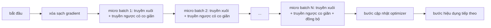
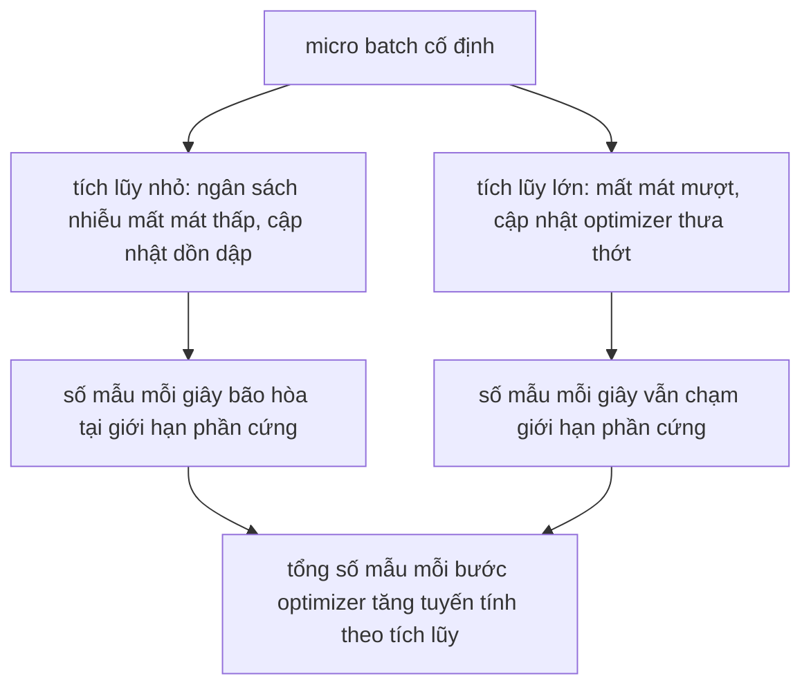

# Tích Lũy Gradient (Gradient Accumulation)

> Huấn luyện với kích thước batch hiệu dụng (effective batch) vượt quá khả năng dung nạp của phần cứng, chia nhỏ thành từng micro-batch tại một thời điểm. Co giãn hàm mất mát, giữ lại bước cập nhật tối ưu hóa và để các gradient tự tích lũy trong bộ đệm.

**Type:** Build
**Languages:** Python
**Prerequisites:** Phase 19 lessons 42 to 45
**Time:** ~90 phút

## Mục Tiêu Học Tập

- Suy diễn đẳng thức kích thước batch hiệu dụng: `effective_batch = micro_batch * accum_steps * world_size`, rút gọn thành `micro_batch * accum_steps` trên một thiết bị đơn lẻ như trong bài học này.
- Cài đặt phép co giãn hàm mất mát trên từng micro-batch để gradient tích lũy khớp chính xác với một lượt truyền ngược trên toàn bộ batch lớn duy nhất.
- Trì hoãn đồng bộ hóa bộ tối ưu hóa cho tới micro-batch cuối cùng (mô hình đồng bộ hóa ở bước cuối - sync-on-last-step).
- Phân tích đường cong thông lượng theo kích thước batch hiệu dụng và giải thích quy luật lợi suất giảm dần (diminishing return).

## Vấn Đề

Bạn muốn huấn luyện mô hình với kích thước batch hiệu dụng là 512 mẫu vì đường cong hàm mất mát sẽ mượt mà hơn và bước cập nhật của bộ tối ưu hóa có ý nghĩa toán học vững chắc hơn ở quy mô đó. Nhưng thiết bị tăng tốc (accelerator/GPU) trên bàn làm việc chỉ chứa tối đa 32 mẫu trước khi tràn bộ nhớ VRAM. Nhân đôi batch không phải là phương án khả thi. Cắt giảm một nửa kích thước mô hình lại càng không. Thủ thuật mà cộng đồng nghiên cứu AI tìm ra từ năm 2017 và không bao giờ ngừng sử dụng là: chạy 16 lượt truyền ngược (backward pass), để các gradient tự tích lũy dần bên trong các bộ đệm tham số, và chỉ thực hiện bước cập nhật của bộ tối ưu hóa khi số lượt tích lũy chạm ngưỡng mục tiêu.

Rủi ro tiềm ẩn là giá trị hàm mất mát không còn là con số giống như khi tính trên một batch lớn đầy đủ. Hàm mất mát cross-entropy của 16 mini-batch cộng lại một cách ngây thơ sẽ lớn gấp 16 lần hàm mất mát của một batch lớn duy nhất. Nếu không chia tỉ lệ co giãn, hướng gradient vẫn đúng nhưng độ lớn lại sai lệch hoàn toàn, khiến bước cập nhật của bộ tối ưu hóa bị phóng to gấp 16 lần. Cách khắc phục chỉ đơn giản là một phép chia. Nhưng đó cũng chính là phép chia rất dễ bị lãng quên.

## Khái Niệm



Bản giao ước kỹ thuật gồm các điểm mấu chốt sau:

- Hàm mất mát của mỗi micro-batch được chia cho `accum_steps` trước khi gọi `backward()`. Theo mặc định, PyTorch luôn cộng dồn các gradient vào `param.grad`; phép chia này kéo tổng tích lũy trở về đúng thang đo chuẩn.
- Bước cập nhật của bộ tối ưu hóa chỉ được kích hoạt một lần cho mỗi batch hiệu dụng, ngay sau lượt truyền ngược của micro-batch cuối cùng. Cập nhật giữa chừng quá trình tích lũy sẽ làm lệch lạc mọi tham số mà toàn bộ phần còn lại của quá trình huấn luyện phụ thuộc vào.
- Trạng thái nội bộ của bộ tối ưu hóa (các bộ đệm động lượng momentum, ước tính mô-men bậc một và hai trong Adam) chỉ tiến lên một bước sau mỗi bước hiệu dụng, chứ không phải sau mỗi micro-batch. Nếu không, các giá trị trung bình động hàm mũ (exponential moving averages) sẽ nhìn thấy tần suất cập nhật sai lệch và làm kiệt quệ lịch trình học tập.
- Trên một thiết bị đơn lẻ, đây đơn thuần là bài toán quản lý sổ sách (bookkeeping). Trên một cụm phân tán nhiều rank, cùng mô hình này sẽ bọc các micro-batch không-phải-cuối-cùng vào một ngữ cảnh `no_sync` để bỏ qua thao tác all-reduce gradient; micro-batch cuối cùng sẽ thực hiện gom và rút gọn toàn bộ gradient tích lũy trong một lần duy nhất thay vì phải trả chi phí mạng tới $N$ lần.

### Chứng minh tính tương đương trong mã nguồn

```python
loss = criterion(model(x_full), y_full)
loss.backward()
opt.step()
```

hoàn toàn tương đương về mặt toán học với

```python
for x, y in chunks(x_full, y_full, n):
    scaled = criterion(model(x), y) / n
    scaled.backward()
opt.step()
```

ngoại trừ sai số thứ tự cộng dấu phẩy động cực nhỏ. Bộ đệm gradient tích lũy ở cuối vòng lặp hoàn toàn là cùng một tensor mà một lượt truyền ngược trên batch đầy đủ duy nhất sinh ra. Mã nguồn bài học xác nhận điều này bằng phép khẳng định độ chênh lệch tuyệt đối tối đa `max_abs_diff` nhỏ hơn $10^{-4}$ trong hàm `equivalence_check`.

### Chi phí tính toán chuyển dịch đi đâu?

Mỗi micro-batch tiêu tốn một lượt truyền xuôi và một lượt truyền ngược. Với kỹ thuật tích lũy, bạn đang đánh đổi thời gian để lấy dung lượng bộ nhớ. Đường cong thông lượng trong tệp `outputs/accum-curve.json` thể hiện rõ điều gì diễn ra khi batch hiệu dụng tăng lên trong khi micro-batch giữ cố định:



Không có bữa trưa nào miễn phí. Nhân đôi `accum_steps` sẽ nhân đôi thời gian đồng hồ thực (wall time) cho mỗi bước cập nhật tối ưu hóa. Điều thay đổi ở đây là phương sai của ước tính gradient: cùng một quỹ thời gian, bạn thực hiện ít bước tối ưu hóa hơn nhưng mỗi bước đều là kết quả trung bình của nhiều mẫu dữ liệu hơn. Giới nghiên cứu học thuật coi batch lớn và batch nhỏ là hai bài toán tối ưu hóa khác nhau; bài học ở đây tập trung vào khía cạnh cơ học kỹ thuật, không phải khía cạnh thống kê.

```figure
cc-grad-accumulation
```

## Tự Xây Dựng (Build It)

Tệp `code/main.py` là hiện vật có thể thực thi được. Nó thực hiện ba nhiệm vụ cốt lõi:

### Bước 1: Kiểm tra tính tương đương (Equivalence check)

Hàm `equivalence_check()` khởi tạo hai bản sao của cùng một mạng nơ-ron với cùng một hạt giống ngẫu nhiên. Một bản sao xử lý một batch gồm 16 mẫu trong một lượt truyền xuôi duy nhất. Bản sao còn lại xử lý bốn mẩu nhỏ gồm 4 mẫu với hàm mất mát được chia cho 4. Hàm so sánh bộ đệm gradient trước bước tối ưu hóa và các tham số sau bước tối ưu hóa. Điều kiện kiểm chứng bắt buộc là `max_abs_diff < 1e-4`.

### Bước 2: Mô hình đồng bộ ở bước cuối (Sync-on-last-step)

Hàm `train_one_optimizer_step` duyệt qua các micro-batch. Đối với mọi micro-batch trừ bước cuối cùng, nó đi vào ngữ cảnh `no_sync_context(model)`. Trên một tiến trình đơn, ngữ cảnh này không thực hiện thao tác nào (no-op); trên cơ chế DDP, đây chính là nơi thao tác all-reduce gradient được bỏ qua. Khâu ghi nhận sổ sách hoàn toàn giống nhau. Biến `sync_counter` ghi nhận số lần chúng ta thoát khỏi phạm vi `no_sync`; với $N$ micro-batch, biến đếm này chỉ tăng một lần cho mỗi bước hiệu dụng, chứ không phải $N$ lần.

### Bước 3: Đường cong thông lượng (Throughput curve)

Hàm `sweep_effective_batches` chạy cùng một mô hình với kích thước micro-batch cố định và một danh sách các bước tích lũy khác nhau. Đối với mỗi thiết lập, nó ghi nhận:

- `samples_per_sec`: tổng số mẫu xử lý chia cho thời gian thực
- `median_step_ms`: phân vị thứ 50 (trung vị) thời gian cho mỗi bước hiệu dụng tính bằng mili-giây
- `sync_calls`: số điểm truyền thông tập thể đã kích hoạt
- `avg_loss`: hàm mất mát trung bình qua các bước cập nhật tối ưu hóa của đợt quét

Đầu ra được lưu vào `outputs/accum-curve.json` và có thể tái sử dụng dễ dàng từ một Jupyter Notebook.

Chạy thử:

```bash
python3 code/main.py
```

Tập lệnh in kết quả kiểm tra tương đương, sau đó in bảng dữ liệu quét thông lượng, và đường dẫn tệp JSON. Mã thoát bằng 0.

## Sử Dụng Thư Viện (Use It)

Trong môi trường huấn luyện thực tế, tích lũy gradient ẩn sau một núm xoay cấu hình duy nhất. Mô hình chuẩn mực của PyTorch là `accumulation_steps = effective_batch // (micro_batch * world_size)`. Các framework cấp cao đóng gói cùng vòng lặp này, nhưng các bước thực thi bên dưới là bất biến: co giãn hàm mất mát, bỏ qua đồng bộ hóa trên các micro-batch trung gian, tích lũy gradient, và cập nhật một lần.

Ba quy tắc thực chiến điển hình:

- Kích thước micro-batch được lựa chọn để lấp đầy bộ nhớ thiết bị. Bất cứ kích thước nào nhỏ hơn đều lãng phí chu kỳ tính toán của bộ tăng tốc. Bất cứ kích thước nào lớn hơn đều dẫn đến tràn bộ nhớ (OOM).
- Kích thước batch hiệu dụng được xác định dựa trên lịch trình tốc độ học. Các batch hiệu dụng lớn đòi hỏi tốc độ học được nhân tỉ lệ và có giai đoạn khởi động (warmup); đây là quy tắc mở rộng tuyến tính (linear scaling rule) kinh điển từ năm 2017.
- Số bước tích lũy là cầu nối giữa hai đại lượng trên và là núm điều chỉnh duy nhất bạn được tự do tinh chỉnh tại thời điểm chạy mà không cần phải viết lại bộ nạp dữ liệu.

## Xuất Bản Sản Phẩm (Ship It)

Tệp `outputs/skill-gradient-accumulation.md` đúc kết công thức kỹ thuật chuẩn để một đồng nghiệp có thể đưa ngay vào một kho mã nguồn mới: chia tỉ lệ hàm mất mát theo `accum_steps`, bỏ qua đồng bộ hóa bộ tối ưu hóa trên các micro-batch trung gian, cập nhật bộ tối ưu hóa đúng một lần cho mỗi batch hiệu dụng, và ghi nhận thông lượng theo batch hiệu dụng dưới dạng JSON để đánh giá sự đánh đổi một cách trực quan.

## Bài Tập Thực Hành

1. Chạy lại đợt quét với `--num-steps 100` và vẽ biểu đồ số mẫu mỗi giây theo kích thước batch hiệu dụng. Đường cong bắt đầu phẳng ra ở điểm nào?
2. Thêm một biến thể co giãn sai (không thực hiện phép chia) và chỉ ra độ chênh lệch tham số ở bước 1 so với triển khai chuẩn tham chiếu.
3. Thay thế SGD bằng AdamW và xác nhận rằng trạng thái của bộ tối ưu hóa chỉ tăng lên một lần cho mỗi bước hiệu dụng, không phải cho mỗi micro-batch.
4. Tích hợp một lớp bọc `DistributedDataParallel` thực sự và định tuyến `no_sync_context` tới phương thức của nó. Xác nhận rằng `sync_calls` giảm đi $N-1$ lần trên mỗi batch hiệu dụng.
5. Sửa đổi phép kiểm tra tính tương đương để so sánh hai cách phân chia micro-batch khác nhau (2 nhóm 8 mẫu so với 4 nhóm 4 mẫu) và giải thích sai số dung sai bạn cần phải nới lỏng.

## Thuật Ngữ Then Chốt

| Thuật ngữ | Người ta thường nói | Bản chất thực sự |
|-----------|--------------------|-------------------|
| Micro batch | Batch truyền xuôi | Lát cắt dữ liệu vừa vặn với bộ nhớ trong một lượt truyền xuôi duy nhất |
| Bước tích lũy (Accum steps) | Số lượt truyền ngược mỗi bước | Số lượt truyền ngược được cộng dồn trước khi thực hiện một bước cập nhật tối ưu |
| Batch hiệu dụng (Effective batch) | Kích thước batch thực | Micro-batch nhân với số bước tích lũy nhân với kích thước thế giới song song dữ liệu (world size) |
| Co giãn hàm mất mát (Loss scaling) | Chia cho N | Phép chia trên từng micro-batch để tổng gradient tích lũy khớp với gradient của batch đầy đủ |
| Đồng bộ ở bước cuối (Sync on last) | Bỏ qua phần còn lại | Chỉ kích hoạt lệnh truyền thông tập thể cho gradient ở lượt truyền ngược cuối cùng trong cửa sổ |

## Đọc Thêm (Further Reading)

- Tài liệu PyTorch về `DistributedDataParallel.no_sync` cho phiên bản sản xuất của thủ thuật đồng bộ ở bước cuối cùng.
- Goyal et al., 2017, về quy tắc tỷ lệ tuyến tính cho huấn luyện batch lớn — lý do kinh điển để quan tâm đến batch hiệu dụng.
- Hệ thống theo dõi sự cố của PyTorch về sự tương tác giữa tích lũy gradient và giải co giãn độ chính xác hỗn hợp.
- Các bài học Phase 19 từ 42 đến 45 bao gồm mô hình, bộ nạp dữ liệu, bộ tối ưu hóa và giàn khung huấn luyện mà bài học này kế thừa.
- Bài học Phase 19 · 47 bao gồm lưu và khôi phục điểm kiểm tra để một đợt tích lũy dài hạn sống sót qua giới hạn thời gian chạy phần cứng.
