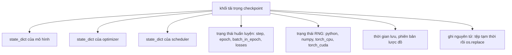
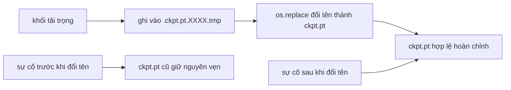
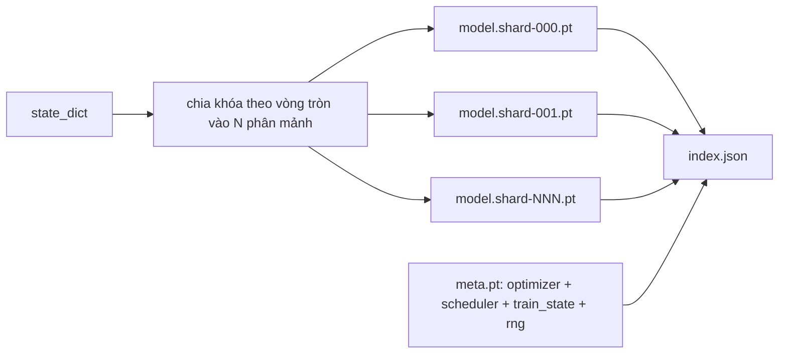

# Lưu và Khôi Phục Điểm Kiểm Tra (Checkpoint Save and Resume)

> Việc tiến trình bị gián đoạn sẽ giết chết các lượt chạy huấn luyện; các điểm kiểm tra (checkpoints) giúp chúng tiếp tục vận hành. Lưu trữ mô hình, bộ tối ưu hóa, bộ điều phối lịch trình, lịch sử hàm mất mát, bộ đếm bước và trạng thái bộ sinh số ngẫu nhiên (RNG state) một cách nguyên tử (atomically), để sự cố dừng đột ngột ở bất kỳ khoảnh khắc nào cũng để lại một tệp tin hợp lệ trọn vẹn trên đĩa.

**Type:** Build
**Languages:** Python
**Prerequisites:** Phase 19 lessons 42 to 45
**Time:** ~90 phút

## Mục Tiêu Học Tập

- Gói trọn vẹn toàn bộ trạng thái huấn luyện vào một khối tải trọng (payload) duy nhất có thể nạp lại vào một tiến trình hoàn toàn mới.
- Cài đặt cơ chế lưu nguyên tử bằng kỹ thuật ghi vào tệp tạm rồi đổi tên (write-to-temp then rename) để sự cố sập nguồn không bao giờ để lại một tệp tin bị ghi dở dang.
- Khôi phục trạng thái bộ sinh số ngẫu nhiên (RNG state) cho Python, NumPy và PyTorch để quỹ đạo mất mát sau khi tiếp tục huấn luyện khớp hoàn toàn với đường cơ sở không bị gián đoạn.
- Xây dựng bố cục điểm kiểm tra phân mảnh (sharded checkpoint) cho các mô hình vượt quá dung lượng của một tệp đơn lẻ, đi kèm các phân mảnh được xác thực mã băm và một chỉ mục JSON.

## Vấn Đề

Bạn thiết lập một tác vụ huấn luyện dự kiến chạy trong 18 giờ. Hệ thống điều phối cụm giới hạn mỗi phiên phân bổ tài nguyên tối đa 4 giờ, do đó lượt chạy thực chất là một chuỗi các tác vụ được nối tiếp nhau thông qua khôi phục trạng thái. Sau đó, cụm máy chủ khởi động lại ở giờ thứ 11 của lượt chạy vì quản trị viên phê duyệt một bản nâng cấp nhân hệ điều hành. Nếu không có điểm kiểm tra, bạn phải bắt đầu lại từ con số không. Nếu không khôi phục trạng thái bộ tối ưu hóa, bạn cũng sẽ mất trắng trạng thái tích lũy mà bộ tối ưu hóa đã mất 11 giờ để học hỏi; ngay cả khi trọng số mô hình còn nguyên vẹn, các mô-men của AdamW đã biến mất và bước cập nhật tiếp theo sẽ chao đảo theo một hướng mà quỹ đạo huấn luyện lẽ ra đã vượt qua từ lâu.

Tạo tác chuẩn xác là một tệp duy nhất chứa mọi thứ cần thiết để tiếp tục: tham số mô hình, trạng thái bộ tối ưu hóa, trạng thái bộ điều phối lịch trình, lịch sử hàm mất mát để vẽ biểu đồ, các bộ đếm bước, epoch và vị trí batch trong epoch hiện tại, cùng trạng thái RNG của mọi nguồn sinh số ngẫu nhiên. Nếu thiếu trạng thái RNG, đường cong mất mát sau khi tiếp tục sẽ là một đường cong hoàn toàn khác. Cùng mô hình, cùng dữ liệu, nhưng thứ tự xáo trộn khác nhau, mặt nạ dropout khác nhau, và những con số hiển thị trên bảng điều khiển cũng sẽ khác nhau.

Lưu trữ nguyên tử (atomic save) là nửa còn lại của bản giao ước. Việc ghi thẳng vào tên tệp đích đồng nghĩa với việc nếu xảy ra sự cố giữa chừng, tệp sẽ bị hỏng; quá trình khôi phục sau đó sẽ đọc phải dữ liệu rác. Ghi vào một tệp tạm thời trong cùng thư mục rồi mới đổi tên đồng nghĩa với việc nếu có sự cố xảy ra giữa chừng, tệp tin hợp lệ trước đó vẫn hoàn toàn nguyên vẹn. Thao tác đổi tên (rename) mang tính nguyên tử trên các hệ thống tệp chuẩn POSIX.

## Khái Niệm



### Năm nhóm trạng thái cốt lõi

| Nhóm | Lý do cần lưu trữ |
|------|-------------------|
| Mô hình (Model) | Trọng số và các bộ đệm; định nghĩa bản thân mô hình. |
| Bộ tối ưu hóa (Optimizer) | Động lượng (momentum) và các mô-men thích nghi; thiếu chúng, bước cập nhật tiếp theo sẽ trở thành một bài toán tối ưu hoàn toàn khác. |
| Bộ điều phối (Scheduler) | Vị trí hiện tại của tốc độ học trên đường cong; đặc biệt quan trọng với các lịch trình cosine. |
| Bộ đếm huấn luyện (Train counters) | Bước (step), chu kỳ (epoch), chỉ số batch trong epoch, cùng lịch sử mất mát để vẽ biểu đồ giám sát. |
| Trạng thái RNG (RNG state) | Tính tiền định cho cơ chế dropout, xáo trộn dữ liệu và bất kỳ phép lấy mẫu ngẫu nhiên nào bên trong mô hình. |

### Cơ chế lưu nguyên tử (Atomic save)



Hai quy tắc vàng: Thứ nhất, tệp tạm thời phải nằm trong cùng thư mục với tệp đích để thao tác đổi tên diễn ra trong phạm vi cùng một hệ thống tệp (file system); việc đổi tên xuyên thiết bị lưu trữ (cross-device rename) không đảm bảo tính nguyên tử. Thứ hai, tên tệp tạm thời phải là duy nhất cho mỗi lần ghi để tránh trường hợp hai tiến trình ghi đè lên nhau.

### Điểm kiểm tra phân mảnh (Sharded checkpoints)

Khi kích thước mô hình tăng vọt, tệp tải trọng đơn lẻ trở nên quá lớn để nạp nhanh, quá cồng kềnh để kiểm tra, và rất dễ đổ vỡ khi chia sẻ mạng bị trục trặc giữa chừng. Giải pháp là chia nhỏ trạng thái tham số thành nhiều phân mảnh và ghi một tệp chỉ mục nhỏ kết nối chúng lại với nhau.



Tệp chỉ mục ghi lại số lượng phân mảnh, mã sha256 của từng phân mảnh và mã sha256 của tệp siêu dữ liệu (meta). Trình nạp sẽ lập tức báo lỗi nghiêm trọng khi phát hiện bất kỳ mã băm nào không khớp. Các phân mảnh có thể được phân bổ trên các đĩa cứng vật lý khác nhau; tệp meta có kích thước nhỏ và luôn được đọc trước tiên.

### Khôi phục tiếp tục ngay giữa chừng epoch

Một cơ chế khôi phục mà chỉ có thể nhảy về đầu epoch tiếp theo sẽ gây lãng phí từ vài phút cho tới cả một ngày tính toán. Giải pháp là lưu cặp `(epoch, batch_in_epoch)` cùng với trạng thái RNG. Sau khi nạp, vòng lặp huấn luyện tua nhanh (fast-forward) bộ sinh số ngẫu nhiên qua các batch đã tiêu thụ trong epoch hiện tại và tiếp tục chạy mượt mà từ `batch_in_epoch`. Mã nguồn bài học thực thi chính xác điều này; điều kiện kiểm chứng khẳng định rằng quỹ đạo hàm mất mát sau khi khôi phục khớp với đường cơ sở không bị gián đoạn với sai số tuyệt đối dưới $10^{-4}$.

```figure
cc-atomic-checkpoint
```

## Tự Xây Dựng (Build It)

Tệp `code/main.py` cung cấp bốn thành phần nguyên thủy và một kịch bản minh họa.

### Bước 1: Thu thập và khôi phục trạng thái RNG

Hàm `capture_rng_state` trả về một từ điển chứa `random.getstate` của Python, `np.random.get_state` của NumPy, cùng chuỗi byte RNG của PyTorch trên CPU và CUDA. Mỗi phần tử đều được lưu trữ dưới dạng các số nguyên, tuple và list thuần túy của Python (mảng khóa của NumPy được chuyển qua `tolist()`), nhờ đó trình nạp ở Bước 3 có thể đọc lại mà không cần phải unpickle các đối tượng tùy ý. Hàm `restore_rng_state` đảo ngược lại quy trình này. Tensor của CPU là một bộ đệm byte uint8 mà hệ thống RNG của PyTorch có thể tiếp nhận trực tiếp.

### Bước 2: Lưu nguyên tử (Atomic save)

Hàm `atomic_save` ghi khối tải trọng vào một tệp tạm thời trong thư mục đích, sau đó dùng lệnh `os.replace` để hoán đổi nó thành tên tệp chính thức. Hàm `atomic_write_json` thực hiện thao tác tương tự cho tệp chỉ mục JSON của các phân mảnh.

### Bước 3: Chu trình lưu và nạp điểm kiểm tra toàn diện

Hàm `save_checkpoint` đóng gói mô hình, bộ tối ưu hóa, bộ điều phối lịch trình, trạng thái huấn luyện và RNG vào một từ điển duy nhất. Hàm `load_checkpoint` giải nén ngược lại và trả về đối tượng `TrainState`. Trường `schema` là điểm móc để nâng cấp phiên bản: các thay đổi định dạng trong tương lai chỉ cần tăng chuỗi phiên bản và trình nạp sẽ điều phối xử lý phù hợp.

Hàm `load_checkpoint` gọi `torch.load(..., weights_only=True)`. Tệp `.pt` thực chất là một tệp pickle, và việc unpickle một tệp không đáng tin cậy với `weights_only=False` có thể thực thi bất kỳ đoạn mã độc hại nào được đặt tên trong tệp. Trình nạp chỉ-trọng-số (weights-only loader) chỉ chấp nhận các tensor và các khối chứa nguyên thủy, từ chối mọi đối tượng tùy ý khác — đây chính là lý do tại sao Bước 1 lưu giữ trạng thái RNG trong các danh sách list thuần túy. Các bước kiểm tra tính toàn vẹn đưa ra ngoại lệ `ValueError` thay vì dùng câu lệnh `assert`, bởi vì cờ tối ưu hóa `python -O` sẽ lược bỏ hoàn toàn các câu lệnh assert. Cần sử dụng PyTorch 2.6 trở lên: trước phiên bản này, cờ `weights_only=True` tồn tại một lỗ hổng vượt quyền đã biết (CVE-2025-32434), do đó sự đảm bảo an toàn của bài học này chỉ có hiệu lực từ bản 2.6 trở đi.

### Bước 4: Biến thể điểm kiểm tra phân mảnh

Hàm `save_sharded_checkpoint` phân phối các khóa tham số xoay vòng (round-robin) qua $N$ phân mảnh, ghi từng phân mảnh bằng cơ chế lưu nguyên tử riêng, ghi một tệp `meta.pt` chứa bộ tối ưu hóa, bộ điều phối và trạng thái huấn luyện, đồng thời ghi tệp chỉ mục JSON kèm mã sha256 của từng phân mảnh. Hàm `load_sharded_checkpoint` xác thực toàn diện mọi phân mảnh trước khi hợp nhất và kiên quyết từ chối bất kỳ đường dẫn phân mảnh nào trỏ ra ngoài thư mục điểm kiểm tra.

### Bước 5: Kịch bản thử nghiệm khôi phục huấn luyện

Hàm `run_resume_demo` huấn luyện một mô hình nhỏ trong `total_steps` bước, lưu điểm kiểm tra tại bước `interrupt_at`, sau đó tiếp tục chạy. Một tiến trình thứ hai phục hồi điểm kiểm tra và chạy các bước còn lại. Hàm trả về độ chênh lệch tuyệt đối tối đa giữa hai quỹ đạo hàm mất mát sau thời điểm gián đoạn. Khi trạng thái RNG được khôi phục chuẩn xác, sự chênh lệch này bằng 0 hoặc chỉ nằm trong phạm vi sai số dấu phẩy động.

Chạy thử:

```bash
python3 code/main.py
```

Cả bản thử nghiệm tệp đơn lẫn phân mảnh đều khẳng định độ chênh lệch tối đa dưới $10^{-4}$. Bản tóm tắt được xuất ra tệp `outputs/resume-demo.json`.

## Sử Dụng Thư Viện (Use It)

Các ngăn xếp huấn luyện trong sản xuất luôn tích hợp sẵn cơ chế lưu điểm kiểm tra như một phần của lớp Trainer. Cấu trúc chuẩn mực luôn là: mô hình + bộ tối ưu hóa + bộ điều phối + bộ đếm + RNG, được ghi nguyên tử và đặt tên theo số bước để dễ dàng tìm kiếm bản mới nhất. Bố cục phân mảnh hỗ trợ nạp mô hình khổng lồ với các luồng đọc song song; và tệp `index.json` chính là mắt xích giúp toàn bộ quy trình này hoạt động.

Bốn nguyên tắc bắt buộc phải tuân thủ:

- **Luôn nạp với `weights_only=True`.** Một điểm kiểm tra kéo về từ ổ đĩa chia sẻ hoặc tải từ internet phải luôn được xem là dữ liệu đầu vào không đáng tin cậy. Trình nạp chỉ-trọng-số ngăn chặn tệp độc hại thực thi mã tùy ý trên máy tiếp tục huấn luyện.
- **Lược đồ (Schema) là một chuỗi ký tự trong tải trọng.** Các quy trình chuyển đổi định dạng (migration) sẽ rẽ nhánh dựa trên chuỗi này. Thiếu nó, bạn không thể nâng cấp định dạng lưu trữ mà không làm hỏng các lần chạy cũ.
- **Tính mã sha256 cho từng phân mảnh.** Một tệp tải về bị cắt ngắn âm thầm là loại lỗi tồi tệ nhất; trình nạp phải phát hiện lỗi ngay từ đầu (fail-fast) thay vì sụp đổ muộn màng ở giữa chặng đường.
- **Giữ nhịp độ lưu điểm kiểm tra hợp lý.** Lưu sau mỗi $N$ bước hoặc sau mỗi số phút đồng hồ thực nhất định, tùy theo điều kiện nào đến trước. Nếu không, một bước huấn luyện dài bị sập sẽ làm lãng phí toàn bộ thành quả của cả một khoảng thời gian dài trước đó.

## Xuất Bản Sản Phẩm (Ship It)

Tệp `outputs/skill-checkpoint-save-resume.md` là công thức hoàn chỉnh cho bất kỳ tập lệnh huấn luyện mới nào: cấu trúc tải trọng, cơ chế ghi nguyên tử, thu thập trạng thái RNG, và chỉ mục phân mảnh. Đưa kỹ năng này vào kho mã nguồn, gắn `save_checkpoint` tại vị trí lưu định kỳ, gắn `load_checkpoint` khi khởi động, và đợt huấn luyện sẽ hoàn toàn sống sót qua mọi sự cố tắt tiến trình.

## Bài Tập Thực Hành

1. Thay thế cơ chế phân mảnh xoay vòng bằng cơ chế phân mảnh theo nhóm tham số (các tầng kết thúc bằng `.weight` tách riêng với `.bias`). Trường hợp nào thì mỗi bố cục này phát huy ưu thế tốt hơn?
2. Mở rộng vòng lặp lưu trữ để giữ lại $K$ điểm kiểm tra gần nhất và tự động dọn dẹp các bản cũ hơn. Giá trị $K$ hợp lý là bao nhiêu khi dung lượng đĩa bị hạn chế?
3. Thêm cờ `--ckpt-every-seconds` kích hoạt lưu điểm kiểm tra theo khoảng thời gian đồng hồ thực, thay vì chỉ dựa vào số bước.
4. Thêm quy trình kiểm tra mã tổng kiểm chạy khi khởi động, quét toàn bộ các điểm kiểm tra trong thư mục và báo cáo những bản nào bị hỏng.
5. Cài đặt hàm `migrate_v1_to_v2` thêm một trường mới vào tải trọng và nâng chuỗi schema. Đảm bảo logic nạp có thể tiếp nhận và xử lý tương thích cả hai phiên bản.

## Thuật Ngữ Then Chốt

| Thuật ngữ | Người ta thường nói | Bản chất thực sự |
|-----------|--------------------|-------------------|
| Lưu nguyên tử (Atomic save) | "Ghi rồi cầu nguyện" | Ghi vào một tệp tạm trong cùng thư mục, sau đó dùng `os.replace` hoán đổi tên vào tệp đích |
| Từ điển trạng thái (State dict) | "Trọng số mô hình" | Toàn bộ tham số và bộ đệm của mô hình, được định danh theo tên tham số |
| Điểm kiểm tra phân mảnh (Sharded checkpoint) | "Tệp mô hình lớn" | Nhiều tệp riêng biệt cho từng phân mảnh, cộng thêm một tệp meta và một chỉ mục JSON kèm mã sha256 |
| Trạng thái RNG (RNG state) | "Hạt giống ngẫu nhiên" | Trạng thái toàn diện được chụp lại của random trong python, numpy, torch CPU, torch CUDA; không đơn thuần chỉ là giá trị seed |
| Khôi phục giữa epoch (Mid-epoch resume) | "Khởi động lại" | Tua nhanh bộ sinh số ngẫu nhiên RNG và tiếp tục chạy từ batch kế tiếp trong cùng một epoch |

## Đọc Thêm (Further Reading)

- Ngữ nghĩa hàm `rename` của POSIX cho tính chất nguyên tử mà `os.replace` dựa vào.
- Tài liệu PyTorch về `torch.save` và `torch.load`, bao gồm tùy chọn `map_location` để khôi phục xuyên thiết bị và `weights_only` để nạp tệp an toàn.
- Bài học Phase 19 · 46 bao gồm kỹ thuật tích lũy gradient mà tải trọng điểm kiểm tra của bài học này giúp duy trì trạng thái xuyên suốt.
- Bài học Phase 19 · 48 bao gồm các lớp bọc phân tán mà định dạng state dict này có thể thích ứng hoàn hảo.
- Tài liệu về lời gọi hệ thống `fsync` trong nhân Linux cho sự đảm bảo tính bền vững đằng sau phép đổi tên nguyên tử.
