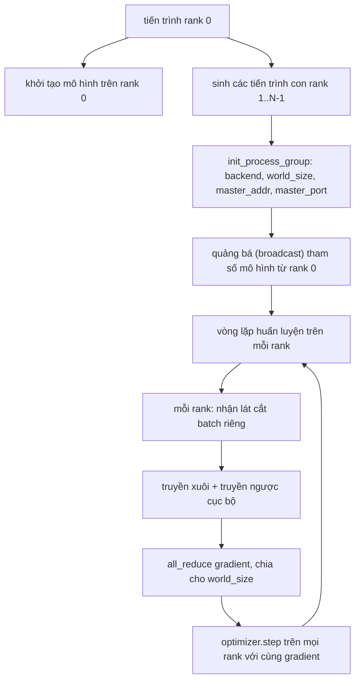
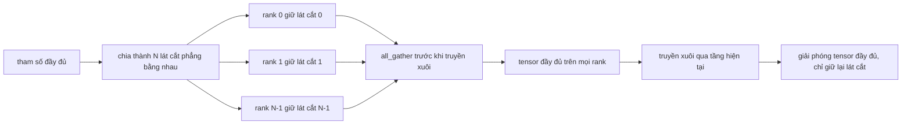

# Song Song Dữ Liệu Phân Tán và FSDP từ Đầu (Distributed Data Parallel and FSDP from Scratch)

> Huấn luyện đa tiến trình (multi-rank training) quy về hai phép toán truyền thông tập thể và một quy tắc duy nhất: Quảng bá (broadcast) các tham số khi khởi động, lấy trung bình gradient sau lượt truyền ngược, và không bao giờ để các rank bất đồng về việc chúng đang ở bước huấn luyện nào.

**Type:** Build
**Languages:** Python
**Prerequisites:** Phase 19 lessons 42 to 45
**Time:** ~90 phút

## Mục Tiêu Học Tập

- Thiết lập một nhóm tiến trình (process group) trên $N$ rank với backend `gloo` mà không cần phần cứng chuyên dụng.
- Cài đặt một lớp bọc DDP tối giản có khả năng quảng bá tham số khi khởi tạo và gom rút gọn (all-reduce) gradient sau lượt truyền ngược.
- Chứng minh rằng thao tác all-reduce gradient trên từng rank khớp chính xác với gradient tính toán bởi một tiến trình đơn trên dữ liệu đầu vào ghép nối.
- Phác thảo cơ chế phân mảnh tham số FSDP: mỗi rank chỉ giữ một lát cắt nhỏ, tensor đầy đủ được gom lại (gather) cho lượt truyền xuôi và giải phóng bộ nhớ ngay sau đó.

## Vấn Đề

Mô hình thì vừa vặn trên một thiết bị phần cứng, nhưng tập dữ liệu thì không. Ngân sách tối ưu hóa yêu cầu bạn phải xử lý số lượng mẫu dữ liệu mỗi giây gấp $N$ lần. Đòn bẩy đầu tiên là song song dữ liệu (data parallel - DDP): mỗi rank chạy cùng một mô hình trên một lát cắt dữ liệu khác nhau của batch, sau đó tính trung bình gradient trước bước cập nhật của bộ tối ưu hóa. Đòn bẩy thứ hai là song song phân mảnh hoàn toàn (Fully Sharded Data Parallel - FSDP): khi bản thân mô hình cũng không còn vừa trên một thiết bị đơn lẻ, mỗi rank sẽ chỉ lưu trữ một phần nhỏ của từng tham số và tái cấu trúc lại tensor đầy đủ theo từng tầng ngay trong lượt truyền xuôi.

Khó khăn lớn nhất nằm ở khâu quản lý tính nhất quán (bookkeeping). Nếu các tham số bị lệch pha giữa các rank, đợt huấn luyện sẽ bị hỏng trong âm thầm. Nếu bạn tính trung bình gradient nhưng quên tính trung bình hàm mất mát, các chỉ số trên bảng điều khiển sẽ là giả dối. Nếu backend truyền thông tập thể không thể thống nhất về cấu trúc liên kết mạng (topology), toàn bộ hệ thống sẽ bị treo vĩnh viễn. Cách giải quyết triệt để là tự tay lập trình các phép toán tập thể một lần để không bao giờ phải tin tưởng mù quáng vào một lớp bọc mà bạn không thể tự tái tạo lại.

Bài học này chạy hoàn toàn trên CPU mà không đòi hỏi GPU hay CUDA. Backend `gloo` được tích hợp sẵn trong mọi bản cài đặt PyTorch và tương thích trực tiếp với các tiến trình con của `torch.multiprocessing`; toàn bộ cấu trúc mã nguồn này có thể chuyển thẳng sang `nccl` trên một máy chủ nhiều GPU mà không cần thay đổi kiến trúc.

## Khái Niệm



### Hai phép toán truyền thông tập thể then chốt

| Phép toán tập thể | Chức năng | Thời điểm sử dụng |
|-------------------|-----------|-------------------|
| `broadcast` | Sao chép một tensor từ một rank nguồn tới tất cả các rank khác | Khởi tạo tham số, đồng bộ trạng thái scheduler, mọi thao tác đồng bộ một-tới-tất-cả |
| `all_reduce` | Cộng dồn (hoặc tính trung bình, tìm max) một tensor trên mọi rank, mọi rank đều nhận kết quả cuối cùng | Lấy trung bình gradient sau lượt truyền ngược |
| `all_gather` | Mỗi rank đóng góp một tensor, mọi rank nhận lại tensor ghép nối từ tất cả các rank | Thu thập logits, phục hồi tham số FSDP trước khi tính toán |

Bản giao ước của DDP là gọi `broadcast` khi khởi tạo và gọi `all_reduce` sau lượt truyền ngược. Mô hình FSDP bổ sung thêm thao tác `all_gather` ngay trước lượt truyền xuôi của từng tầng.

### Tính trung bình gradient khớp với gradient của tiến trình đơn

Một mô hình được huấn luyện trên một batch gồm $B$ mẫu phân bổ qua $N$ rank bắt buộc phải sinh ra gradient giống hệt như khi một tiến trình đơn lẻ huấn luyện trên một batch gồm $N \times B$ mẫu. Chìa khóa ở đây là: việc cộng dồn gradient của từng rank rồi chia cho $N$ sẽ cho ra gradient của hàm mất mát trung bình — chính là kết quả mà hàm cross-entropy với tùy chọn thu giảm trung bình (mean reduction) sẽ tạo ra trên toàn bộ batch lớn. Mã nguồn bài học kiểm chứng điều này với điều kiện `max-abs-diff < 1e-3` giữa gradient gom bằng all-reduce thủ công và gradient đối chứng từ tiến trình đơn lẻ.

### Bản phác thảo kiến trúc FSDP



Lợi ích tiết kiệm bộ nhớ ở đây là tuyệt đối: dung lượng bộ nhớ dành cho tham số trên mỗi rank giảm xuống còn $1/N$. Chi phí đánh đổi là thao tác gom (gather) dữ liệu phải trả giá ở mỗi lượt truyền xuôi. FSDP trong môi trường sản xuất thực tế sẽ gối đầu (overlap) thao tác gom dữ liệu của tầng tiếp theo với quá trình tính toán của tầng hiện tại, giúp chi phí thời gian thực tế thấp hơn nhiều so với tính toán lý thuyết ngây thơ. Bài học thực hiện chu trình chia nhỏ rồi gom lại trên từng tham số và chứng minh tensor tái tạo hoàn toàn khớp từng bit so với ban đầu.

### CPU và backend gloo

Mặc dù CUDA là mục tiêu trong môi trường sản xuất, nhưng các tuyến thực thi mã nguồn trên CPU là hoàn toàn tương đương. `gloo` là backend truyền thông tập thể cho CPU. Nó chậm hơn `nccl` trên GPU nhiều bậc độ lớn, nhưng bề mặt API là giống hệt nhau. Nhóm tiến trình trong bài học được khởi tạo với `backend="gloo"` và các rank được sinh ra bằng `torch.multiprocessing` thay vì công cụ dòng lệnh `torchrun`; cả hai cách tiếp cận cuối cùng đều gọi tới các hàm `torch.distributed` giống nhau. Trên một máy chủ nhiều GPU, những thay đổi duy nhất chỉ là đổi `backend="nccl"`, đưa tensor lên thiết bị GPU, và dùng `torchrun` để khởi chạy.

```figure
cg-allreduce-ring
```

## Tự Xây Dựng (Build It)

Tệp `code/main.py` là hiện vật có thể thực thi được.

### Bước 1: Khởi tạo nhóm tiến trình (Process group)

```python
os.environ["MASTER_ADDR"] = "127.0.0.1"
os.environ["MASTER_PORT"] = str(port)
dist.init_process_group(backend="gloo", rank=rank, world_size=world_size)
```

`MASTER_ADDR` và `MASTER_PORT` là điểm hẹn (rendezvous): mọi rank đều kết nối tới cùng một cổng mạng trên cùng một máy chủ. Bài học tự động tìm một cổng mạng chưa bị chiếm dụng thông qua thủ thuật liên kết-rồi-đóng (bind-and-close) để tránh xung đột cổng khi nhiều tiến trình chạy song song trên cùng một máy.

### Bước 2: Quảng bá tham số khi khởi tạo

Phương thức khởi tạo `MinimalDDP.__init__` duyệt qua mọi tham số và bộ đệm rồi gọi `dist.broadcast(tensor, src=0)`. Các giá trị của rank 0 sẽ trở thành giá trị khởi tạo chuẩn tắc cho toàn bộ cụm. Nếu thiếu bước này, mỗi rank sẽ tự khởi tạo tham số với hạt giống ngẫu nhiên riêng và các rank sẽ phân kỳ ngay từ bước đầu tiên.

### Bước 3: All-reduce gradient sau lượt truyền ngược

```python
def all_reduce_grads_(module, world_size):
    for p in module.parameters():
        if p.grad is None:
            p.grad = torch.zeros_like(p.data)
        dist.all_reduce(p.grad.data, op=dist.ReduceOp.SUM)
        p.grad.data.div_(world_size)
```

Mọi rank đều nhận được cùng một gradient trung bình giống hệt nhau. Bước cập nhật của bộ tối ưu hóa lúc này nhận cùng một đầu vào trên mọi rank, đó là lý do tại sao các trọng số tham số luôn duy trì trạng thái đồng bộ tuyệt đối trong suốt quá trình chạy.

### Bước 4: Chứng minh tính tương đương

Hàm `manual_all_reduce_matches_single_process` xây dựng cùng một mô hình trên rank 0 và so sánh gradient sau khi all-reduce với gradient mà một tiến trình đơn lẻ tính toán trên tập dữ liệu đầu vào ghép nối. Độ chênh lệch tuyệt đối tối đa chỉ rơi vào khoảng $10^{-8}$.

### Bước 5: Chu trình khép kín của FSDP

Hàm `fsdp_round_trip_sketch` làm phẳng (flatten) từng tham số, đệm thêm số 0 để kích thước chia hết cho `world_size`, cắt lát, thực hiện `all_gather`, và loại bỏ phần đệm thừa. Bản tái tạo trên mỗi rank khớp hoàn toàn với tensor gốc ban đầu. Đây chính là bước mở phân mảnh (unshard); bước đảo ngược (tái phân mảnh sau lượt truyền xuôi) chỉ đơn giản là cắt lấy một lát tương ứng từ tensor đã gom.

Chạy thử:

```bash
python3 code/main.py
```

Quy mô thế giới mặc định là 2 rank. Hai tiến trình CPU được sinh ra, giao tiếp với nhau qua `gloo` và thoát với mã lỗi 0. Tệp đầu ra `outputs/ddp-demo.json` ghi lại tổng giá trị tham số trên từng rank, chuẩn gradient sau all-reduce, kết quả chu trình FSDP, và sai lệch gradient giữa tính toán thủ công và đối chứng.

## Sử Dụng Thư Viện (Use It)

Các ngăn xếp huấn luyện trong sản xuất gọi chính xác các phép toán nguyên thủy này. Lớp `DistributedDataParallel` chuẩn của PyTorch bổ sung thêm: các hook gradient sau truyền ngược để gối đầu việc all-reduce với lượt truyền ngược, gom nhóm all-reduce (bucketed all-reduce) để gộp nhiều gradient nhỏ vào một lần truyền thông, và ngữ cảnh `no_sync` mà bài học 46 đã sử dụng.

Triển khai FSDP của PyTorch bổ sung: góc nhìn tham số phẳng (flat parameter view) theo từng tầng để mỗi rank chỉ giữ một bộ đệm liên tục, gối đầu việc mở phân mảnh của tầng tiếp theo với việc tính toán của tầng hiện tại, và tùy chọn đẩy bớt các phân mảnh sang bộ nhớ RAM của CPU (CPU offload).

Cấu trúc cốt lõi vẫn không đổi: quảng bá khi khởi động, gom rút gọn sau truyền ngược, và phân mảnh tham số khi chúng không còn vừa bộ nhớ.

## Xuất Bản Sản Phẩm (Ship It)

Tệp `outputs/skill-distributed-fsdp-ddp.md` mang lại công thức chuẩn cho một tập lệnh huấn luyện mới: khởi tạo nhóm tiến trình với `gloo` cho CPU và `nccl` cho GPU, bọc mô hình trong một lớp vỏ DDP thực hiện quảng bá khi khởi tạo và gom rút gọn sau truyền ngược, tùy chọn phân mảnh tham số với mô hình `all_gather` từ bản phác thảo FSDP.

## Bài Tập Thực Hành

1. Chạy với `--world-size 4` và xác nhận độ phân tán tham số giữa các rank luôn dưới mức $10^{-3}$ trong suốt quá trình chạy.
2. Thay thế phép tính trung bình thủ công bằng `dist.all_reduce(op=dist.ReduceOp.AVG)` và đo lường sự chênh lệch về thời gian thực thi.
3. Thêm một hook sau truyền ngược (post-backward hook) vào lớp bọc DDP để thao tác all-reduce gối đầu song song với phần còn lại của lượt truyền ngược; đo lường mức độ cải thiện thời gian chạy thực tế.
4. Cài đặt bước tái phân mảnh (re-shard) cho FSDP: sau lượt truyền xuôi, thay thế tensor đầy đủ bằng lát cắt cục bộ ban đầu. Xác nhận rằng mức sử dụng bộ nhớ trên mỗi rank giảm rõ rệt.
5. Chuyển đổi backend sang `nccl` trên một máy chủ hỗ trợ CUDA. Ghi nhận những biến môi trường nào cần thay đổi và những biến nào được giữ nguyên.

## Thuật Ngữ Then Chốt

| Thuật ngữ | Người ta thường nói | Bản chất thực sự |
|-----------|--------------------|-------------------|
| Backend | "gloo hoặc nccl" | Thư viện phần mềm cài đặt các phép toán truyền thông tập thể; gloo dành cho CPU, nccl dành cho GPU |
| Quy mô thế giới (World size) | "Tổng số rank" | Tổng số tiến trình tham gia trong nhóm; nhóm là đơn vị mà các phép toán tập thể thao tác trên đó |
| Rank | "ID của worker" | Mã định danh duy nhất của tiến trình bên trong nhóm, bắt đầu đánh số từ 0 |
| All-reduce | "Cộng tổng gradient" | Tính tổng một tensor trên toàn bộ các rank trong nhóm, mọi rank đều nhận được cùng một kết quả cuối cùng |
| Mở phân mảnh (Unshard) | "Gom tham số" | Tái tạo lại tensor tham số đầy đủ từ các lát cắt của từng rank thông qua thao tác all_gather |

## Đọc Thêm (Further Reading)

- Tài liệu `torch.distributed` của PyTorch về ngữ nghĩa các phép toán tập thể mà bài học này dựa vào.
- Danh sách các phép toán tập thể của thư viện `gloo`, hoàn toàn tương đồng về mặt cấu trúc với các nguyên thủy `nccl` trên nền tảng CUDA.
- Bài học Phase 19 · 46 về mô hình tích lũy gradient bọc thao tác all-reduce của DDP trong ngữ cảnh `no_sync`.
- Bài học Phase 19 · 47 về bố cục điểm kiểm tra có thể duy trì hoạt động xuyên suốt các đợt chạy DDP và FSDP.
- Tài liệu PyTorch FSDP cho triển khai sản xuất thực tế của cơ chế phân mảnh tham số được phác thảo trong bài này.
