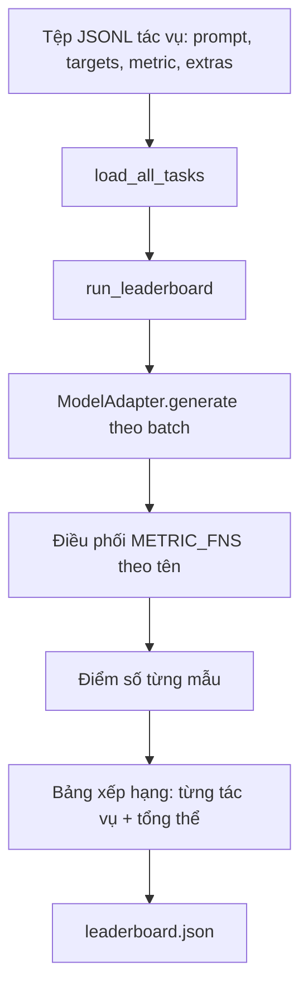
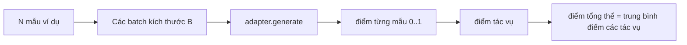

# Khung Đánh Giá Mô Hình Ngôn Ngữ (Language Model Evaluation Harness)

> Một mô hình thể hiện tốt trên một tác vụ mà bạn không thể định nghĩa chính xác là một mô hình làm tốt chỉ nhờ ăn may. Khung đánh giá (evaluation harness) chính là định nghĩa tác vụ, thang đo đánh giá, trình thực thi và bảng xếp hạng được đóng gói trong một cấu trúc ngắn gọn, dễ dàng hoán đổi.

**Type:** Build
**Languages:** Python
**Prerequisites:** Phase 19 lessons 42 to 45
**Time:** ~90 phút

## Mục Tiêu Học Tập

- Định nghĩa một tác vụ dưới dạng tệp JSONL chứa các trường `prompt`, `targets`, `metric`, và trường mở rộng `extras` tùy chọn cho từng mẫu dữ liệu.
- Cài đặt năm thang đo đánh giá chuẩn mực: khớp chính xác (exact match), ROUGE-L F1, kiểm tra mã thực thi (executable check), trắc nghiệm đa lựa chọn (multiple choice), và chứa chuỗi con (substring contains).
- Xây dựng trình thực thi gom batch các mẫu theo từng tác vụ và phân phối tới một adapter mô hình có thể hoán đổi linh hoạt.
- Xuất ra tệp bảng xếp hạng JSON (leaderboard) chứa điểm số chi tiết từng tác vụ, thời gian phản hồi (độ trễ) và điểm trung bình tổng thể có khả năng tái lập hoàn toàn.

## Vấn Đề

Hàng tuần đều có các mô hình ngôn ngữ mới xuất hiện. Lời quảng bá tiếp thị luôn khẳng định rằng mô hình mới hoạt động rất xuất sắc. Nhưng câu hỏi thẳng thắn luôn là: xuất sắc trên tác vụ nào? Câu trả lời trung thực duy nhất nằm ở bảng xếp hạng do chính bạn tự viết ra, bởi vì bảng xếp hạng của các nhà cung cấp luôn là thứ mà mô hình của họ đã được tinh chỉnh để tối ưu riêng.

Nếu thiếu một khung đánh giá chuẩn tắc trong kho mã nguồn, bạn chỉ có thể so sánh hai mô hình dựa trên "cảm tính" (vibes). Khi có khung đánh giá, bạn so sánh chúng dựa trên điểm số thực tế trên một bộ tác vụ cố định với thang đo cố định, xuất ra một tệp JSON có thể so sánh khác biệt (diff) trực tiếp. Khung đánh giá chính là bản giao ước giữa lần chạy hôm qua và lần chạy hôm nay. Thiếu nó, bạn sẽ vô tình đẩy lên môi trường sản xuất các phiên bản mô hình bị thoái lui chất lượng (regressions).

Cái bẫy nguy hiểm nhất là tối ưu khung đánh giá quá mức cho một mô hình cụ thể. Cách giải quyết là tách biệt hoàn toàn mọi quyết định đặc thù của mô hình ra khỏi khung đánh giá: khung đánh giá phải đủ nhỏ gọn để đọc hiểu trong mười lăm phút, các tác vụ phải đủ tinh gọn để lưu trữ trực tiếp trong kho mã nguồn, các thang đo được viết từ đầu để bất kỳ đồng nghiệp nào cũng có thể kiểm toán, và lớp adapter là nơi duy nhất chứa mã nguồn đặc thù của mô hình. Hoán đổi adapter thì điểm số trên bảng xếp hạng thay đổi; hoán đổi tác vụ thì điểm số thay đổi. Ngoài hai yếu tố đó, không thành phần nào khác được phép thay đổi.

## Khái Niệm



### Đặc tả định dạng tác vụ (Task spec)

Mỗi mẫu ví dụ tương ứng với một dòng JSONL:

```json
{"id": "arith-00", "prompt": "compute: 2 + 2", "targets": ["4"], "metric": "exact_match"}
```

Đối với các thang đo cần dữ liệu hỗ trợ chấm điểm, trường `extras` mang tải trọng phụ trợ:

```json
{
  "id": "code-00",
  "prompt": "python: write a function f that doubles its input",
  "targets": ["ok"],
  "metric": "code_exec",
  "extras": {"io_pairs": [[1, 2], [3, 6]]}
}
```

Một tác vụ là một tệp `.jsonl` đặt trong thư mục `outputs/tasks/`. Tên tệp chính là tên của tác vụ. Toàn bộ các mẫu trong cùng một tệp chia sẻ chung một thang đo.

### Năm tác vụ mẫu (Five fixture tasks)

| Tác vụ | Thang đo | Mục đích kiểm tra |
|--------|----------|-------------------|
| arithmetic (số học) | exact_match | Tính chính xác đến từng token trên một câu trả lời tất định |
| summary (tóm tắt) | rouge_l | Chỉ số F1 của dãy con chung dài nhất (LCS) so với bản tóm tắt tham chiếu một dòng |
| code-exec (chạy mã) | code_exec | Kiểm tra tính thực thi được: hàm được sinh ra phải vượt qua danh sách các cặp đầu vào - đầu ra |
| multiple-choice (trắc nghiệm) | multiple_choice | Ký tự đầu tiên của câu trả lời phải khớp với ký tự đáp án cho phép |
| generation (sinh văn bản) | substring_contains | Văn bản tự do phải chứa ít nhất một chuỗi con mục tiêu |

### Bản giao ước của thang đo (Metric contract)

Mỗi thang đo là một hàm nhận `(prediction, targets, extras) -> float` trả về giá trị trong đoạn $[0.0, 1.0]$. Khung đánh giá tính trung bình điểm số của từng mẫu để ra điểm của tác vụ, sau đó tính trung bình các tác vụ để ra điểm tổng thể. Các hàm thang đo đều rất tinh gọn:

- `exact_match`: chuyển chữ thường, loại bỏ khoảng trắng thừa, so sánh bằng.
- `substring_contains`: chuẩn hóa tương tự, kiểm tra chuỗi con.
- `multiple_choice`: lấy ký tự đầu tiên chuyển thành chữ hoa.
- `rouge_l`: tính độ dài dãy con chung dài nhất (LCS) chia cho độ dài của dự đoán và tham chiếu, tính F1 từ độ chuẩn xác (precision) và độ thu hồi (recall).
- `code_exec`: thực thi đoạn mã dự đoán trong một không gian tên (namespace) bị cô lập hạn chế, gọi hàm `f(x)` trên từng cặp đầu vào - đầu ra, đếm số lần khớp.

Thang đo `code_exec` chạy đoạn mã dự đoán trong một không gian hàm tích hợp bị lược bỏ (stripped builtins namespace). Bộ kiểm thử của bài học kiểm chứng rằng lệnh `import os` sẽ lập tức báo lỗi vì mô-đun `os` không tồn tại trong không gian tên; đoạn mã do mô hình sinh ra tuyệt đối không thể truy cập hệ thống tệp.

### Lớp tiếp hợp mô hình (Model adapter)

```python
class ModelAdapter(Protocol):
    def generate(self, prompts: Sequence[str]) -> List[str]: ...
    @property
    def name(self) -> str: ...
```

Adapter là đường ranh giới kết nối. Bài học cung cấp `ToyAdapter`, một bộ so khớp mẫu tất định luôn trả về câu trả lời chính xác cho mọi câu hỏi trong năm tác vụ mẫu. Một adapter thực tế sẽ gọi tới mô hình và trả về kết quả sinh ra. Khung đánh giá không quan tâm bên dưới là gì.

### Trình thực thi (The runner)

Hàm `run_task` gom các câu hỏi thành từng batch kích thước `batch_size` và điều phối tới hàm thang đo tương ứng. Hàm `run_leaderboard` duyệt qua mọi tác vụ và tính toán giá trị trung bình. Hàm `write_leaderboard` xuất ra tệp JSON kèm chuỗi định danh lược đồ (schema string) để các thay đổi định dạng sau này không làm hỏng các bảng điều khiển giao diện.



```figure
eval-harness-matrix
```

## Tự Xây Dựng (Build It)

Tệp `code/main.py` là hiện vật có thể thực thi được.

### Bước 1: Khởi tạo các tác vụ mẫu

Hàm `seed_fixture_tasks(target_dir)` ghi năm tệp `.jsonl`. Lần chạy đầu tiên của `main.py` sẽ tự động khởi tạo các tệp này nếu thư mục còn trống.

### Bước 2: Nạp tác vụ

Hàm `load_all_tasks(task_dir)` đọc từng tệp `.jsonl` và trả về một từ điển ánh xạ từ tên tác vụ sang danh sách các bản ghi `Example`. Các dòng chú thích bắt đầu bằng `#` và các dòng trống được tự động bỏ qua để người đóng góp có thể ghi chú vào tệp dữ liệu.

### Bước 3: Cài đặt các thang đo

Mỗi thang đo là một hàm độc lập đi kèm kiểm thử đơn vị. Bộ kiểm thử của bài học bao gồm 13 trường hợp kiểm thử bao phủ các khâu: chuẩn hóa văn bản, trùng lặp một phần, thực thi mã nguồn và từ chối mã nguồn không an toàn.

### Bước 4: Viết trình thực thi

Hàm `run_task` lặp qua các batch và tạo ra kết quả `TaskResult` chứa điểm số, số câu đúng, tổng số câu và thời gian thực thi (độ trễ). Hàm `run_leaderboard` duyệt qua toàn bộ các tác vụ và xuất ra đối tượng `Leaderboard` với điểm trung bình chung.

### Bước 5: Xuất dữ liệu JSON

Hàm `write_leaderboard` tuần tự hóa bảng xếp hạng. Cờ `--include-per-example` cho phép lưu chi tiết từng mẫu ví dụ để bạn có thể so sánh chi tiết câu trả lời của mô hình với lần chạy trước khi điểm số có sự biến động.

Chạy thử:

```bash
python3 code/main.py
```

Tập lệnh sẽ khởi tạo các bộ dữ liệu mẫu trong lần chạy đầu tiên, chấm điểm bằng adapter mẫu (vốn trả lời đúng 100% các câu hỏi mẫu), và ghi kết quả vào `outputs/leaderboard.json`. Điểm tổng thể đạt 1.0 với toy adapter; bài kiểm tra stub adapter trong `test_main.py` chứng minh rằng chính khung đánh giá này sẽ cho điểm 0.0 khi adapter không thể trả lời.

## Sử Dụng Thư Viện (Use It)

Để kết nối một mô hình thực tế, bạn chỉ cần viết một adapter. Cấu trúc chuẩn:

```python
class HttpAdapter:
    name = "vendor.v1"

    def __init__(self, endpoint, api_key):
        self.endpoint = endpoint
        self.api_key = api_key

    def generate(self, prompts):
        out = []
        for prompt in prompts:
            response = http_post(self.endpoint, prompt, self.api_key)
            out.append(response["text"])
        return out
```

Thay thế `ToyAdapter` bằng `HttpAdapter` ở đầu hàm `main()`. Khung đánh giá, tập tác vụ, các thang đo và cấu trúc bảng xếp hạng vẫn giữ nguyên vẹn 100%.

Ba quy tắc cần tuân thủ khi áp dụng khung đánh giá vào một dự án thực tế:

- **Ghim chặt nội dung tệp tác vụ (Pin task files).** Tệp leaderboard.json phải ghi kèm mã băm của nội dung tác vụ hoặc lưu trữ kèm các tệp JSONL tương ứng; nếu không, khi điểm số thay đổi bạn sẽ không thể phân biệt được là do mô hình thay đổi hay do tệp câu hỏi đã bị chỉnh sửa.
- **So sánh câu trả lời chi tiết, không chỉ nhìn điểm số.** Cờ `--include-per-example` cho phép bạn nhìn thấy chính xác mô hình đã nói những gì vào ngày điểm số bị sụt giảm.
- **Giới hạn kích thước batch.** Các adapter thực tế luôn có giới hạn tần suất gọi API (rate limits). Kích thước batch nhỏ giúp khung đánh giá duy trì khả năng tương thích xuyên suốt qua nhiều nhà cung cấp khác nhau.

## Xuất Bản Sản Phẩm (Ship It)

Tệp `outputs/skill-lm-eval-harness.md` mang lại công thức chuẩn: đặc tả tác vụ JSONL, năm thang đo cốt lõi, adapter có thể hoán đổi, trình thực thi theo batch, và bảng xếp hạng JSON có lược đồ rõ ràng. Các tệp tác vụ trong `outputs/tasks/` là các bài kiểm tra mẫu chuẩn mực; hãy sao chép chúng sang dự án thực tế làm điểm xuất phát.

## Bài Tập Thực Hành

1. Thêm tác vụ thứ sáu với thang đo tự viết từ đầu (độ đo chồng lấn tương tự BLEU, chấm điểm tham chiếu tương tự BLEURT, hoặc bất kỳ cơ chế nào có bản giao ước rõ ràng).
2. Mở rộng `code_exec` để thu thập luồng xuất chuẩn (stdout) và chấp nhận danh sách các stdout mong đợi làm nhãn mục tiêu.
3. Thêm lệnh so sánh bảng xếp hạng (diff): nhận đầu vào là hai tệp `leaderboard.json`, in ra những tác vụ nào có điểm số biến động và mức độ chênh lệch là bao nhiêu.
4. Giới hạn độ trễ cho từng mẫu. Bọc lệnh gọi adapter trong một cơ chế ngắt thời gian chờ (timeout); hiển thị thêm cột `timeouts` riêng trên bảng xếp hạng.
5. Ghim nội dung tác vụ bằng mã băm sha256 trong bảng xếp hạng để người đọc sau này có thể xác thực rằng họ đang chấm điểm trên cùng một bộ câu hỏi.

## Thuật Ngữ Then Chốt

| Thuật ngữ | Người ta thường nói | Bản chất thực sự |
|-----------|--------------------|-------------------|
| Đặc tả tác vụ (Task spec) | "Định dạng đánh giá" | Tệp JSONL chứa prompt, targets, metric và trường extras tùy chọn cho từng mẫu |
| Thang đo (Metric) | "Cách chấm điểm" | Hàm ánh xạ từ (prediction, targets, extras) thành một số thực trong đoạn [0, 1] |
| Lớp tiếp hợp (Adapter) | "Client của mô hình" | Đối tượng cung cấp phương thức generate(prompts) -> list[str]; nơi duy nhất chứa mã đặc thù của mô hình |
| Bảng xếp hạng (Leaderboard) | "Bảng điểm" | Tệp JSON chứa điểm số từng tác vụ, tổng số câu hỏi, độ trễ và điểm trung bình tổng thể |
| Thang đo chạy mã (Code exec metric) | "Chạy thử xem sao" | Thực thi đoạn mã dự đoán trong một không gian tên bị cô lập, so sánh với các cặp đầu vào - đầu ra |

## Đọc Thêm (Further Reading)

- Thư viện gốc `lm-evaluation-harness` của EleutherAI cho tham chiếu triển khai môi trường sản xuất quy mô lớn.
- Thư viện `lighteval` của HuggingFace cho một triển khai thay thế với cùng bản giao ước thiết kế.
- Bài học Phase 19 · 46 bao gồm các mô hình tích lũy gradient được dùng trong ngăn xếp huấn luyện mà khung đánh giá này chấm điểm.
- Bài học Phase 19 · 47 bao gồm định dạng điểm kiểm tra mà bạn sẽ đánh giá; ghim mã băm của điểm kiểm tra vào bảng xếp hạng.
- Bài học Phase 19 · 48 bao gồm ngăn xếp huấn luyện phân tán đã sản sinh ra mô hình đang được kiểm thử.
