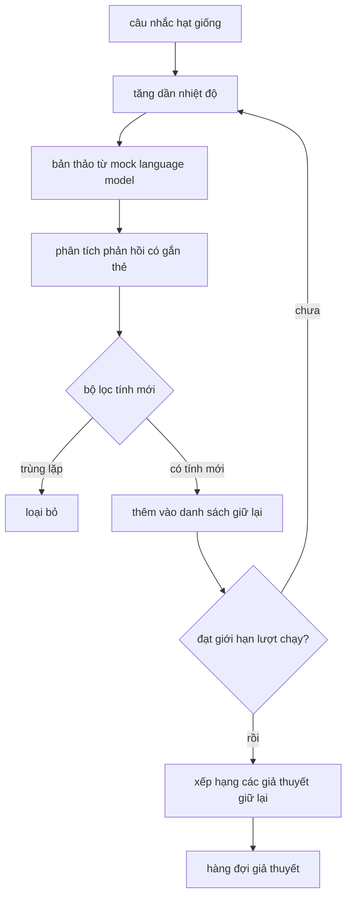

# Bộ tạo giả thuyết (Hypothesis Generator)

> Một tác tử nghiên cứu lặp lại cùng một câu hỏi hai lần là đang lãng phí token. Bí quyết cốt lõi là buộc mỗi bản thảo giả thuyết phải hướng tới một vùng khám phá mới.

**Phân loại:** Xây dựng (Build)  
**Ngôn ngữ:** Python  
**Yêu cầu tiên quyết:** Các bài học 20-29 thuộc Nhánh A của Giai đoạn 19  
**Thời lượng:** ~90 phút  

## Mục tiêu học tập
- Điều khiển một bộ lấy mẫu (sampler) từ một câu nhắc hạt giống (seed prompt) và chuyển đổi các đầu ra thành các bản ghi giả thuyết có định kiểu chặt chẽ.
- Tăng dần nhiệt độ lấy mẫu (temperature ramping) qua từng lượt chạy để bản thảo tiếp theo phân kỳ xa hơn bản thảo trước đó.
- Lọc các bản sao gần tương đồng thông qua một mô hình nhúng (embedding model) kích thước nhỏ và một ngưỡng khoảng cách cosine (cosine distance threshold).
- Xếp hạng các giả thuyết còn lại bằng một hàm tính điểm kết hợp giữa tính mới (novelty), độ đặc hiệu (specificity) và khả năng kiểm chứng (testability).
- Đảm bảo tính tất định (deterministic) cho mọi bước để cùng một hạt giống luôn tạo ra cùng một hàng đợi giả thuyết.

## Vì sao cần sinh rồi mới lọc (Why generate, then filter)

Một bộ lập kế hoạch (planner) chỉ hỏi một mô hình duy nhất một lần sẽ chỉ nhận được một giả thuyết. Điều này có thể phù hợp với một ví dụ minh họa đơn giản. Tuy nhiên, đối với một vòng lặp nghiên cứu (research loop), đó là cấu trúc không phù hợp. Vòng lặp cần một hàng đợi có thứ hạng (ranked queue) với chiều sâu nhất định, để khi giả thuyết đầu tiên thất bại, bộ thực thi thí nghiệm (runner) đã có sẵn giả thuyết tiếp theo mà không phải trả thêm chi phí cho một lượt lấy mẫu toàn phần mới.

Hai ý tưởng được kết hợp để tạo ra hàng đợi đó. Đầu tiên là kỹ thuật tăng dần nhiệt độ (temperature ramping): mỗi lượt qua bộ lấy mẫu sẽ tăng nhiệt độ lên một nấc, khuyến khích các bản thảo sau phân kỳ và mở rộng không gian tìm kiếm. Thứ hai là bộ lọc tính mới (novelty filtering): sau mỗi bản thảo, bộ tạo giả thuyết đo khoảng cách nhúng (embedding distance) so với mọi bản ghi đã được chấp nhận trước đó và loại bỏ bất kỳ nội dung nào rơi vào trong cụm tương đồng.

Bài học này cung cấp một mô hình ngôn ngữ mô phỏng (mock language model) trả về các chuỗi token được lập kịch bản sẵn cho các câu nhắc cố định. Mô hình mô phỏng này là đủ để thực thi toàn bộ luồng quy trình: nhận câu nhắc hạt giống, áp dụng bước tăng nhiệt độ, phân tích cú pháp các ứng viên, chạy bộ lọc tính mới và xuất ra hàng đợi đã được xếp hạng.

## Cấu trúc dữ liệu Giả thuyết (The Hypothesis shape)

```text
Hypothesis
  id             : int           (tăng đơn điệu trong một lượt chạy)
  text           : str           (nội dung tuyên bố)
  variables      : list[str]     (những biến số thay đổi giữa các điều kiện)
  metric         : str           (chỉ số mà runner sẽ đo lường)
  baseline_ref   : str | None    (bài báo hoặc lượt chạy dùng làm đối chuẩn đối chiếu)
  draft_pass     : int           (lượt lấy mẫu nào đã tạo ra bản ghi này)
  temperature    : float         (thiết lập nhiệt độ của sampler tại thời điểm tạo bản thảo)
  novelty_score  : float         (khoảng cách so với các bản ghi tồn tại trước đó, 0..1)
  rank_score     : float         (tổng có trọng số dùng để sắp xếp thứ tự)
```

`variables` và `metric` không phải là văn bản tự do. Bộ phân tích cú pháp (parser) trích xuất chúng từ phản hồi có gắn thẻ định dạng. Bộ thực thi thí nghiệm (runner) trong bài học thứ năm mươi hai sẽ đọc trực tiếp các trường này khi xây dựng cấu hình thí nghiệm.

`baseline_ref` là tùy chọn nhưng được khuyến nghị. Bộ đánh giá (evaluator) trong bài học thứ năm mươi ba cần một đường cơ sở (baseline) để so sánh đối chiếu. Nếu giả thuyết bỏ qua trường này, bộ đánh giá sẽ sử dụng lượt chạy trước đó trên cùng một chỉ số làm mốc dự phòng.

```figure
cg-novelty-ramp
```

## Kiến trúc (Architecture)



Vòng lặp vận hành rất mạch lạc. Điểm đáng lưu ý là mỗi khối xử lý đều tuân theo một giao ước (contract) nghiêm ngặt.

## Tăng dần nhiệt độ (Temperature ramp)

Bắt đầu tại `t_min`, kết thúc tại `t_max`, bước nhảy là `(t_max - t_min) / (n_passes - 1)`. Mỗi lượt chạy sẽ gọi bộ lấy mẫu ở mức nhiệt độ hiện tại, tạo ra `n_passes` giá trị cách đều nhau từ `GeneratorConfig.schedule()`. Mô hình mô phỏng tuân thủ nhiệt độ bằng cách chuyển đổi giữa một tập hợp nhỏ các phản hồi theo kịch bản được định danh bởi khóa `(prompt, temp_bucket)`. Các khoảng nhiệt độ (buckets) là các khoảng mở, do đó một thay đổi nhỏ về nhiệt độ sẽ chọn một khoảng khác và tạo ra một bản thảo khác. Trong môi trường sản xuất thực tế, bộ lấy mẫu sẽ là một mô hình thực thụ với tham số `temperature=t` được truyền vào.

Lịch trình mặc định gồm sáu lượt chạy từ `0.2` đến `1.2`. Sáu lượt là đủ để lấp đầy hàng đợi mà không tốn chi phí cho các mẫu mà bộ lọc tính mới đằng nào cũng sẽ loại bỏ. Dưới `0.2`, mô hình có xu hướng lặp lại y nguyên câu nhắc hạt giống. Trên `1.2`, các phản hồi dễ bị lạc đề và thất bại khi phân tích cú pháp.

## Bộ lọc tính mới (Novelty filter)

Sau khi mỗi bản thảo được phân tích cú pháp, bộ tạo giả thuyết sẽ nhúng văn bản và so sánh với từng giả thuyết đã được chấp thuận. Phép nhúng ở đây là một túi từ (bag-of-words) được băm nhỏ, chuẩn hóa về độ dài đơn vị. Khoảng cách cosine giữa hai vector đơn vị là `1 - dot(a, b)`. Một bản thảo đạt yêu cầu nếu khoảng cách tối thiểu của nó tới bất kỳ giả thuyết nào được giữ lại trước đó vượt qua ngưỡng `novelty_threshold`. Giá trị mặc định là `0.25`.

Phép nhúng băm này không quá phức tạp. Nó mang tính tất định, không có phần phụ thuộc bên ngoài và đủ để phát hiện trường hợp hiển nhiên: hai bản thảo chia sẻ hầu hết các danh từ. Việc triển khai trong sản xuất có thể thay thế bằng một mô hình nhúng câu (sentence model) gọn nhẹ. Giao diện xử lý vẫn giữ nguyên hoàn toàn.

## Điểm xếp hạng (Rank score)

```text
rank_score = w_novelty * novelty_score
           + w_specificity * specificity_score
           + w_testability * testability_score
```

Điểm xếp hạng gồm ba điểm thành phần. `novelty_score` là khoảng cách nhúng tối thiểu so với các giả thuyết đã chấp thuận trước đó. `specificity_score` là số lượng biến số cụ thể trong giả thuyết chia cho một số lượng mục tiêu. `testability_score` nhận giá trị 1 nếu giả thuyết chỉ định cả chỉ số đo lường lẫn đường cơ sở, nhận 0.5 nếu chỉ có chỉ số đo lường, và 0 trong các trường hợp còn lại.

Các trọng số mặc định là `0.4`, `0.3`, `0.3`. Các trọng số này nằm trong cấu hình của bộ tạo giả thuyết, giúp các bài học tiếp theo có thể điều chỉnh linh hoạt mà không cần sao chép hay sửa đổi mã nguồn gốc.

## Mô hình ngôn ngữ mô phỏng (Mock language model)

```python
class MockLLM:
    def sample(self, prompt: str, temperature: float, seed: int) -> str:
        ...
```

Bộ lấy mẫu có tính tất định khi nhận vào bộ ba `(prompt, temperature, seed)`. Mô hình mô phỏng duy trì một bảng phản hồi theo kịch bản dựa trên khóa `(prompt_signature, temperature_bucket)`. Nếu bảng không có mục nhập cho khóa tương ứng, bộ lấy mẫu sẽ trả về phản hồi dự phòng (fallback) khiến bộ phân tích cú pháp báo lỗi. Nhánh dự phòng này được kiểm thử trong bộ bài kiểm tra (test suite).

Hạt giống (seed) được kết hợp vào phản hồi để cùng một cặp `(prompt, temperature)` với các seed khác nhau sẽ tạo ra các bản thảo khác nhau. Trong các bài kiểm thử, chúng ta ghim cố định hạt giống để đảm bảo kết quả tái lập được. Trong triển khai thực tế, hạt giống có thể lấy từ đồng hồ hệ thống hoặc một bộ đếm.

## Hàng đợi đầu ra (Output queue)

Đầu ra là danh sách các bản ghi `Hypothesis` được sắp xếp giảm dần theo `rank_score`. Bộ thực thi (runner) trong bài học thứ năm mươi hai sẽ lấy phần tử ở đầu hàng đợi (pop head), chạy thí nghiệm, và bộ đánh giá trong bài học thứ năm mươi ba sẽ ghi nhận kết luận. Nếu kết luận xác định giả thuyết sai, bộ thực thi sẽ lấy phần tử tiếp theo.

Hàng đợi có số lượng hữu hạn. Khi hàng đợi rỗng, bộ điều phối (orchestrator) có thể mở rộng câu nhắc hạt giống và chạy lại bộ tạo giả thuyết, hoặc dừng lại và báo cáo rằng ngân sách đã cạn kiệt.

## Cách đọc mã nguồn (How to read the code)

`code/main.py` định nghĩa `Hypothesis`, `MockLLM`, `HypothesisGenerator` và một kịch bản minh họa tất định. Bộ tạo giả thuyết cung cấp duy nhất một phương thức `run(seed_prompt)` trả về hàng đợi đã sắp xếp; số lượt chạy được đọc từ `GeneratorConfig.n_passes` thay vì truyền vào dưới dạng đối số. Phép nhúng là một túi token được băm. Bộ lọc tính mới là một hàm đơn lẻ. Hàm tính điểm xếp hạng cũng là một hàm đơn lẻ. Không có thành phần nào phụ thuộc vào `numpy`; toán học cho phép nhúng hoàn toàn sử dụng thư viện chuẩn (stdlib) của Python để bài học duy trì tính tương thích và dễ di chuyển.

`code/tests/test_generator.py` kiểm thử luồng tuần tự, luồng loại bỏ bản sao trùng lặp, luồng xử lý lỗi bộ phân tích cú pháp, các mốc biên tăng nhiệt độ và trật tự sắp xếp thứ hạng.

## Vị trí trong hệ thống (Where this slots in)

Bài học 50 tạo ra hàng đợi giả thuyết. Bài học 51 lấy phần tử đầu hàng đợi và thực hiện tìm kiếm tài liệu học thuật nhằm khẳng định hoặc bác bỏ nó. Bài học 52 nhận cùng phần tử đầu đó và chạy một thí nghiệm thực tế. Bài học 53 đọc kết quả từ cả hai bài trước và đưa ra phán quyết đánh giá. Bốn bài học này hợp thành một vòng lặp nghiên cứu tự động không cần con người can thiệp; tuy nhiên chuyên gia con người vẫn có thể tham gia vào bất kỳ ranh giới nào của quy trình.
