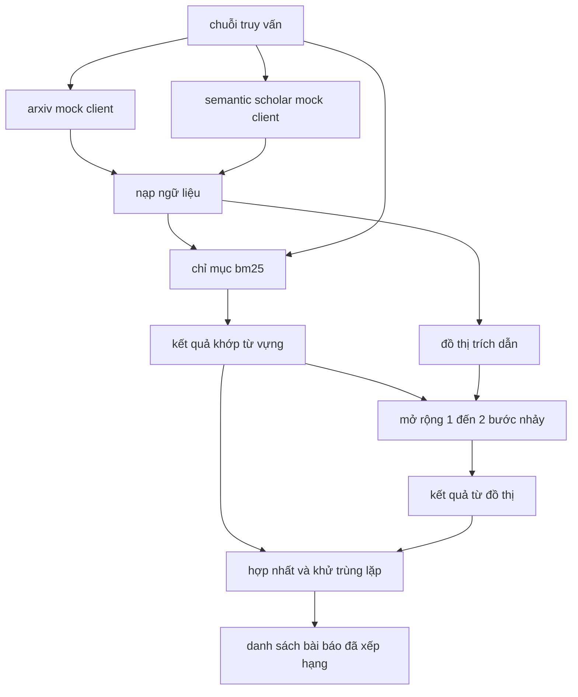

# Truy xuất tài liệu học thuật (Literature Retrieval)

> Đưa ra một giả thuyết thì chi phí rất thấp. Biết được liệu ai đó đã chứng minh nó hay chưa mới là phần tốn kém. Hãy xây dựng tầng truy xuất để trả lời câu hỏi đó trước khi bộ thực thi khởi tạo một môi trường hộp cát (sandbox).

**Phân loại:** Xây dựng (Build)  
**Ngôn ngữ:** Python  
**Yêu cầu tiên quyết:** Các bài học 20-29 thuộc Nhánh A của Giai đoạn 19  
**Thời lượng:** ~90 phút  

## Mục tiêu học tập
- Mô hình hóa một bản ghi bài báo khoa học gọn nhẹ với các trường dữ liệu mà vòng lặp nghiên cứu sẽ đọc ở các bước hạ nguồn.
- Xây dựng một chỉ mục BM25 (BM25 index) trên các bản tóm tắt (abstracts) chỉ bằng các cấu trúc dữ liệu của thư viện chuẩn (stdlib).
- Duyệt đồ thị trích dẫn (citation graph) để làm lộ diện các bài báo mà tìm kiếm từ vựng (lexical search) đã bỏ sót.
- Khử trùng lặp các kết quả tìm kiếm qua các lượt từ vựng và đồ thị dựa trên định danh bài báo ổn định (stable paper id).
- Đóng gói hai API bên ngoài mô phỏng (mock external APIs) phía sau một client duy nhất để điểm gọi phía trên không thay đổi khi kết nối các endpoint thực tế.

## Vì sao cần hai lượt truy xuất (Why two retrieval passes)

Tìm kiếm từ khóa trên các phần tóm tắt trả về những bài báo có cùng vốn từ vựng với truy vấn. Cách tiếp cận này bao quát phần lớn bề mặt thông tin, nhưng lại bỏ sót hai trường hợp quan trọng. Trường hợp thứ nhất là khi bài báo nền tảng sử dụng hệ thuật ngữ khác biệt; ví dụ một truy vấn về "chú ý thưa" ("sparse attention") sẽ bỏ qua một bài báo có tiêu đề "lựa chọn khối trong định tuyến transformer" ("block selection in transformer routing"). Trường hợp thứ hai là khi bài báo liên quan là một công trình tiếp nối trích dẫn một mỏ neo (anchor) đã biết; việc tìm mỏ neo đó rồi duyệt tiếp về phía trước sẽ hiệu quả hơn nhiều so với việc quét cạn tập hợp tóm tắt.

Bài học này xây dựng cả hai lượt truy xuất. Thuật toán BM25 trên các phần tóm tắt bắt các kết quả khớp từ vựng. Quá trình duyệt đồ thị trích dẫn sẽ mở rộng tập hạt giống theo chiều xuôi và chiều ngược từ một đến hai bước nhảy (hops). Hợp của hai tập này được khử trùng lặp theo định danh bài báo và xếp hạng bằng một điểm số kết hợp gọn nhẹ.

## Cấu trúc dữ liệu Bài báo (The Paper shape)

```text
Paper
  id          : str           (định danh ổn định, "p001" cho kho ngữ liệu mô phỏng)
  title       : str           (tiêu đề)
  abstract    : str           (phần tóm tắt)
  year        : int           (năm xuất bản)
  authors     : list[str]     (danh sách tác giả)
  references  : list[str]     (danh sách id các bài báo mà bài này trích dẫn)
  citations   : list[str]     (danh sách id các bài báo trích dẫn bài này)
  source      : str           (api mô phỏng nào đã cung cấp, "arxiv" hoặc "s2")
```

Các trường `references` và `citations` tạo nên một đồ thị trích dẫn có hướng (directed citation graph). Hai API mô phỏng trả về các trường có phần chồng lấn nhưng không hoàn toàn giống hệt nhau, vì vậy bộ nạp kho ngữ liệu (corpus loader) sẽ hợp nhất chúng dựa trên `id`.

```figure
cg-citation-hops
```

## Kiến trúc (Architecture)



Client truy xuất nắm quyền điều phối cả hai lượt tìm kiếm và bước hợp nhất. Phía gọi truyền cho nó một truy vấn và nhận lại danh sách xếp hạng, trong đó mỗi mục mang các trường điểm số riêng cho từng bài báo (`bm25_score`, `graph_distance`, `recency_score`, `final_score`) để giải thích rõ lý do xếp hạng.

## BM25 từ con số không (BM25 from scratch)

Việc cài đặt tuân theo chuẩn Okapi BM25 với các tham số mặc định `k1=1.5`, `b=0.75`. Chỉ mục gồm hai từ điển: `term -> doc_frequency` và `term -> list of (doc_id, term_count)`. Độ dài tài liệu là số lượng token của phần tóm tắt. Độ dài tài liệu trung bình được tính toán một lần tại thời điểm xây dựng chỉ mục. Việc tính điểm cho một truy vấn là tổng trên các thuật ngữ truy vấn của `idf * tf_norm`, trong đó `tf_norm` là tần suất thuật ngữ được chuẩn hóa theo độ dài chuẩn của BM25.

Bộ tách từ (tokenizer) thực hiện chuyển thành chữ thường (`lower`) sau đó tách theo các ký tự không phải chữ số và chữ cái. Nó không áp dụng rút gọn gốc từ (stemming). Một hệ thống sản xuất có thể tích hợp thêm một bộ tách gốc từ nhỏ. Giao diện chương trình vẫn được giữ nguyên.

```math
\begin{aligned}
\text{idf}(t) &= \log\!\left(\frac{N - \text{df} + 0.5}{\text{df} + 0.5} + 1.0\right) \\
\text{tf\_norm}(t) &= \frac{f \cdot (k_1 + 1)}{f + k_1 \cdot \left(1 - b + b \cdot \text{dl} / \text{avgdl}\right)} \\
\text{score}(d, q) &= \sum_{t \in q} \text{idf}(t) \cdot \text{tf\_norm}(t)
\end{aligned}
```

## Duyệt đồ thị trích dẫn (Citation graph traversal)

Đồ thị được xây dựng một lần từ kho ngữ liệu. Các cạnh xuôi đi từ một bài báo tới các tài liệu tham khảo (references) của nó. Các cạnh ngược đi từ một bài báo tới các bài trích dẫn (citations) nó. Quá trình duyệt là một thuật toán tìm kiếm theo chiều rộng (breadth-first search - BFS) xuất phát từ các kết quả BM25 hàng đầu, giới hạn tối đa hai bước nhảy (hops).

Mức trần hai bước nhảy là một giới hạn có chủ ý. Một bước nhảy là quá nông; tác tử thường cần tìm tổ tiên trực tiếp hoặc thế hệ kế thừa tiếp theo. Ba bước nhảy sẽ làm bùng nổ kích thước tập kết quả trên một đồ thị liên thông và có xu hướng làm loãng nội dung, trôi dạt khỏi chủ đề. Bài học hiển thị giới hạn bước nhảy như một nút điều khiển cấu hình để vòng lặp hạ nguồn có thể siết chặt lại khi cần.

## Khử trùng lặp và xếp hạng (Dedup and ranking)

Hai lượt truy xuất trả về các tập hợp có phần chồng lấn. Quá trình hợp nhất sử dụng định danh bài báo làm khóa. Đối với mỗi bài báo, điểm số cuối cùng là tổng kết hợp có trọng số.

```text
final_score = w_bm25 * bm25_score_norm
            + w_graph * graph_score
            + w_recency * recency_score
```

`bm25_score_norm` là điểm BM25 chia cho điểm BM25 cao nhất trong tập hợp đã hợp nhất (giúp giá trị nằm trong khoảng từ 0 đến 1). `graph_score` nhận giá trị 1 cho các kết quả khớp từ vựng trực tiếp, `0.6` cho một bước nhảy, `0.3` cho hai bước nhảy, và 0 cho các trường hợp khác. `recency_score` là hàm dốc tuyến tính từ 0 tại năm xuất bản cũ nhất của ngữ liệu đến 1 tại năm mới nhất.

Các trọng số mặc định là `0.5`, `0.3`, `0.2`. Các trọng số này được cấu hình linh hoạt; một chủ đề ít biến động có thể giảm trọng số tính mới về thời gian, trong khi một chủ đề thay đổi nhanh có thể tăng nó lên.

## Kho ngữ liệu mô phỏng (Mock corpus)

Kho ngữ liệu bao gồm một trăm bài báo, được sinh bởi hàm `build_corpus()`. Mỗi bài báo có tiêu đề và tóm tắt được soạn sẵn xoay quanh một trong năm chủ đề: độ thưa của cơ chế chú ý (attention sparsity), tăng cường truy xuất (retrieval augmentation), bộ điều hợp hạng thấp (low rank adapters), cô đọng tập dữ liệu (dataset distillation), và bộ khung đánh giá (evaluation harnesses). Các trích dẫn và tài liệu tham khảo được kết nối để mỗi chủ đề tạo thành một đồ thị con liên thông cùng một vài cạnh liên kết chéo giữa các chủ đề.

Hai client API mô phỏng (`ArxivMockClient`, `SemanticScholarMockClient`) cùng đọc từ một kho ngữ liệu nhưng cung cấp các trường dữ liệu khác nhau. Arxiv trả về tiêu đề, phần tóm tắt, năm xuất bản và tác giả. Semantic Scholar bổ sung thêm tài liệu tham khảo và trích dẫn. Client truy xuất hợp nhất các bản ghi dựa trên `id`; việc xử lý mâu thuẫn trường dữ liệu giữa các client được dành lại cho bài học tiếp theo.

## Các bài học 52 và 53 đọc những gì (What lessons 52 and 53 read)

Bộ thực thi thí nghiệm trong bài học 52 đọc `paper.id`, `paper.title` và ba câu đầu tiên của phần tóm tắt để làm ngữ cảnh cho thí nghiệm. Bộ đánh giá trong bài học 53 đọc `paper.year` và `paper.references` để quy gán một đường cơ sở (baseline) cho một bài báo cụ thể.

Client truy xuất trả về một đối tượng `RetrievalResult` bao gồm cả danh sách đã xếp hạng lẫn các chỉ số trên mỗi truy vấn: số lượng kết quả khớp (hit count), điểm trung bình, điểm cao nhất, tổng thời gian thực tế (wall time). Bộ thực thi ghi lại những thông tin này để bước quan sát hạ nguồn có thể biểu diễn chất lượng theo thời gian.

## Cách đọc mã nguồn (How to read the code)

`code/main.py` định nghĩa `Paper`, `ArxivMockClient`, `SemanticScholarMockClient`, `BM25Index`, `CitationGraph`, `RetrievalClient`, và một kịch bản minh họa tất định. Các mock client và kho ngữ liệu nằm trong cùng một tệp để bài học giữ được tính độc lập và dễ di chuyển. Phần cài đặt BM25 gói gọn trong một lớp với sáu mươi dòng mã. Phần duyệt đồ thị nằm trong một phương thức duy nhất.

`code/tests/test_retrieval.py` bao quát kiểm thử cho luồng từ vựng, luồng đồ thị, bước hợp nhất, khử trùng lặp và trường hợp truy vấn rỗng.

## Vị trí trong hệ thống (Where this slots in)

Bài học 50 sinh ra một giả thuyết. Bài học 51 tìm kiếm tài liệu học thuật để xem giả thuyết đó đã được giải quyết hay chưa. Bài học 52 sẽ tiến hành thí nghiệm nếu giả thuyết chưa được giải quyết. Bài học 53 đọc cả kết quả truy xuất lẫn các chỉ số thí nghiệm để đưa ra phán quyết. Client truy xuất là giai đoạn có chi phí thấp nhất trong bốn giai đoạn và được bộ điều phối chạy đầu tiên.
