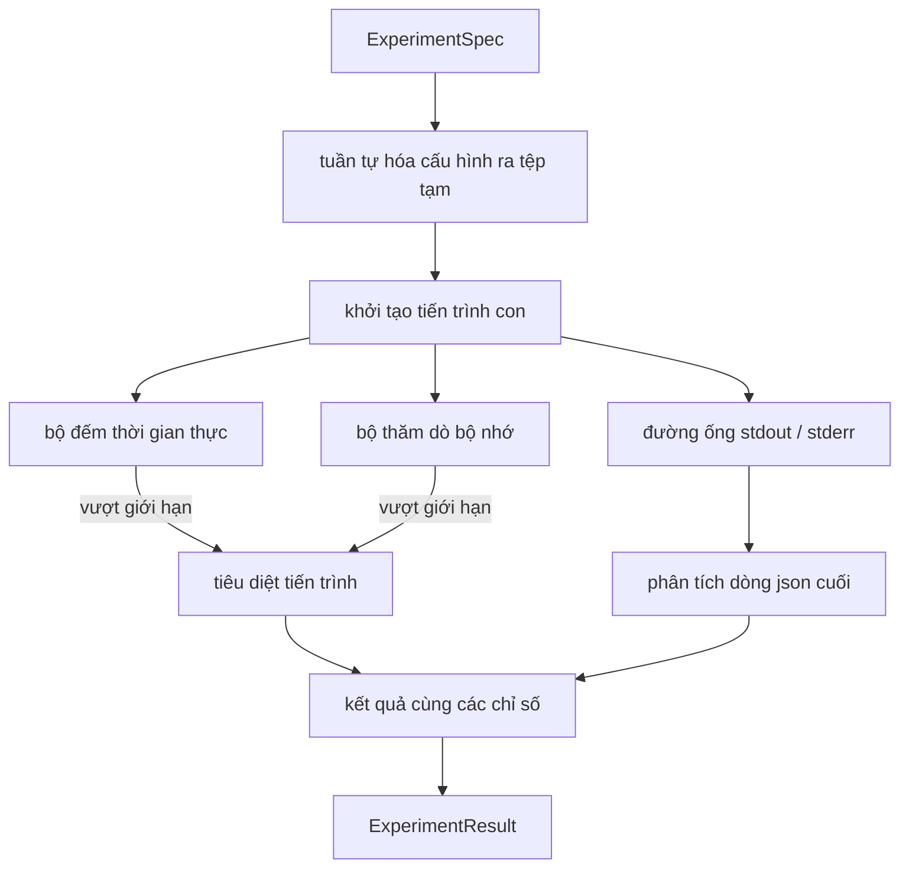

# Bộ thực thi thí nghiệm (Experiment Runner)

> Vòng lặp nghiên cứu chỉ trung thực ngang với các phép đo lường của nó. Hãy xây dựng bộ thực thi nhận vào một bản đặc tả, chạy nó trong một tiến trình con (subprocess) được cô lập trong hộp cát, và phát ra một khối dữ liệu chỉ số dạng json mà bộ đánh giá có thể tin cậy.

**Phân loại:** Xây dựng (Build)  
**Ngôn ngữ:** Python  
**Yêu cầu tiên quyết:** Các bài học 20-29 thuộc Nhánh A của Giai đoạn 19  
**Thời lượng:** ~90 phút  

## Mục tiêu học tập
- Mã hóa một thí nghiệm dưới dạng một bản đặc tả có định kiểu (typed spec) mà bộ thực thi có thể tuần tự hóa sang tiến trình con.
- Khởi chạy một tiến trình con với thời hạn thời gian thực (wall clock timeout) nghiêm ngặt và mức trần bộ nhớ mềm (soft memory cap), đồng thời đưa cả hai trường hợp ra ngoài dưới dạng các điều kiện kết thúc (terminal conditions).
- Thu thập stdout, stderr và khối chỉ số có cấu trúc thành một bản ghi kết quả duy nhất.
- Xây dựng bảng cắt bỏ (ablation table) quét qua từng núm điều khiển cấu hình tại một thời điểm trên một đặc tả cơ sở cố định.
- Đảm bảo mọi kết quả đều mang tính tất định khi có hạt giống (seed) để bộ đánh giá luôn nhận được cùng những con số qua các lượt chạy.

## Vì sao cần tiến trình con (Why a subprocess)

Một vòng lặp nghiên cứu sẽ chạy mã nguồn không hoàn toàn đáng tin cậy. Giả thuyết đến từ một bộ lấy mẫu, tập lệnh thí nghiệm cũng đến từ cùng con đường đó; việc coi một trong hai là an toàn để chạy trực tiếp trong tiến trình chính (in-process) rất dễ dẫn đến sự cố sập làm gián đoạn toàn bộ bộ điều phối (orchestrator). Tiến trình con (subprocess) là cơ chế cô lập đơn giản nhất mà ngôn ngữ cung cấp: một tiến trình độc lập, một không gian địa chỉ riêng biệt, và một trình xử lý tín hiệu (signal handle) từ phía tiến trình cha.

Bộ thực thi ở đây không triển khai cơ chế hộp cát đầy đủ (full sandboxing). Không có cgroup, không có bộ lọc seccomp, không có ánh xạ lại không gian tên (namespace remapping). Những gì nó sở hữu là một thời hạn thời gian thực ngắt cứng, một vòng lặp thăm dò (polling loop) mức tăng trưởng bộ nhớ, và một luồng tiêu diệt (kill path) để chấm dứt tiến trình khi chạm phải một trong hai giới hạn. Đó chính là giao ước thực thi mà mọi hệ thống hộp cát phức tạp hơn đều kế thừa và mở rộng. Bài học này giữ cho giao ước đủ tinh gọn để người học có thể nắm bắt trọn vẹn trong một lần đọc.

## Cấu trúc dữ liệu ExperimentSpec (The ExperimentSpec shape)

```text
ExperimentSpec
  spec_id        : str            (định danh ổn định, "exp_001")
  hypothesis_id  : int            (liên kết ngược về hàng đợi từ bài học 50)
  script_path    : str            (đường dẫn tới tập lệnh python cần chạy)
  config         : dict           (truyền tới tập lệnh dưới dạng một đối số json)
  seed           : int            (hạt giống tất định cho thí nghiệm)
  wall_timeout_s : float          (thời hạn ngắt cứng, bị tiêu diệt khi vượt quá)
  memory_cap_mb  : int            (mức trần mềm, thăm dò định kỳ; bị tiêu diệt khi vượt quá)
  metric_keys    : list[str]      (các trường dữ liệu mà bộ đánh giá sẽ đọc)
```

Tập lệnh nằm trên đĩa; bộ thực thi ghi cấu hình ra một tệp tạm thời mà tập lệnh sẽ đọc. Tập lệnh được kỳ vọng sẽ in ra một dòng json duy nhất trên stdout với các khóa bao hàm tập `metric_keys`. Mọi dữ liệu khác trên stdout đều được thu thập nhưng sẽ bị bộ phân tích cú pháp chỉ số bỏ qua.

```figure
cg-runner-limits
```

## Kiến trúc (Architecture)



Bộ thực thi là một lớp duy nhất với một phương thức chính. Bộ thăm dò là một luồng (thread) nhỏ thức dậy sau mỗi khoảng thời gian định kỳ và đọc thông tin tương đương `psutil` của tiến trình con từ hệ thống tệp proc khi khả dụng, và chuyển sang chế độ không làm gì (no-op) khi nền tảng không hỗ trợ.

## Vì sao dùng mức trần bộ nhớ mềm (Why a soft memory cap)

Mức trần bộ nhớ cứng đòi hỏi `resource.setrlimit` và chỉ hoạt động trên các hệ thống POSIX. Bài học cung cấp một giải pháp khả chuyển: thăm dò dung lượng bộ nhớ thực tế chiếm dụng (Resident Set Size - RSS) từ nền tảng và tiêu diệt tiến trình con nếu nó vượt quá mức trần. Mức trần này gọi là "mềm" vì bộ thăm dò có khoảng thời gian nghỉ giữa các lần quét; một tiến trình có thể tăng đột biến vượt trần giữa hai chu kỳ thăm dò rồi hạ xuống. Bộ thực thi ghi lại giá trị RSS quan sát được lớn nhất để bộ đánh giá có thể thấy lượt chạy đã tiệm cận giới hạn đến mức nào.

Trên các hệ thống không hỗ trợ thanh tra tiến trình, bộ thăm dò sẽ ghi nhật ký cảnh báo một lần và tự vô hiệu hóa. Khi đó, giới hạn thời gian thực vẫn tiếp tục được áp dụng. Các bài kiểm thử của bài học bao quát cả hai nhánh xử lý này.

## Thu thập stdout và stderr (Capturing stdout and stderr)

Bộ thực thi đọc cạn cả hai đường ống sau khi tiến trình hoàn tất. Dòng stdout được quét từng dòng một; dòng cuối cùng phân tích cú pháp thành json hợp lệ và chứa đầy đủ các trường trong `metric_keys` sẽ được chọn làm khối dữ liệu chỉ số. Các dòng json xuất hiện trước đó được giữ lại trong kết quả dưới dạng `intermediate_metrics`; bộ đánh giá có thể dùng chúng để dựng đường cong học tập (learning curves).

Dữ liệu stderr được ghi nhận nguyên văn vào kết quả. Bộ thực thi không bao giờ ném ngoại lệ khi mã thoát (exit code) khác 0; thay vào đó, nó ghi lại mã thoát vào đối tượng kết quả. Bất kỳ lần thoát nào có mã khác không đều bị dán nhãn `"crash"` ngay cả khi tập lệnh đã in ra các chỉ số, nhờ đó bộ đánh giá sẽ mặc định xem các lượt chạy dở dang là thất bại.

## Bảng cắt bỏ (Ablation table)

```python
def ablate(base: ExperimentSpec, knob: str, values: list[Any]) -> list[ExperimentSpec]:
    ...
```

Khi nhận vào một bản đặc tả cơ sở và tên của một núm điều khiển, hàm trợ giúp sẽ trả về danh sách các đặc tả cho từng giá trị tương ứng với `config[knob]` được ghi đè. Mỗi bản đặc tả nhận một `spec_id` phái sinh (`f"{base.spec_id}_{knob}_{value}"`). Bộ thực thi cung cấp `AblationRunner` để chạy tuần tự các đặc tả này và trả về một `AblationTable` được định khóa theo giá trị của núm điều khiển.

Vì sao lại quét từng núm một tại một thời điểm? Việc quét giai thừa toàn phần (full factorial sweeps) sẽ làm bùng nổ số lượng tổ hợp theo hàm mũ và tạo ra các kết quả mà bộ đánh giá không thể giải thích rõ ràng. Việc biến đổi từng núm riêng lẻ mang lại một trục quan sát đơn biến rõ ràng mà bộ đánh giá có thể vẽ đồ thị minh họa. Bài học chỉ hỗ trợ quét nhiều núm dưới hình thức lặp lại các bài kiểm tra cắt bỏ đơn biến do phía gọi chủ động cấu thành.

## Tính tất định (Determinism)

Mỗi bản đặc tả đều mang một hạt giống (seed). Bộ thực thi chuyển tiếp hạt giống tới tập lệnh thông qua từ điển cấu hình (`config["__seed"] = spec.seed`). Các tập lệnh thí nghiệm mô phỏng trong `code/experiments/` tuân thủ hạt giống này và tạo ra các chỉ số giống hệt nhau qua các lượt chạy. Bộ đánh giá trong bài học 53 phụ thuộc chặt chẽ vào tính chất này; nếu không có tính tất định, một hiện tượng "suy giảm hiệu năng" (regression) có thể đơn thuần chỉ là do một lần khởi tạo ngẫu nhiên khác biệt.

## Tập lệnh thí nghiệm mô phỏng (The mock experiment script)

Bài học cung cấp một tập lệnh thí nghiệm: `code/experiments/sparsity_experiment.py`. Đây là một tập lệnh thực tế đọc tệp cấu hình của nó, mô phỏng một lượt huấn luyện nhỏ bằng một lượt sinh ngẫu nhiên của numpy, và in ra khối chỉ số định dạng json. Tập lệnh tuân thủ núm điều khiển `sleep_s` để kiểm thử thời hạn timeout và núm `allocate_mb` để kiểm thử bộ thăm dò bộ nhớ.

Quá trình mô phỏng không thực sự huấn luyện bất kỳ mô hình thực tế nào. Nó là một phép tính số học mô phỏng lại cấu trúc của một vòng lặp huấn luyện: đường cong hàm mất mát (loss curve), độ hỗn loạn cuối cùng (final perplexity), và thời gian thực thi (wall time). Trọng tâm của bài học là bộ thực thi, không phải bản thân việc mô phỏng. Một tập lệnh thí nghiệm thực tế sẽ nhập mô hình và dữ liệu cụ thể.

## Cấu trúc dữ liệu Kết quả (Result shape)

```text
ExperimentResult
  spec_id              : str
  hypothesis_id        : int
  exit_code            : int
  terminal             : "ok" | "timeout" | "oom" | "crash"
  wall_time_s          : float
  peak_rss_mb          : float | None
  metrics              : dict
  intermediate_metrics : list[dict]
  stdout_tail          : str
  stderr_tail          : str
```

Bộ đánh giá sẽ đọc `metrics` và `terminal` trước tiên. Nếu trạng thái kết thúc là bất kỳ giá trị nào khác `"ok"`, thí nghiệm được tính là thất bại và bộ đánh giá sẽ tự động đưa ra kết luận bác bỏ. Ngược lại, các chỉ số sẽ được chuyển tiếp qua bài kiểm định ý nghĩa thống kê (significance test).

## Cách đọc mã nguồn (How to read the code)

`code/main.py` định nghĩa `ExperimentSpec`, `ExperimentResult`, `ExperimentRunner`, `AblationRunner` và một kịch bản minh họa tất định. Việc quản lý tiến trình con nằm gọn trong một lớp duy nhất. Bộ thăm dò bộ nhớ là một luồng nhỏ gọn. Trợ thủ phân tích cắt bỏ là một hàm đơn lẻ.

`code/experiments/sparsity_experiment.py` là thí nghiệm mô phỏng được sử dụng trong các bài kiểm thử. Nó đọc đường dẫn tệp cấu hình từ đối số dòng lệnh và ghi một dòng chỉ số json duy nhất khi kết thúc.

`code/tests/test_runner.py` kiểm thử các kịch bản thành công, vượt quá thời gian (timeout), gặp sự cố (crash), xây dựng bảng cắt bỏ, và kiểm tra tính tất định qua hai lượt chạy liên tiếp.

## Vị trí trong hệ thống (Where this slots in)

Bài học 50 sinh ra giả thuyết. Bài học 51 lọc bỏ những gì tài liệu học thuật đã chứng minh hoặc giải quyết xong. Bài học 52 chạy thí nghiệm cho những giả thuyết còn lại. Bài học 53 đọc kết quả, chạy kiểm định ý nghĩa thống kê và ghi nhận phán quyết mà bộ điều phối lưu trữ gắn với định danh của giả thuyết.
