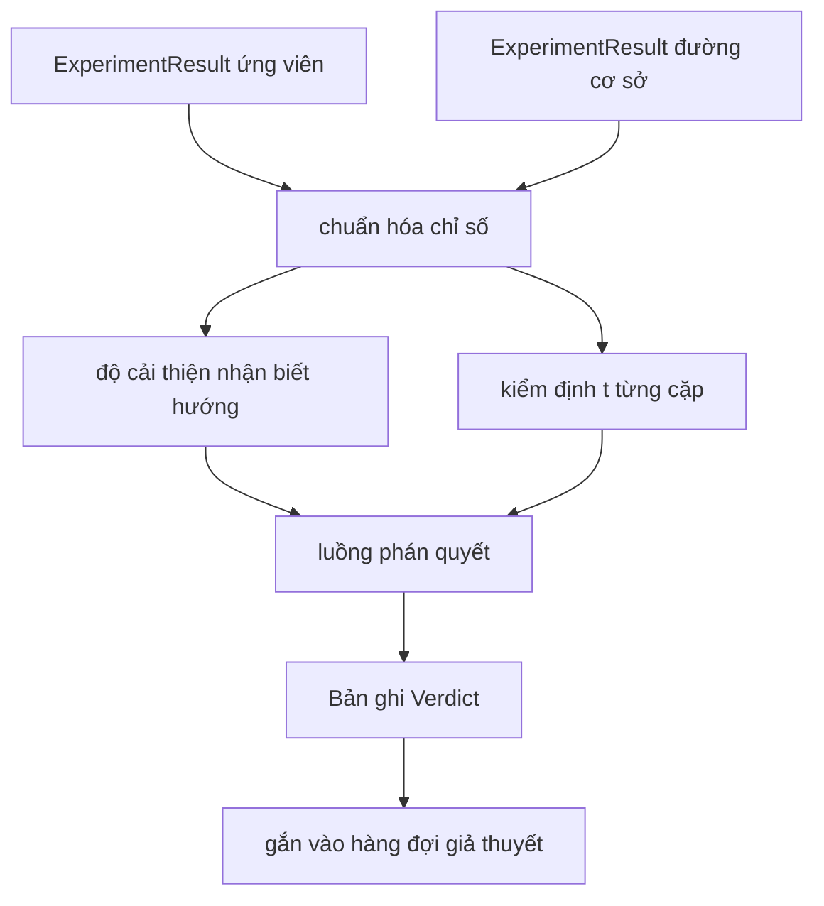

# Bộ đánh giá kết quả (Result Evaluator)

> Bộ thực thi tạo ra những con số. Bộ đánh giá quyết định xem những con số đó là một sự cải thiện, một sự suy giảm hay chỉ là nhiễu thống kê. Hãy xây dựng luồng phán quyết để biến các chỉ số đo lường thành một dòng kết luận súc tích.

**Phân loại:** Xây dựng (Build)  
**Ngôn ngữ:** Python  
**Yêu cầu tiên quyết:** Các bài học 20-29 thuộc Nhánh A của Giai đoạn 19  
**Thời lượng:** ~90 phút  

## Mục tiêu học tập
- So sánh lượt chạy ứng viên (candidate run) với đường cơ sở (baseline) bằng cách sử dụng độ cải thiện có nhận biết phương hướng (direction-aware improvement) và một ngưỡng cố định.
- Tự cài đặt bài kiểm định t từng cặp (paired t-test) từ con số không trên các chỉ số theo từng hạt giống (seed) và phân tích trị số p (p-value) thu được.
- Chuẩn hóa các chỉ số theo thang đo logarit để báo cáo hạ nguồn có thể kết hợp đồng nhất với các chỉ số tuyến tính.
- Phát ra phán quyết (verdict) cho từng giả thuyết để bộ điều phối có thể gắn kèm vào hàng đợi từ bài học 50.
- Đảm bảo tính thuần túy (pure functions) cho mọi bước tính toán để cùng một đầu vào luôn tạo ra cùng một kết luận đánh giá.

## Vì sao cần kiểm định từng cặp (Why a paired test)

Một con số đơn lẻ từ bộ thực thi không thể khẳng định sự thay đổi có thực sự mang tính bản chất hay không. Cùng một cấu hình nhưng với một hạt giống ngẫu nhiên khác sẽ cho ra một độ hỗn loạn (perplexity) khác. Sự thay đổi quan sát được có thể chỉ là nhiễu ngẫu nhiên. Phép so sánh đúng đắn phải là so sánh từng cặp (paired comparison): cùng các hạt giống với cùng dữ liệu, chạy một lần với mô hình ứng viên và một lần với mô hình cơ sở. Mỗi hạt giống đóng góp một giá trị chênh lệch. Giá trị trung bình của các chênh lệch đó chính là độ lớn hiệu ứng (effect size). Sai số chuẩn của các chênh lệch đó chính là ngưỡng nền của nhiễu (noise floor).

Bài học này tự cài đặt bài kiểm định từ con số không mà không cần dùng đến `scipy.stats`. Phần toán học đủ tinh gọn để hiển thị trọn vẹn trên một màn hình.

```text
diffs    = [a_i - b_i for i in seeds]
mean     = sum(diffs) / n
variance = sum((d - mean) ** 2 for d in diffs) / (n - 1)
t_stat   = mean / sqrt(variance / n)
df       = n - 1
p_value  = two_sided_p(t_stat, df)
```

Trị số p hai phía (two-sided p-value) sử dụng hàm beta không đầy đủ được chính quy hóa (regularised incomplete beta function). Bài học cung cấp một cài đặt gọn nhẹ sử dụng liên phân số Lentz (Lentz continued fraction). Toàn bộ thuật toán gói gọn trong sáu mươi dòng toán học sử dụng thư viện chuẩn stdlib.

## Cải thiện có nhận biết phương hướng (Direction aware improvement)

Một số chỉ số được coi là cải thiện khi giá trị tăng lên (độ chính xác, thông lượng). Các chỉ số khác lại cải thiện khi giá trị giảm xuống (hàm mất mát, độ hỗn loạn, thời gian thực thi). Bộ đánh giá mang một trường `direction` trên mỗi chỉ số.

```text
if direction == "higher_is_better":
    improvement = (candidate - baseline) / abs(baseline)
elif direction == "lower_is_better":
    improvement = (baseline - candidate) / abs(baseline)
```

Độ cải thiện mang dấu đại số. Một độ cải thiện âm trên một chỉ số "càng cao càng tốt" đồng nghĩa với việc ứng viên hoạt động kém hơn. Luồng phán quyết đọc đồng thời cả dấu và độ lớn của giá trị.

Một ngưỡng cố định phẳng (`improvement_threshold=0.02`, tức hai phần trăm) quyết định liệu sự thay đổi có đủ lớn để ghi nhận hay không. Dưới ngưỡng đó, phán quyết sẽ là "nhiễu" ("noise") bất kể trị số p là bao nhiêu; vòng lặp nghiên cứu không quan tâm đến những thay đổi mà người dùng thực tế không thể cảm nhận được sự khác biệt.

```figure
cg-paired-verdict
```

## Kiến trúc (Architecture)



Bộ đánh giá thực hiện ba phép tính độc lập và kết hợp chúng trong luồng phán quyết. Mỗi phép tính là một hàm thuần túy không chia sẻ trạng thái.

## Chuẩn hóa thang logarit (Log normalisation)

Độ hỗn loạn biến thiên theo hàm mũ so với hàm mất mát. Mức giảm 0.1 của hàm mất mát tương ứng với mức giảm lớn hơn rất nhiều của độ hỗn loạn. Việc so sánh trực tiếp độ hỗn loạn giữa hai cấu hình là hoàn toàn hợp lệ, nhưng để kết hợp nó với các chỉ số tuyến tính trong một báo cáo chung đòi hỏi phải thực hiện chuẩn hóa.

Bài học chuẩn hóa bất kỳ chỉ số nào có trường `scale` là `"log"` bằng cách lấy logarit tự nhiên trước khi tính toán độ cải thiện. Sau đó, ngưỡng đánh giá được áp dụng trong không gian logarit. Một mức giảm độ hỗn loạn từ 32 xuống 28 trở thành `log(32) = 3.466` so với `log(28) = 3.332`. Độ cải thiện tương đối trên một chỉ số "càng thấp càng tốt" là `(3.466 - 3.332) / 3.466 = 0.039`, vượt qua ngưỡng kiểm định hai phần trăm.

```text
if scale == "log":
    a = log(candidate)
    b = log(baseline)
else:
    a = candidate
    b = baseline
```

Các chỉ số có `scale="linear"` (mặc định) sẽ bỏ qua phép biến đổi này. Cùng một nhánh mã nguồn xử lý thống nhất cho cả hai trường hợp.

## Kiểm định từng cặp theo từng hạt giống (Per seed paired test)

Bộ thực thi từ bài học 52 phát ra một khối dữ liệu chỉ số cuối cùng cho mỗi lượt chạy. Đối với kiểm định từng cặp, bộ đánh giá cần một khối chỉ số cho mỗi hạt giống của ứng viên và một khối cho mỗi hạt giống của đường cơ sở. Bộ điều phối chạy cùng một thí nghiệm dưới cả hai cấu hình trên một danh sách các hạt giống và bàn giao cho bộ đánh giá hai danh sách các bản ghi `ExperimentResult`.

Bộ đánh giá ghép cặp chúng theo hạt giống (hạt giống nằm trong `result.metrics["seed"]`) và duyệt qua chỉ số được yêu cầu. Nếu các hạt giống không khớp nhau giữa hai danh sách, bộ đánh giá sẽ phát sinh lỗi `PairingError`. Khi đó bộ điều phối cần chạy lại thí nghiệm.

## Cấu trúc dữ liệu Phán quyết (The Verdict shape)

```text
Verdict
  hypothesis_id          : int
  metric                 : str
  direction              : "higher_is_better" | "lower_is_better"
  scale                  : "linear" | "log"
  candidate_mean         : float
  baseline_mean          : float
  improvement            : float       (có dấu, dạng phân số; xem quy tắc hướng)
  p_value                : float | None  (None nếu n < 2)
  significance_threshold : float
  improvement_threshold  : float
  verdict                : "improved" | "regressed" | "noise" | "failed"
  rationale              : str
```

Luồng phán quyết là một bảng quyết định nhỏ gọn:

```text
1. Nếu bất kỳ kết quả ứng viên nào có terminal != "ok": verdict = "failed"
2. ngược lại nếu |improvement| < improvement_threshold:  verdict = "noise"
3. ngược lại nếu p_value là None hoặc p_value > significance: verdict = "noise"
4. ngược lại nếu improvement > 0:                          verdict = "improved"
5. ngược lại:                                             verdict = "regressed"
```

Trường `rationale` là một câu ngắn gọn, dễ đọc để con người nắm bắt thông tin và bộ điều phối có thể ghi nhận lại tương ứng với id của giả thuyết.

## Cách đọc mã nguồn (How to read the code)

`code/main.py` định nghĩa `MetricSpec`, `Verdict`, `Evaluator`, các hàm trợ giúp tính thống kê t và hàm beta không đầy đủ, cùng một kịch bản minh họa tất định. Kiểm định t được triển khai bằng toán học thuần túy của stdlib; numpy chỉ được dùng để đọc danh sách chỉ số và tính giá trị trung bình cùng phương sai.

`code/tests/test_evaluator.py` bao quát kiểm thử cho luồng cải thiện (`improved`), luồng suy giảm (`regressed`), luồng nhiễu do cải thiện quá nhỏ (`noise`), luồng nhiễu do kích thước mẫu n quá nhỏ, luồng trạng thái kết thúc thất bại (`failed`), luồng chuẩn hóa logarit, kiểm định t so với giá trị tham chiếu đã biết, và kiểm tra lỗi ghép cặp (`pairing error`).

## Vị trí trong hệ thống (Where this slots in)

Bài học 50 tạo ra hàng đợi giả thuyết. Bài học 51 lọc bỏ những gì tài liệu khoa học đã làm sáng tỏ. Bài học 52 chạy thí nghiệm dưới cả hai cấu hình ứng viên và đường cơ sở trên tập hợp các hạt giống. Bài học 53 đọc các lượt chạy đó và đưa ra phán quyết. Bộ điều phối sẽ kết nối bốn thành phần lại với nhau:

```text
for hypothesis in queue:
    literature = retrieval.search(hypothesis.text)
    if literature_settles(hypothesis, literature):
        attach(hypothesis, verdict="settled")
        continue
    candidates = runner.run_all(specs_for(hypothesis))
    baselines  = runner.run_all(baseline_specs_for(hypothesis))
    metric_spec = MetricSpec("perplexity", direction=LOWER, scale=LOG)
    verdict = evaluator.evaluate(hypothesis.id, metric_spec, candidates, baselines)
    attach(hypothesis, verdict)
```

Bộ điều phối hoàn chỉnh không nằm trong bài học này; bốn bài học tự khớp nối hoàn hảo với nhau mà không cần thêm lớp trung gian nào ngoài các lớp dữ liệu (dataclasses) do chính mỗi bài định nghĩa.
