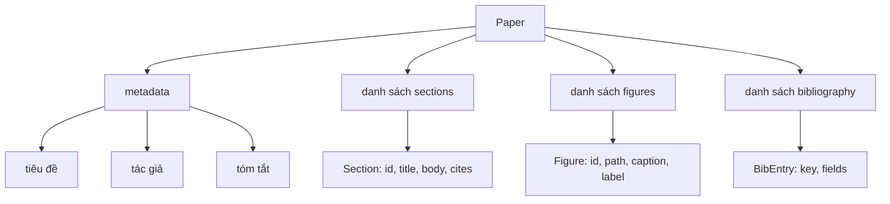
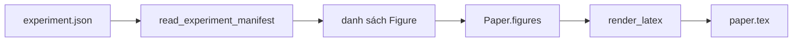
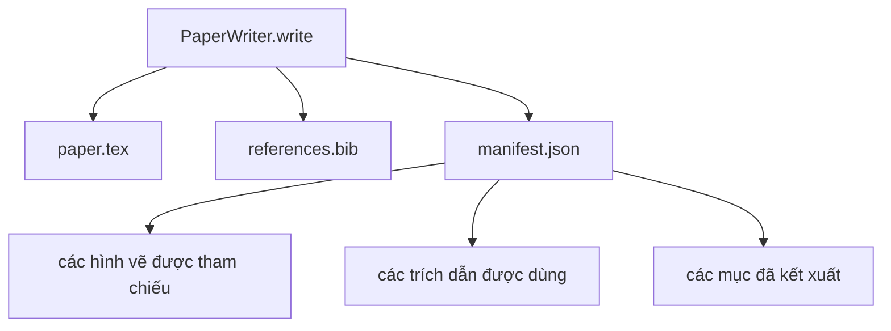

# Trình soạn thảo bài báo (Paper Writer)

> Một khung sườn LaTeX là một giao ước giữa nhà nghiên cứu và bộ sắp chữ (typesetter). Nếu giao ước bị phá vỡ, tài liệu sẽ không thể biên dịch và lỗi sẽ xuất hiện ngay lập tức. Hãy xây dựng khung sườn trước, sau đó mới lấp đầy nội dung văn bản.

**Phân loại:** Xây dựng (Build)  
**Ngôn ngữ:** Python  
**Yêu cầu tiên quyết:** Các bài học 50-53 của Giai đoạn 19  
**Thời lượng:** ~90 phút  

## Mục tiêu học tập

- Coi một bài báo nghiên cứu như một cấu phần có cấu trúc (structured artifact) với đồ thị phân mục đã biết, thay vì một tài liệu văn bản tự do.
- Sinh một khung sườn LaTeX (LaTeX skeleton) khai báo phần tóm tắt (abstract), các phân mục, các vị trí đặt hình vẽ (figure slots) và các khóa thư mục tham khảo (bibliography keys) trước khi viết bất kỳ phần văn xuôi nào.
- Chèn các hình vẽ từ đầu ra của thí nghiệm (đường dẫn và chú thích) vào khung sườn thông qua một cơ chế vị trí (slot mechanism) tất định.
- Kết nối một bộ sinh văn bản mô phỏng (mocked prose generator) giúp lấp đầy từng mục từ một dàn ý có cấu trúc để bộ khung có thể kiểm thử được mà không cần đến mô hình ngôn ngữ.
- Phát ra một tệp `paper.tex` duy nhất kèm tệp `references.bib` và một bản kê khai (manifest) liệt kê mọi hình vẽ được tham chiếu cùng mọi trích dẫn được sử dụng.

```figure
ch-paper-skeleton
```

## Vì sao cần khung sườn trước (Why a skeleton first)

Một bản thảo bắt đầu trực tiếp bằng việc viết văn xuôi sẽ tích lũy "nợ cấu trúc" (structural debt). Phần giới thiệu có nguy cơ phình to thêm ba đoạn văn vốn dĩ nên thuộc về phần các công trình liên quan (related work). Một hình vẽ có thể được tham chiếu trước cả khi nó được định nghĩa. Thư mục tham khảo kết thúc với ba khóa khác nhau cho cùng một bài báo. Đến khi tác giả nhận ra, chi phí viết lại đã vượt xa chi phí viết ban đầu.

Một khung sườn sẽ đảo ngược quy trình đó. Cấu trúc được khai báo ngay từ đầu dưới dạng dữ liệu. Các phân mục là các vị trí (slots) có tên và thứ tự rõ ràng. Các hình vẽ là các vị trí có định danh và chú thích. Các khóa thư mục được khai báo ở đầu cùng với các mục nhập mà chúng trỏ tới. Văn bản sau đó được sinh vào từng vị trí một. Bộ khung có thể kiểm định, trước khi bất kỳ từ ngữ nào được viết ra, rằng mọi hình vẽ đều có một vị trí đặt, mọi trích dẫn đều có một mục tham khảo tương ứng, và mọi mục đều xuất hiện trong mục lục.

Đây chính là tính kỷ luật mà các bài học trước đã áp dụng cho kế hoạch, lời gọi công cụ và dấu vết thực thi (traces). Cấu trúc chính là giao ước.

## Cấu trúc dữ liệu Bài báo (The Paper shape)



Mọi trường dữ liệu đều là dữ liệu thuần túy của Python. Trình kết xuất (renderer) là một hàm thuần túy chuyển đổi từ `Paper` sang một chuỗi ký tự LaTeX. Bộ khung có thể tự thanh tra bài báo trước khi kết xuất: đếm số mục, liệt kê các tệp hình vẽ còn thiếu, kiểm tra xem mỗi thẻ `\cite{key}` có một `BibEntry` khớp hay không.

## Giao ước kết xuất (The render contract)

Trình kết xuất đảm bảo ba thuộc tính. Thứ nhất, mỗi vị trí hình vẽ trong khung sườn phát ra một khối `\begin{figure}` với nhãn ổn định có dạng `fig:<id>`. Thứ hai, mỗi phân mục phát ra một lệnh `\section{}` với nhãn ổn định có dạng `sec:<id>` để các tham chiếu chéo (cross-references) hoạt động chính xác. Thứ ba, phần thư mục phát ra một khối `\bibliography` với tệp `references.bib` chứa chính xác các mục nhập đã khai báo trên bài báo, không thừa và không thiếu.

Việc vi phạm bất kỳ thuộc tính nào trong số này đều là lỗi kết xuất (render error) chứ không phải là cảnh báo. Khung sườn là một giao ước; một bản kết xuất âm thầm làm rơi mất một hình vẽ là một hành vi phá vỡ giao ước.

## Chèn hình vẽ từ các thí nghiệm (Figure injection from experiments)

Các bài học trước trong nhánh này đã tạo ra các đầu ra thí nghiệm dưới dạng các bản kê khai JSON. Mỗi bản kê khai mang một danh sách các cấu phần với đường dẫn và chú thích ngắn gọn. Trình soạn thảo bài báo đọc bản kê khai đó và tạo ra các bản ghi `Figure`.



Quá trình chèn hình mang tính tất định. Các id hình vẽ được phái sinh từ tên thí nghiệm kết hợp với một bộ đếm tăng đơn điệu. Chú thích được lấy trực tiếp từ bản kê khai. Đường dẫn được chuẩn hóa tương đối so với thư mục đầu ra của bài báo để mã nguồn LaTeX có thể biên dịch trơn tru ngay cả khi đầu ra thí nghiệm nằm ở một thư mục khác trên đĩa.

## Bộ sinh văn bản mô phỏng (The mocked prose generator)

Bài học này không gọi tới một mô hình ngôn ngữ bên ngoài. Một lớp `MockProseGenerator` sẽ đọc cấu trúc dàn ý và phát ra văn bản một cách tất định. Cấu trúc dàn ý là một chuỗi ngắn gọn cho mỗi mục. Bộ sinh sẽ mở rộng chuỗi đó thành hai đoạn văn ngắn có lồng ghép tiêu đề của mục. Văn bản được sinh ra sẽ nhắc đến các hình vẽ và trích dẫn chính xác vào thời điểm dàn ý khai báo chúng.

Cơ chế này là đủ để kiểm thử mọi hành vi của trình soạn thảo bài báo. Một bản triển khai thực tế có thể thay thế bộ sinh này bằng một lời gọi mô hình AI. Toàn bộ khung vận hành xung quanh không hề thay đổi. Đó chính là giá trị của việc khai báo bộ sinh văn bản dưới dạng một hàm có thể gọi (callable): môi trường kiểm thử dùng một triển khai tất định, môi trường sản xuất dùng một mô hình thực thụ, còn phần còn lại của đường ống xử lý là giống hệt nhau.

## Đầu ra bản kê khai (The manifest output)

Trình soạn thảo phát ra ba tệp vào thư mục đầu ra.



Bản kê khai (manifest) là tài liệu mà bộ đánh giá hoặc vòng lặp phê bình (critic loop) ở hạ nguồn sẽ đọc. Nó không phân tích cú pháp LaTeX; nó đọc trực tiếp tệp kê khai. Bài học tiếp theo - vòng lặp phê bình - sẽ nhận bản kê khai này làm đầu vào để sinh ra danh sách phản hồi góp ý. Đó là lý do vì sao bản kê khai là một phần của giao ước hệ thống, trong khi tệp LaTeX chỉ là sản phẩm trung gian để biên dịch.

## Các cổng kiểm định (Validation gates)

Trình soạn thảo chạy bốn cổng kiểm định trước khi ghi bất kỳ tệp nào ra đĩa:

1. Mỗi id hình vẽ phải là duy nhất trong toàn bài báo.
2. Trường `cites` của mỗi mục phải tham chiếu tới một khóa thư mục đã được khai báo trên bài báo.
3. Phần tóm tắt (abstract) không được rỗng.
4. Tiêu đề không được rỗng.

Việc không vượt qua bất kỳ cổng nào sẽ làm phát sinh ngoại lệ `PaperValidationError` kèm theo lý do cụ thể. Bộ khung sẽ hiển thị lý do này như một dạng lỗi thực thi. Không có hiện tượng ghi tệp dở dang: hoặc cả ba tệp cùng được phát ra, hoặc không tệp nào được tạo.

## Cách đọc mã nguồn (How to read the code)

`code/main.py` định nghĩa `Paper`, `Section`, `Figure`, `BibEntry`, `PaperValidationError`, `MockProseGenerator`, `PaperWriter`, và hàm `render_latex`. Phương thức `write` nhận một thư mục đầu ra và phát ra `paper.tex`, `references.bib`, cùng `manifest.json`. Hàm trợ giúp `read_experiment_manifest` chuyển đổi một danh sách các bản kê khai thí nghiệm thành các bản ghi `Figure`.

`code/tests/test_paper_writer.py` bao quát: kết xuất khung sườn khi chưa có nội dung mục, kết xuất đầy đủ với hai mục và hai hình vẽ, cổng kiểm tra trích dẫn bị thiếu, cổng kiểm tra trùng lặp id hình vẽ, nội dung tệp kê khai, và giao ước chuỗi LaTeX (mọi mục đều phát ra `\section{}`, mọi hình vẽ đều phát ra `\begin{figure}`).

## Mở rộng thêm (Going further)

Có hai phần mở rộng mà một hệ thống thực tế sẽ cần. Thứ nhất là kết xuất đa định dạng (multi-format render): cùng một cấu trúc `Paper` có thể biên dịch sang Markdown cho các bài đăng blog và HTML để xem trước nhanh. Trình kết xuất khi đó trở thành một chiến lược (strategy) trên `Paper`. Thứ hai là làm giàu trích dẫn (citation enrichment): trình soạn thảo tự động tìm nạp các mục BibTeX từ một khóa trích dẫn dựa trên bộ nhớ đệm cục bộ của các mã DOI. Cả hai đều mang lại giá trị lớn và đều có thể bổ sung mà không làm ảnh hưởng đến giao ước khung sườn ban đầu.

Khung sườn chính là nền tảng cốt lõi: các phân mục, hình vẽ và trích dẫn được khai báo dưới dạng dữ liệu; văn bản được sinh trực tiếp vào các vị trí tương ứng; bản kê khai được phát hành song song cùng tệp LaTeX. Mọi cải tiến khác đều có thể xây dựng vững chắc trên nền tảng đó.
