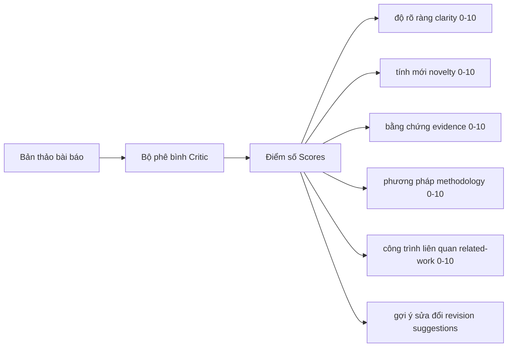
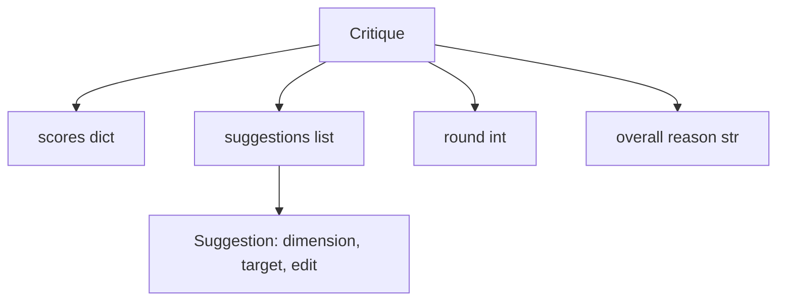
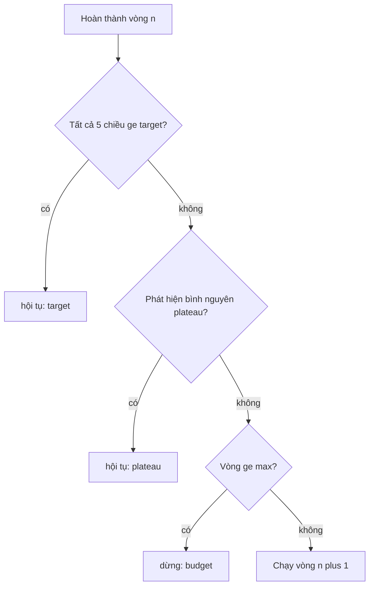
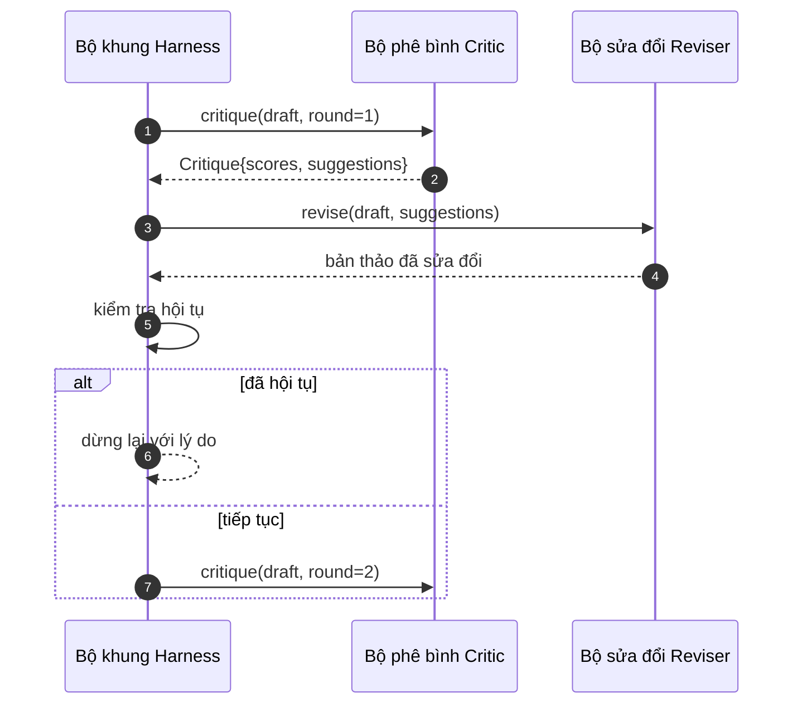

# Vòng lặp phê bình (Critic Loop)

> Một bộ phê bình đưa ra nhận xét "trông ổn đấy" ngay lần đầu tiên là một bộ phê bình bị lỗi. Một bộ phê bình luôn luôn phán "cần làm thêm" cũng là bị lỗi. Bộ phê bình đáng giá là bộ phê bình biết hội tụ, và bạn phải chủ động thiết kế kỹ thuật để đạt được sự hội tụ đó.

**Phân loại:** Xây dựng (Build)  
**Ngôn ngữ:** Python  
**Yêu cầu tiên quyết:** Các bài học 50-53 của Giai đoạn 19  
**Thời lượng:** ~90 phút  

## Mục tiêu học tập

- Chấm điểm một bản thảo bài báo theo năm chiều kích cố định: độ rõ ràng (clarity), tính mới (novelty), bằng chứng thực nghiệm (evidence), phương pháp luận (methodology), và công trình liên quan (related-work).
- Áp dụng đánh giá phê bình của mỗi vòng dưới dạng một bản khác biệt sửa đổi có cấu trúc (structured revision diff) thay vì viết lại tự do.
- Nhận diện sự hội tụ bằng cách so sánh điểm số qua các vòng; dừng lại khi chạm vùng bình nguyên (plateau), khi đạt mục tiêu hoặc khi cạn kiệt ngân sách.
- Giới hạn các vòng lặp bằng ngân sách số lượt tối đa để một bộ phê bình không hội tụ không thể chạy vô tận.
- Phát ra dấu vết thực thi (trace) cho từng vòng để bảng thông tin (dashboard) hoặc công đoạn kế tiếp có thể trực quan hóa quỹ đạo điểm số.

```figure
ch-critic-converge
```

## Vì sao cần năm chiều kích cố định (Why five fixed dimensions)

Một bộ phê bình tự do là một mô hình ngôn ngữ trả về một đoạn văn các gợi ý rời rạc. Vòng sửa đổi tiếp theo sẽ coi đoạn văn đó như một ngữ cảnh môi trường mơ hồ. Việc bản thảo viết lại có thực sự giải quyết được lời phê bình hay không là điều không thể kiểm chứng, bởi vì bản thân lời phê bình chưa bao giờ có cấu trúc.

Năm chiều kích mang lại cho bộ khung một giao ước thực thi rõ ràng:



Điểm số là một vector. Bộ khung giám sát từng chiều kích qua các vòng lặp. Một bản sửa đổi làm tăng độ rõ ràng nhưng lại làm sụt giảm nghiêm trọng bằng chứng thực nghiệm là một sự suy giảm hiệu năng về mặt bằng chứng, và bước kiểm tra hội tụ sẽ lập tức phát hiện ra điều đó. Một bộ phê bình hoàn toàn dựa trên mô hình ngôn ngữ thuần túy không thể đảm bảo được điều này.

## Cấu trúc dữ liệu Phê bình (The Critique shape)



Mỗi gợi ý đều mang theo chiều kích mà nó muốn cải thiện, phân mục mục tiêu cần tác động, và một chỉ dẫn `edit` mà bộ sửa đổi (reviser) có thể áp dụng. Bộ sửa đổi cũng là một đối tượng có thể gọi (callable). Bài học cung cấp một bộ sửa đổi tất định giải thích chỉ dẫn chỉnh sửa như một thao tác nối thêm vào phân mục (append-to-section). Một bộ sửa đổi điều khiển bởi mô hình AI sẽ hiểu cùng trường dữ liệu đó như một câu nhắc (prompt). Giao ước hệ thống không hề thay đổi.

## Quy tắc hội tụ theo thứ tự ưu tiên (Convergence rules, in order)

Vòng lặp phê bình kết thúc khi thỏa mãn bất kỳ một trong ba điều kiện sau:



Đạt mục tiêu (`target`) là trường hợp khắt khe nhất: toàn bộ năm chiều kích (clarity, novelty, evidence, methodology, related_work) đều phải đạt ngưỡng `>= target_score` (mặc định là `8.0`) trước khi vòng lặp trả về kết quả thành công. Một điểm trung bình cao nhưng có một chiều kích yếu kém là không đạt yêu cầu. Cơ chế phát hiện bình nguyên (`plateau`) so sánh điểm trung bình của vòng hiện tại với vòng trước đó. Nếu mức cải thiện thấp hơn `plateau_epsilon` (mặc định là `0.1`) trong hai vòng liên tiếp, vòng lặp sẽ thoát với lý do `plateau`. Ngân sách (`budget`) là một mức chặn cứng về số vòng (mặc định là `5`) và sẽ thoát với lý do `budget`.

Thứ tự ưu tiên mang tính quyết định: Đạt mục tiêu (`target`) ưu tiên hơn Chạm bình nguyên (`plateau`), và Bình nguyên ưu tiên hơn Cạn ngân sách (`budget`). Nếu vòng ba đạt điểm mục tiêu ngay tại lần lặp cũng kích hoạt điều kiện bình nguyên, kết quả trả về sẽ là `target`, không phải `plateau`.

## Vì sao phát hiện bình nguyên cần chạy qua hai vòng (Why plateau detection runs over two rounds)

Sự chững lại chỉ trong một vòng có thể chỉ là nhiễu ngẫu nhiên. Một bộ phê bình thực tế sẽ trả về điểm số hơi khác biệt sau mỗi lần lặp ngay cả trên một bản thảo cố định, bởi vì việc chấm điểm tất định vẫn phụ thuộc vào những gợi ý nào đã được áp dụng và theo thứ tự nào. Việc yêu cầu hai vòng bình nguyên liên tiếp sẽ giúp loại bỏ nhiễu đó. Nếu bộ khung báo cáo một bình nguyên, bản thảo đã thực sự ngừng tiến bộ.

## Bộ phê bình tất định trong bài học này (The deterministic critic in this lesson)

Bài học này không gọi tới mô hình bên ngoài. Bộ phê bình đi kèm là một đối tượng có thể gọi giúp chấm điểm bản thảo dựa trên ba tín hiệu: độ dài trung bình phần thân phân mục (độ rõ ràng), số lượng hình vẽ và số lượng trích dẫn (bằng chứng), cùng một trường `originality_tag` trên siêu dữ liệu bài báo (tính mới). Bộ sửa đổi nắm rõ cách thức để thúc đẩy từng điểm số tăng lên.

```text
clarity      tăng khi độ dài trung bình phần thân phân mục tăng
novelty      tăng khi originality_tag được gán là "high"
evidence     tăng khi trường figure_refs của một mục không rỗng
methodology  tăng khi tồn tại mục có tiêu đề "Method" với nội dung
related-work tăng khi tồn tại mục có tiêu đề "Related Work" với nội dung
```

Bộ sửa đổi diễn giải mỗi gợi ý như một hành động nối thêm có chủ đích. Sau vòng một, bộ khung có thể quan sát thấy điểm số tăng lên. Các bài kiểm thử sử dụng thuộc tính này để khẳng định vòng lặp đang thu hẹp khoảng cách chất lượng.

## Giao ước toàn vòng lặp (The full loop contract)



Bộ khung (harness) sở hữu bộ đếm vòng, dấu vết thực thi (trace), và logic kiểm tra hội tụ. Bộ phê bình sở hữu điểm số. Bộ sửa đổi sở hữu bản khác biệt (diff). Không có thành phần nào can thiệp vào trạng thái nội bộ của nhau.

## Dữ liệu dấu vết đầu ra (The Trace output)

Mỗi vòng phát ra một sự kiện dấu vết (trace event) gồm số thứ tự vòng, vector điểm số, số lượng gợi ý, và phán quyết hội tụ. Toàn bộ dấu vết được trả về cùng với bản thảo cuối cùng. Một bảng điều khiển ở hạ nguồn có thể vẽ biểu đồ điểm số qua từng vòng. Bài học tiếp theo - bộ lập lịch lặp lại - sẽ đọc dấu vết này để quyết định xem nhánh nghiên cứu có đáng để giữ lại hay không.

## Ngân sách bảo vệ trước các bộ phê bình kém chất lượng (Budgets that protect against bad critics)

Một bộ phê bình đưa ra các gợi ý không bao giờ giúp cải thiện điểm số sẽ đẩy vòng lặp chạm ngưỡng số lượt tối đa. Dấu vết thực thi làm lộ rõ điều đó: năm vòng, điểm số nằm ngang, phán quyết là `budget`. Người dùng nhận định đó là lỗi của bộ phê bình chứ không phải lỗi của bản thảo. Ngược lại, nếu chỉ hiển thị bản thảo cuối cùng, nguyên nhân thực sự sẽ bị che giấu. Thiết kế ưu tiên dấu vết (trace-first design) giúp minh bạch hóa hoàn toàn khâu chẩn đoán.

## Cách đọc mã nguồn (How to read the code)

`code/main.py` định nghĩa `Critique`, `Suggestion`, giao thức `Critic`, giao thức `Reviser`, `CriticLoop`, và hàm xuất xưởng `make_deterministic_critic_pair` trả về bộ phê bình tất định kèm bộ sửa đổi tương ứng. Một cấu trúc `Paper` tối thiểu được tích hợp sẵn để bài học có thể vận hành độc lập.

`code/tests/test_critic_loop.py` bao quát: sự cải thiện đơn điệu sau vòng một, hội tụ đạt mục tiêu trên bản thảo hoàn thiện, phát hiện bình nguyên sau hai vòng không tăng điểm, cạn kiệt ngân sách khi không có gợi ý nào giúp ích, việc áp dụng gợi ý của bộ sửa đổi, và cấu trúc định dạng của dấu vết.

## Mở rộng thêm (Going further)

Có hai phần mở rộng mà hệ thống thực tế sẽ muốn trang bị: Thứ nhất là trọng số chiều kích (dimension weights): một bài báo nộp cho hội thảo (workshop) có thể đặt trọng số tính mới cao hơn phương pháp luận; một bài gửi tạp chí (journal) thì ngược lại. Khi đó phép kiểm tra hội tụ sẽ là trung bình có trọng số. Thứ hai là ghép cặp các bộ phê bình (paired critics): một bộ phê bình chấm điểm, một bộ phê bình thứ hai thẩm định các gợi ý trước khi bộ sửa đổi tiếp nhận. Cả hai đều mang lại giá trị cao và đều có thể tích hợp trực tiếp trên cùng cấu trúc `Critique`.

Trọng tâm cốt lõi nằm ở vector điểm số. Một khi lời phê bình đã được cấu trúc hóa, mọi cải tiến khác - từ quy tắc hội tụ, bảng điều khiển, đến các bộ phê bình ghép cặp - đều có thể bổ sung dễ dàng mà không cần thay đổi vòng lặp trung tâm.
