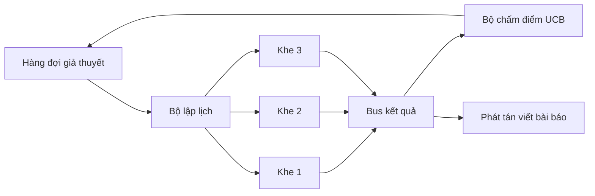
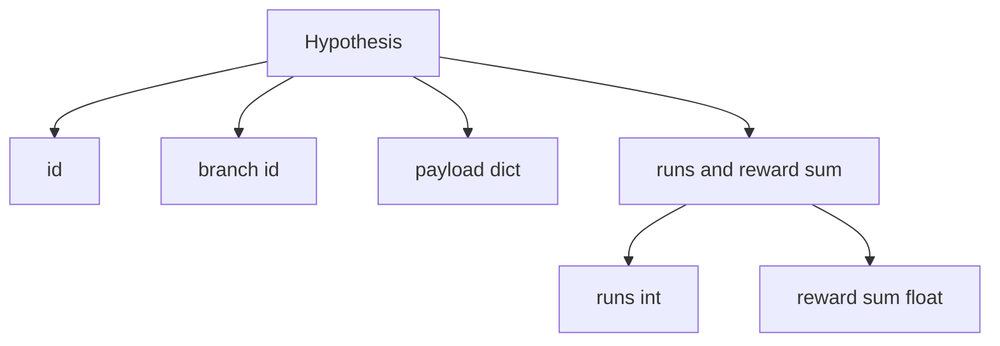
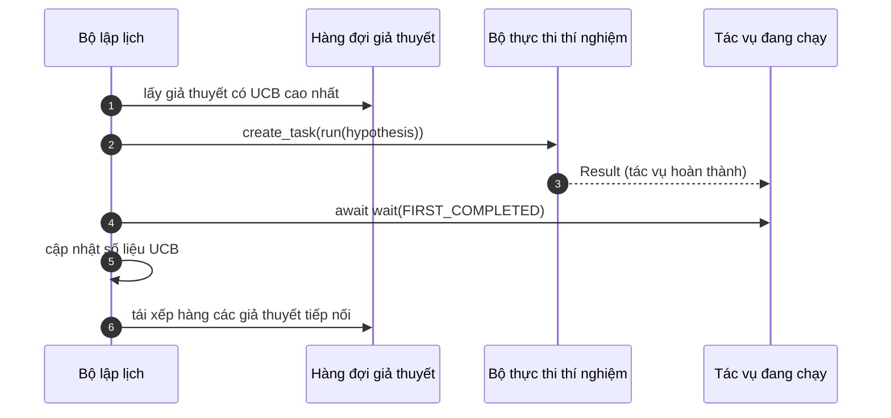

# Bộ lập lịch lặp lại (Iteration Scheduler)

> Một vòng lặp nghiên cứu không có bộ lập lịch thì chẳng khác nào một hàng đợi đầy ảo tưởng. Bộ lập lịch chính là nơi vòng lặp quyết định dừng khám phá điều gì, và quyết định đó định đoạt toàn bộ cuộc chơi.

**Phân loại:** Xây dựng (Build)  
**Ngôn ngữ:** Python  
**Yêu cầu tiên quyết:** Các bài học 50-53 của Giai đoạn 19  
**Thời lượng:** ~90 phút  

## Mục tiêu học tập

- Mô hình hóa một quy trình nghiên cứu khoa học dưới dạng hàng đợi giả thuyết cấp việc cho các khe thí nghiệm song song, sau đó gom kết quả đầu ra quay trở lại.
- Chạy nhiều thí nghiệm đồng thời bằng `asyncio` để bộ lập lịch có thể duy trì trạng thái bận rộn cho tất cả các khe thực thi.
- Chấm điểm từng nhánh giả thuyết bằng giải thuật UCB (Upper Confidence Bound) để bộ lập lịch có thể cắt tỉa (prune) các nhánh hiệu suất thấp mà không từ bỏ nỗ lực khám phá.
- Rẽ nhánh phát tán (fan-out) các kết quả đã hoàn thành sang công đoạn viết bài báo và công đoạn tái xếp hàng để một nhánh có sản lượng cao có thể sinh ra các giả thuyết tiếp nối.
- Thể hiện rõ dấu vết thực thi (trace) cho từng bước lặp với điểm số các nhánh, trạng thái chiếm dụng khe, và các quyết định cắt tỉa nhánh.

```figure
ch-ucb-scheduler
```

## Vì sao cần bộ lập lịch thay vì một danh sách công việc thuần túy (Why a scheduler, not a worklist)

Một danh sách công việc phẳng (flat worklist) chạy các tác vụ theo thứ tự đệ trình. Điều đó hoàn toàn ổn khi các tác vụ độc lập với nhau. Nhưng nghiên cứu khoa học không mang tính độc lập: một phát hiện từ thí nghiệm số ba sẽ làm thay đổi độ ưu tiên của thí nghiệm số bốn và số năm. Một bộ lập lịch đọc luồng gom kết quả (result fan-in) và sắp xếp lại hàng đợi sẽ hoàn thành nhiều công việc hữu ích hơn trên mỗi đơn vị năng lực tính toán.

Lựa chọn thiết kế mang tính then chốt nằm ở quy tắc chấm điểm. Một bộ chấm điểm tham lam (greedy scorer) luôn luôn chọn nhánh đang dẫn đầu và không bao giờ chịu khám phá. Một bộ chấm điểm phân phối đều (uniform scorer) thì lại không bao giờ khai thác tối đa lợi thế. Thuật toán UCB (Upper Confidence Bound - Giới hạn tin cậy trên) chính là con đường cân bằng ở giữa: khai thác nhánh dẫn đầu trong khi vẫn dành dung lượng cho các nhánh ít được thử nghiệm hơn.

## Kiến trúc hệ thống (The system shape)



Hàng đợi lưu giữ các giả thuyết. Bộ lập lịch chọn giả thuyết có điểm UCB cao nhất mỗi khi một khe thực thi được giải phóng. Mỗi khe sẽ chạy một thí nghiệm bất đồng bộ. Các thí nghiệm hoàn thành sẽ đẩy kết quả lên bus thông điệp. Bus này cập nhật số liệu thống kê UCB cho nhánh gốc tương ứng và phát tín hiệu rẽ nhánh sang công đoạn viết bài báo khi sản lượng tích lũy của nhánh đó vượt qua một ngưỡng quy định.

## Cấu trúc dữ liệu Giả thuyết (The Hypothesis shape)



`branch` là khóa định danh cho các số liệu thống kê UCB. Nhiều giả thuyết có thể cùng thuộc về một nhánh (nhánh là hướng nghiên cứu tổng thể; giả thuyết là một phép thử cụ thể bên trong nhánh đó). `runs` là số lượng thí nghiệm đã hoàn thành của nhánh đó, `reward_sum` là tổng phần thưởng tích lũy. Thuật toán UCB đọc cả hai giá trị này.

## Chấm điểm UCB (UCB scoring)

Công thức UCB được sử dụng trong bài học này là thuật toán kinh điển UCB1:

```math
\text{ucb}(\text{branch}) = \text{mean\_reward}(\text{branch}) + c \sqrt{ \frac{\ln(\text{total\_runs})}{\text{runs}(\text{branch})} }
```

`total_runs` là tổng số lượng thí nghiệm đã hoàn thành trên tất cả các nhánh. `c` là trọng số khám phá; bài học đặt mặc định là `sqrt(2)`. Một nhánh chưa từng chạy (`runs = 0`) sẽ nhận giá trị `+inf` để các nhánh chưa thử nghiệm luôn được ưu tiên lập lịch đầu tiên. Một nhánh có phần thưởng trung bình cao sẽ duy trì điểm số cao cho đến khi các nhánh khác bắt kịp; một nhánh chạy nhiều lần mà không mang lại nhiều phần thưởng sẽ dần bị lu mờ trước các nhánh thay thế ít được chạy hơn.

Cổng cắt tỉa nhánh (pruning gate) tách biệt với bộ chọn lựa. Cơ chế cắt tỉa sẽ loại bỏ một nhánh khỏi việc lập lịch trong tương lai khi phần thưởng trung bình của nó rơi xuống dưới một ngưỡng sàn tuyệt đối (mặc định là `0.2`) sau ít nhất `prune_after_runs` lượt thử nghiệm (mặc định là `3`). Điều này giúp hàng đợi luôn nằm trong tầm kiểm soát.

## Các khe chạy song song với asyncio (Parallel slots with asyncio)

Bộ lập lịch điều phối các thí nghiệm bằng `asyncio.create_task`. Mỗi tác vụ chạy bộ thực thi thí nghiệm (một đối tượng có thể gọi `async def`) và trả về một `Result`. Vòng lặp chính đợi trên tập hợp các tác vụ đang thực thi bằng cách gọi `asyncio.wait(..., return_when=asyncio.FIRST_COMPLETED)` và kích hoạt cập nhật điểm số ngay khi có tác vụ đầu tiên hoàn tất.



Ba khe thực thi chạy đồng thời. Vòng lặp chính không bao giờ bị nghẽn bởi một thí nghiệm đơn lẻ. Bộ lập lịch liên tục khởi động các tác vụ mới ngay khi có khe trống, cho tới khi hàng đợi rỗng và không còn tác vụ nào đang chạy.

## Rẽ nhánh phát tán: Kích hoạt viết bài báo (Fan-out: paper triggers)

Khi phần thưởng trung bình của một nhánh vượt qua ngưỡng `paper_threshold` (mặc định là `0.7`) và nhánh đó chưa từng sinh ra bài báo nào, bộ lập lịch sẽ phát tán sự kiện `paper.trigger` vào danh sách đầu ra. Ở hạ nguồn, trình soạn thảo bài báo từ bài học 54 sẽ tiếp nhận sự kiện này. Trong bài học hiện tại, sự kiện kích hoạt được ghi lại thành một danh sách để các bài kiểm thử có thể kiểm tra và xác nhận.

## Rẽ nhánh phát tán: Các giả thuyết tiếp nối (Fan-out: follow-up hypotheses)

Khi một kết quả có hiệu suất cao xuất hiện, bộ lập lịch có thể gọi hàm `expander` do người dùng cung cấp để tạo ra một hoặc nhiều giả thuyết tiếp nối trên cùng một nhánh. Hàm `expander` là một hàm thuần túy chuyển đổi từ `Result` sang `list[Hypothesis]`. Bài học cung cấp sẵn một bộ mở rộng tất định sinh ra hai giả thuyết tiếp nối cho bất kỳ kết quả nào có phần thưởng vượt qua ngưỡng viết bài báo.

## Ngân sách kiểm soát (Budgets)

Hai loại ngân sách giúp bảo vệ bộ lập lịch trước nguy cơ rơi vào các vòng lặp vô tận:

```text
max_experiments    : tổng số thí nghiệm tối đa chạy trên tất cả các nhánh
max_seconds        : mức trần thời gian thực (wall-clock cap đo bằng asyncio time)
```

Khi một trong hai giới hạn bị chạm tới, bộ lập lịch sẽ ngừng tiếp nhận các tác vụ mới, đợi các tác vụ đang chạy hoàn tất và trả về dấu vết thực thi cuối cùng kèm theo lý do dừng (`stop_reason`).

## Dấu vết thực thi và báo cáo tổng kết (The Trace and final report)

Mỗi quyết định lập lịch (chọn nhánh, điều phối, nhận kết quả, cắt tỉa, phát tán) đều phát ra một sự kiện. Báo cáo cuối cùng tổng kết các số liệu thống kê theo từng nhánh, tổng số lượt chạy, tổng thời gian thực tế, và danh sách các sự kiện kích hoạt viết bài báo đã phát ra. Bài học tiếp theo - kịch bản trình diễn nghiên cứu trọn vẹn - sẽ đọc báo cáo này để điều khiển trình soạn thảo bài báo.

## Cách đọc mã nguồn (How to read the code)

`code/main.py` định nghĩa `Hypothesis`, `Result`, `BranchStats`, `IterationScheduler`, và một hàm xuất xưởng `make_deterministic_runner` trả về bộ thực thi thí nghiệm asyncio với các phần thưởng có thể dự đoán trước. Bộ thực thi tạm dừng một khoảng thời gian cố định `delay_ms` (mặc định `5ms`) để có thể quan sát rõ tính đồng thời.

`code/tests/test_scheduler.py` bao quát: kiểm thử UCB chọn nhánh chưa thử trước tiên, kiểm tra độ chiếm dụng khe song song, sự kiện kích hoạt viết bài báo khi vượt ngưỡng, việc cắt tỉa nhánh sau các lượt thử nghiệm kém hiệu quả, phát tán giả thuyết tiếp nối, và cơ chế dừng do hết ngân sách (cả giới hạn số thí nghiệm lẫn giới hạn thời gian thực).

## Mở rộng thêm (Going further)

Có ba hướng mở rộng giá trị cho một bản triển khai thực tế: Thứ nhất là lưu trữ bền vững thống kê UCB qua các phiên làm việc (persistent UCB stats): các số liệu hiện nằm trong bộ nhớ RAM; một bộ lập lịch thực thụ sẽ tạo điểm kiểm tra (checkpoint) để việc khởi động lại không làm mất đi ngân sách khám phá đã tiêu tốn. Thứ hai là chấm điểm đa mục tiêu (multi-objective scoring): thay vì một phần thưởng vô hướng đơn lẻ, mỗi kết quả trả về một vector và thuật toán UCB sẽ trở thành bộ chọn lựa theo chuẩn tối ưu Pareto. Thứ ba là bài toán cướp có ngữ cảnh (contextual bandits): bộ chọn lựa sẽ điều kiện hóa trên các đặc trưng của giả thuyết (độ dài, độ phức tạp) để các giả thuyết tương đồng có thể chia sẻ tri thức khám phá.

Bộ lập lịch chính là nơi nâng tầm nghiên cứu vượt lên trên một danh sách công việc giản đơn. Một khi UCB đã được kết nối và các khe chạy song song, mọi cải tiến nâng cao đều có thể tự tin xây dựng tiếp nối.
