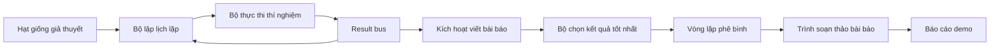
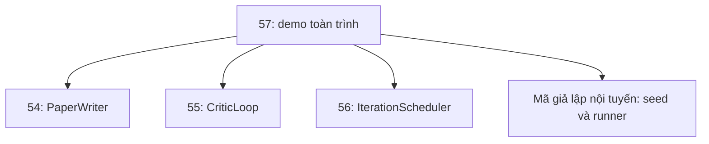
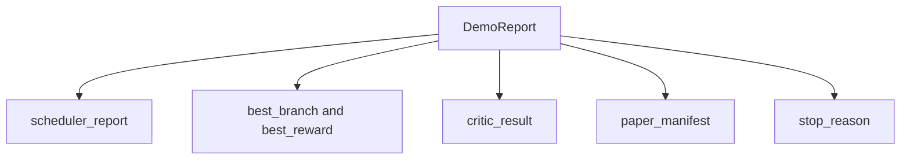

# Trình diễn nghiên cứu toàn trình (End-to-End Research Demo)

> Một kịch bản trình diễn là nơi mọi giao ước bạn đã thiết kế trước đó phải tự kết hợp ăn khớp với nhau. Nếu có bất kỳ giao ước nào bị rò rỉ hay sai lệch, bản demo chính là nơi phát hiện ra điều đó.

**Phân loại:** Xây dựng (Build)  
**Ngôn ngữ:** Python  
**Yêu cầu tiên quyết:** Các bài học 50-53 của Giai đoạn 19  
**Thời lượng:** ~90 phút  

## Mục tiêu học tập

- Kết nối vòng lặp tự nghiên cứu (auto-research loop) toàn trình từ đầu đến cuối: câu nhắc hạt giống giả thuyết, bộ thực thi thí nghiệm, bộ lập lịch, vòng lặp phê bình, và trình soạn thảo bài báo.
- Kết hợp các thành phần nguyên thủy từ bốn bài học trước thuộc Nhánh D thông qua các lệnh nhập (import) Python thuần túy mà không phụ thuộc vào framework.
- Chạy vòng lặp tới điểm kết thúc tự ngắt và phát ra một báo cáo demo duy nhất liệt kê toàn bộ đầu ra của từng công đoạn.
- Đảm bảo tính tất định tuyệt đối cho bản demo để bộ kiểm thử có thể khẳng định cấu trúc đầu ra cuối cùng.
- Thể hiện rõ ràng các dạng thức lỗi (failure modes) khi giao ước của bất kỳ công đoạn nào bị phá vỡ, ngăn không cho công đoạn tiếp theo nhận dữ liệu đầu vào không hợp lệ.

```figure
ch-research-pipeline
```

## Các thành phần kết hợp tại đây (What composes here)



Toàn bộ quy trình gồm sáu công đoạn: Tập hạt giống là danh sách ba giả thuyết. Bộ lập lịch chạy sáu thí nghiệm trải rộng trên các giả thuyết này với ba khe thực thi song song. Bus kết quả báo cáo một hoặc nhiều sự kiện kích hoạt viết bài báo. Bộ chọn lọc lấy ra kết quả tốt nhất duy nhất. Vòng lặp phê bình lặp lại việc cải tiến bản thảo được xây dựng từ kết quả đó. Trình soạn thảo bài báo phát ra các tệp LaTeX, BibTeX và bản kê khai cuối cùng.

## Vì sao nhập module trực tiếp thay vì sao chép mã (Why import, not copy)

Mỗi bài học trước đó đều cung cấp một tệp `main.py` chứa các dataclass và hàm công khai. Bản demo nhập trực tiếp chúng bằng cách điều chỉnh `sys.path` trỏ tới thư mục cha của từng bài học. Đây không phải là sự kết nối phức tạp của một framework nào cả; đó chính là phương thức import mà các tệp kiểm thử ở các bài học trước đã sử dụng.



Đoạn mã giả lập nội tuyến (inline stub) đóng vai trò đại diện cho các bài học từ 50 đến 53: một bộ sinh các giả thuyết hạt giống nhỏ gọn và một hàm phần thưởng đồng bộ. Người học hoàn toàn có thể thay thế đoạn mã giả lập này bằng các thành phần nguyên thủy thực tế từ các bài học đó chỉ bằng cách điều chỉnh hai dòng import.

## Bảo đảm tính tất định (Determinism guarantees)

Bản demo được thiết kế tất định ngay từ cấu trúc xây dựng: Bộ thực thi thí nghiệm sử dụng numpy với hạt giống được ghim cố định. Bộ sửa đổi của vòng lặp phê bình duyệt qua các chiều kích cố định theo thứ tự cố định. Trình sinh văn bản của trình soạn thảo bài báo là bản mô phỏng từ bài học 54. Bộ chọn UCB của bộ lập lịch xử lý các trường hợp hòa điểm dựa trên thứ tự duyệt thay vì lựa chọn ngẫu nhiên.

Với cùng một hạt giống đầu vào, bản demo luôn phát ra cùng một báo cáo đầu ra. Bài kiểm thử khẳng định thuộc tính này bằng cách chạy demo hai lần liên tiếp và so sánh từng trường trong bản kê khai.

## Cấu trúc dữ liệu Báo cáo Demo (The demo report shape)



Mỗi trường dữ liệu được lấy nguyên văn từ công đoạn thượng nguồn tương ứng. Bản demo không chuyển đổi hay biến tấu bất kỳ đầu ra nào; nó chỉ kết hợp chúng lại. Bản thân bản demo chính là bài kiểm thử tính tương thích này.

## Xử lý các dạng thức lỗi (Failure mode handling)

Mỗi công đoạn hoặc là thành công hoặc là ném ra một lỗi có định kiểu rõ ràng:

```text
Scheduler ........ trả về SchedulerReport với stop_reason
                   thuộc tập {queue_empty, max_experiments, deadline}
Best-result pick . ném ngoại lệ NoTriggerError nếu không có sự kiện kích hoạt bài báo nào phát ra
Critic loop ...... trả về LoopResult với trạng thái converged hoặc stopped
Paper writer ..... ném ngoại lệ PaperValidationError khi phá vỡ giao ước
```

Một sự cố ở bất kỳ công đoạn nào cũng sẽ ngắt mạch (short-circuit) bản demo bằng một ngoại lệ có định kiểu. Các bài kiểm thử ghim chặt giao ước này: `test_no_triggers_raises_typed_error` và `test_best_picker_raises_when_no_triggers` khẳng định bộ chọn sẽ ném `NoTriggerError` / `BestResultError` khi không có nhánh nào kích hoạt ngưỡng thành công, và trình soạn thảo bài báo sẽ tuyệt đối không bao giờ bị gọi.

## Bộ chọn kết quả tốt nhất (The best-result picker)

Bộ lập lịch phát ra các sự kiện kích hoạt viết bài báo cho từng nhánh. Bộ chọn sẽ chọn nhánh có phần thưởng trung bình cao nhất trong số tất cả các sự kiện kích hoạt. Khi hòa điểm, việc phân định thắng thua dựa trên thứ tự chữ cái của id nhánh để giữ tính tất định. Bộ chọn là một hàm thuần túy nhỏ gọn; bài kiểm thử ghim cố định nó trên một báo cáo lập lịch có sẵn.

## Kết nối vòng lặp phê bình (Wiring the critic loop)

Vòng lặp phê bình trong bài học 55 thao tác trên đối tượng `MiniPaper`. Bản demo xây dựng một `MiniPaper` từ nhánh được chọn bằng cách điền id nhánh vào phần tóm tắt, tạo sẵn hai phân mục (Introduction và Results), và thiết lập trường `originality_tag` dựa trên phần thưởng trung bình của nhánh (gán "high" nếu `>= 0.8`, "medium" nếu `>= 0.6`, và "low" trong các trường hợp còn lại).

Sau đó, bộ sửa đổi sẽ lặp lại việc cải thiện bản thảo cho đến khi hội tụ. Bản thảo đầu ra này được chuyển tiếp tới trình soạn thảo bài báo.

## Kết nối trình soạn thảo bài báo (Wiring the paper writer)

Trình soạn thảo bài báo trong bài học 54 thao tác trên cấu trúc đầy đủ `Paper` với các hình vẽ và thư mục tham khảo. Bản demo nâng cấp `MiniPaper` đã hội tụ thông qua hàm `mini_to_full_paper`. Hàm này đính kèm một hình vẽ cho nhánh được chọn và một danh mục thư mục nhân tạo được tạo nên từ hợp các khóa trích dẫn mà bộ phê bình đã gợi ý. Mọi trích dẫn mà demo thêm vào đều được đưa vào danh sách thư mục tham khảo, nhờ đó vượt qua khâu kiểm định.

## Cách đọc mã nguồn (How to read the code)

`code/main.py` định nghĩa `BestResultError`, `NoTriggerError`, `DemoReport`, `pick_best_branch`, `build_mini_paper`, `mini_to_full_paper`, và hàm `run_demo`. Các lệnh import ở đầu tệp điều chỉnh `sys.path` một lần duy nhất và nạp `PaperWriter`, `CriticLoop`, cùng `IterationScheduler` từ các bài học tương ứng.

`code/tests/test_e2e.py` bao quát: bản demo chạy thông suốt từ đầu đến cuối và phát ra báo cáo có đầy đủ năm trường dữ liệu, tính tất định qua hai lượt chạy liên tiếp, ngoại lệ NoTriggerError khi không có nhánh nào vượt ngưỡng, PaperValidationError khi giao ước của trình soạn thảo bị vi phạm, bản kê khai bài báo chứa đúng hình vẽ của nhánh được chọn, và lý do dừng của bộ lập lịch nằm trong danh sách các giá trị hợp lệ.

## Mở rộng thêm (Going further)

Có ba cải tiến rất đáng triển khai một khi bản demo đã chạy thành công: Thứ nhất là trạng thái bền vững (persistent state): ghi kết quả của từng giai đoạn vào một kho lưu trữ JSON nhỏ để khi khởi động lại có thể tiếp tục ngay mà không cần chạy lại các giai đoạn tốn ít tài nguyên. Thứ hai là bảng thông tin điều khiển (dashboard): hiển thị các sự kiện dấu vết từ bộ lập lịch và vòng lặp phê bình trên một dòng thời gian thống nhất. Thứ ba là các lời gọi mô hình AI thực tế: thay thế bộ sinh văn bản mô phỏng và bộ phê bình tất định bằng các mô hình AI thực thụ; cấu trúc kết nối đường ống vẫn giữ nguyên vẹn.

Nhiệm vụ của bản demo là chứng minh rằng khả năng hợp thành (composition) chính là bản chất của kiến trúc. Năm bài học, bốn lệnh import, một bản báo cáo duy nhất. Lần tới khi bạn bổ sung thêm một công đoạn mới, mã nguồn kết nối chỉ tăng thêm đúng một dòng.
