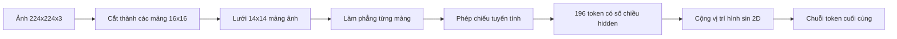

# Phân mảnh Bộ mã hóa Thị giác (Vision Encoder Patches)

> Một mô hình thị giác đọc các điểm ảnh (pixel) cần có một bộ tách từ (tokenizer) cho điểm ảnh. Nhúng mảng ảnh (patch embedding) chính là bộ tách từ đó. Cắt hình ảnh thành một lưới các ô vuông, làm phẳng (flatten) từng ô vuông, chiếu nó qua một tầng tuyến tính (linear layer), sau đó cộng thêm tín hiệu vị trí 2D để transformer biết được từng ô vuông nằm ở đâu trong ảnh gốc.

**Type:** Build
**Languages:** Python
**Prerequisites:** Phase 19 lessons 30-37 (Track B foundations)
**Time:** ~90 phút

## Mục tiêu Học tập

- Tách từ hóa một hình ảnh thành một chuỗi nhúng mảng ảnh có độ dài cố định.
- Hiện thực hóa phép chiếu mảng ảnh dựa trên `Conv2d` tương đương về mặt toán học với thao tác trải phẳng rồi nhân tuyến tính (unfold-then-linear).
- Xây dựng phép nhúng vị trí hình sin 2 chiều (2D sinusoidal position embedding) tất định để thứ tự mã thông báo (token) mã hóa được vị trí không gian.
- Kiểm chứng số lượng mảng ảnh, kích thước nhúng (embedding shape) và sự tương đương giữa `Conv2d` và unfold trên dữ liệu thử nghiệm tổng hợp (synthetic fixture).

## Vấn đề Cần giải quyết

Mô hình transformer tiếp nhận đầu vào là một chuỗi các vector. Trong khi đó, một hình ảnh lại là một lưới 3 kênh màu (RGB). Việc coi mỗi điểm ảnh là một token sẽ làm bùng nổ độ dài chuỗi: một ảnh RGB kích thước 224x224 sẽ tạo ra 150.528 token, một con số mà cơ chế chú ý (attention) của transformer 12 tầng không thể kham nổi về mặt tính toán. Ngược lại, nếu làm phẳng toàn bộ bức ảnh thành một vector khổng lồ duy nhất thì sẽ làm mất đi tính cục bộ không gian (spatial locality) - điều mà tầng attention sau đó không thể khôi phục lại được. Nhiệm vụ của khối tiền xử lý bộ mã hóa (encoder front end) là nén lưới điểm ảnh thành vài trăm token, trong đó mỗi token tóm tắt một vùng không gian hình vuông.

Kỹ thuật nhúng mảng ảnh giải quyết bài toán này chỉ với một phép chiếu tuyến tính duy nhất. Một hình ảnh 224x224 được cắt thành các mảng ảnh 16x16 sẽ tạo ra một lưới 14x14 gồm 196 mảng ảnh. Mỗi mảng ảnh được làm phẳng từ `(3, 16, 16) = 768` giá trị điểm ảnh thành một vector, sau đó một tầng tuyến tính sẽ ánh xạ nó sang chiều ẩn (hidden dimension) của mô hình. Transformer sẽ nhìn thấy 196 token có số chiều `hidden` (thường là 768) cùng với một token CLS. Đó là một chuỗi có kích thước phù hợp để phần còn lại của mạng xử lý hiệu quả.

## Khái niệm Cốt lõi



### Tại sao lại dùng mảng ảnh thay vì điểm ảnh?

Độ phức tạp tính toán của cơ chế chú ý tăng theo hàm bậc hai (quadratic) theo độ dài chuỗi. Một chuỗi 196 token chỉ tốn `196 * 196 = 38.416` điểm chú ý (attention score) cho mỗi đầu chú ý (head) trên mỗi tầng; trong khi chuỗi 150.528 token sẽ ngốn tới `150.528 * 150.528 = 22,6 tỷ` phép tính. Việc chia mảng ảnh giúp giảm chi phí tính toán attention tới 590.000 lần, trong khi một vùng 16x16 vẫn mang đủ tín hiệu cho các tác vụ thị giác cấp cao (high-level vision tasks). Đổi lại, ta phải chấp nhận mất mát chi tiết không gian mịn bên trong mỗi mảng ảnh. Đó là lý do tại sao các kiến trúc đa phương thức (multimodal stacks) xuôi dòng thường chạy thêm một nhánh phụ có độ phân giải cao khi cần định vị không gian chi tiết.

### Tại sao một phép chiếu tuyến tính là đủ?

Mỗi mảng ảnh được đối xử như một vector độc lập. Phép chiếu sẽ học một hệ cơ sở: bộ phát hiện cạnh (edge detectors), bộ lọc màu sắc, kết cấu đơn giản. Một tầng tuyến tính đơn lẻ có kích thước rất nhỏ (`768 * 768 = 589.824` tham số đối với ViT-Base) và hội tụ nhanh trong quá trình huấn luyện. Mặc dù tồn tại các khối trích xuất đặc trưng tích chập sâu hơn ("hybrid" ViT), phép chiếu tuyến tính phẳng vẫn là chuẩn mực, và hầu hết các bộ mã hóa mã nguồn mở hiện đại đều sử dụng chính xác cấu trúc này.

### Mẹo tối ưu bằng `Conv2d`

Một tầng tích chập `Conv2d(in_channels=3, out_channels=hidden, kernel_size=patch_size, stride=patch_size)` không dùng đệm (no padding) cho ra kết quả số học y hệt như thao tác trải phẳng rồi nhân tuyến tính (unfold-then-linear), bởi vì mỗi vị trí đầu ra thực chất là tích vô hướng giữa các điểm ảnh trong mảng với một bộ lọc (filter). Phép tích chập chính là phép chiếu mảng ảnh, và hầu hết các mã nguồn triển khai thực tế (production codebases) đều dùng cách này vì nó chạy nhanh hơn trên GPU và bớt đi một bước định hình lại tensor (reshape).

### Nhúng vị trí

Sau khi qua phép chiếu tuyến tính, các token hoàn toàn không mang thông tin về thứ tự. Phép nhúng hình sin 2 chiều (2D sinusoidal embedding) bổ sung cho mỗi token một tín hiệu cố định mã hóa tọa độ `(hàng, cột)` của nó. Một nửa số chiều nhúng dùng để mã hóa vị trí hàng bằng các hàm sin/cos ở nhiều tần số khác nhau; nửa còn lại mã hóa vị trí cột. Phép mã hóa này mang tính tất định (deterministic) nên bạn có thể thay đổi độ phân giải ảnh mà không cần huấn luyện lại mô hình, đồng thời nó nội suy rất mượt mà sang các lưới tọa độ mà mô hình chưa từng gặp trong giai đoạn huấn luyện.

| Thành phần | Kích thước | Tham số |
|------------|------------|---------|
| Phép chiếu mảng ảnh (`Conv2d`) | `(hidden, 3, patch, patch)` | `3 * P * P * hidden + hidden` |
| Nhúng vị trí (cố định) | `(num_patches, hidden)` | 0 (tính toán giải tích, không học) |
| Token CLS (học được) | `(1, hidden)` | `hidden` |

Đối với cấu hình ViT-Base/16 ở độ phân giải 224: có 590.592 tham số trong phép chiếu, 768 tham số trong token CLS, và 0 tham số cho nhúng vị trí hình sin. Bài học tiếp theo (59) sẽ xếp chồng một transformer 12 tầng lên trên khối tiền xử lý này.

### Kiểm tra tính tương đương

Bước chia mảng ảnh có hai cách hiện thực hóa: dùng phép chiếu `Conv2d` hoặc dùng thao tác tường minh `unfold` rồi đưa qua tầng tuyến tính. Cả hai phải cho ra cùng một kết quả với cùng một bộ trọng số. Nếu chúng lệch nhau, công thức toán của phép `unfold` đã bị sai, và phần còn lại của bộ mã hóa sẽ được xây dựng trên một nền móng không vững chắc. Các bài kiểm thử trong bài học này sẽ trực tiếp đối soát tính tương đương đó.

```figure
ch-patch-tokenizer
```

## Tự Xây dựng

Tệp `code/main.py` hiện thực:

- `PatchEmbed`, một `nn.Module` bao bọc `Conv2d` cho phép chiếu mảng ảnh.
- `sinusoidal_2d(grid_h, grid_w, dim)`, một hàm không trạng thái (stateless) tạo bảng vị trí 2D.
- `VisionFrontEnd`, kết hợp nhúng mảng ảnh, chèn token CLS vào đầu chuỗi và cộng thêm vị trí trong một lượt lan truyền xuôi (forward pass).
- Một hàm tiện ích `synthesize_image(seed)` tạo dữ liệu mẫu 224x224x3 tất định từ `numpy.random`.
- Một hàm chạy thử (demo) đưa một ảnh mẫu qua khối tiền xử lý và in ra kích thước đầu ra, chuẩn (norm) của token CLS, cùng một hàng của ma trận nhúng vị trí.

Chạy thử mã nguồn:

```bash
python3 code/main.py
```

Kết quả: ảnh mẫu 224x224 được tách từ thành một chuỗi có kích thước `(1, 197, 768)`. Token đầu tiên là CLS; 196 token tiếp theo là các token mảng ảnh. Chuẩn của các vector nhúng vị trí là đồng nhất trong cùng một hàng, đây chính là đặc trưng nhận diện của phép nhúng hình sin.

## Ứng dụng Thực tế

Khối tiền xử lý mảng ảnh này xuất hiện trong mọi mô hình thị giác - ngôn ngữ (vision-language model) hiện đại: CLIP ViT-L/14, SigLIP, DINOv2, họ mô hình Qwen-VL, và kiến trúc InternVL đều bắt đầu từ một phép chiếu mảng ảnh bằng `Conv2d` cộng với tín hiệu vị trí. Sự khác biệt giữa các họ mô hình nằm ở các tầng xử lý phía sau (cơ chế gom cụm pooling bằng CLS hay không dùng CLS, token thanh ghi - register tokens, các kích thước mảng ảnh khác nhau như 14 hay 16, độ phân giải động thông qua nội suy vị trí). Khối tiền xử lý trong bài học này chính là nền tảng cốt lõi nâng đỡ tất cả các mô hình đó.

## Kiểm thử

Tệp `code/test_main.py` bao quát các trường hợp:

- Số lượng mảng ảnh khớp với công thức `(image_size / patch_size) ** 2`.
- Kích thước đầu ra khớp với `(batch, num_patches + 1, hidden)`.
- Phép chiếu bằng `Conv2d` cho kết quả tương đương với phép unfold thủ công kết hợp tầng tuyến tính trên dữ liệu mẫu nhỏ.
- Bảng vị trí hình sin đảm bảo tính tất định qua các lần gọi.
- Token CLS được mở rộng (broadcast) chuẩn xác qua chiều batch mà không bị rò rỉ dữ liệu giữa các mẫu.

Chạy kiểm thử:

```bash
python3 -m unittest code/test_main.py
```

## Bài tập Mở rộng

1. Thay thế vị trí hình sin bằng một `nn.Parameter` có thể học được và so sánh hàm mất mát (loss) ở kỷ nguyên (epoch) đầu tiên trên một tác vụ phân loại tổng hợp quy mô nhỏ. Vị trí học được hoạt động tốt hơn ở độ phân giải cố định; vị trí hình sin chiếm ưu thế khi bạn thay đổi độ phân giải sau khi huấn luyện.

2. Hoán đổi `Conv2d` sang việc sử dụng tường minh `nn.Unfold` kết hợp với `nn.Linear`, sau đó khẳng định (assert) rằng kết quả đầu ra khớp nhau trong phạm vi sai số dấu phẩy động (float tolerance). Cùng một bản chất toán học, nhưng thể hiện qua hai cách viết code khác nhau.

3. Thêm hỗ trợ cho kích thước mảng ảnh không vuông (chẳng hạn 32x16 cho các ảnh đầu vào có tỉ lệ khung hình rộng) và kiểm chứng xem bảng vị trí có xử lý tốt lưới không vuông hay không.

4. Đo đạc hiệu năng (profile) bước xử lý mảng ảnh ở các kích thước batch 1, 8, 64. Phép chiếu mảng ảnh hiếm khi là điểm nghẽn cổ chai (bottleneck); các tầng attention phía sau mới là nơi chiếm phần lớn thời gian tính toán.

5. Huấn luyện khối tiền xử lý như một bộ trích xuất đặc trưng đóng băng (frozen feature extractor) trên tập dữ liệu hình học tổng hợp gồm 4 lớp (hình tròn, hình vuông, hình tam giác, hình ngôi sao). Đầu ra của token CLS phải có khả năng phân tách tuyến tính (linearly separable).

## Thuật ngữ Then chốt

| Thuật ngữ | Ý nghĩa |
|-----------|---------|
| Mảng ảnh (Patch) | Một vùng con hình vuông của ảnh, thường có kích thước 14x14 hoặc 16x16 |
| Nhúng mảng ảnh (Patch embedding) | Phép chiếu tuyến tính một mảng ảnh đã làm phẳng sang chiều ẩn |
| Độ dài chuỗi (Sequence length) | Số lượng token sau khi tách từ hóa mảng ảnh, thường cộng thêm token CLS |
| Vị trí hình sin (Sinusoidal position) | Tín hiệu hàm sin/cos cố định mã hóa tọa độ lưới 2 chiều |
| Token CLS (CLS token) | Vector học được chèn vào đầu chuỗi đóng vai trò làm đầu gom thông tin (pooling head) |

## Tài liệu Tham khảo

- An Image is Worth 16x16 Words (ViT, 2021) để hiểu cách tiếp cận nhúng mảng ảnh nguyên bản.
- Attention Is All You Need (2017) cho công thức vị trí hình sin được điều chỉnh sang 2D trong bài này.
- Bài báo DINOv2 về token thanh ghi (register tokens), một phần mở rộng bạn có thể thực hiện như bài tập số 6.
