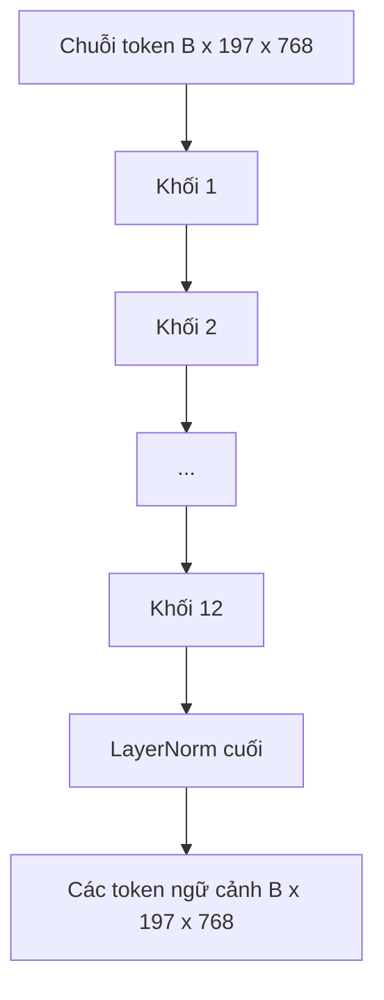

# Bộ mã hóa Vision Transformer (Vision Transformer Encoder)

> Chỉ riêng các mảng ảnh thì chưa thể "nhìn" được. Một transformer 12 tầng với chuẩn hóa trước (pre-LN) cùng 12 đầu chú ý (attention heads) sẽ biến chuỗi token mảng ảnh thành một chuỗi token mang tính ngữ cảnh (contextual tokens), trong đó token CLS thực hiện gom cụm các đặc trưng toàn cảnh của bức ảnh tại trạng thái ẩn cuối cùng. Bài học này chính là "buồng máy" vận hành bên trong mọi mô hình thị giác - ngôn ngữ (vision-language model) hiện đại.

**Type:** Build
**Languages:** Python
**Prerequisites:** Phase 19 lessons 30-37 (Track B foundations)
**Time:** ~90 phút

## Mục tiêu Học tập

- Hiện thực hóa một khối transformer sử dụng Pre-LN kết hợp cơ chế tự chú ý đa đầu (multi-head self-attention) và một tầng con truyền thẳng (feed-forward sub-layer).
- Xếp chồng 12 khối với 12 đầu chú ý để tạo thành bộ mã hóa ViT-Base hoàn chỉnh.
- Kết nối khối tiền xử lý mảng ảnh từ Bài học 58 vào bộ mã hóa và thực hiện một lượt lan truyền xuôi (forward pass).
- Kiểm chứng xem token CLS có tổng hợp thông tin từ mọi mảng ảnh hay không.

## Vấn đề Cần giải quyết

Bước nhúng mảng ảnh tạo ra một chuỗi 197 token, trong đó mỗi token là một vector hoàn toàn chưa nhận biết được bất kỳ mảng ảnh nào khác xung quanh. Để hiểu một bức ảnh chụp con mèo, từng mảng ảnh cần biết mảng nào chứa râu, mảng nào là phông nền và mảng nào chứa đôi mắt. Transformer chính là cơ chế xây dựng nhận thức tương quan đó, thông qua từng tầng chú ý liên tiếp. Nếu không có nó, khối tiền xử lý mảng ảnh chỉ là một bộ tách từ khéo léo nhưng vô tri.

Công thức thiết kế tiêu chuẩn gồm 12 khối sâu, 12 đầu chú ý rộng, áp dụng vị trí chuẩn hóa tầng trước (Pre-LayerNorm), hàm kích hoạt GELU và hệ số mở rộng mạng truyền thẳng (feed-forward expansion) gấp 4 lần. Công thức này là xương sống của CLIP ViT-L, SigLIP, DINOv2, họ mô hình Qwen-VL, InternVL và hầu như mọi bộ mã hóa thị giác mã nguồn mở trong giai đoạn 2025-2026. Công thức này ổn định đến mức bạn có thể đọc bất kỳ bài báo nào trong số đó và mặc định cấu trúc khối này trừ khi các tác giả nêu rõ điểm khác biệt.

## Khái niệm Cốt lõi




### Pre-LN so với Post-LN

Kiến trúc Transformer gốc đặt LayerNorm ở phía sau kết nối phần dư (Post-LN). Pre-LN (đặt LayerNorm trước mỗi tầng con) là biến thể mà mọi mô hình thị giác - ngôn ngữ hiện đại đều lựa chọn, bởi vì nó giúp quá trình huấn luyện ổn định mà không cần đến các mẹo làm ấm tốc độ học (learning-rate warm-up). Điểm khác biệt chỉ là một dòng code trong hàm lan truyền xuôi, nhưng dòng chảy gradient ở độ sâu từ 12 tầng trở lên là một sự khác biệt một trời một vực.

### Cơ chế tự chú ý đa đầu

Mỗi đầu chú ý chiếu vector token sang bộ ba `(truy vấn - query, khóa - key, giá trị - value)` riêng biệt với số chiều `head_dim = hidden / num_heads`. Với `hidden = 768` và `heads = 12`, mỗi đầu có `dim = 64`. 12 đầu này tính toán chú ý song song, sau đó kết quả đầu ra của chúng được nối lại (concat) về số chiều 768 rồi đi qua một phép chiếu đầu ra (output projection). Lợi ích của cơ chế đa đầu là một đầu có thể học cách "chú ý vào mắt mèo" trong khi một đầu khác học cách "chú ý vào gradient của phông nền" mà không gây nhiễu lẫn nhau.

### Tại sao lại mở rộng mạng truyền thẳng gấp 4 lần?

Mạng truyền thẳng FFN biến đổi theo kích thước `hidden -> 4 * hidden -> hidden` với hàm kích hoạt GELU ở giữa. Hệ số 4 này được đúc kết từ thực nghiệm và giữ vững tính hiệu quả qua các kiến trúc transformer ngôn ngữ và thị giác từ năm 2017 đến nay. Mở rộng nhỏ hơn (2x) khiến mô hình chưa khớp (underfit); mở rộng lớn hơn (8x) lại gây quá khớp (overfit) khi ngân sách dữ liệu cố định. Mạng MLP chính là nơi mô hình lưu trữ phần lớn các tri thức học được, và vùng mở rộng rộng rãi ở giữa chính là không gian chứa đựng chúng.

| Thành phần | Số tham số ở quy mô ViT-Base |
|------------|------------------------------|
| Phép chiếu qkv mỗi khối | `3 * 768 * 768 = 1,77M` |
| Phép chiếu đầu ra mỗi khối | `768 * 768 = 590K` |
| FFN mỗi khối (mở rộng 4x) | `2 * 768 * 4 * 768 = 4,72M` |
| LayerNorm mỗi khối | `4 * 768 = 3K` |
| Tổng cộng mỗi khối | Khoảng 7,1M |
| 12 khối | Khoảng 85M |
| Cộng thêm khối tiền xử lý | Khoảng 86M tổng cộng |

ViT-Base là một bộ mã hóa có khoảng 86 triệu tham số. Con số này là khá khiêm tốn theo tiêu chuẩn năm 2026 (SigLIP-So400M có 400 triệu tham số, ViT của Qwen-VL có 675 triệu tham số), nhưng cấu trúc kiến trúc của chúng là hoàn toàn giống nhau, chỉ khác biệt về độ rộng và độ sâu.

### Có cần mặt nạ nhân quả hay không?

Các Vision Transformer chỉ đóng vai trò là bộ mã hóa (encoder-only) và có tính hai chiều (bidirectional): token `i` có thể chú ý tới token `j` với bất kỳ cặp nào. Hoàn toàn không có mặt nạ che. Cơ chế tự chú ý của văn bản trong bộ giải mã (decoder) ở Bài học 61 sẽ sử dụng mặt nạ nhân quả (nhưng cơ chế chú ý chéo của nó lên các mảng ảnh thì không), còn bên trong bộ mã hóa thị giác, cơ chế chú ý là liên thông hoàn toàn (fully connected).

### Token CLS học được những gì?

Token CLS ban đầu là một tham số học được, tự thân nó không chứa nội dung của bất kỳ mảng ảnh nào, và nó tích lũy thông tin thông qua cơ chế chú ý qua từng khối mạng. Khi đến tầng cuối cùng, hàng tương ứng với token CLS là một vector tóm tắt toàn bộ bức ảnh; các đầu xử lý xuôi dòng (downstream heads) sẽ chiếu vector đơn lẻ này thành phân phối xác suất phân loại (class logits), vector nhúng tương phản (contrastive embeddings), hoặc các khóa chú ý chéo (cross-attention keys) cho bộ giải mã văn bản.

```figure
ch-cls-funnel
```

## Tự Xây dựng

Tệp `code/main.py` hiện thực:

- `MultiHeadSelfAttention`, bao gồm các phép chiếu `qkv` và đầu ra, các phép toán chú ý tích vô hướng có tỷ lệ (scaled-dot-product attention), và các kiểm tra kích thước (shape assertions).
- `FeedForward`, mạng MLP mở rộng 4 lần với kích hoạt GELU.
- `Block`, một khối Pre-LN kết hợp các tầng con chú ý và truyền thẳng cùng các kết nối phần dư.
- `ViT`, một chồng gồm 12 khối với một tầng LayerNorm cuối cùng.
- `VisionEncoder`, kết nối `VisionFrontEnd` từ Bài học 58 với ngăn xếp `ViT` và cung cấp phương thức `forward()` trả về cả chuỗi ngữ cảnh lẫn vector CLS đã gom cụm.
- Một đoạn mã chạy thử (demo) đưa ảnh mẫu 224x224 qua toàn bộ bộ mã hóa và in ra kích thước đầu vào, kích thước đầu ra, số lượng tham số và chuẩn của token CLS ở các tầng xen kẽ.

Chạy mã nguồn:

```bash
python3 code/main.py
```

Kết quả: ảnh mẫu được mã hóa thành một tensor kích thước `(1, 197, 768)`. Chuẩn của token CLS tăng dần qua các tầng và ổn định lại tại tầng LayerNorm cuối cùng. Tổng số tham số được báo cáo vào khoảng 86M.

## Ứng dụng Thực tế

Bộ mã hóa được định nghĩa ở đây, xét về mặt bản chất cấu trúc (ngoại trừ độ rộng và độ sâu), chính là ngăn xếp khối được tích hợp bên trong mọi mô hình VLM mã nguồn mở giai đoạn 2025-2026. Các điểm khác biệt chủ yếu nằm ở:

- **Độ rộng và độ sâu:** ViT-Large có `hidden=1024, depth=24, heads=16`; SigLIP So400M có `hidden=1152, depth=27, heads=16`. Cùng một cấu trúc khối.
- **Đầu gom cụm (Pooling head):** Gom cụm bằng CLS (trong bài này) so với gom cụm trung bình (average pooling - SigLIP) so với gom cụm chú ý (attention pooling - các VLM thế hệ sau).
- **Xử lý vị trí:** Vị trí hình sin cố định (Bài 58) so với học 1D so với ALiBi so với RoPE 2D. Các phép toán trong khối mạng không thay đổi.
- **Token thanh ghi (Register tokens):** DINOv2 chèn thêm 4 token học được vào đầu chuỗi. Chỉ cần thêm một dòng code.

Ngăn xếp khối này chính là nền móng. Các bài học tiếp theo (60-63) sẽ xây dựng tiếp trên nền móng này.

## Kiểm thử

Tệp `code/test_main.py` bao quát:

- Một khối đơn lẻ bảo toàn kích thước và bất biến với kích thước batch đầu vào.
- Điểm chú ý (attention scores) có tổng bằng 1 dọc theo trục khóa (kiểm tra tính hợp lệ của softmax).
- Các đường dẫn phần dư hoạt động chuẩn xác (đầu vào bằng 0 vẫn sinh ra đầu ra khác 0 thông qua token CLS).
- Lượt lan truyền xuôi qua 4 khối xếp chồng tạo ra kích thước chuẩn xác.
- Gradient truyền ngược thông suốt từ đầu ra CLS về tới phép chiếu mảng ảnh.

Chạy kiểm thử:

```bash
python3 -m unittest code/test_main.py
```

## Bài tập Mở rộng

1. Bổ sung các token thanh ghi (4 vector học được chèn sau token CLS) và chạy lại. So sánh độ mượt của bản đồ chú ý (attention map smoothness) thông qua entropy của phân phối softmax tại tầng cuối cùng.

2. Hoán đổi Pre-LN sang Post-LN và huấn luyện trong một kỷ nguyên trên bộ phân loại hình dạng tổng hợp. Quan sát xem cấu trúc nào huấn luyện ổn định mà không cần làm ấm tốc độ học (LR warm-up).

3. Hiện thực hóa mặt nạ nhân quả dưới dạng tham số `attn_mask` để khối này có thể tái sử dụng làm khối giải mã (decoder block). Mặt nạ có kích thước `(seq, seq)`, dạng tam giác dưới.

4. Đo đạc hiệu năng lượt lan truyền xuôi ở kích thước batch 1, 8, 64 bằng `torch.profiler`. Tầng MLP chiếm phần lớn thời gian thực thi chứ không phải attention.

5. Thay thế các phép chiếu q-k-v của một đầu chú ý bằng một bộ thích ứng LoRA hạng thấp (low-rank LoRA adapter), đóng băng phần còn lại, và kiểm chứng gradient chỉ chảy đúng vào nơi mong muốn.

## Thuật ngữ Then chốt

| Thuật ngữ | Ý nghĩa |
|-----------|---------|
| Pre-LN | Chuẩn hóa tầng được áp dụng trước mỗi tầng con thay vì sau |
| Tự chú ý (Self-attention) | Mỗi token chú ý tới mọi token khác trong cùng chuỗi |
| Đa đầu (Multi-head) | Chiều ẩn được chia thành `H` đầu chú ý độc lập |
| Mở rộng FFN (FFN expansion) | Tầng truyền thẳng mở rộng tới `4 * hidden` trước khi thu hẹp lại |
| Gom cụm bằng CLS (CLS pooling) | Sử dụng trạng thái ẩn cuối cùng của token đầu tiên làm bản tóm tắt cho toàn bộ ảnh |

## Tài liệu Tham khảo

- An Image is Worth 16x16 Words (ViT, 2021) cho công thức thiết kế bộ mã hóa.
- DINOv2 (2023) cho kỹ thuật token thanh ghi và mục tiêu huấn luyện tự giám sát.
- SigLIP (2023) cho biến thể gom cụm trung bình và hàm mất mát tương phản sigmoid được sử dụng trong Bài học 62.
