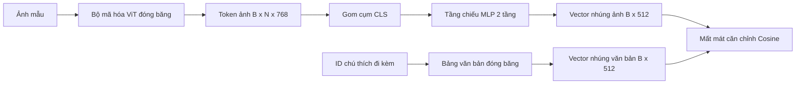

# Tầng Chiếu để Căn chỉnh Phương thức (Projection Layer for Modality Alignment)

> Bộ mã hóa thị giác (vision encoder) tạo ra các token hình ảnh. Bộ giải mã văn bản (text decoder) lại tiêu thụ các token văn bản. Hai loại token này tồn tại trong hai không gian vector hoàn toàn khác nhau. Một mạng MLP hai tầng nhỏ gọn sẽ chiếu các token hình ảnh vào không gian nhúng của văn bản, và hàm mất mát căn chỉnh cosine (cosine alignment loss) với chú thích đi kèm (paired caption) sẽ kéo hai không gian này về trạng thái đồng thuận. Tầng chiếu đó là mảnh ghép nhỏ nhất trong một mô hình thị giác - ngôn ngữ, nhưng lại là thành phần quan trọng nhất đối với khả năng chuyển giao tri thức (transfer learning).

**Type:** Build
**Languages:** Python
**Prerequisites:** Phase 19 lessons 30-37 (Track B foundations)
**Time:** ~90 phút

## Mục tiêu Học tập

- Xây dựng một tầng chiếu MLP 2 tầng ánh xạ các đặc trưng hình ảnh vào không gian nhúng văn bản.
- Thiết lập một bảng nhúng văn bản giả lập (mock text embedding table) mà không cần bộ tách từ tiền huấn luyện hay kho ngữ liệu thực tế.
- Tính toán hàm mất mát căn chỉnh cosine giữa các token hình ảnh đã chiếu và vector nhúng của chú thích đi kèm.
- Huấn luyện riêng tầng chiếu với bộ mã hóa thị giác đóng băng và bảng nhúng văn bản đóng băng.

## Vấn đề Cần giải quyết

Bạn đang có một bộ mã hóa thị giác (từ các Bài học 58-59) sinh ra các token với số chiều `vision_hidden = 768`. Bạn lại có một bộ giải mã văn bản muốn gắn lên trên với số chiều nhúng `text_hidden = 512` (bất kỳ con số nào khác cũng tương tự). Bộ giải mã kỳ vọng các token có định dạng và phân phối của văn bản. Thế nhưng các token hình ảnh lại không có hình thái văn bản: chúng nằm trong một hệ cơ sở mà bộ mã hóa đã học được trong quá trình tiền huấn luyện thuần thị giác, hoàn toàn không có mối liên hệ nào với các vector từ của bộ giải mã.

Một phép chiếu bằng mạng MLP hai tầng (tuyến tính, GELU, tuyến tính) sẽ bắc cầu qua khoảng cách này. Nó đủ nhỏ (khoảng `768 * 1024 + 1024 * 512 = 1,3M` tham số) để huấn luyện trong vài phút trên một GPU đơn lẻ, và nó là thành phần duy nhất cần phải học trong giai đoạn căn chỉnh phương thức (modality alignment). Bộ mã hóa thị giác được giữ đóng băng (frozen). Bảng nhúng văn bản cũng được giữ đóng băng. Chỉ có tầng chiếu là cập nhật trọng số. Đây chính là công thức mà LLaVA đã công bố năm 2023, mà BLIP-2 đã tái định hình dưới dạng Q-Former, và hầu như mọi mô hình VLM mã nguồn mở kể từ đó đều áp dụng dưới hình thức này hay hình thức khác.

## Khái niệm Cốt lõi



### Gom cụm trước khi chiếu

Bộ mã hóa thị giác phát ra 197 token. Phía văn bản lại có một vector nhúng duy nhất ở cấp độ câu chú thích. Để căn chỉnh chúng, bạn cần một vector cấp độ hình ảnh duy nhất cho mỗi mẫu dữ liệu. Gom cụm bằng CLS (CLS pooling) là cách đơn giản nhất: lấy token đầu tiên từ bộ mã hóa và chiếu nó. Gom cụm trung bình (mean pooling) trên toàn bộ 197 token là một lựa chọn khác và là cách mà SigLIP sử dụng. Cả hai cách đều nén 197 vector xuống còn một vector duy nhất.

### Tại sao lại là hai tầng mà không phải một tầng?

Một phép chiếu tuyến tính đơn lẻ chỉ có thể xoay và co giãn không gian nhưng không thể hiệu chỉnh lại hệ cơ sở nếu hai không gian có độ cong không khớp nhau. Hàm kích hoạt GELU nằm giữa hai tầng tuyến tính mang lại cho phép chiếu một độ uốn phi tuyến (non-linear bend), điều này trên thực nghiệm đã chứng minh là đủ để căn chỉnh các đặc trưng kiểu CLIP với các vector nhúng của mô hình ngôn ngữ. Các kiến trúc chiếu sâu hơn (chẳng hạn LLaVA-NeXT dùng GLU; Qwen-VL dùng một chồng các tầng attention) là những phần mở rộng; MLP hai tầng vẫn là chuẩn cơ sở (canonical baseline) và chính là thứ mà đầu chiếu Q-Former của BLIP-2 sử dụng dưới lớp vỏ của nó.

| Tầng | Kích thước | Tham số |
|------|------------|---------|
| fc1 | `(vision_hidden, projection_hidden)` | `768 * 1024 + 1024` |
| kích hoạt | GELU | 0 |
| fc2 | `(projection_hidden, text_hidden)` | `1024 * 512 + 512` |

Khoảng 1,3M tham số cho một đầu chiếu có cấu hình `768 -> 1024 -> 512`.

### Hàm mất mát căn chỉnh Cosine

Căn chỉnh (align) không có nghĩa là ép `image_emb == text_emb`. Căn chỉnh nghĩa là `image_emb` cùng hướng với `text_emb` trong không gian chung. Hàm mất mát cosine được định nghĩa là `1 - cos_sim(image, text)`, dao động từ 0 (căn chỉnh hoàn hảo) đến 2 (ngược hướng hoàn toàn). Quá trình huấn luyện sẽ kéo giá trị này về 0 cho từng cặp mẫu. Bài học 62 sẽ tổng quát hóa bài toán này lên quy mô một batch học tương phản (contrastive batch với InfoNCE), nơi mỗi ảnh phải gần với chú thích của chính nó hơn bất kỳ chú thích nào khác trong batch; bài học này sử dụng phiên bản theo từng cặp để bạn quan sát rõ ràng động lực học (dynamics) của quá trình tối ưu.

### Mẹo giữ đóng băng bộ mã hóa

Bộ mã hóa thị giác có 86M tham số. Bảng nhúng văn bản có thêm vài triệu tham số nữa. Việc huấn luyện toàn bộ chúng từ một tập dữ liệu giả lập là điều bất khả thi. Đóng băng cả hai thành phần này giúp cho 1,3M tham số của tầng chiếu là thứ duy nhất thay đổi, và chỉ cần vài trăm bước huấn luyện trên các cặp dữ liệu tổng hợp là đủ để kéo giảm hàm mất mát. Đây chính xác là phương thức vận hành của mọi VLM dựa trên bộ thích ứng (adapter-based VLM): các phần nặng nề được giữ nguyên đóng băng, chiếc cầu nối nhẹ nhàng sẽ đảm nhận việc học.

```figure
ch-projection-bridge
```

## Tự Xây dựng

Tệp `code/main.py` hiện thực:

- `MLPProjector(in_dim, hidden_dim, out_dim)`, mạng MLP tuyến tính 2 tầng với hàm kích hoạt GELU.
- `MockTextEmbedding(vocab_size, dim)`, một bảng nhúng đóng băng với giá trị khởi tạo tất định từ một giá trị hạt giống (seed).
- `make_pair(seed, vocab_size)`, tổng hợp một mẫu cặp (ảnh, chú thích). Các chú thích là chuỗi ID ngắn; vector nhúng chú thích được gom cụm trung bình trên các token nhúng.
- `cosine_alignment_loss(image_emb, text_emb)`, hàm mục tiêu `1 - cos_sim` cho từng cặp.
- Vòng lặp huấn luyện chạy tầng chiếu trong 200 bước trên 32 cặp tổng hợp (lặp vòng), với bộ mã hóa thị giác và bảng văn bản được đóng băng, in ra hàm mất mát sau mỗi 25 bước.

Chạy mã nguồn:

```bash
python3 code/main.py
```

Kết quả: nhật ký huấn luyện cho thấy mất mát giảm từ mức ban đầu khoảng 1,07 xuống còn khoảng 0,80 sau 200 bước, chứng minh rằng chỉ riêng tầng chiếu đã có thể kéo các token hình ảnh về gần không gian văn bản. Độ tương đồng cosine cuối cùng cho từng cặp cũng được in ra.

## Ứng dụng Thực tế

Mô hình tương tự xuất hiện trong mọi VLM mã nguồn mở:

- **LLaVA 1.5:** Tầng chiếu MLP 2 tầng với GELU từ chiều ẩn của CLIP-ViT-L sang chiều nhúng của LLaMA. Bộ mã hóa thị giác đóng băng, LLM đóng băng, chỉ huấn luyện tầng chiếu (sau đó mở đóng băng LLM ở giai đoạn hai).
- **BLIP-2:** Q-Former tiếp nhận 32 token truy vấn học được thông qua chú ý chéo với các token ảnh, sau đó chiếu sang chiều nhúng của LLM. Đầu chiếu ở cuối Q-Former tương đương với MLP trong bài học này.
- **MiniGPT-4:** Một phép chiếu tuyến tính đơn lẻ từ đầu ra BLIP-2 Q-Former sang chiều nhúng của Vicuna.
- **Qwen-VL:** Bộ thích ứng chú ý chéo (cross-attention adapter) gồm nhiều tầng, nhưng thành phần cuối cùng vẫn là một phép chiếu sang chiều nhúng của mô hình ngôn ngữ (LM).

Hình thái có thể biến đổi nhưng vai trò là đồng nhất: gom cụm token ảnh, chiếu sang chiều nhúng văn bản, và huấn luyện độc lập.

## Kiểm thử

Tệp `code/test_main.py` bao quát:

- Kích thước đầu ra của bộ chiếu khớp với `out_dim` đã cấu hình.
- Bảng nhúng văn bản đóng băng không có tham số nào yêu cầu tính đạo hàm (`requires_grad=False`).
- Mất mát cosine bằng 0 đối với các vector đồng nhất và bằng 2 đối với các vector ngược chiều.
- Gradient truyền qua bộ chiếu sau một lượt lan truyền ngược (backward pass).
- Vòng lặp huấn luyện thực sự làm giảm hàm mất mát giữa bước 0 và bước 200.

Chạy kiểm thử:

```bash
python3 -m unittest code/test_main.py
```

## Bài tập Mở rộng

1. Thay thế gom cụm CLS bằng gom cụm trung bình trên 196 token mảng ảnh và so sánh mức mất mát cuối cùng sau 200 bước. Gom cụm trung bình thường học nhanh hơn trên dữ liệu tổng hợp; gom cụm CLS lại hiệu quả hơn về mặt mẫu (sample-efficient) trên ảnh tự nhiên.

2. Thêm một tham số nhiệt độ vô hướng học được vào hàm mất mát cosine (`cos / tau`) và quan sát điều gì xảy ra khi `tau` quá nhỏ (nhiễu gradient) hoặc quá lớn (mất mát chững lại ở mức cao).

3. Hoán đổi MLP hai tầng lấy một tầng tuyến tính duy nhất và định lượng khoảng cách hàm mất mát. Tính phi tuyến có vai trò rõ rệt hơn trên các đặc trưng ảnh tự nhiên và ít khác biệt hơn trên dữ liệu tổng hợp.

4. Bổ sung một lượng phạt L2 nhỏ lên trọng số của bộ chiếu và theo dõi cách nó tương tác với phép căn chỉnh cosine (cosine bất biến với độ lớn - scale-invariant, nên lượng phạt chủ yếu triệt tiêu các hướng không dùng đến).

5. Lưu trữ trọng số của bộ chiếu, sau đó tải lại chúng cạnh bộ mã hóa thị giác đóng băng và chạy suy luận mà không cần backward pass. Kiểm chứng rằng bộ chiếu là hiện vật mới duy nhất bạn cần bàn giao; bộ mã hóa vẫn chạy lan truyền xuôi như bình thường khi triển khai.

## Thuật ngữ Then chốt

| Thuật ngữ | Ý nghĩa |
|-----------|---------|
| Căn chỉnh phương thức (Modality alignment) | Hành động làm cho các vector nhúng của hình ảnh và văn bản có thể so sánh được trong một không gian chung |
| Đầu chiếu (Projection head) | Module nhỏ ánh xạ không gian này sang không gian khác, thường là mạng MLP 2 tầng |
| Độ tương đồng Cosine (Cosine similarity) | Tích vô hướng chia cho tích độ dài chuẩn L2 của hai vector |
| Bộ mã hóa đóng băng (Frozen encoder) | Mô hình thị giác (hoặc văn bản) có toàn bộ tham số đặt `requires_grad=False` |
| Ngữ liệu giả lập (Mock corpus) | Các cặp dữ liệu tổng hợp được tạo ra để quá trình huấn luyện không phụ thuộc vào việc tải tập dữ liệu |

## Tài liệu Tham khảo

- Bài báo LLaVA về quy trình huấn luyện hai giai đoạn (chiếu trước, sau đó mở đóng băng LM).
- Bài báo BLIP-2 về kiến trúc Q-Former như một giải pháp thay thế phép chiếu học được.
- Báo cáo kỹ thuật Qwen-VL về các bộ thích ứng chú ý chéo đóng vai trò làm đầu chiếu sâu hơn.
