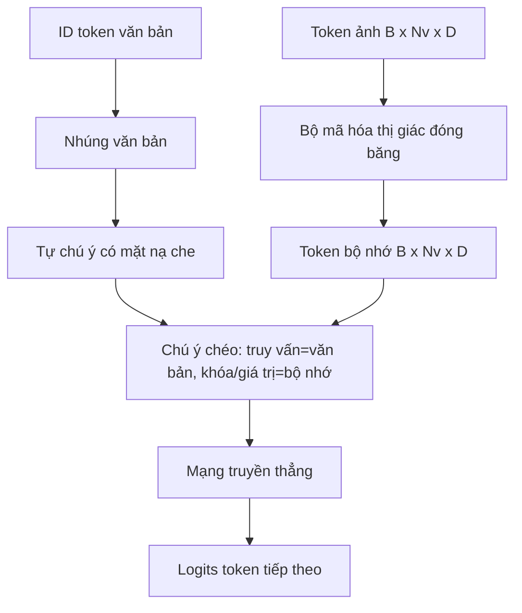
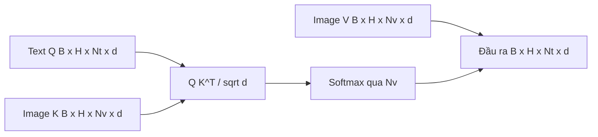

# Hợp nhất qua Chú ý Chéo (Cross-Attention Fusion)

> Tầng chiếu căn chỉnh một vector hình ảnh với một vector chú thích văn bản. Nhưng một bộ giải mã thị giác - ngôn ngữ thực thụ đòi hỏi mọi token văn bản phải có khả năng chú ý tới mọi token mảng ảnh, để mô hình có thể liên kết (ground) từng từ ngữ với một vùng không gian trong ảnh. Cơ chế chú ý chéo (cross-attention) chính là phương thức hiện thực hóa sự liên kết đó. Dòng văn bản đóng vai trò truy vấn (query); các khóa (key) và giá trị (value) của thị giác sẽ đưa ra câu trả lời. Bài học này xây dựng khối chú ý chéo, cơ chế tự chú ý nhân quả cho văn bản (causal text self-attention), và định dạng các mặt nạ (mask shapes) giúp cả hai cơ chế hoạt động chuẩn xác theo luật sinh từ.

**Type:** Build
**Languages:** Python
**Prerequisites:** Phase 19 lessons 30-37 (Track B foundations)
**Time:** ~90 phút

## Mục tiêu Học tập

- Hiện thực hóa cơ chế chú ý chéo đa đầu (multi-head cross-attention) trong đó luồng truy vấn (query) là văn bản và luồng khóa/giá trị (key/value) là thị giác.
- Xây dựng một khối giải mã (decoder block) hoàn chỉnh: tự chú ý nhân quả + chú ý chéo + mạng truyền thẳng.
- Thiết lập chuẩn xác kích thước các mặt nạ (mask shapes): mặt nạ nhân quả cho cơ chế tự chú ý, không dùng mặt nạ cho cơ chế chú ý chéo.
- Thực hiện một lượt lan truyền xuôi với các token văn bản theo batch và một kho token hình ảnh cố định.

## Vấn đề Cần giải quyết

Nối các token hình ảnh và token văn bản thành một chuỗi duy nhất là một giải pháp kết hợp (hợp nhất sớm - early fusion, con đường mà Chameleon và Emu3 lựa chọn). Cơ chế chú ý chéo là một giải pháp khác (hợp nhất muộn - late fusion, con đường do Flamingo tiên phong và hầu hết các bộ giải mã dạng Flamingo từ đó đến nay đều áp dụng). Trong phương thức hợp nhất muộn, bộ giải mã văn bản hoạt động trên các token thuần văn bản và vươn sang luồng hình ảnh thông qua cơ chế chú ý chéo ở từng tầng mạng.

Hợp nhất muộn mang lại hai lợi thế lớn. Thứ nhất, luồng văn bản được giữ thuần khiết, giúp mô hình bảo toàn trọn vẹn năng lực xử lý ngôn ngữ sẵn có. Thứ hai, luồng hình ảnh chỉ cần tính toán một lần duy nhất cho mỗi bức ảnh và được tái sử dụng cho mọi bước giải mã tiếp theo, giúp cho quá trình sinh văn bản cực kỳ tiết kiệm tài nguyên ngay cả với những câu chú thích dài. Đổi lại, ta phải chấp nhận bổ sung thêm một tầng con chú ý trong mỗi khối giải mã.

## Khái niệm Cốt lõi





### Kích thước các mặt nạ

Hai cơ chế chú ý bên trong một khối giải mã đòi hỏi hai loại mặt nạ khác nhau:

| Cơ chế chú ý | Độ dài truy vấn | Độ dài khóa | Mặt nạ | Lý do |
|--------------|-----------------|-------------|--------|-------|
| Tự chú ý (Self-attention) | `Nt` (văn bản) | `Nt` (văn bản) | Nhân quả: tam giác dưới `(Nt, Nt)` | Các token văn bản không được nhìn trước tương lai trong quá trình tự hồi quy |
| Chú ý chéo (Cross-attention) | `Nt` (văn bản) | `Nv` (thị giác) | Không dùng mặt nạ | Toàn bộ bức ảnh luôn hiển thị đầy đủ đối với mọi vị trí văn bản |

Bài học này bao gồm một hàm kiểm định kích thước để nếu xảy ra nhầm lẫn giữa hai loại mặt nạ, chương trình sẽ báo lỗi `ValueError` rõ ràng thay vì âm thầm làm hỏng đường cong hội tụ của hàm mất mát.

### Tại sao không dùng mặt nạ cho cơ chế chú ý chéo?

Hình ảnh đã được quan sát toàn vẹn từ trước khi bất kỳ từ ngữ nào được sinh ra. Token thứ `t` của câu chú thích có thể thoải mái chú ý tới bất kỳ mảng ảnh nào; các mảng ảnh không hề có thứ tự thời gian. Một số biến thể Flamingo bổ sung khuôn mẫu mặt nạ theo từng mẫu khi đan xen nhiều ảnh và nhiều đoạn văn bản, nhưng đối với trường hợp một ảnh kèm một câu chú thích, cơ chế chú ý chéo được quyền nhìn thấy toàn bộ.

### Bộ nhớ đệm Khóa/Giá trị

Các khóa (keys) và giá trị (values) của hình ảnh được tính toán một lần duy nhất khi bắt đầu quá trình giải mã và được lưu trong bộ nhớ đệm (KV cache). Mỗi token văn bản mới được sinh ra sẽ tái sử dụng bộ nhớ đệm này mà không cần tính toán lại. Đây chính là yếu tố giúp tác vụ chú thích ảnh chạy cực nhanh khi suy luận: bộ mã hóa ViT nặng nề chỉ chạy đúng một lần; cơ chế chú ý chéo tái sử dụng các vector K và V cho từng bước sinh từ. Bài học sẽ hướng dẫn cấu trúc bộ nhớ đệm này và kiểm tra luồng truy xuất trúng bộ nhớ đệm (cache-hit path).

### Cấu tạo của một khối giải mã

Một khối giải mã vận hành theo chuỗi: Pre-LN -> tự chú ý -> kết nối phần dư -> Pre-LN -> chú ý chéo -> kết nối phần dư -> Pre-LN -> truyền thẳng -> kết nối phần dư. Tổng cộng ba tầng con, mỗi tầng đi kèm một tầng LayerNorm riêng. Bài báo Flamingo có bổ sung thêm một cổng hàm tanh học được (learned tanh gate) trên nhánh phần dư của chú ý chéo, khởi tạo ở mức 0, nhờ đó mô hình ngôn ngữ đóng băng lúc ban đầu hoàn toàn giữ nguyên hành vi gốc và quá trình huấn luyện diễn ra ổn định; kiến trúc chuẩn cơ sở (sử dụng ở đây) không dùng cổng này.

```python
class DecoderBlock:
    def forward(self, text_tokens, image_tokens, text_mask, cross_mask):
        text_tokens = text_tokens + self.self_attn(self.ln1(text_tokens),
                                                   mask=text_mask)
        text_tokens = text_tokens + self.cross_attn(self.ln2(text_tokens),
                                                    image_tokens,
                                                    mask=cross_mask)
        text_tokens = text_tokens + self.ffn(self.ln3(text_tokens))
        return text_tokens
```

```figure
ch-crossattn-fan
```

## Tự Xây dựng

Tệp `code/main.py` hiện thực:

- `CrossAttention(hidden, heads)`, cơ chế chú ý chéo đa đầu với các phép chiếu `q` và `kv` tách biệt.
- `CausalSelfAttention(hidden, heads)`, cơ chế tự chú ý có mặt nạ che từ bộ giải mã tiêu chuẩn.
- `DecoderBlock`, kết hợp ba tầng con với các kết nối phần dư dạng Pre-LN.
- `VisionLanguageDecoder`, bộ giải mã 4 tầng tiếp nhận đầu ra giả lập của bộ mã hóa thị giác và một bảng nhúng văn bản nhỏ.
- `causal_mask(length)`, trả về tensor boolean dạng tam giác dưới có kích thước `(length, length)`.
- Một hàm chạy thử đưa vào một batch gồm hai chuỗi văn bản độ dài 10 cùng bộ nhớ hình ảnh độ dài 197 và in ra kích thước đầu ra, kích thước mặt nạ tự chú ý, và chuẩn đầu ra của chú ý chéo tại từng vị trí.

Chạy mã nguồn:

```bash
python3 code/main.py
```

Kết quả: bộ giải mã sinh ra tensor logits có kích thước `(2, 10, text_vocab)`. Kích thước mặt nạ là `(10, 10)`. Bước kiểm tra tái sử dụng KV-cache xác nhận logits hoàn toàn đồng nhất giữa luồng dùng cache và luồng tính toán lại từ đầu.

## Ứng dụng Thực tế

Cơ chế chú ý chéo xuất hiện trong hai họ mô hình sản xuất chính:

- **Flamingo và IDEFICS:** Chèn thêm một tầng con chú ý chéo sau mỗi K khối của mô hình ngôn ngữ (với LM được đóng băng). Bộ thích ứng thị giác - ngôn ngữ chính là khối chú ý chéo cùng cổng điều khiển của nó.
- **BLIP-2:** Q-Former sử dụng cơ chế chú ý chéo từ một tập cố định 32 token truy vấn vào các đặc trưng hình ảnh, sau đó chiếu các truy vấn này vào không gian nhúng của LM.

Cấu trúc khối trong bài học này ánh xạ trực tiếp vào cả hai kiến trúc trên. Quy tắc sử dụng mặt nạ (nhân quả cho self-attention, không che cho cross-attention) là hoàn toàn tương đồng.

## Kiểm thử

Tệp `code/test_main.py` bao quát:

- Mặt nạ nhân quả có dạng tam giác dưới và khớp kích thước boolean kỳ vọng.
- Kích thước đầu ra của chú ý chéo luôn là `(B, Nt, hidden)` bất kể độ dài chuỗi khóa (key length) là bao nhiêu.
- Luồng tính toán dùng KV-cache khớp hoàn toàn với luồng không dùng cache trong phạm vi sai số dấu phẩy động.
- Sự không khớp kích thước giữa luồng văn bản và hình ảnh sẽ kích hoạt lỗi `ValueError` rõ ràng.
- Lượt lan truyền xuôi của toàn bộ bộ giải mã sinh ra đúng kích thước batch và chuỗi.

Chạy kiểm thử:

```bash
python3 -m unittest code/test_main.py
```

## Bài tập Mở rộng

1. Thêm một cổng tanh học được vào kết nối phần dư của chú ý chéo (mẹo của Flamingo) và kiểm chứng quá trình huấn luyện hội tụ từ giá trị cổng ban đầu xấp xỉ 0. Cổng bắt đầu ở mức 0 giúp mô hình khôi phục hành vi thuần văn bản trước khi hòa trộn luồng hình ảnh vào.

2. Hiện thực hóa cơ chế chú ý đan xen (interleaved attention), nơi cùng một bộ giải mã tiếp nhận nhiều hình ảnh kèm nhiều đoạn văn bản. Xây dựng ma trận mặt nạ chú ý chéo cho từng mẫu để ngăn đoạn văn bản thứ 2 chú ý tới bức ảnh thứ 1.

3. Đo đạc hiệu năng của tầng chú ý chéo so với tầng tự chú ý tại `Nt=64, Nv=576` (lưới 24x24 ở độ phân giải cao hơn). Chi phí tính toán của chú ý chéo là `Nt * Nv` và sẽ chiếm ưu thế áp đảo ở độ phân giải ảnh cao.

4. Bổ sung kỹ thuật dropout ở phía truy vấn (query-side dropout) trên bản đồ chú ý chéo và đo lường độ đa dạng của câu chú thích được sinh ra (phương sai mẫu của chú thích tăng lên khi có dropout trên bản đồ chú ý chéo).

5. Hoán đổi tầng chú ý chéo lấy một khối chú ý kiểu Q-Former, nơi một kho 32 token truy vấn cố định chú ý tới các đặc trưng hình ảnh một lần ở mỗi tầng.

## Thuật ngữ Then chốt

| Thuật ngữ | Ý nghĩa |
|-----------|---------|
| Hợp nhất muộn (Late fusion) | Văn bản và thị giác duy trì hai luồng tách biệt; chú ý chéo bắc cầu nối giữa chúng ở mỗi khối |
| Chú ý chéo (Cross-attention) | Truy vấn Q đến từ một luồng, Khóa K và Giá trị V đến từ luồng khác |
| Mặt nạ nhân quả (Causal mask) | Mặt nạ boolean tam giác dưới ngăn các vị trí nhìn trước tương lai khi tự hồi quy |
| KV cache | Các khóa và giá trị hình ảnh được lưu trữ một lần và tái sử dụng cho mọi bước giải mã |
| Token bộ nhớ (Memory tokens) | Các token hình ảnh đóng băng mà bộ giải mã vươn tới để trích xuất thông tin |

## Tài liệu Tham khảo

- Flamingo (2022) cho thiết kế hợp nhất muộn chuẩn mực với cơ chế chú ý chéo có cổng điều khiển.
- BLIP-2 (2023) cho Q-Former, một khối chú ý chéo hoạt động như một kho truy vấn học được.
- IDEFICS (2023) cho phiên bản tái tạo mã nguồn mở của công thức Flamingo.
