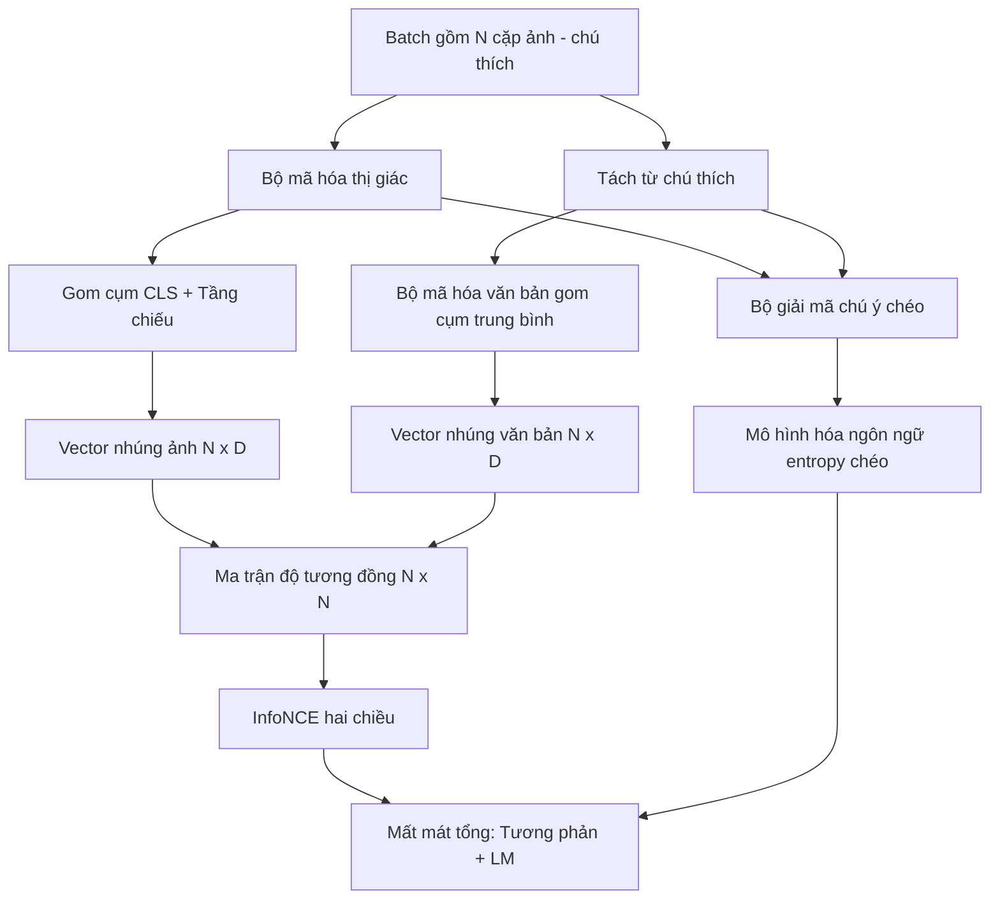

# Tiền huấn luyện Thị giác - Ngôn ngữ (Vision-Language Pretraining)

> Bộ mã hóa, tầng chiếu và bộ giải mã đã được kết nối hoàn chỉnh. Bây giờ là lúc huấn luyện chúng cùng nhau. Hai hàm mục tiêu sẽ dẫn dắt quá trình học: hàm mất mát tương phản hình ảnh - văn bản (contrastive image-text loss - InfoNCE) kéo các cặp tương ứng lại gần nhau trong không gian nhúng chung, và hàm mất mát mô hình hóa ngôn ngữ (language modeling loss) yêu cầu bộ giải mã sinh chú thích cho từng hình ảnh. Khi kết hợp lại, chúng dạy cho mạng nơ-ron cả hai năng lực: vừa tìm đúng hình ảnh cho một câu chú thích, vừa viết được câu chú thích cho một bức ảnh.

**Type:** Build
**Languages:** Python
**Prerequisites:** Phase 19 lessons 30-37 (Track B foundations)
**Time:** ~90 phút

## Mục tiêu Học tập

- Hiện thực hóa hàm mất mát tương phản InfoNCE trên một batch gồm các cặp ảnh - chú thích.
- Kết hợp hàm mất mát tương phản với hàm mất mát mô hình hóa ngôn ngữ tự hồi quy (autoregressive language modeling loss).
- Tổng hợp một ngữ liệu giả lập gồm 200 cặp ảnh - chú thích mà không cần tải bất kỳ tập dữ liệu thực tế nào.
- Thực thi vòng lặp huấn luyện mẫu 50 bước và quan sát sự sụt giảm đồng thời của cả hai hàm mất mát.

## Vấn đề Cần giải quyết

Một mô hình thị giác - ngôn ngữ đòi hỏi hai kỹ năng cốt lõi. Thứ nhất là kỹ năng xếp hạng (ranking): cho trước một câu chú thích, tìm ra bức ảnh phù hợp nhất trong số rất nhiều ảnh. Thứ hai là kỹ năng sinh nội dung (generation): cho trước một bức ảnh, viết ra câu chú thích tương ứng. Việc chỉ tiền huấn luyện mô hình trên một kỹ năng duy nhất sẽ chỉ mang lại một hệ thống bán hoàn chỉnh. CLIP xuất sắc ở bài toán xếp hạng nhưng không thể tự viết chú thích. GPT-4V có thể sinh chú thích nhưng lại cần một đầu trích xuất tìm kiếm riêng cho bài toán xếp hạng. Tiền huấn luyện đa mục tiêu (multi-objective pretraining) giải quyết cả hai bài toán này trong cùng một lượt huấn luyện.

Hàm mất mát InfoNCE đảm nhận nửa bài toán xếp hạng. Đối với một batch gồm N cặp, mô hình coi N cặp khớp nhau là mẫu dương tính (positives) và `N^2 - N` cặp cọc cạch còn lại là mẫu âm tính (negatives), sau đó tính hàm mất mát entropy chéo (cross-entropy) trên ma trận độ tương đồng `(N, N)` thu được. Hàm mất mát mô hình ngôn ngữ (LM loss) đảm nhận nửa bài toán sinh nội dung: dự đoán token tiếp theo tiêu chuẩn có điều kiện dựa trên hình ảnh. Cả hai hàm mất mát đều có thể tính đạo hàm và cùng chia sẻ trọng số của bộ mã hóa và bộ chiếu; riêng bộ giải mã chỉ được huấn luyện dựa trên hàm mất mát LM.

## Khái niệm Cốt lõi



### InfoNCE tóm gọn trong một đoạn văn

Xếp N vector nhúng hình ảnh thành các hàng và N vector nhúng văn bản thành các hàng. Chuẩn hóa L2 (L2-normalize) cho cả hai. Tính ma trận `N x N` theo công thức `S = I T^T / tau`, trong đó `tau` là tham số nhiệt độ (temperature) học được. Các phần tử trên đường chéo chính đại diện cho các cặp ăn khớp; các phần tử nằm ngoài đường chéo là các mẫu âm tính. Áp dụng entropy chéo với nhãn mục tiêu `argmax` chạy dọc đường chéo: hàng thứ `i` phải có giá trị lớn nhất tại cột thứ `i`. Thực hiện tương tự một cách đối xứng dọc theo các cột. Mất mát tổng hợp là trung bình cộng của hai chiều. Đây chính là hàm mất mát CLIP gói gọn trong tám dòng code.

### Tầm quan trọng của tham số nhiệt độ

Tham số nhiệt độ `tau` điều tiết độ sắc nhọn của hàm softmax. Nếu `tau` quá nhỏ (ví dụ `tau = 0.01`), gradient sẽ chỉ dồn về mẫu âm tính khó nhất (hardest negative), khiến quá trình huấn luyện bị nhiễu động nghiêm trọng. Nếu `tau` quá lớn, phân phối softmax bị san phẳng và gradient dần triệt tiêu. CLIP coi `tau` như một tham số có thể học được; phần thực nghiệm trong bài học này cũng áp dụng đúng cơ chế đó.

### Hàm mất mát mô hình hóa ngôn ngữ

Bộ giải mã tiếp nhận các token bộ nhớ hình ảnh thông qua cơ chế chú ý chéo và dự đoán token văn bản tiếp theo tại mọi vị trí. Hàm mất mát là entropy chéo tiêu chuẩn với nhãn là token ở vị trí kế tiếp. Các vị trí đệm (padding) được che mặt nạ để loại bỏ khỏi phép tính mất mát.

### Kết hợp các hàm mất mát

Công thức tổng quát: `total = contrastive + lm_weight * lm`, trong đó `lm_weight` là một hệ số vô hướng (thường đặt là 1.0). Hai hàm mất mát này cùng truyền gradient vào bộ mã hóa và tầng chiếu; bộ giải mã chỉ nhận gradient từ hàm mất mát LM. Đây là công thức đa tác vụ (multi-task) mà CoCa và BLIP sử dụng với nhiều tỷ lệ trọng số khác nhau. Trong khi đó, SigLIP chỉ giữ lại thành phần tương phản và thay thế softmax bằng hàm mất mát cặp sigmoid (sigmoid pair loss).

| Thành phần | Không gian mất mát | Tác động tới |
|------------|--------------------|--------------|
| InfoNCE | Xếp hạng cặp trong không gian chung | Bộ mã hóa + Tầng chiếu + Đầu văn bản |
| LM | Dự đoán token có điều kiện dựa trên ảnh | Bộ mã hóa + Tầng chiếu + Bộ giải mã |
| Kết hợp | Đa tác vụ (Multi-task) | Toàn bộ hệ thống |

### Tại sao 50 bước là đủ cho một bản chạy thử?

Ngữ liệu giả lập là một tập dữ liệu tổng hợp gồm 200 cặp với các ảnh ngẫu nhiên và chuỗi ID chú thích ngẫu nhiên. Sau 50 bước tối ưu SGD với kích thước batch 16, cả hai hàm mất mát đều giảm rõ rệt mặc dù giá trị tuyệt đối vẫn cao hơn so với kết quả đạt được trên dữ liệu thực tế. Mục đích của bản chạy thử là xác nhận hệ thống đường ống gradient hoạt động trơn tru từ đầu đến cuối và việc bổ sung hàm mất mát LM không làm mất ổn định mục tiêu tương phản.

```figure
ch-infonce-diagonal
```

## Tự Xây dựng

Tệp `code/main.py` hiện thực:

- `MultimodalModel`, kết hợp một bộ mã hóa ViT nhỏ, bộ chiếu MLP, một bộ mã hóa văn bản nhỏ (gom cụm trung bình trên các ID đã nhúng), và bộ giải mã chú ý chéo từ Bài học 61.
- `info_nce_loss(image_emb, text_emb, temperature)`, hàm mất mát tương phản hai chiều kiểu CLIP.
- `lm_loss(logits, target_ids, padding_id)`, entropy chéo dự đoán token tiếp theo có mặt nạ che đệm.
- `make_mock_corpus(seed, n_pairs)`, trả về 200 cặp (ảnh, caption_ids) tất định.
- Vòng lặp huấn luyện chạy 50 bước với kích thước batch 16, bộ tối ưu hóa Adam, và một tham số log-nhiệt độ học được. Cả hai hàm mất mát được in ra sau mỗi 5 bước.

Chạy mã nguồn:

```bash
python3 code/main.py
```

Kết quả: mất mát tương phản giảm từ khoảng `ln(16) = 2.77` xuống gần 2.4; mất mát LM giảm từ đường cơ sở ngẫu nhiên đều `ln(512) ≈ 6.24` xuống khoảng 4.7. Cả hai chiều hướng giảm chứng minh hệ thống gradient đã được kết nối chuẩn xác. Các mô hình thực tế huấn luyện hàng triệu bước; động lực học diễn ra hoàn toàn tương tự.

## Ứng dụng Thực tế

Đây chính là công thức hàm mất mát được áp dụng trong:

- **CLIP (2021):** Chỉ dùng hàm tương phản ảnh - văn bản, kèm theo một bộ dò chú thích với bộ mã hóa đóng băng riêng biệt.
- **CoCa (2022):** Kết hợp tương phản ảnh - văn bản cùng hàm mất mát LM chú thích ảnh trong một mô hình duy nhất. Đúng theo khuôn mẫu bài học này xây dựng.
- **BLIP (2022) và BLIP-2:** Kết hợp tương phản + LM + đầu khớp nối ảnh - văn bản (image-text matching head). Ba hàm mất mát cùng lúc.
- **SigLIP (2023):** Chuyển từ InfoNCE sang hàm mất mát cặp sigmoid; cùng vai trò tương phản nhưng dạng hàm toán học khác nhau.
- **Họ mô hình LLaVA:** Quy trình huấn luyện hai giai đoạn, giai đoạn một là căn chỉnh phương thức (cosine trên LM đóng băng) và giai đoạn hai bổ sung hàm mất mát LM khi đã mở đóng băng LM. Bài học 60 tương ứng với giai đoạn một; bài học này tương ứng với giai đoạn hai.

## Kiểm thử

Tệp `code/test_main.py` bao quát:

- Hàm mất mát InfoNCE đảm bảo tính đối xứng qua các hàng ảnh/văn bản.
- Hàm mất mát InfoNCE trả về 0 khi ma trận độ tương đồng là đường chéo hoàn hảo với các giá trị dương lớn.
- Hàm mất mát LM che chuẩn xác các vị trí đệm (padding).
- Lượt lan truyền xuôi của mô hình tạo ra cả hai hàm mất mát mà không gặp lỗi.
- Vòng lặp huấn luyện 5 bước thực sự làm giảm hàm mất mát kết hợp.

Chạy kiểm thử:

```bash
python3 -m unittest code/test_main.py
```

## Bài tập Mở rộng

1. Thay thế InfoNCE bằng hàm mất mát cặp sigmoid kiểu SigLIP và so sánh tốc độ hội tụ trên ngữ liệu giả lập.

2. Thêm một bước khai thác mẫu âm tính khó (hard-negative mining): sau mỗi batch xen kẽ, chọn ra cặp ngoài đường chéo khó nhất từ batch trước và đưa thêm vào. Huấn luyện và quan sát xem mất mát tương phản có giảm nhanh hơn không.

3. Bổ sung một đầu nhị phân khớp nối hình ảnh - văn bản (đúng/sai: hai thành phần này có khớp nhau không?) phía trên không gian nhúng chung để tạo hàm mất mát thứ ba, tái lập cấu trúc 3 đầu của BLIP.

4. Thay thế ngữ liệu giả lập bằng các chuỗi caption-id được sinh ra từ một xích Markov (Markov chain) có ma trận chuyển tiếp phụ thuộc vào giá trị băm (hash) của bức ảnh. Mất mát chú thích sẽ giảm sâu hơn vì lúc này dữ liệu đã có tín hiệu thực sự để học.

5. Huấn luyện cùng mô hình với `lm_weight = 0` và lặp lại với `lm_weight = 1`. So sánh mất mát tương phản; hàm mất mát LM không được làm suy giảm hiệu năng của mục tiêu xếp hạng.

## Thuật ngữ Then chốt

| Thuật ngữ | Ý nghĩa |
|-----------|---------|
| InfoNCE | Ước lượng tương phản nhiễu (Noise contrastive estimation): entropy chéo trên ma trận tương đồng |
| Nhiệt độ (Temperature) | Hệ số vô hướng điều khiển độ sắc nhọn của phân phối softmax tương phản |
| Mẫu âm tính khó (Hard negative) | Cặp mẫu ngoài đường chéo khiến mô hình dễ nhầm lẫn, rất hữu ích cho việc lấy mẫu |
| Mất mát LM (LM loss) | Hàm entropy chéo dự đoán token tiếp theo tiêu chuẩn ở phía sinh chú thích |
| Không gian nhúng chung (Joint embedding space) | Không gian chia sẻ nơi các vector ảnh và văn bản cùng tồn tại sau khi chiếu |

## Tài liệu Tham khảo

- Bài báo CLIP cho công thức học tương phản nguyên bản.
- Bài báo CoCa cho phương pháp kết hợp tương phản và chú thích trong một mô hình.
- Bài báo SigLIP cho biến thể mất mát cặp sigmoid và lý do nó mở rộng quy mô tốt hơn.
