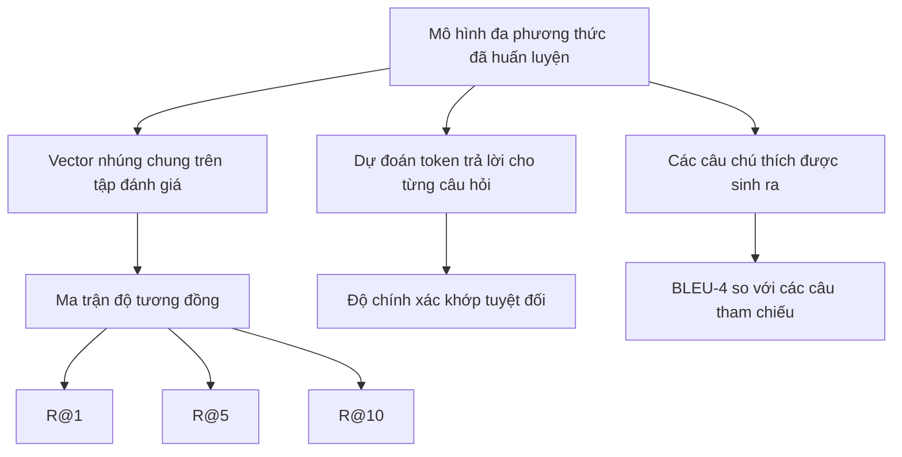

# Đánh giá Đa phương thức (Multimodal Evaluation)

> Huấn luyện mới chỉ là một nửa chu trình. Nửa còn lại là đo lường đánh giá. Bài học này xây dựng ba diện mạo đánh giá (evaluation surfaces) từ các thành phần nguyên thủy: truy xuất ảnh - chú thích được báo cáo dưới dạng R@1, R@5, R@10; trả lời câu hỏi thị giác (VQA) được báo cáo bằng độ chính xác khớp tuyệt đối (exact match accuracy); và chú thích hình ảnh được báo cáo bằng chỉ số BLEU-4. Mỗi thước đo là một hàm toán học xử lý đầu ra của mô hình trên một bộ dữ liệu đánh giá tổng hợp chạy xong trong vài giây.

**Type:** Build
**Languages:** Python
**Prerequisites:** Phase 19 lessons 58-62 (Track E foundations: encoder, transformer, projection, cross-attention fusion, pretraining)
**Time:** ~90 phút

## Mục tiêu Học tập

- Tính toán Recall@K từ ma trận độ tương đồng giữa các vector nhúng hình ảnh và chú thích.
- Tính toán độ chính xác khớp tuyệt đối (exact-match) cho VQA từ một mô hình ánh xạ các cặp (ảnh, câu hỏi) sang một tập từ vựng câu trả lời cố định.
- Tính toán chỉ số BLEU-4 từ chuỗi token sinh ra và các chuỗi token tham chiếu mà không cần bất kỳ thư viện bên ngoài nào.
- Thực thi cả ba bài đánh giá trên bộ kiểm thử tổng hợp được xây dựng dựa trên mô hình đã huấn luyện từ Bài học 62.

## Vấn đề Cần giải quyết

Chúng ta rất dễ mắc phải cái bẫy tuyên bố một mô hình đa phương thức đã hoàn thiện chỉ vì hàm mất mát trong quá trình huấn luyện đã chững lại (plateau). Mất mát huấn luyện chỉ đo lường mức độ khớp trên phân phối dữ liệu huấn luyện; nó không thể đo lường xem liệu mô hình có thể xếp hạng các cặp mẫu trong một tập kiểm thử tách biệt (held-out batch), trả lời một câu hỏi, hay viết ra một câu chú thích mà con người có thể chấp nhận được hay không. Ba phương thức đánh giá tiêu chuẩn trong ngành gồm có:

- **Truy xuất (R@1, R@5, R@10):** Xây dựng vector nhúng trong không gian chung cho câu chú thích truy vấn; xếp hạng mọi bức ảnh trong kho đánh giá theo độ tương đồng cosine; báo cáo xem liệu bức ảnh tương ứng có rơi vào top 1, top 5, top 10 hay không. Dạng đối xứng (từ ảnh sang văn bản) cũng chạy theo cách tương tự.
- **Trả lời câu hỏi thị giác (Visual question answering - VQA khớp tuyệt đối):** Cho trước cặp (ảnh, câu hỏi), mô hình đưa ra một token câu trả lời. Khớp tuyệt đối là thước đo 1-bit trên mỗi mẫu: câu trả lời dự đoán có trùng khớp hoàn toàn với câu trả lời tham chiếu hay không? Lấy trung bình trên toàn bộ tập đánh giá.
- **Chú thích hình ảnh (BLEU-4):** Sinh một câu chú thích. Tính trung bình nhân của độ chuẩn xác (precisions) từ 1-gram đến 4-gram so với các câu chú thích tham chiếu, có áp dụng hệ số phạt độ dài ngắn (brevity penalty). Chuẩn mực là sử dụng đa tham chiếu (multi-reference: một ảnh đi kèm nhiều câu chú thích tham chiếu của con người).

Mỗi thước đo thực chất là một hàm toán học ngắn gọn. Bài học này tự tay hiện thực hóa tất cả chúng trong mã nguồn để công thức toán học trở nên cụ thể và toàn bộ quy trình luôn nằm trong tầm kiểm soát của bạn. Các bộ tiêu chuẩn thực tế (MS-COCO, VQA v2, GQA, OK-VQA) đều cắm vào những cấu trúc hàm y hệt như vậy.

## Khái niệm Cốt lõi



### Tính Recall@K từ ma trận tương đồng

Xây dựng ma trận tương đồng cosine `(N, N)` giữa các vector nhúng ảnh và chú thích. Với mỗi hàng, sắp xếp các cột theo thứ tự độ tương đồng giảm dần. Recall@K là tỷ lệ số hàng mà trong đó chỉ số cột trên đường chéo chính nằm trong top K vị trí dẫn đầu. Recall@K đối xứng (từ chú thích sang ảnh) được tính toán trên ma trận chuyển vị. Cả hai chỉ số đều được báo cáo. Đối với một tập đánh giá gồm N=100 mẫu, R@1 = 0.6 có nghĩa là 60 trong số 100 câu chú thích đã tìm đúng bức ảnh tương ứng ở vị trí đầu tiên.

### VQA khớp tuyệt đối

Với mỗi bộ ba (ảnh, câu hỏi, câu trả lời), mã hóa bức ảnh, nhúng câu hỏi, hợp nhất chúng qua bộ giải mã và đọc ra token tiếp theo. ID token dự đoán được so sánh với ID tham chiếu; tính là đúng nếu chúng bằng nhau. Lấy trung bình trên tập đánh giá. Các tập dữ liệu VQA thực tế thường đi kèm nhiều câu trả lời do người gán nhãn và sử dụng công thức tính độ chính xác mềm (soft-accuracy: đạt 1.0 nếu có ít nhất 3 trong số 10 người gán nhãn đồng thuận, tỷ lệ giảm dần bên dưới); bài học này sử dụng so khớp tuyệt đối với một câu trả lời duy nhất để giữ tính mạch lạc, sáng sủa.

### Chỉ số BLEU-4

```math
\text{BLEU-4} = \text{BP} \cdot \exp\big(\text{mean}(\log p_1, \log p_2, \log p_3, \log p_4)\big)
```

Trong đó `p_n` là độ chuẩn xác n-gram có hiệu chỉnh (số lượng n-gram sinh ra xuất hiện trong bất kỳ câu tham chiếu nào, bị chặn trên bởi số lần xuất hiện tối đa của nó trong tham chiếu, chia cho tổng số n-gram sinh ra), và `BP` là hệ số phạt độ dài ngắn (brevity penalty):

```math
\text{BP} = \begin{cases} 1 & \text{nếu độ dài sinh ra} > \text{độ dài tham chiếu} \\ \exp(1 - r/g) & \text{trường hợp khác, với } r \text{ là độ dài tham chiếu và } g \text{ là độ dài sinh ra} \end{cases}
```

Kỹ thuật làm mịn (smoothing) là bắt buộc cho các mẫu nhỏ nơi một số giá trị `p_n` có thể bằng 0. Bản hiện thực áp dụng phương pháp 1 của Chen và Cherry (cộng 1 vào cả tử số và mẫu số cho bất kỳ tần suất nào bằng 0), đây là lựa chọn mặc định an toàn nhất khi số lượng mẫu còn nhỏ.

### Bộ kiểm thử tổng hợp

Một bộ kiểm thử gồm 50 mẫu được tạo ra trong bộ nhớ dựa trên khuôn mẫu ngữ liệu giả lập từ Bài học 62, nhưng với một hạt giống (seed) tách biệt hoàn toàn. Bộ kiểm thử bao gồm ba danh sách:

- `pairs`: 50 cặp (ảnh, caption_ids) phục vụ bài toán truy xuất.
- `vqa`: 50 bộ ba (ảnh, question_ids, answer_id).
- `caps`: 50 mục (ảnh, [reference_caption_ids, ...]) với tối đa 3 câu chú thích tham chiếu cho mỗi ảnh.

Bộ kiểm thử này có tính tất định từ hạt giống và được giữ tách biệt (held-out) khỏi ngữ liệu huấn luyện, vì vậy các thước đo được tính toán trên dữ liệu mà mô hình chưa bao giờ nhìn thấy. Việc lưu bộ kiểm thử ra tệp JSON được để lại như một bài tập tự rèn luyện.

| Thước đo | Miền giá trị | Đường cơ sở ngẫu nhiên (N=50) |
|----------|--------------|-------------------------------|
| R@1 | 0 đến 1 | 0.02 (1 / N) |
| R@5 | 0 đến 1 | 0.10 |
| R@10 | 0 đến 1 | 0.20 |
| VQA EM | 0 đến 1 | 1 / vocab |
| BLEU-4 | 0 đến 1 | Nhỏ nhưng khác không |

Đối với một lượt chạy huấn luyện 50 bước trên dữ liệu tổng hợp, các thước đo không kỳ vọng đạt mức cao tuyệt đối; chúng chỉ cần vượt lên trên đường cơ sở ngẫu nhiên, và đó chính là điều mà bản chạy thử sẽ kiểm tra.

```figure
ch-recall-window
```

## Tự Xây dựng

Tệp `code/main.py` hiện thực:

- `recall_at_k(sim_matrix, k)`, trả về một số thực trong khoảng `[0, 1]` cho cả hai chiều truy xuất.
- `vqa_exact_match(predictions, references)`, trả về giá trị trung bình phép so sánh bằng giữa các số nguyên.
- `bleu4(generated, references, smoothing=True)`, hỗ trợ đa tham chiếu.
- `build_eval_suite(seed, n_samples, vocab_size, max_len)`, trả về ba danh sách đánh giá tất định.
- `evaluate(model, suite)`, thực thi cả ba thước đo và trả về một `dict` chứa các con số kết quả.
- Một bản chạy thử tải mô hình đa phương thức mới khởi tạo từ Bài học 62, đánh giá mô hình, sau đó huấn luyện trong 50 bước rồi đánh giá lại, in ra bảng so sánh số liệu trước và sau huấn luyện.

Chạy mã nguồn:

```bash
python3 code/main.py
```

Kết quả: bảng số liệu trước/sau cho thấy năng lực truy xuất cải thiện rõ rệt từ mức gần như ngẫu nhiên tiến dần theo tín hiệu mô hình học được, độ chính xác VQA vượt lên trên mức ngẫu nhiên, và điểm BLEU-4 tăng lên (cấu trúc tổng hợp mang đủ tín hiệu để cải thiện độ chuẩn xác 4-gram).

## Ứng dụng Thực tế

Mỗi thước đo ánh xạ trực tiếp vào một bộ tiêu chuẩn thực tế trong công nghiệp:

- **Truy xuất:** Tập MS-COCO 5K val và Flickr30K đều là bài toán R@K trên cùng một ma trận độ tương đồng. Bài toán zero-shot trên ImageNet cũng sử dụng ma trận đó, với mỗi lớp tương ứng một vector nhúng câu gợi ý (prompt embedding), nhưng báo cáo độ chính xác phân loại top-1 (chính là R@1 trên các prompt của các lớp). Chỉ cần thay dữ liệu tổng hợp bằng các tệp thực tế, chữ ký hàm (signature) hoàn toàn không thay đổi.
- **VQA:** VQA v2, GQA, OK-VQA đều sử dụng cùng dạng khớp tuyệt đối (với soft-accuracy thay cho EM đơn lẻ đối với VQA v2).
- **BLEU-4:** Tác vụ chú thích ảnh trên MS-COCO, NoCaps, Flickr30K đều sử dụng BLEU-4 kết hợp với CIDEr và METEOR. Việc thêm thước đo CIDEr chỉ đơn thuần là viết thêm một hàm tính toán.

Khi kiểm thử trên các bộ chuẩn thực tế, bạn chỉ cần thay `build_eval_suite` bằng một bộ nạp dữ liệu thật và giữ nguyên thân các hàm đo lường. Bản chất toán học là hoàn toàn độc lập với tập dữ liệu chuẩn.

## Kiểm thử

Tệp `code/test_main.py` bao quát:

- Hàm recall@k trả về 1.0 trên ma trận tương đồng đơn vị hoàn hảo và trả về 0.0 trên ma trận bị đảo ngược với k < N.
- Hàm recall@k tuân thủ cận trên `k <= N`.
- Hàm bleu4 trả về 1.0 khi chuỗi sinh ra trùng khớp hoàn toàn với một trong các câu tham chiếu.
- Hàm bleu4 trả về 0.0 khi tập từ vựng hoàn toàn rời nhau.
- Độ chính xác khớp tuyệt đối VQA bằng đúng tỷ lệ các cặp trùng khớp.
- Hàm build_eval_suite trả về đúng số lượng cặp ảnh-chú thích, câu hỏi VQA và mục chú thích kỳ vọng.

Chạy kiểm thử:

```bash
python3 -m unittest code/test_main.py
```

## Bài tập Mở rộng

1. Bổ sung thước đo CIDEr vào nhóm các chỉ số chú thích ảnh. CIDEr sử dụng trọng số TF-IDF trên các n-gram, giúp tưởng thưởng thích đáng cho các token mang nhiều thông tin.

2. Hiện thực hóa độ chính xác mềm (soft-accuracy) cho VQA: mỗi câu hỏi có nhiều câu trả lời của con người, độ chính xác là `min(human_count / 3, 1)` nếu có câu trả lời trùng khớp. Tái lập cách tính của VQA v2.

3. Xây dựng một biến thể an toàn với giá trị NaN cho `bleu4` để xử lý mượt mà các chuỗi sinh ra bị rỗng mà không gây sập chương trình.

4. Tính toán hạng nghịch đảo trung bình (Mean Reciprocal Rank - MRR) song song với R@K. MRR nhạy cảm với vị trí chính xác của mục tiêu khi nó nằm ngoài top K; trong khi R@K chỉ quan tâm mục tiêu có nằm trong top K hay không.

5. Thực hiện đánh giá mô hình tại 6 điểm kiểm tra (checkpoints) trong quá trình huấn luyện (bước 0, 10, 20, 30, 40, 50) và vẽ đường cong học tập. Xác nhận xem quỹ đạo của các thước đo có bám sát quỹ đạo giảm của hàm mất mát hay không.

## Thuật ngữ Then chốt

| Thuật ngữ | Ý nghĩa |
|-----------|---------|
| R@K | Tỷ lệ các truy vấn mà trong đó kết quả đúng nằm trong top K kết quả hàng đầu |
| Khớp tuyệt đối (Exact match) | Cách chấm điểm VQA đơn giản nhất: câu trả lời dự đoán trùng khớp hoàn toàn với đáp án tham chiếu |
| BLEU-4 | Trung bình nhân độ chuẩn xác của các n-gram từ 1 đến 4, có kèm hệ số phạt độ dài ngắn |
| Đa tham chiếu (Multi-reference) | Thước đo chú thích chấp nhận nhiều câu chú thích tham chiếu cho cùng một bức ảnh |
| Giữ tách biệt (Held-out) | Tập đánh giá được lấy mẫu từ một hạt giống độc lập hoàn toàn với ngữ liệu huấn luyện |

## Tài liệu Tham khảo

- Bài báo VQA v2 về công thức tính độ chính xác mềm và các thống kê tập dữ liệu.
- Bài báo CIDEr về phương pháp đánh giá chú thích ảnh dựa trên n-gram có trọng số TF-IDF.
- Bài báo BLEU gốc (Papineni et al., 2002) về các biến thể kỹ thuật làm mịn.
- Các tập lệnh đánh giá chú thích ảnh của MS-COCO để tham khảo cách triển khai chuẩn mực.
