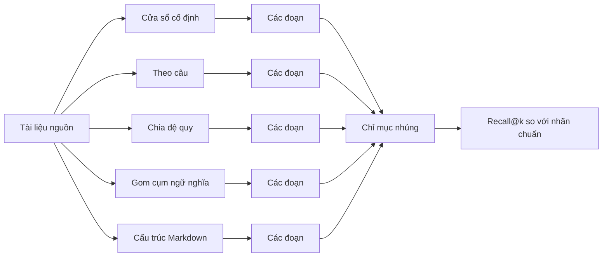

# So sánh các Chiến lược Phân đoạn Văn bản (Chunking Strategies, Compared)

> Phân đoạn văn bản (chunking) quyết định trần năng lực những gì mà hệ thống truy xuất của bạn có thể tìm thấy. Xác định sai ranh giới phân đoạn thì không một mô hình nhúng (embedding model), không một bộ tái xếp hạng (reranker), và không một LLM nào có thể cứu vãn được thiệt hại ở các bước xử lý phía sau.

**Type:** Build
**Languages:** Python
**Prerequisites:** Phase 11 lessons 04 (embeddings), 06 (RAG), 07 (advanced RAG); Phase 19 Track B foundations (lessons 20-29)
**Time:** ~90 phút

## Mục tiêu Học tập

- Tự tay hiện thực hóa từ đầu năm chiến lược phân đoạn văn bản: cửa sổ cố định (fixed-window), theo câu (sentence), chia đệ quy (recursive-split), gom cụm ngữ nghĩa (semantic clustering), và theo tiêu đề cấu trúc markdown (structural markdown headers).
- Đo lường chỉ số Recall@K trên một ngữ liệu kiểm thử có gán nhãn chuẩn (gold-labeled answer spans) và giải thích tại sao một chiến lược chiến thắng trên văn xuôi trong khi một chiến lược khác lại áp đảo trên tài liệu kỹ thuật.
- Đọc biểu đồ phân phối độ dài đoạn văn bản và nhận diện các dạng lỗi điển hình (failure modes) mà mỗi chiến lược có thể gây ra: câu mồ côi (orphan sentences), cắt ngang ký hiệu/từ (mid-symbol cuts), đoạn chỉ chứa tiêu đề (header-only chunks), trôi dạt ngữ nghĩa (semantic drift).
- Lựa chọn chiến lược mặc định cho một ngữ liệu mới mà không cần chạy benchmark thông qua việc kiểm tra ba thuộc tính: loại tài liệu, độ dài đoạn văn trung bình, và định dạng văn bản có mang cấu trúc tường minh hay không.

## Vấn đề Cần giải quyết

Mọi đường ống RAG (Retrieval-Augmented Generation) đều bắt đầu bằng việc cắt nhỏ các tài liệu nguồn thành các mảnh đủ nhỏ để mô hình nhúng có thể xử lý vừa vặn, nhưng cũng phải đủ lớn để mỗi mảnh mang trọn vẹn một ý tưởng hoàn chỉnh. Quyết định cắt ở đâu không đơn thuần là một siêu tham số (hyperparameter). Nó chính là giới hạn trên tuyệt đối (upper bound) cho những gì bộ truy xuất có thể tìm về.

Một câu truy vấn hỏi: "ngưỡng hủy bỏ ngân sách (budget abort threshold) được thiết lập như thế nào?" chỉ có thể trả lời thành công nếu đoạn văn bản chứa giá trị ngưỡng đó được truy xuất ra. Nếu bộ phân đoạn cửa sổ cố định vô tình cắt rời giá trị ngưỡng khỏi ngữ cảnh xung quanh, vector nhúng sẽ bị đẩy sang một cụm khác, điểm BM25 giảm mạnh, bộ tái xếp hạng chỉ nhìn thấy tín hiệu nhiễu, và câu trả lời mà LLM tạo ra sẽ sai lệch hoàn toàn. Bài báo năm 2024 "LongRAG: Enhancing Retrieval-Augmented Generation with Long-context LLMs" đã đo lường được mức dao động tuyệt đối lên tới 35% về chỉ số recall của hệ thống truy xuất chỉ xuất phát từ lựa chọn chiến lược phân đoạn. Công trình tiếp nối vào năm 2025 về tiêu đề đoạn theo ngữ cảnh (contextual chunk headers) đã thu hẹp khoảng cách này nhưng vẫn chưa thể xóa bỏ hoàn toàn.

Bài học này xây dựng năm chiến lược song song cạnh nhau, chạy thực nghiệm đối soát chúng trên một ngữ liệu mẫu có gán nhãn chuẩn các đoạn chứa câu trả lời, giúp bạn trực tiếp quan sát và đánh giá các con số recall thực tế.

## Khái niệm Cốt lõi



### Phân đoạn cửa sổ cố định

Phương pháp đường cơ sở dạng vét cạn (brute-force). Cắt văn bản sau mỗi N ký tự. Có thể tùy chọn thêm phần chồng lấn (overlap) để một câu bị cắt ở vị trí N sẽ xuất hiện trọn vẹn trong đoạn kế tiếp bắt đầu từ vị trí N - overlap. Nhanh, tất định, nhưng cực kỳ tệ tại các ranh giới tự nhiên. Hãy dùng nó làm mốc đối chứng (control), đừng chọn làm mặc định.

### Phân đoạn theo câu

Tách văn bản tại ranh giới các câu bằng biểu thức chính quy (regex) hoặc một máy trạng thái (state machine) đơn giản. Đóng gói một hoặc nhiều câu vào một đoạn cho đến khi chạm ngân sách ký tự mục tiêu. Phương pháp này chấm dứt tình trạng cắt đứt ngang từ. Tuy nhiên, nó vẫn có thể cắt ngang đoạn văn (paragraph) và ngang phần (section). Đây là lựa chọn mặc định trong nhiều đường ống RAG thời kỳ đầu và là giải pháp hợp lý cho văn xuôi không có cấu trúc đặc biệt.

### Phân đoạn chia đệ quy

Chiến lược phân cấp được phổ biến rộng rãi bởi các thư viện AI giai đoạn 2023. Hệ thống cố gắng tách tại dấu phân cách mạnh nhất trước (xuống dòng đôi, phân tách đoạn văn), nếu không vừa thì lùi dần về mức tiếp theo (xuống dòng đơn), rồi đến ranh giới câu, và cuối cùng mới cắt theo ký tự. Đệ quy dừng lại khi đoạn văn bản đã nằm gọn trong ngân sách độ dài. Rất mạnh mẽ trên các tài liệu có cấu trúc không đồng nhất vì nó tự thích ứng theo từng vùng văn bản.

### Gom cụm ngữ nghĩa

Nhúng vector cho từng câu riêng lẻ. Gom cụm các câu liền kề chia sẻ chung một trọng tâm chủ đề (topic centroid). Cắt đoạn bất cứ khi nào độ tương đồng liên tục so với trọng tâm giảm xuống dưới một ngưỡng xác định. Ranh giới phản ánh ý nghĩa ngữ nghĩa chứ không dựa vào số lượng ký tự. Tốn nhiều thời gian xử lý hơn và phụ thuộc vào chất lượng của mô hình nhúng, nhưng có khả năng chống chịu tốt trước những tài liệu thay đổi chủ đề đột ngột ngay bên trong một đoạn văn.

### Phân đoạn theo cấu trúc tiêu đề Markdown

Đối với các tài liệu mang cấu trúc rõ ràng (markdown, reStructuredText, tài liệu tiêu chuẩn dạng RFC với các mục đánh số), ta cắt tại ranh giới các tiêu đề (headings). Mỗi đoạn trở thành tiêu đề cộng với toàn bộ nội dung nằm bên dưới nó cho đến tiêu đề tiếp theo có cùng cấp hoặc cấp cao hơn. Tạo ra các đoạn nhỏ gọn nhất theo từng chủ đề, nhưng chỉ áp dụng được khi ngữ liệu có định dạng chuẩn chỉnh.

### Cách đo lường Recall@K đánh giá lựa chọn ranh giới

Mỗi câu truy vấn có gán nhãn chuẩn sẽ mang vị trí ký tự chính xác (character offsets) của đoạn văn bản chứa câu trả lời trong tài liệu nguồn. Sau khi phân đoạn và truy xuất, ta đặt câu hỏi: có bất kỳ đoạn nào trong top-k đoạn mà bộ truy xuất trả về chồng lấn với đoạn nhãn chuẩn hay không? Nếu có, recall@k cho truy vấn đó bằng 1. Nếu không, bằng 0. Lấy giá trị trung bình trên toàn bộ tập câu hỏi. Chạy cùng bài đánh giá này cho từng chiến lược, mức độ chênh lệch kết quả sẽ chỉ rõ chính sách ranh giới nào tồn tại tốt nhất trên ngữ liệu bạn đang có.

```figure
ci-chunk-boundaries
```

## Tự Xây dựng

Tệp `code/main.py` hiện thực:

- `fixed_window(text, size, overlap)` - phương pháp cơ sở.
- `sentence_chunks(text, target)` - bộ đóng gói câu đơn giản.
- `recursive_split(text, separators, target)` - phân tách đệ quy có thứ bậc.
- `semantic_chunks(text, similarity_threshold)` - gom cụm dựa trên trọng tâm (centroid) trên nền mô hình nhúng giả lập tất định.
- `structural_markdown(text)` - bộ phân đoạn nhận biết tiêu đề.
- `mock_embed(text, dim)` - mô hình nhúng dựa trên hàm băm (hash-based) giúp vòng lặp chạy ngoại tuyến hoàn toàn.
- `DenseIndex` - chỉ mục mật độ tương tự cấu trúc dùng trong bài truy xuất lai của Track B, Phase 19.
- `eval_recall(strategy, corpus, queries, k)` - vòng lặp đánh giá so sánh.
- Hàm `main()` chạy tất cả các chiến lược trên ngữ liệu mẫu và in bảng so sánh recall@k.

Chạy mã nguồn:

```bash
python3 code/main.py
```

Kết quả hiển thị một bảng gọn gàng với mỗi hàng là một chiến lược và mỗi cột là một giá trị k. Phân đoạn theo câu thua trên ngữ liệu có cấu trúc. Phân đoạn theo cấu trúc markdown chiến thắng áp đảo trên ngữ liệu markdown. Phân đoạn đệ quy giữ vững phong độ ổn định trên ngữ liệu hỗn hợp vì tính thích ứng của cơ chế đệ quy. Gom cụm ngữ nghĩa giành chiến thắng trên ngữ liệu văn xuôi thuần túy nơi không có các chỉ dấu cấu trúc rõ rệt.

## Các dạng lỗi mà bảng số liệu không thể che giấu

**Câu mồ côi (Orphan sentences):** Việc đóng gói câu đơn thuần tạo ra các đoạn bị thiếu mất câu chủ đề mở đoạn (topic sentence). Hậu quả là vector nhúng sẽ trỏ sai sang một cụm chủ đề khác.

**Cắt ngang ký hiệu (Mid-symbol cuts):** Cửa sổ cố định áp dụng bên trong mã nguồn hoặc tệp cấu hình YAML sẽ chém đôi một định danh biến hay hàm. Hai nửa bị chia cắt sẽ bị nhúng thành các vector nhiễu vô nghĩa.

**Đoạn chỉ chứa tiêu đề (Header-only chunks):** Phân đoạn markdown cấu trúc có thể phát ra một đoạn chẳng có gì ngoài tiêu đề `## Title`. Hãy lọc bỏ chúng hoặc ghép đoạn văn đầu tiên của phần tiếp theo vào.

**Trôi dạt ngữ nghĩa (Semantic drift):** Gom cụm ngữ nghĩa sẽ ít cắt đoạn khi toàn bộ ngữ liệu đều bám sát một chủ đề chung đồng nhất. Một đoạn dài 5000 ký tự có thể gom quá nhiều câu trả lời cụ thể vào một vector nhúng khuếch tán mơ hồ. Giải pháp là kết hợp gom cụm ngữ nghĩa với một giới hạn ký tự cứng (hard character cap).

**Vector nhúng bị lỗi thời (Stale embeddings):** Gom cụm ngữ nghĩa sử dụng một mô hình nhúng. Nếu bạn thay đổi mô hình này, các ranh giới đoạn cũng bị thay đổi theo. Hãy ghim cố định (pin) mô hình phân đoạn độc lập với mô hình truy xuất, hoặc xây dựng lại chỉ mục đồng bộ cùng nhau.

## Lựa chọn mặc định mà không cần chạy benchmark

Ba đặc tính sau đây giúp bạn quyết định chiến lược phân đoạn mặc định cho một ngữ liệu mới:

| Đặc tính | Giá trị | Lựa chọn mặc định |
|----------|---------|-------------------|
| Loại tài liệu | Văn xuôi không có cấu trúc | Chia đệ quy (Recursive split), mục tiêu 800 ký tự |
| Loại tài liệu | Markdown / RFC / Tài liệu API | Cấu trúc Markdown (Structural markdown) |
| Loại tài liệu | Mã nguồn | Nhận biết cây cú pháp AST (nằm ngoài phạm vi; xem Phase 19 Bài 02) |
| Độ dài đoạn văn | Dài, đơn chủ đề | Theo câu (Sentence), mục tiêu 500 ký tự |
| Độ dài đoạn văn | Ngắn, đa chủ đề | Ngữ nghĩa (Semantic), ngưỡng 0.6 |

Khi còn phân vân, hãy chọn chia đệ quy. Đây là đường cơ sở đơn chiến lược mạnh mẽ và an toàn nhất.

## Ứng dụng Thực tế

Các khuôn mẫu trong sản xuất:

- Luôn chạy đánh giá trước khi phát hành một đường ống RAG mới; đừng bao giờ tin tưởng mù quáng vào chiến lược mặc định của thư viện bạn dùng.
- Chạy lại đánh giá bất cứ khi nào bạn thay đổi mô hình nhúng hoặc thay đổi cơ cấu ngữ liệu; chiến lược chiến thắng luôn phụ thuộc chặt chẽ vào ngữ liệu.
- Lưu tên chiến lược vào siêu dữ liệu (metadata) của từng đoạn để có thể truy nguyên nguyên nhân nếu xảy ra suy thoái chất lượng sau này.

## Đưa vào Sản phẩm

Hệ thống RAG đầu-cuối trong Track F ở Bài học 69 sẽ sử dụng bộ phân đoạn được tuyển chọn tại đây làm tầng xử lý đầu tiên. Khung đánh giá trong Bài học 68 sẽ đọc chỉ số recall@k theo đúng cấu trúc dữ liệu mà hàm `eval_recall` trong bài này trả về. Hãy chọn chiến lược chiến thắng trên ngữ liệu của bạn và chuyển tiếp nó sang các bước sau.

## Bài tập Mở rộng

1. Bổ sung chiến lược thứ sáu: cửa sổ token (token-window) sử dụng thư viện `tiktoken` thay vì đếm số ký tự. So sánh đối soát với phương pháp cửa sổ cố định trên cùng tập ngữ liệu mẫu.
2. Chèn 30% khối mã nguồn (code blocks) vào ngữ liệu văn xuôi mẫu. Chạy lại bảng so sánh. Giải thích tại sao mọi chiến lược trừ phân đoạn cấu trúc markdown đều bị sụt giảm recall.
3. Thay thế mô hình nhúng tất định bằng mô hình từ nhà cung cấp dịch vụ thực tế của dự án bạn. Đo lường độ lệch recall của phân đoạn ngữ nghĩa. Báo cáo xem khoảng cách giữa các chiến lược rộng ra hay thu hẹp lại.
4. Thêm một trường `summary` cho mỗi đoạn: một câu mô tả trọng tâm chủ đề. Chạy lại bài đánh giá với phần tóm tắt được nối vào thân đoạn văn bản. Đo lường mức độ cải thiện của recall.

## Thuật ngữ Then chốt

| Thuật ngữ | Cách mọi người thường nói | Ý nghĩa thực sự |
|-----------|---------------------------|-----------------|
| Recall@K | "Chúng ta có tìm đúng đoạn văn không?" | Tỷ lệ các truy vấn mà trong đó có ít nhất một đoạn trong top-k đoạn chồng lấn với vùng đáp án chuẩn |
| Chồng lấn đoạn (Chunk overlap) | "Cửa sổ trượt (sliding window)" | Giữ lại N ký tự cuối của đoạn trước đưa vào phần đầu của đoạn kế tiếp |
| Bộ phân đoạn cấu trúc (Structural splitter) | "Phân đoạn theo tiêu đề" | Cắt tại các ranh giới H1/H2/H3; văn bản tiêu đề trở thành một phần của đoạn |
| Phân đoạn ngữ nghĩa (Semantic chunker) | "Phân đoạn theo chủ đề" | Nhúng các câu, gom cụm theo độ tương đồng với trọng tâm, cắt khi có sự chuyển hướng |
| Trôi dạt trọng tâm (Centroid drift) | "Chuyển dịch chủ đề" | Độ tương đồng cosine giữa trung bình cộng hiện tại và câu kế tiếp giảm xuống dưới ngưỡng |

## Tài liệu Tham khảo

- [LongRAG: Enhancing Retrieval-Augmented Generation with Long-context LLMs (arXiv 2406.15319)](https://arxiv.org/abs/2406.15319)
- [Anthropic, Contextual Retrieval](https://www.anthropic.com/news/contextual-retrieval)
- [LlamaIndex, Chunking strategies for production RAG](https://docs.llamaindex.ai/en/stable/optimizing/production_rag/)
- Phase 11 lesson 06 - RAG fundamentals
- Phase 11 lesson 07 - advanced RAG
- Phase 19 lesson 65 - hybrid retrieval that ranks the chunks produced here
- Phase 19 lesson 68 - the eval harness that scores the strategy choice in production
