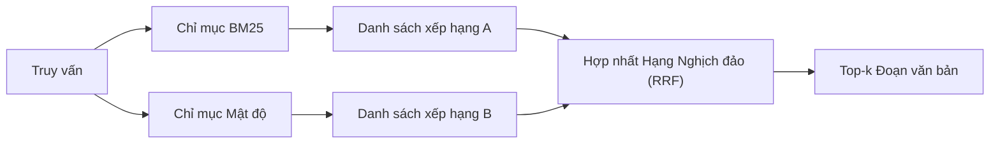

# Truy xuất Lai kết hợp BM25 và Nhúng Mật độ (Hybrid Retrieval with BM25 and Dense Embeddings)

> Truy xuất từ vựng (lexical) và truy xuất ngữ nghĩa (semantic) thường thất bại trên các phân phối truy vấn trái ngược nhau. Truy xuất lai (hybrid retrieval) với cơ chế hợp nhất hạng nghịch đảo (Reciprocal Rank Fusion - RRF) không sử dụng phép nội suy điểm số, mà vận hành theo cơ chế bỏ phiếu - và lá phiếu đó chiến thắng trên mọi phân lớp truy vấn.

**Type:** Build
**Languages:** Python
**Prerequisites:** Phase 11 lessons 04 (embeddings), 06 (RAG); Phase 19 Track B foundations (lessons 20-29); Phase 19 lesson 64 (chunking strategies)
**Time:** ~90 phút

## Mục tiêu Học tập

- Tự tay hiện thực hóa BM25 từ đầu dựa trên công thức toán học của Robertson và Sparck Jones, bao gồm gán trọng số trường (field weighting), chuẩn hóa độ dài tài liệu (document length normalization), cùng các tham số có thể tinh chỉnh k1 và b.
- Xây dựng bộ truy xuất mật độ (dense retriever) trên nền mô hình nhúng giả lập tất định để vòng lặp thực thi hoàn toàn ngoại tuyến.
- Hiện thực hóa cơ chế hợp nhất hạng nghịch đảo (Reciprocal Rank Fusion - RRF) chính xác theo công bố của Cormack, Clarke và Buettcher năm 2009, đồng thời giải thích tại sao nó áp đảo hoàn toàn phương pháp nội suy điểm số có trọng số.
- Tinh chỉnh hằng số k của RRF cùng trọng số theo từng phương thức (per-modality weights) và phân tích các đánh đổi trên ngữ liệu mẫu nhỏ.

## Vấn đề Cần giải quyết

Tìm kiếm từ vựng (lexical search) chiếm ưu thế tuyệt đối khi câu truy vấn mang một định danh chính xác xuất hiện nguyên văn trong ngữ liệu. Một truy vấn cho `AbortMultipartOnFail` sẽ trả về hàm Go tương ứng thông qua BM25 chỉ trong vài micro giây. Ngược lại, chính câu truy vấn đó khi được nhúng thành vector lại nằm ở vùng ranh giới giữa ba cụm độ tương đồng khác nhau, khiến bộ truy xuất mật độ xếp nhầm một tệp khác lên đầu.

Tìm kiếm mật độ (dense search) lại thắng thế khi câu truy vấn được diễn đạt lại (paraphrased) xa rời các token từ vựng nguyên văn trong ngữ liệu. Một người dùng hỏi "chúng ta xử lý các lượt tải lên bị hủy như thế nào?" hoàn toàn không gõ các từ như "abort" hay "multipart". BM25 sẽ trả về đoạn tài liệu nói về "tải lên các tệp lớn" chỉ vì trang đó có chứa từ "tải lên". Trong khi đó, bộ truy xuất mật độ lại tìm thấy chính xác hàm xử lý hủy bỏ vì phần tóm tắt của hàm có nhắc đến khái niệm hủy bỏ.

Sự lựa chọn giữa hai phương pháp này không phải là một quyết định tĩnh. Phân phối của câu truy vấn chính là biến số. Một hệ thống RAG trong môi trường sản xuất phải phục vụ cả hai nhóm truy vấn từ cùng một điểm cuối (endpoint), do đó tầng truy xuất bắt buộc phải xử lý đồng thời cả hai hướng tiếp cận. Đó chính là truy xuất lai (hybrid retrieval). Và bước hợp nhất kết quả (merge step) chính là khâu then chốt phải được thực hiện chuẩn xác.

## Khái niệm Cốt lõi



### BM25 tóm gọn trong một đoạn văn

BM25 chấm điểm một cặp truy vấn - tài liệu bằng cách tính tổng trên các từ trong câu truy vấn của một thừa số tần số nghịch đảo tài liệu (IDF) nhân với một thừa số tần số từ (TF) có tính bão hòa kèm hiệu chỉnh chuẩn hóa độ dài. Hai núm vặn: `k1` kiểm soát độ bão hòa tần số từ; giá trị mặc định 1.5 là khuyến nghị từ các công bố khoa học và bạn không nên thay đổi nếu chưa có benchmark đo lường. `b` kiểm soát mức độ ảnh hưởng của độ dài tài liệu; giá trị mặc định 0.75 ngụ ý rằng các tài liệu dài hơn sẽ bị phạt, nhưng không phạt theo hàm tuyến tính.

Công thức IDF sử dụng định nghĩa làm mịn của Robertson và Sparck Jones: `log((N - df + 0.5) / (df + 0.5) + 1)`. Phần cộng thêm một bên trong hàm log giữ cho giá trị IDF luôn dương ngay cả khi một từ xuất hiện trong hơn một nửa số tài liệu của ngữ liệu. Điều này rất quan trọng đối với các từ dừng (stopwords) - vốn xuất hiện ở hầu hết tài liệu, và trên các ngữ liệu quy mô nhỏ nơi một từ thông dụng có thể dễ dàng vượt qua ngưỡng nửa ngữ liệu.

Trọng số trường (field weighting) cho phép bạn báo cho BM25 biết rằng việc trùng khớp ở tên hàm/biến có giá trị lớn hơn nhiều so với việc trùng khớp ở phần thân tài liệu. Việc hiện thực hóa được thực hiện bằng cách nhân hệ số trực tiếp vào tần số xuất hiện của từ trong quá trình lập chỉ mục, chứ không phải ở thời điểm tính điểm. Cách làm này giữ cho công thức toán học đồng nhất và tránh phải duy trì điểm số riêng biệt cho từng trường.

### Truy xuất mật độ tóm gọn trong một đoạn văn

Nhúng từng đoạn văn bản thành một vector có số chiều cố định bằng một mô hình nhúng. Tại thời điểm truy vấn, nhúng câu truy vấn, xếp hạng mọi đoạn văn bản theo độ tương đồng cosine, và trả về top-k. Bản thân mô hình nhúng là biến số quyết định chất lượng. Thuật toán truy xuất thực chất chỉ gói gọn trong hai dòng: tích vô hướng và sắp xếp.

Bài học này sử dụng mô hình nhúng dựa trên hàm băm (hash-based) mang tính tất định để bạn có thể nắm bắt bản chất toán học của thuật toán hợp nhất mà không cần thực hiện bất kỳ lệnh gọi mạng nào. Hàm băm sẽ cộng dồn các giá trị bù được khóa theo token vào một vector 96 chiều rồi chuẩn hóa. Thứ hạng cosine là hoàn toàn tất định qua các lần chạy, đáp ứng hoàn hảo yêu cầu của bộ kiểm thử.

### Hợp nhất hạng nghịch đảo theo công thức công bố

Ta có hai danh sách xếp hạng. Đối với mỗi ứng viên xuất hiện trong bất kỳ danh sách nào, hãy tính tổng các đóng góp hạng nghịch đảo của nó. Bài báo năm 2009 sử dụng công thức `1 / (k + rank)` với giá trị mặc định `k = 60`. Sắp xếp lại theo tổng điểm số. Đó là toàn bộ thuật toán.

Hằng số công bố `k = 60` không phải là một con số ngẫu nhiên. Với `k = 60`, đóng góp của ứng viên xếp hạng 1 là `1 / 61` và của ứng viên xếp hạng 10 là `1 / 70`. Mức độ đóng góp giảm dần rất chậm rãi, nhờ đó các ứng viên nằm sâu bên dưới vẫn có tiếng nói bỏ phiếu. Giá trị `k` nhỏ hơn sẽ khiến các kết quả đứng đầu áp đảo hoàn toàn. Giá trị `k` lớn hơn sẽ san phẳng đường cong đóng góp.

Bản hiện thực của chúng ta có hai núm tinh chỉnh: Hằng số `k`, và một cặp trọng số cho từng phương thức để bạn có thể gia tăng tầm ảnh hưởng của BM25 hoặc mật độ khi bạn có bằng chứng thực nghiệm từ trước cho thấy một bên hoạt động tốt hơn trên ngữ liệu của mình. Nhân phần đóng góp hạng với trọng số là cách tiếp cận bài bản và sáng sủa nhất; nó bảo toàn hình thái suy giảm của thứ hạng mà không phụ thuộc vào thang đo điểm số gốc (scale-free).

### Tại sao hợp nhất theo hạng lại vượt trội hơn nội suy điểm số?

Điểm số BM25 không bị chặn trên và phụ thuộc chặt chẽ vào ngữ liệu cụ thể. Trong khi đó, độ tương đồng cosine lại bị chặn trong khoảng từ -1 đến 1. Một phép kết hợp tuyến tính `alpha * bm25 + (1 - alpha) * cosine` đòi hỏi phải tinh chỉnh hệ số alpha riêng biệt cho từng ngữ liệu và sẽ lập tức đổ vỡ mỗi khi bạn lập lại chỉ mục. Phương pháp hợp nhất dựa trên thứ hạng thì không bị ảnh hưởng. Thứ hạng giữa hai phương thức luôn có thể so sánh trực tiếp với nhau. Đường cơ sở RRF đã được chứng minh là đánh bại phương pháp nội suy điểm số trong mọi nhánh thi đấu TREC kể từ năm 2010 đến nay.

Đây cũng chính là lập luận bạn thường thấy về RankFusion so với RRF trong tài liệu kỹ thuật của Vespa và Weaviate. Họ đều đi đến cùng một kết luận: hãy trung thành với phương pháp dựa trên thứ hạng trừ khi bạn có bằng chứng cực kỳ vững chắc để thực hiện nội suy điểm số.

```figure
rrf-fusion
```

## Tự Xây dựng

Tệp `code/main.py` hiện thực:

- `tokenize(text)` - bộ tách từ nhanh dựa trên biểu thức chính quy.
- `BM25Index` - hỗ trợ trọng số trường, với các phương thức `add` và `search` cùng các tham số k1, b có thể tinh chỉnh.
- `mock_embed`, `DenseIndex` - mô hình nhúng tất định tương tự như Bài học 64 để các đoạn văn bản có thể so sánh tương thích.
- `rrf(rankings, k, weights)` - thuật toán hợp nhất theo chuẩn công bố khoa học kèm trọng số đa phương thức.
- `HybridRetriever` - kết hợp BM25 và truy xuất mật độ.
- Hàm `main()` chạy thử tải một ngữ liệu mẫu nhỏ, chạy ba câu truy vấn nhắm vào các điểm mạnh và điểm yếu của từng bộ truy xuất, sau đó in ra bảng xếp hạng mà mỗi phương thức sinh ra cùng danh sách đã được hợp nhất.

Chạy mã nguồn:

```bash
python3 code/main.py
```

Hãy quan sát kết quả chạy thử đối chiếu cạnh nhau. Câu truy vấn chứa định danh nguyên văn xếp hạng 1 trên BM25, hạng 4 trên Dense, và đạt hạng 1 trên RRF. Câu truy vấn diễn giải lại xếp hạng 6 trên BM25, hạng 1 trên Dense, và đạt hạng 1 trên RRF. Câu truy vấn mơ hồ xếp hạng 3 trên BM25, hạng 3 trên Dense, và vươn lên hạng 1 trên RRF. Phép hợp nhất không đơn thuần là một cơ chế phá vỡ thế hòa điểm (tie-breaker); nó là một hệ thống tối ưu giành chiến thắng trên mọi phân lớp truy vấn.

## Tinh chỉnh các tham số

| Tham số | Mặc định | Tăng lên khi | Giảm xuống khi |
|---------|----------|--------------|----------------|
| BM25 k1 | 1.5 | Các từ lặp lại nhiều trong tài liệu và bạn muốn tần suất có ý nghĩa lớn hơn | Tài liệu ngắn và việc lặp từ chỉ mang tính chất nhiễu |
| BM25 b | 0.75 | Tài liệu dài thực sự mang ít thông tin hơn trên mỗi từ | Độ dài tài liệu không liên quan đến chủ đề |
| RRF k | 60 | Muốn các ứng viên ở vị trí sâu tiếp tục có tiếng nói bỏ phiếu | Muốn ứng viên top-1 áp đảo hoàn toàn |
| BM25 weight | 1.0 | Ngữ liệu chứa các định danh nguyên văn và truy vấn khớp trực tiếp với chúng | Câu truy vấn người dùng mang tính diễn giải ngữ nghĩa |
| Dense weight | 1.0 | Câu truy vấn mang tính diễn giải ngữ nghĩa | Câu truy vấn mang tính từ khóa nguyên văn |

Hãy tinh chỉnh các núm vặn này bằng cách chạy lại bộ kiểm thử đánh giá của Bài học 68 trên tập truy vấn tách biệt của bạn, tuyệt đối không tinh chỉnh dựa trên trực giác chủ quan.

## Các dạng lỗi mà bản chạy thử sẽ che giấu

**Token ngoài từ vựng (Out-of-vocabulary tokens):** Giá trị IDF của BM25 được tính toán trực tiếp từ ngữ liệu, do đó các từ chỉ xuất hiện trong câu truy vấn mà không có trong ngữ liệu sẽ đóng góp điểm bằng 0. Trong khi đó, mô hình nhúng mật độ lại tự suy diễn (hallucinate) ra một vector cho chính từ đó. Đối với các định danh nằm ngoài ngữ liệu, phương thức mật độ sẽ trả về các kết quả lân cận trông có vẻ hợp lý nhưng thực chất là sai lệch hoàn toàn. Thuật toán hợp nhất sẽ dung hòa được lỗi này vì BM25 không trả về gì và phần đóng góp hạng bị triệt tiêu, nhưng điều này chỉ hiệu quả nếu bạn khử trùng lặp theo tài liệu chứ không phải theo từng đoạn.

**Sự áp đảo của từ dừng (Stop-token domination):** Truy vấn BM25 với các từ như "the" sẽ tạo ra một danh sách xếp hạng gần như phẳng lì trên toàn ngữ liệu. Hãy lọc từ dừng ngay trong bộ chỉ mục hoặc chấp nhận nguyên lý các từ có IDF cao sẽ tự động áp đảo một cách tự nhiên.

**Nội dung trùng khớp hoàn toàn giữa các phương thức:** Nếu ngữ liệu của bạn đủ nhỏ đến mức top-1 của BM25 cũng chính là top-1 của truy xuất mật độ, RRF sẽ trả về đúng vị trí top-1 đó cùng các phần tử lân cận y hệt. Đây là hành vi hoàn toàn chính xác chứ không phải lỗi, nhưng nó khiến phép hợp nhất trông như không có tác dụng gì. Hãy bổ sung các cặp truy vấn mang tính đối kháng (adversarial query pair) trong tập đánh giá để kiểm chứng xem cơ chế hợp nhất có thực sự hoạt động hay không.

## Ứng dụng Thực tế

Các khuôn mẫu trong sản xuất:

- Lập chỉ mục BM25 ngay trong tiến trình (in-process); điểm nghẽn hiệu năng nằm ở từ điển tần số từ chứ không nằm ở các vector.
- Lưu trữ các vector mật độ trong một kho chuyên dụng riêng biệt (trong bài này ta dùng danh sách phẳng; trong sản xuất bạn sẽ dùng HNSW).
- Thực thi cả hai truy vấn song song; bước hợp nhất thực chất chỉ là một thao tác gộp tập hợp với thời gian hằng số O(1).
- Lưu lại phương thức nguồn gốc của từng kết quả truy xuất để bộ tái xếp hạng (reranker) ở tầng sau có thể biết phương thức nào đã bỏ phiếu cho nó.

## Đưa vào Sản phẩm

Bài học 66 sẽ tiếp nhận top-k kết quả đã hợp nhất từ bài học này và thực hiện tái xếp hạng bằng mô hình cross-encoder. Bài học 68 sẽ đánh giá toàn bộ đường ống với các chỉ số precision, recall, MRR và nDCG. Bộ truy xuất lai trong bài học này chính là tầng xử lý đầu tiên của hệ thống hoàn chỉnh trong Bài học 69.

## Bài tập Mở rộng

1. Thay thế `mock_embed` bằng một mô hình thực tế từ nhà cung cấp của bạn. Chạy lại bản demo và báo cáo xem thứ hạng của phương thức thuần mật độ thay đổi như thế nào trên câu truy vấn diễn giải.
2. Bổ sung phương thức thứ ba: phần tóm tắt đoạn văn bản được lập chỉ mục riêng và hợp nhất thành danh sách xếp hạng thứ ba. Đo lường mức độ cải thiện hiệu năng.
3. Quét tham số RRF k qua các giá trị 10, 30, 60, 100, 200. Vẽ đường cong recall@k theo Bài học 68. Báo cáo giá trị k giúp đường cong đạt đỉnh trên ngữ liệu của bạn.
4. Hiện thực hóa chuẩn xác thuật toán BM25F (chuẩn hóa độ dài theo từng trường thay vì dùng mẹo nhân hệ số) và so sánh đối soát trên một ngữ liệu nơi sự trùng khớp ký hiệu đóng vai trò quan trọng nhất.

## Thuật ngữ Then chốt

| Thuật ngữ | Cách mọi người thường nói | Ý nghĩa thực sự |
|-----------|---------------------------|-----------------|
| BM25 | "Tìm kiếm từ vựng" | Xếp hạng xác suất kết hợp idf x tf bão hòa x chuẩn hóa độ dài |
| RRF | "Hợp nhất thứ hạng" | Tổng của 1 / (k + rank) qua các danh sách xếp hạng; mặc định k = 60 |
| k1 | "Độ bão hòa TF" | Kiểm soát tốc độ mà một từ lặp lại ngừng đóng góp thêm điểm số |
| b | "Hệ số phạt độ dài" | 0 nghĩa là bỏ qua độ dài tài liệu, 1 nghĩa là chuẩn hóa hoàn toàn |
| Trọng số trường (Field weighting) | "Tăng cường điểm ký hiệu" | Lặp lại token khi lập chỉ mục để tăng điểm cho các kết quả khớp ở trường đó |
| Hợp nhất theo hạng so với theo điểm | "Tại sao RRF đánh bại tuyến tính" | Thứ hạng có thể so sánh xuyên suốt giữa các phương thức; điểm số thì không |

## Tài liệu Tham khảo

- Cormack, Clarke, Buettcher, "Reciprocal Rank Fusion outperforms Condorcet and individual rank learning methods", SIGIR 2009
- Robertson, Walker, Beaulieu, Gatford, Payne, "Okapi at TREC-3" (bài báo gốc về BM25)
- [Vespa: Hybrid Retrieval with BM25 and Embeddings](https://docs.vespa.ai/en/tutorials/hybrid-search.html)
- [Weaviate: Hybrid Search](https://weaviate.io/developers/weaviate/search/hybrid)
- Phase 11 lesson 06 - RAG fundamentals
- Phase 19 lesson 64 - chunkers whose output is indexed here
- Phase 19 lesson 66 - cross-encoder reranker that consumes the fused top-k
