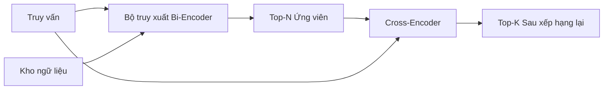

# Mô hình xếp hạng lại Cross-Encoder (Cross-Encoder Reranker)

> Một bi-encoder nhúng truy vấn và tài liệu một cách độc lập. Một cross-encoder ghép nối chúng lại và đọc cả hai cùng một lúc. Cross-encoder là trình đọc thông minh nhất nhưng cũng chậm nhất. Khi được sử dụng làm giai đoạn thứ hai trên tập top-k của bi-encoder, nó mang lại giá trị hoàn toàn xứng đáng với chi phí bỏ ra.

**Type:** Xây dựng (Build)
**Languages:** Python
**Prerequisites:** Phase 11 bài học 06 (RAG), Phase 11 bài học 07 (RAG nâng cao); các bài học nền tảng Phase 19 Track B (bài học 20-29); Phase 19 bài học 65 (truy xuất kết hợp làm đầu vào cho giai đoạn này)
**Time:** ~90 phút

## Mục tiêu học tập
- Phân biệt bộ truy xuất bi-encoder (bi-encoder retriever) và bộ xếp hạng lại cross-encoder (cross-encoder reranker) qua hình dạng đầu vào (input shape), số lượng tham số và chi phí tính toán trên mỗi truy vấn.
- Hiện thực một cross-encoder kích thước nhỏ từ đầu (from scratch) dưới dạng một khối transformer nhận vào chuỗi ghép cặp (truy vấn, tài liệu) và xuất ra một giá trị vô hướng biểu thị độ liên quan (relevance scalar).
- Thiết lập đường ống truy xuất rồi xếp hạng lại hai giai đoạn (two-stage retrieve-then-rerank pipeline): truy xuất top-N bằng bộ truy xuất chi phí thấp, xếp hạng lại N ứng viên xuống top-K bằng cross-encoder, trả về K kết quả.
- Đo lường sự đánh đổi giữa độ trễ và chất lượng (latency-vs-quality trade-off) trên một ngữ cảnh kiểm thử (fixture corpus) nhỏ và chọn giá trị N phù hợp cho một ngân sách độ trễ nhất định.

## Vấn đề

Một bi-encoder ánh xạ truy vấn và tài liệu vào cùng một không gian vector rồi xếp hạng theo độ tương đồng cosine (cosine similarity). Hai biểu diễn mã hóa không bao giờ nhìn thấy nhau. Mô hình buộc phải nén mọi thông tin hữu ích của một tài liệu thành một vector duy nhất mà không hề biết trước nội dung truy vấn. Phương pháp này rất nhanh - chỉ cần nhúng một lần cho mỗi tài liệu vào thời điểm lập chỉ mục (index time) và một lần cho mỗi truy vấn vào thời điểm truy vấn (query time) - và đây là cách duy nhất để xếp hạng ở quy mô toàn bộ kho ngữ liệu (corpus scale).

Cái giá phải trả chính là độ chính xác (precision). Hai tài liệu có cùng chủ đề tổng thể có thể sở hữu các vector nhúng gần như giống hệt nhau, ngay cả khi một tài liệu trả lời đúng truy vấn còn tài liệu kia thì không. Bi-encoder không thể phân biệt được chúng.

Một cross-encoder giải quyết vấn đề này bằng cách đọc đồng thời cả truy vấn và tài liệu. Mô hình tiếp nhận `[query] [SEP] [document]` như một chuỗi đơn nhất, chạy cơ chế chú ý toàn phần (full attention) qua điểm nối, và tạo ra một giá trị vô hướng biểu thị độ liên quan. Mọi token của tài liệu đều có thể chú ý tới mọi token của truy vấn. Mô hình đưa ra quyết định điểm số với toàn bộ ngữ cảnh hoàn chỉnh.

Cái giá phải trả lại là thông lượng (throughput). Trong khi bi-encoder chỉ nhúng một lần và có thể dùng để truy vấn mãi mãi, cross-encoder phải chạy một lượt cho mỗi cặp (truy vấn, tài liệu). Với một kho ngữ liệu 10 triệu tài liệu, điều đó tương đương với 10 triệu lượt lan truyền tiến (forward passes) cho mỗi truy vấn. Điều này hoàn toàn bất khả thi trong giới hạn ngân sách thời gian của một yêu cầu.

Giải pháp là phân giai đoạn (staging). Dùng bi-encoder để truy xuất top-N ứng viên. Sau đó dùng cross-encoder để xếp hạng lại N ứng viên này xuống top-K. N là một số nhỏ (từ 50 đến 200) và sự nâng cao chất lượng của cross-encoder được tập trung chính xác vào nơi cần thiết. Tổng độ trễ vẫn nằm trong ngân sách của yêu cầu. Chất lượng tổng thể đạt mức chất lượng của cross-encoder, bị chặn trên bởi độ bao phủ (recall) của bi-encoder tại mốc N.

## Khái niệm



### Hình dạng đầu vào của cross-encoder

Quy cách đóng gói chuẩn là `[CLS] query_tokens [SEP] document_tokens [SEP]`. Đầu ra tại vị trí CLS được đưa vào một đầu tuyến tính (linear head) đơn lẻ để xuất ra giá trị vô hướng về độ liên quan. Một số cách triển khai sử dụng gộp trung bình (mean-pooling) thay vì CLS; sự khác biệt là không đáng kể. Điểm cốt lõi là mô hình tạo ra một con số duy nhất cho mỗi cặp.

Một cross-encoder có 22 triệu tham số (tương đương cấp độ trọng số đã công bố `ms-marco-MiniLM-L-6-v2`) là điểm cân bằng tiêu biểu trong môi trường sản xuất (production). Các mô hình nhỏ hơn sẽ suy giảm chất lượng nhanh hơn mức độ trễ mà chúng tiết kiệm được. Các mô hình lớn hơn (chẳng hạn như `bge-reranker-v2-m3` với 568 triệu tham số) thường được dành riêng cho việc xếp hạng lại ngoại tuyến (offline reranking) hoặc xếp hạng lại cho trang đầu tiên nơi K rất nhỏ.

### Tại sao bài học này huấn luyện một mô hình siêu nhỏ

Một cross-encoder thực tế là một mô hình transformer dạng encoder được tinh chỉnh (finetuned encoder transformer). Trong sản xuất, bạn chỉ cần tải một điểm kiểm tra (checkpoint) và chạy nó. Trong bài học này, mục tiêu là giúp bạn nắm rõ hình dạng kiến trúc của mô hình cũng như dạng đường cong độ trễ - chất lượng, chứ không phải huấn luyện một bộ xếp hạng tối tân nhất (state-of-the-art ranker). Vì vậy, chúng ta xây dựng một `nn.Module` nhỏ với một khối transformer, cơ chế chú ý đa đầu (multi-head attention, mặc định 4 đầu) và một đầu hồi quy (regression head). Mô hình được khởi tạo tất định từ một giá trị mầm (seed) để bản thử nghiệm có thể tái lập mà không cần lưu trữ trọng số trên đĩa.

Mô hình đồ chơi này học được cấu trúc phân loại đúng từ kho dữ liệu kiểm thử: các cặp truy vấn - tài liệu có liên quan sẽ có điểm dự đoán cao hơn các cặp không liên quan. Đường ống đầu-cuối (end-to-end pipeline) xếp hạng lại đầu ra của bi-encoder và danh sách top-k sau khi xếp hạng lại có độ tương quan cao với nhãn chuẩn (gold labels).

### Độ trễ so với chất lượng

Đường ống hai giai đoạn có một tham số điều chỉnh duy nhất: N. Quét giá trị N từ 5 đến 100 trên một tập truy vấn độc lập (held-out query set) và bạn sẽ thu được đường cong đánh giá.

| N | Recall@1 của giai đoạn 2 | Lượt lan truyền tiến cross-encoder mỗi truy vấn | Độ trễ |
|---|-------------------------|------------------------------------------------|--------|
| 5 | 0.62 | 5 | thấp |
| 20 | 0.81 | 20 | trung bình |
| 50 | 0.86 | 50 | cao |
| 100 | 0.86 | 100 | rất cao |

Các con số trên chỉ nhằm minh họa cho hình dạng của đường cong, không phải kết quả đo đạc trực tiếp từ bộ kiểm thử này. Tuy nhiên quy luật dạng đường cong là có thật. Luôn có một "điểm gập" (knee) vào khoảng từ 20 đến 50 ứng viên, nơi mức cải thiện chất lượng của việc xếp hạng lại bắt đầu bão hòa. Vượt qua điểm gập đó, bạn đang trả thêm chi phí tính toán mà hầu như không thu lại được giá trị gì.

Hãy chọn N dựa trên đường cong đánh giá kết hợp với ngân sách độ trễ. Cross-encoder không thể nâng độ bao phủ vượt quá độ bao phủ của bi-encoder tại mốc N, vì vậy một giá trị N quá thấp sẽ giới hạn trần chất lượng chứ không chỉ giới hạn độ trễ.

```figure
rerank-funnel
```

## Xây dựng thực tế (Build It)

Tệp `code/main.py` hiện thực các thành phần:

- `CrossEncoder` - một `torch.nn.Module` kích thước nhỏ: lớp nhúng token (token embedding), một khối transformer với cơ chế chú ý đa đầu và mạng truyền thẳng (feedforward), cùng đầu gộp trung bình xuất ra một giá trị vô hướng.
- `tokenize_pair(query, document)` - đóng gói hai chuỗi văn bản thành một chuỗi id duy nhất kèm theo các id phân loại (type ids) đánh dấu ranh giới, hoàn toàn tất định và chỉ dùng thư viện chuẩn (stdlib).
- `train_tiny(pairs)` - một lượt huấn luyện có giám sát (supervised training) trên danh sách bộ ba (truy vấn, tài liệu, độ liên quan) được dán nhãn thủ công, giúp mô hình đưa ra điểm số hợp lý trên tập dữ liệu mẫu.
- `rerank(query, candidates, top_k)` - giao diện sử dụng trong môi trường sản xuất.
- `pipeline(query, retriever, top_n, top_k)` - luồng xử lý hai giai đoạn hoàn chỉnh.
- Hàm chạy thử nghiệm `main()` tải kho ngữ liệu theo khuôn mẫu của bài học 65, truy xuất top-N, xếp hạng lại thành top-K, in hai danh sách cạnh nhau và báo cáo độ trễ của từng giai đoạn.

Chạy mã nguồn:

```bash
python3 code/main.py
```

Kết quả hiển thị danh sách top-N của bi-encoder, danh sách top-K của cross-encoder và bảng tóm tắt thời gian thực thi. Cross-encoder tốn nhiều thời gian hơn trên mỗi lượt gọi nhưng không phải chạy trên toàn bộ kho ngữ liệu. Tổng thời gian hai giai đoạn vẫn nằm trong ngân sách yêu cầu trong khi chọn trúng câu trả lời mà bi-encoder chỉ xếp ở vị trí thứ hai hoặc thứ ba.

## Các trường hợp lỗi tiềm ẩn mà bản thử nghiệm che giấu

**Cross-encoder không có tính đối xứng.** `rerank(q, d)` và `rerank(d, q)` cho ra các điểm số hoàn toàn khác nhau. Luôn luôn đưa truy vấn vào trước. Nếu vô tình hoán đổi vị trí, độ bao phủ sẽ sụt giảm nghiêm trọng.

**N quá nhỏ để bộc lộ lỗi.** Nếu bạn đặt N = K, cross-encoder chỉ có thể sắp xếp lại thứ tự của K ứng viên nhưng không thể đưa thêm một ứng viên mới nào vào top K. Recall tại K không thể thay đổi, khiến mức cải thiện chất lượng trông như bằng không. Hãy chọn N tối thiểu gấp ba lần K.

**Dữ liệu huấn luyện bị rò rỉ vào tập đánh giá.** Nếu các cặp huấn luyện được dán nhãn thủ công chứa cả các truy vấn đánh giá, kết quả xếp hạng lại sẽ trở nên hoàn hảo một cách giả tạo. Phải phân tách nghiêm ngặt giữa tập huấn luyện (train) và tập đánh giá (eval), ngay cả trên một tập kiểm thử nhỏ.

**Trọng số trong môi trường sản xuất rất lớn.** Một cross-encoder 22 triệu tham số chiếm 88MB ở định dạng float32. Hãy tính toán dung lượng bộ nhớ của máy chủ phục vụ mô hình (model server) trước khi cam kết đạt p95 dưới 100ms.

**Xử lý theo lô (batching) mang tính quyết định.** Một cross-encoder thực tế sẽ chạy N ứng viên trong một lô duy nhất. Bài học này thực hiện điều đó trong hàm `_batch_encode`, hàm này xây dựng các tensor id và type-id theo lô bằng `torch.tensor(...)` và chỉ chạy một lượt lan truyền tiến duy nhất. Nếu bỏ qua cơ chế xử lý theo lô, độ trễ sẽ bị nhân lên gấp N lần.

## Sử dụng trong thực tế (Use It)

Các khuôn mẫu trong môi trường sản xuất:

- Luôn ghim cố định (pin) bộ ba bi-encoder, cross-encoder và giá trị N cùng nhau. Thay đổi bất kỳ yếu tố nào cũng sẽ làm mất hiệu lực của kết quả đánh giá trước đó.
- Lưu bộ nhớ đệm (cache) đầu ra của bộ xếp hạng lại theo mã băm của cặp (query, document_id). Cùng một truy vấn đối với một kho ngữ liệu ổn định sẽ cho ra cùng một thứ tự xếp hạng; các lượt trúng bộ đệm (cache hits) sẽ giúp bạn giảm độ trễ hoàn toàn miễn phí.
- Ghi nhận nhật ký (log) điểm số cross-encoder của vị trí top-1. Một truy vấn có điểm top-1 thấp hơn ngưỡng đặc thù của kho ngữ liệu chứng tỏ kết quả rơi vào ngoài miền dữ liệu (out-of-domain hit); hãy báo hiệu điều này cho LLM dưới dạng "Tôi không chắc chắn".

## Triển khai thành phẩm (Ship It)

Bài học 68 sẽ đánh giá toàn diện đường ống hai giai đoạn này từ đầu đến cuối. Bài học 69 kết nối bộ xếp hạng lại này phía sau bộ truy xuất kết hợp từ bài học 65 và phía trước bộ tạo câu trả lời. Bộ xếp hạng lại đóng vai trò là giai đoạn thứ hai của hệ thống đầu-cuối hoàn chỉnh.

## Bài tập

1. Quét N từ 5 đến 50 và vẽ đồ thị biểu diễn recall@1 của đầu ra sau khi xếp hạng lại. Tìm điểm gập trên tập dữ liệu kiểm thử này.
2. Huấn luyện cross-encoder trong mười chu kỳ (epochs) thay vì một chu kỳ. Đo khoảng cách biên điểm số (score-margin) giữa các cặp dương tính và âm tính tại mỗi chu kỳ.
3. Thay thế đầu gộp trung bình bằng một đầu token CLS. So sánh tốc độ hội tụ trên tập kiểm thử này.
4. Thêm một đầu phân loại thứ hai cho cross-encoder để dự đoán nhãn nhị phân "câu trả lời này có nằm trong tài liệu hay không". Sử dụng cả hai đầu khi suy luận: một đầu để xếp hạng, một đầu để lọc theo ngưỡng.
5. Thay thế bi-encoder giả lập tất định bằng bi-encoder từ bài học 65 và liên kết hai giai đoạn lại với nhau. Đo lường sự thay đổi của top-K so với khi chỉ dùng riêng bi-encoder.

## Thuật ngữ cốt lõi

| Thuật ngữ | Cách gọi thông thường | Ý nghĩa thực tế |
|---|---|---|
| Bi-encoder | "Bộ truy xuất vector" | Mã hóa truy vấn và tài liệu độc lập; xếp hạng chúng bằng độ tương đồng cosine |
| Cross-encoder | "Bộ xếp hạng lại" | Mã hóa chung (truy vấn, tài liệu); xuất ra một giá trị vô hướng biểu thị độ liên quan |
| Hai giai đoạn (Two-stage pipeline) | "Truy xuất và xếp hạng lại" | Bộ truy xuất rẻ tiền trả về N ứng viên, bộ xếp hạng lại tốn kém giữ lại K kết quả |
| N (ngân sách ứng viên) | "Bể xếp hạng lại" (Rerank pool) | Số lượng ứng viên mà cross-encoder chấm điểm trên mỗi truy vấn |
| Đầu gộp trung bình (Mean-pooling head) | "Trung bình trạng thái ẩn cuối" | Lấy trung bình đầu ra của lớp cuối cùng trong bộ mã hóa thành một vector duy nhất |

## Đọc thêm

- Nogueira, Cho, "Passage Re-ranking with BERT", 2019 - bài báo kinh điển về bộ xếp hạng cross-encoder
- Reimers, Gurevych, "Sentence-BERT: Sentence Embeddings using Siamese BERT-Networks", 2019 - so sánh giữa bi-encoder và cross-encoder
- [Tài liệu hướng dẫn về Cross-Encoder của SentenceTransformers](https://www.sbert.net/examples/applications/cross-encoder/README.html)
- [Thẻ mô hình BGE Reranker v2 (Model card)](https://huggingface.co/BAAI/bge-reranker-v2-m3)
- Phase 19 bài học 65 - bộ truy xuất kết hợp cung cấp đầu vào cho giai đoạn xếp hạng lại này
- Phase 19 bài học 68 - quy trình đánh giá đo lường mức cải thiện chất lượng mà bước xếp hạng lại này đem lại
